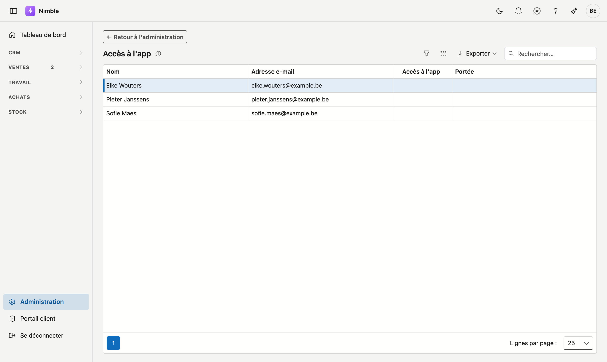
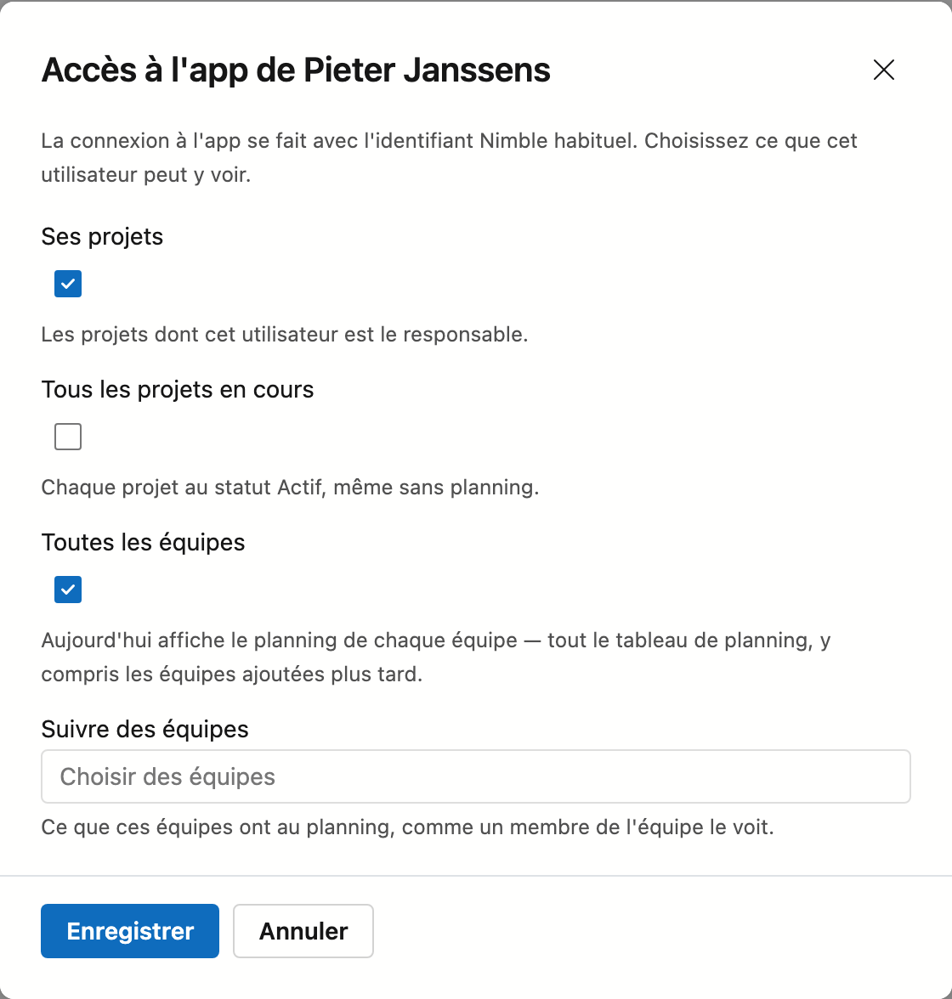

# Accès à l'app

Sur cet écran, vous donnez l'app mobile *Nimble – werf & werkbon* à des collègues qui **ne sont pas des
collaborateurs** : un chef de projet, le gérant, quelqu'un du bureau. Ils se connectent à l'app avec leur identifiant
Nimble habituel et suivent les chantiers. Vous choisissez pour chaque personne ce qu'elle voit dans l'app.

Un collaborateur d'une équipe ne figure pas ici. Il reçoit l'accès à l'app sur sa
[fiche collaborateur](../work/staff.md#acces-a-lapp).

## Ouvrir l'écran

1. Cliquez en bas de la barre latérale sur **Administration**.
2. Dans le groupe **Données et accès**, cliquez sur la tuile **Accès à l'app**.

Vous voyez la tuile si vous pouvez modifier les collaborateurs (le droit *Modifier les collaborateurs et équipes*).

## La liste

La liste affiche les utilisateurs de votre entreprise qui ne sont pas liés à un collaborateur.

| Colonne | Quoi |
|---|---|
| **Nom** et **Adresse e-mail** | L'utilisateur, et l'adresse avec laquelle il se connecte — aussi dans l'app |
| **Accès à l'app** | *Actif* s'il peut utiliser l'app. *Bloqué* si son compte utilisateur est désactivé : l'app ne fonctionne alors pas, même si l'accès est toujours là |
| **Portée** | Ce qu'il voit dans l'app : les cases que vous avez cochées et les équipes qu'il suit |

## Donner ou modifier l'accès

1. Cliquez sur un utilisateur. La fenêtre **Accès à l'app de …** s'ouvre.
2. Choisissez ce qu'il voit dans l'app. Au moins un choix est nécessaire :

    | Choix | Ce qu'il voit dans l'app |
    |---|---|
    | **Ses projets** | Les projets dont il est le *Responsable* |
    | **Tous les projets en cours** | Chaque projet au statut *Actif*, même sans planning |
    | **Toutes les équipes** | Dans *Aujourd'hui*, le planning de chaque équipe — tout le tableau de planning, y compris les équipes ajoutées plus tard |
    | **Suivre des équipes** | Dans *Aujourd'hui*, le planning des équipes que vous choisissez ici. Si *Toutes les équipes* est cochée, ce choix n'est pas nécessaire et il est grisé |

3. Cliquez sur **Enregistrer**.

Il n'a rien d'autre à installer que l'app : il se connecte avec la même adresse e-mail et le même mot de passe que
dans Nimble. Aucun mail d'invitation n'est envoyé.

## Ce qu'il peut faire dans l'app

- Dans **Aujourd'hui**, il voit le planning des équipes qu'il suit et de ses propres projets.
- Le menu de l'app affiche pour lui **Projets** : les projets de sa portée, avec les informations du projet et les
  fichiers.
- Il ajoute des photos, coche des points de la préparation du chantier et des points de réception, ajoute des points
  de réception et crée des tâches.
- Il peut lire le **bon de travail**, mais pas le remplir. Les heures, le matériel, le chronomètre et la signature du
  client sont le travail de l'équipe sur place : voir [Le bon de travail dans l'app](../app/werkbon.md).

## Retirer l'accès

Ouvrez l'utilisateur et cliquez sur **Retirer l'accès**. C'est immédiat : à sa prochaine action dans l'app, Nimble le
refuse. Son accès à Nimble lui-même reste.

## Erreurs fréquentes

!!! warning "Un collègue ne figure pas dans la liste"
    S'il est lié à un collaborateur, donnez-lui l'accès à l'app sur sa
    [fiche collaborateur](../work/staff.md#acces-a-lapp), pas ici. S'il n'a pas encore d'utilisateur Nimble, demandez à
    ADM d'en créer un.

!!! warning "Tous les projets en cours cochée, et pourtant Aujourd'hui est vide"
    *Tous les projets en cours* affiche les projets sous **Projets** dans l'app, pas dans *Aujourd'hui*. S'il doit voir
    tout le tableau de planning dans *Aujourd'hui*, cochez **Toutes les équipes**.

## Voir aussi

- [Collaborateurs](../work/staff.md#acces-a-lapp) — l'accès à l'app pour qui travaille dans une équipe, et la case Chef d'équipe
- [Le bon de travail dans l'app](../app/werkbon.md)
- [Rôles](roles.md) — qui a le droit *Modifier les collaborateurs et équipes*
