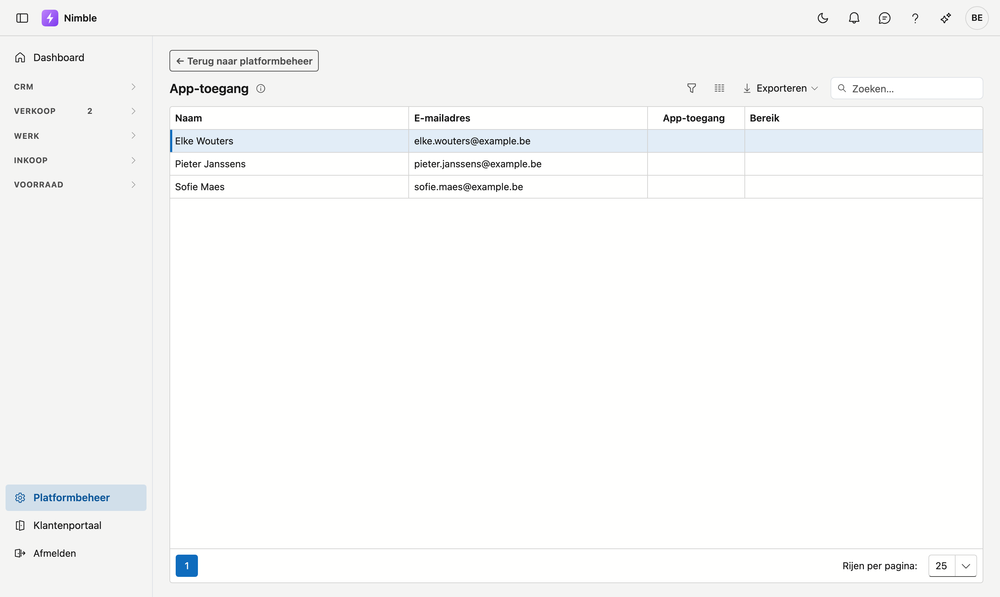
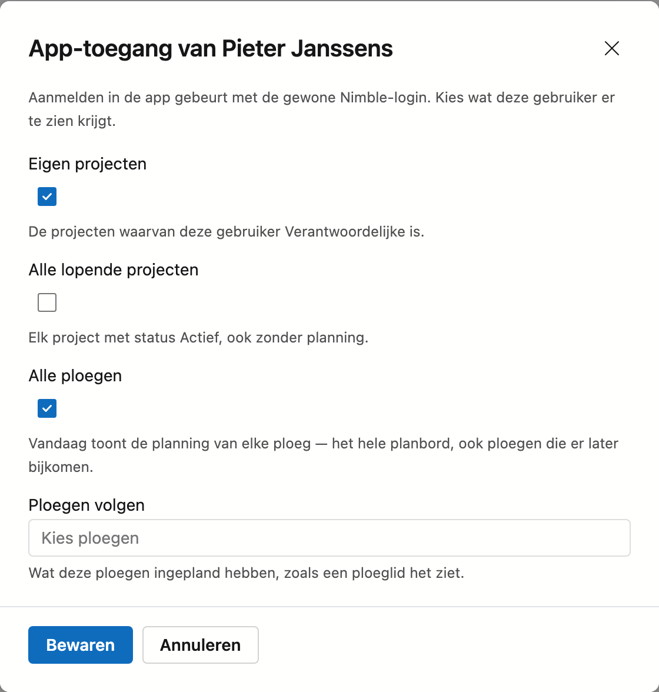

# App-toegang

Op dit scherm geeft u de mobiele app *Nimble – werf & werkbon* aan collega's die **geen medewerker** zijn: een
projectleider, de zaakvoerder, iemand van kantoor. Ze melden zich in de app aan met hun gewone Nimble-login en kijken
mee met de werven. U kiest per persoon wat ze in de app te zien krijgen.

Een medewerker in een ploeg staat hier niet. Die krijgt app-toegang op zijn
[medewerkersfiche](../work/staff.md#app-toegang).

## Het scherm openen

1. Klik onderaan in de zijbalk op **Platformbeheer**.
2. Klik in de groep **Gegevens en toegang** op de tegel **App-toegang**.

U ziet de tegel als u medewerkers mag bewerken (het recht *Medewerkers en ploegen bewerken*).

## De lijst

De lijst toont de gebruikers van uw bedrijf die niet aan een medewerker gekoppeld zijn.

| Kolom | Wat |
|---|---|
| **Naam** en **E-mailadres** | De gebruiker, en het adres waarmee hij zich aanmeldt — ook in de app |
| **App-toegang** | *Actief* als hij de app mag gebruiken. *Geblokkeerd* als zijn gebruikersaccount gedeactiveerd is: dan werkt de app niet, ook al staat de toegang er nog |
| **Bereik** | Wat hij in de app ziet: de vinkjes die u koos en de ploegen die hij volgt |

## Toegang geven of aanpassen

1. Klik op een gebruiker. Het venster **App-toegang van …** gaat open.
2. Kies wat hij in de app ziet. Minstens één keuze is nodig:

    | Keuze | Wat hij in de app ziet |
    |---|---|
    | **Eigen projecten** | De projecten waarvan hij *Verantwoordelijke* is |
    | **Alle lopende projecten** | Elk project met status *Actief*, ook zonder planning |
    | **Alle ploegen** | Op *Vandaag* de planning van elke ploeg — het hele planbord, ook ploegen die er later bijkomen |
    | **Ploegen volgen** | Op *Vandaag* de planning van de ploegen die u hier kiest. Staat *Alle ploegen* aan, dan is deze keuze niet nodig en staat ze grijs |

3. Klik op **Bewaren**.

Hij hoeft niets te installeren behalve de app: hij meldt zich aan met hetzelfde e-mailadres en wachtwoord als in
Nimble. Er vertrekt geen uitnodigingsmail.

## Wat hij in de app kan

- Op **Vandaag** ziet hij de planning van de ploegen die hij volgt en van zijn eigen projecten.
- In het menu van de app staat voor hem **Projecten**: de projecten uit zijn bereik, met de projectinfo en de
  bestanden.
- Hij voegt foto's toe, vinkt punten van de werfvoorbereiding en opleverpunten af, voegt opleverpunten toe en maakt
  taken aan.
- De **werkbon** kan hij lezen, maar niet invullen. Uren, materiaal, de klok en de handtekening van de klant zijn
  werk van de ploeg ter plaatse: zie [De werkbon in de app](../app/werkbon.md).

## Toegang intrekken

Open de gebruiker en klik op **Toegang intrekken**. Dat werkt meteen: bij zijn volgende handeling in de app weigert Nimble
hem. Zijn toegang tot Nimble zelf blijft.

## Veelgemaakte fouten

!!! warning "Een collega staat niet in de lijst"
    Hangt hij aan een medewerker, dan geeft u hem app-toegang op zijn [medewerkersfiche](../work/staff.md#app-toegang),
    niet hier. Heeft hij nog geen Nimble-gebruiker, vraag ADM dan om er een aan te maken.

!!! warning "Alle lopende projecten aangevinkt, en toch een lege Vandaag"
    *Alle lopende projecten* toont de projecten onder **Projecten** in de app, niet op *Vandaag*. Wil hij op *Vandaag*
    het hele planbord zien, vink dan **Alle ploegen** aan.

## Zie ook

- [Medewerkers](../work/staff.md#app-toegang) — app-toegang voor wie in een ploeg werkt, en het vinkje Ploegbaas
- [De werkbon in de app](../app/werkbon.md)
- [Rollen](roles.md) — wie het recht *Medewerkers en ploegen bewerken* heeft
