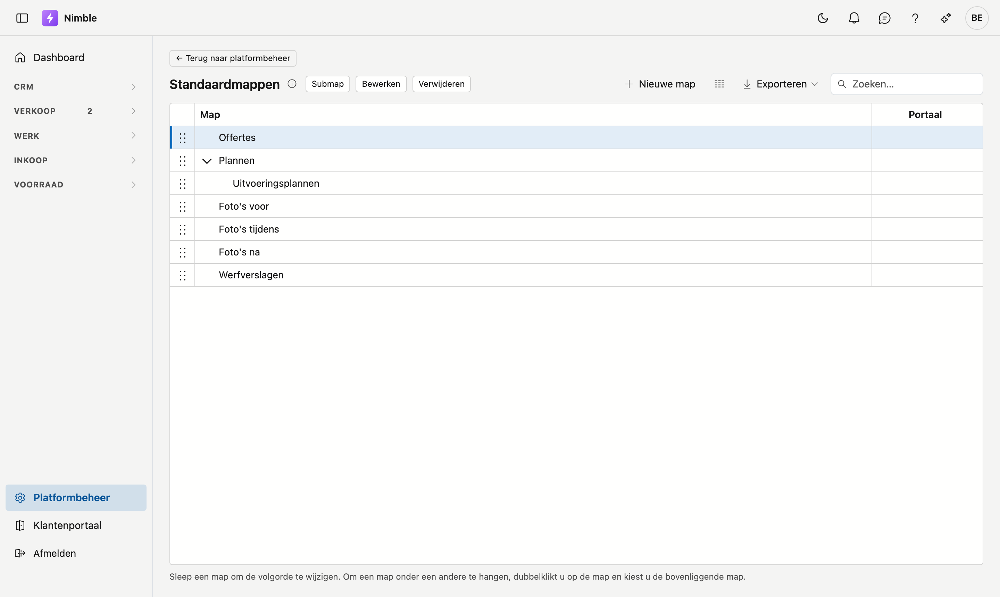

# Standaardmappen

De **standaardmappen** zijn de mappen die elk nieuw project krijgt in zijn tabblad
[Documenten](../work/projects.md#tabblad-documenten). Zo staat bij elk project meteen dezelfde indeling klaar,
bijvoorbeeld *Offertes*, *Plannen* en *Foto's voor*.

## Het scherm openen

1. Klik onderaan in de zijbalk op **Platformbeheer**.
2. Klik in de groep **Projecten** op de tegel **Standaardmappen**.

## Een map toevoegen

- **Nieuwe map** maakt een map op het hoogste niveau.
- **Submap** maakt een map onder de map die u gekozen hebt.

Een map heeft enkel een naam. Twee mappen met dezelfde naam onder dezelfde map kan niet.

## De volgorde wijzigen

Sleep een map aan het handvat links naar haar nieuwe plaats. Ze komt altijd **naast** de map waar u ze
loslaat, op hetzelfde niveau — slepen hangt een map nooit onder een andere.

## Een map onder een andere hangen

Dubbelklik op de map, of kies ze en klik **Bewerken**. In het venster wijzigt u de naam en kiest u de
**Bovenliggende map**. Laat u die leeg, dan staat de map op het hoogste niveau. Een map kan niet onder zichzelf
of onder een van haar eigen submappen; die staan dan ook niet in de keuzelijst.

## Een map verwijderen

**Verwijderen** kan enkel bij een map zonder submappen. Verwijder of verplaats die eerst.

## Zichtbaar in het portaal

In het venster van een map zet u het vinkje **Nieuwe documenten standaard zichtbaar in het portaal**. Een document dat in
die map van een project komt, ziet de klant dan meteen in het [portaal voor uw klanten](../crm/portaal-voor-klanten.md),
ook een werffoto uit de mobiele app. Per document zet u het nog om op het tabblad Documenten van het project. Zo'n map
draagt in de kolom **Portaal** de badge **Standaard zichtbaar**.

Het vinkje geldt voor de mappen die een project daarna krijgt: bij een nieuw project, of met **Standaardmappen invoegen**.
Een map die een project al had, en de documenten die al in een map zaten, blijven zoals ze waren.

!!! info "Een wijziging raakt enkel nieuwe projecten"
    Een project dat een map al kreeg, houdt ze — ook als u de map hier hernoemt of verwijdert. Op een bestaand
    project vult **Standaardmappen invoegen** op het tabblad Documenten aan wat er nog ontbreekt.

## Zie ook

- [Projecten](../work/projects.md) — het tabblad Documenten
- [Platformbeheer](platform-management.md) — alle beheerschermen
