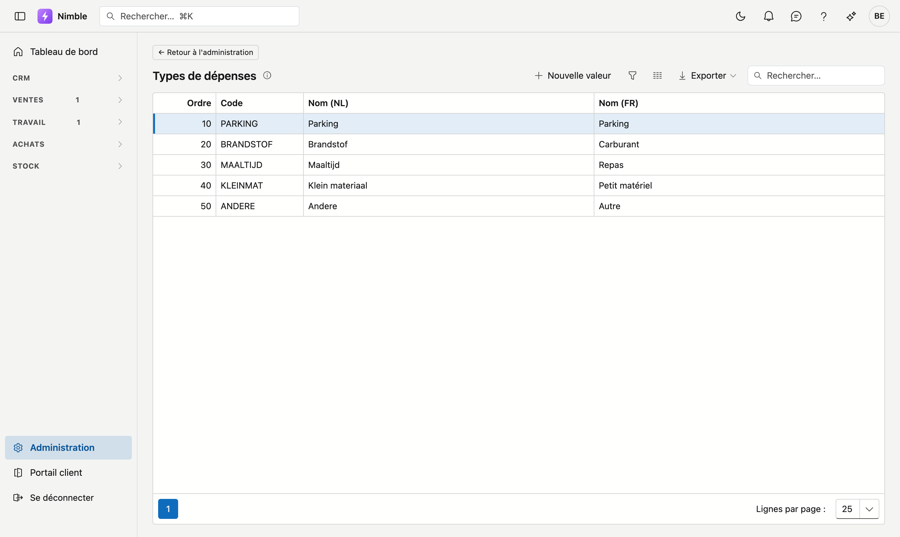

# Types de dépenses

Les **types de dépenses** vous permettent de classer les [dépenses](../work/expenses.md) de vos collaborateurs : parking,
carburant, repas, petit matériel … Vous choisissez vous-même les types dont vous avez besoin.

## Ouvrir l'écran

1. Cliquez en bas de la barre latérale sur **Administration**.
2. Cliquez dans le groupe **Projets** sur la tuile **Types de dépenses**.

Vous avez besoin du droit de modifier les collaborateurs.

## Où le type est utilisé

- Pour chaque **dépense**, dans le champ **Type** : sur l'écran Dépenses et dans le bloc Dépenses d'un bon de travail.
- Comme **colonne** dans la liste [Dépenses](../work/expenses.md), où vous triez et filtrez dessus, et dans l'export.

## Ajouter ou modifier un type

Cliquez sur **Nouvelle valeur**, ou double-cliquez sur une ligne existante. Une fenêtre s'ouvre avec les champs ci-dessous et les
boutons **Enregistrer** et **Annuler** ; pour une valeur existante, **Supprimer** figure aussi à droite.

| Champ | Remarque |
|---|---|
| **Ordre** | Détermine la place dans la liste de choix ; le plus petit nombre en haut |
| **Code** | Votre propre clé courte, obligatoire et unique |
| **Nom (NL)** et **Nom (FR)** | Le nom dans la langue de base de votre entreprise est obligatoire. Si l'autre langue reste vide, le nom apparaît dans la langue de base |

## Supprimer un type

**Supprimer** archive le type : il disparaît de la liste de choix, mais les dépenses qui le portent déjà le gardent. Vous pouvez le
récupérer via la [corbeille](recycle-bin.md).

## Voir aussi

- [Dépenses](../work/expenses.md)
- [Bons de travail](../work/work-sheets.md)
