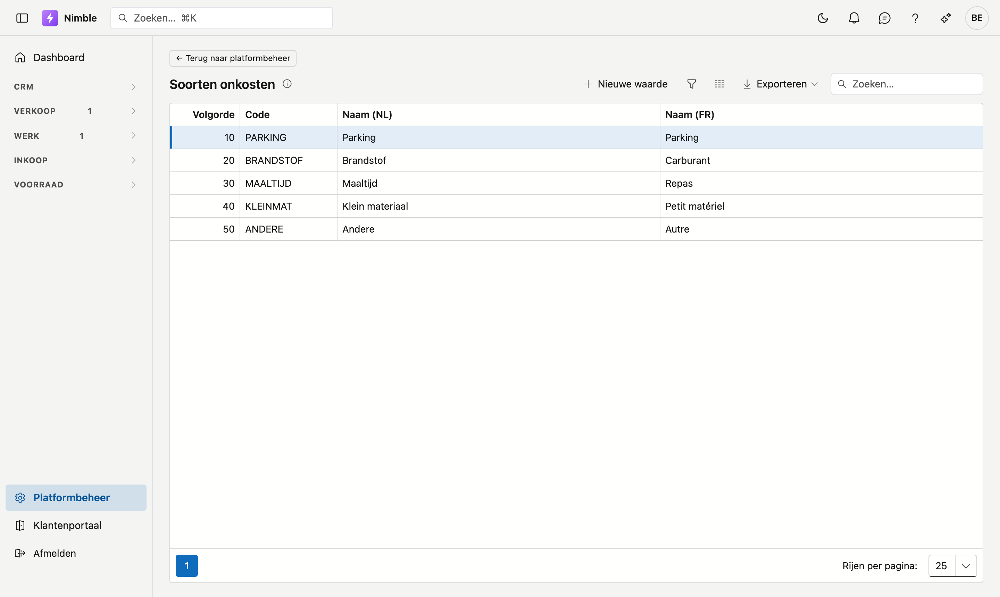

# Soorten onkosten

Met **soorten onkosten** deelt u de [onkosten](../work/expenses.md) van uw medewerkers in: parking, brandstof, maaltijd, klein
materiaal … U kiest zelf welke soorten u nodig hebt.

## Het scherm openen

1. Klik onderaan in de zijbalk op **Platformbeheer**.
2. Klik in de groep **Projecten** op de tegel **Soorten onkosten**.

U hebt het recht nodig om medewerkers te bewerken.

## Waar de soort gebruikt wordt

- Bij elke **onkost**, in het veld **Soort**: op het scherm Onkosten en in het blok Onkosten van een werkbon.
- Als **kolom** in de lijst [Onkosten](../work/expenses.md), waar u erop sorteert en filtert, en in de export.

## Een soort toevoegen of wijzigen

Klik op **Nieuwe waarde**, of dubbelklik op een bestaande rij. Er opent een venster met onderstaande velden en de knoppen
**Bewaren** en **Annuleren**; bij een bestaande waarde staat rechts ook **Verwijderen**.

| Veld | Opmerking |
|---|---|
| **Volgorde** | Bepaalt de plaats in de keuzelijst; laagste getal bovenaan |
| **Code** | Uw eigen korte sleutel, verplicht en uniek |
| **Naam (NL)** en **Naam (FR)** | De naam in de basistaal van uw bedrijf is verplicht. Blijft de andere taal leeg, dan verschijnt de naam in de basistaal |

## Een soort verwijderen

**Verwijderen** archiveert de soort: ze verdwijnt uit de keuzelijst, maar onkosten die ze al dragen, houden ze. Terughalen kan via
de [prullenbak](recycle-bin.md).

## Zie ook

- [Onkosten](../work/expenses.md)
- [Werkbonnen](../work/work-sheets.md)
