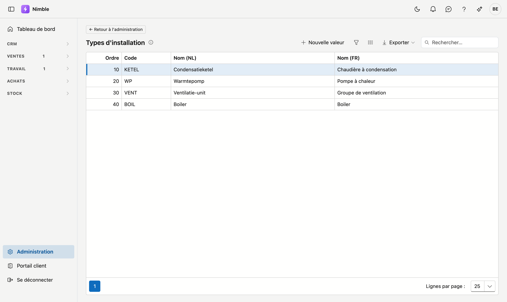

# Types d'installation

Les **types d'installation** vous permettent de classer les installations chez vos clients : chaudière à condensation, pompe à chaleur,
groupe de ventilation, boiler … Vous choisissez vous-même les types dont vous avez besoin.

## Ouvrir l'écran

1. Cliquez en bas de la barre latérale sur **Administration**.
2. Cliquez dans le groupe **Projets** sur la tuile **Types d'installation**.

Sur la fiche d'une installation, **Gérer les types** ouvre le même écran.

La colonne **Points de contrôle** de la liste indique combien de points de contrôle fixes chaque type comporte.

## Où le type est utilisé

- Sur la **fiche d'une installation**, dans le champ **Type**.
- Comme **colonne** dans la liste [Installations](../work/installations.md), où vous pouvez trier et filtrer dessus.
- Dans le **nom** d'une installation : le type, la marque et le modèle ensemble. C'est ainsi que l'installation figure sur l'ordre de
  travail, le bon de travail et l'autocollant QR.
- Sur le **bon de travail** : les [points de contrôle](#points-de-controle) du type sont proposés pour chaque installation de ce type.

Si vous importez des installations depuis Excel avec un type qui n'existe pas encore, Nimble le crée. Vérifiez ensuite la liste.

## Ajouter ou modifier un type

Cliquez sur **Nouvelle valeur**, ou double-cliquez sur une ligne existante. Une fenêtre s'ouvre avec les champs ci-dessous et les
boutons **Enregistrer** et **Annuler** ; pour une valeur existante, **Supprimer** figure aussi à droite.

| Champ | Remarque |
|---|---|
| **Ordre** | Détermine la place dans la liste de choix ; le plus petit nombre en haut |
| **Code** | Votre propre clé courte, obligatoire et unique |
| **Nom (NL)** et **Nom (FR)** | Le nom dans la langue de base de votre entreprise est obligatoire. Si l'autre langue reste vide, le nom apparaît dans la langue de base |
| **Points de contrôle** | Les points fixes à vérifier sur une installation de ce type, un point par ligne. Voir ci-dessous |

### Points de contrôle

Dans le champ **Points de contrôle**, vous indiquez ce qu'il faut vérifier sur chaque installation de ce type, un point par
ligne. Un type compte au maximum 50 points, de 200 caractères au maximum chacun.

Dans l'onglet **Installations** d'un [bon de travail](../work/work-sheets.md#installations), Nimble propose ces points pour une
installation de ce type, sauf si la visite d'entretien a ses propres points. Un contrôle déjà enregistré ne change pas si vous
modifiez ensuite la liste du type. L'application mobile reçoit la même proposition.

## Supprimer un type

**Supprimer** archive le type : il disparaît de la liste de choix, mais les installations qui le portent déjà le gardent. Vous pouvez le
récupérer via la [corbeille](recycle-bin.md).

## Voir aussi

- [Installations](../work/installations.md)
- [Entretien](../work/maintenance.md)
