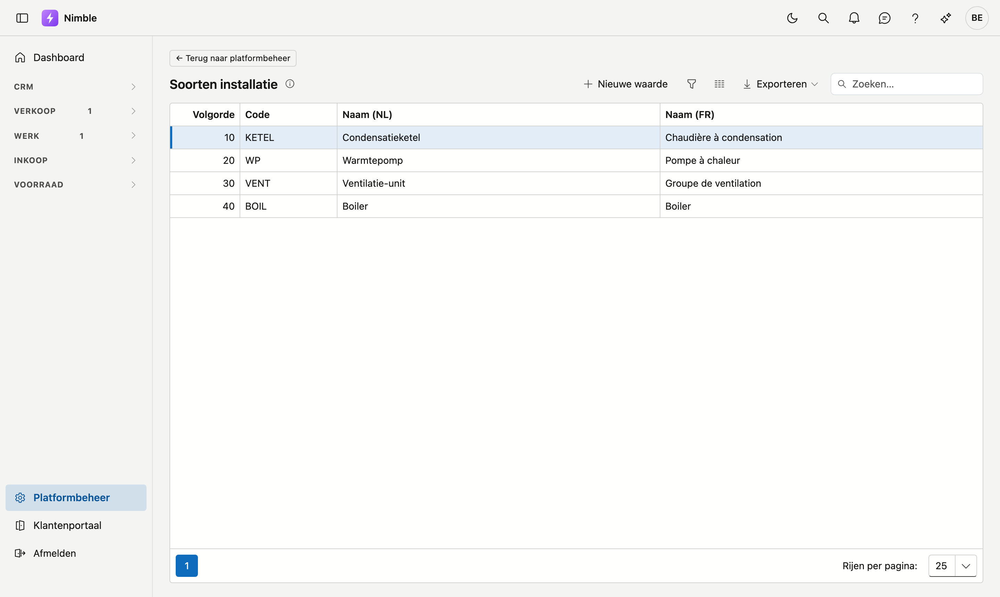

# Soorten installatie

Met **soorten installatie** deelt u de installaties bij uw klanten in: condensatieketel, warmtepomp, ventilatie-unit, boiler … U
kiest zelf welke soorten u nodig hebt.

## Het scherm openen

1. Klik onderaan in de zijbalk op **Platformbeheer**.
2. Klik in de groep **Projecten** op de tegel **Soorten installatie**.

Op de fiche van een installatie opent **Soorten beheren** hetzelfde scherm.

## Waar de soort gebruikt wordt

- Op de **fiche van een installatie**, in het veld **Soort**.
- Als **kolom** in de lijst [Installaties](../work/installations.md), waar u erop kunt sorteren en filteren.
- In de **naam** van een installatie: *Warmtepomp Daikin Altherma 3 H HT* is de soort, het merk en het model samen. Zo staat de
  installatie op de werkorder, de werkbon en de QR-sticker.

Leest u installaties in uit Excel met een soort die nog niet bestaat, dan maakt Nimble ze aan. Kijk de lijst daarna even na.

## Een soort toevoegen of wijzigen

Klik op **Nieuwe waarde**, of dubbelklik op een bestaande rij. Er opent een venster met onderstaande velden en de knoppen
**Bewaren** en **Annuleren**; bij een bestaande waarde staat rechts ook **Verwijderen**.

| Veld | Opmerking |
|---|---|
| **Volgorde** | Bepaalt de plaats in de keuzelijst; laagste getal bovenaan |
| **Code** | Uw eigen korte sleutel, verplicht en uniek |
| **Naam (NL)** en **Naam (FR)** | De naam in de basistaal van uw bedrijf is verplicht. Blijft de andere taal leeg, dan verschijnt de naam in de basistaal |

## Een soort verwijderen

**Verwijderen** archiveert de soort: ze verdwijnt uit de keuzelijst, maar installaties die ze al dragen, houden ze. Terughalen kan via
de [prullenbak](recycle-bin.md).

## Zie ook

- [Installaties](../work/installations.md)
- [Onderhoud](../work/maintenance.md)
