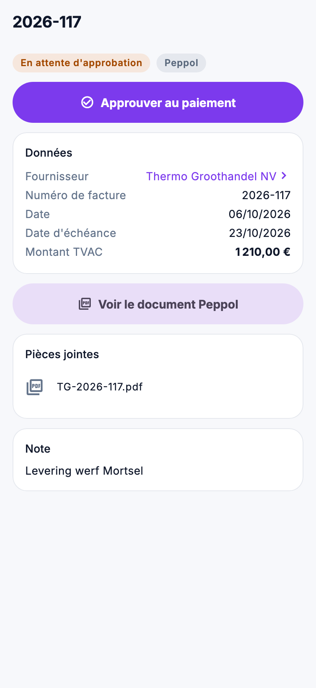

# Achats dans l'app

Approuver une facture d'achat au paiement depuis le chantier, vérifier ce qui est arrivé via Peppol ou ce qui est encore
en commande : tout se trouve sous **Achats** dans le menu.

{ width="320" }

## Qui voit quoi

| Quoi | Droit |
|---|---|
| Consulter **Factures d'achat**, **Documents reçus** et **Commandes** | *Voir les commandes* |
| Approuver une facture d'achat ou retirer l'approbation | aussi *Modifier les commandes* |

## Factures d'achat

La liste s'ouvre sur **À approuver** : ce qui doit encore être approuvé, l'échéance la plus proche en haut. Les autres
filtres : **Approuvées** (approuvées, pas encore payées), **Payées** et **Tous**. Cherchez par numéro de facture ou
fournisseur.

Pour chaque facture, vous voyez le numéro, le fournisseur, la date et l'échéance, le statut et le montant. Une note de
crédit porte **Note de crédit** et s'affiche avec un signe moins.

La fiche affiche le fournisseur, le numéro de facture, les dates et le montant TVAC, ainsi que :

- **Voir le document Peppol**, si la facture est arrivée via Peppol ;
- les **pièces jointes**, par exemple le scan d'une facture papier ;
- la note.

### Approuver au paiement

1. Ouvrez la facture et vérifiez-la.
2. Appuyez sur **Approuver au paiement**.
3. L'app rappelle le numéro, le fournisseur et le montant. Appuyez sur **Approuver**.

Le statut devient **Approuvée au paiement**, comme quand vous cliquez sur **Approuver** dans le back-office. Sur une
facture approuvée figure **Retirer l'approbation** : la facture repasse alors *En attente d'approbation*.

Approuver demande une connexion. Sans réseau, l'app le dit aussitôt ; réessayez dès que vous avez du réseau.

## Documents reçus

Ce qui est arrivé via Peppol et n'a pas encore été traité, le plus récent en haut, avec le fournisseur, le numéro, la
date et le montant. Un appui ouvre le document. Le traitement en facture d'achat se fait dans le back-office, dans
[Documents reçus](../purchasing/peppol-inbox.md).

Si Peppol n'a pas pu lire le nom du fournisseur, **Fournisseur non lu** s'affiche.

## Commandes

La liste s'ouvre sur **En cours** : commandées ou partiellement livrées. Les autres filtres : **Brouillon**, **Reçues**
et **Tous**. Pour chaque commande, vous voyez le numéro, le fournisseur, la date de commande, la date de livraison
prévue, le statut et le total HTVA. **incomplet** signifie qu'au moins une ligne n'a pas de prix.

La fiche affiche par ligne ce qui est commandé, reçu et encore attendu, ainsi que les livraisons. Si une ligne a été
livrée à un autre prix que celui commandé, ce prix s'affiche en orange, avec un avertissement à vérifier avant
d'approuver la facture d'achat.

## Erreurs fréquentes

!!! warning "Le bouton Approuver manque"
    Vous n'avez pas *Modifier les commandes*, ou la facture est déjà payée : une facture payée ne peut plus être
    approuvée ni retirée.

!!! warning "Documents reçus reste vide"
    Si l'app indique que cet environnement n'est lié à aucun client, Nimble ne peut pas déterminer quels documents vous
    appartiennent. Contactez ADM Concept.

## Voir aussi

- [Factures d'achat](../purchasing/purchase-invoices.md), [Documents reçus](../purchasing/peppol-inbox.md) et
  [Commandes](../purchasing/purchase-orders.md) dans le back-office
- [Stock](voorraad.md) : ce qui est commandé pour un article
