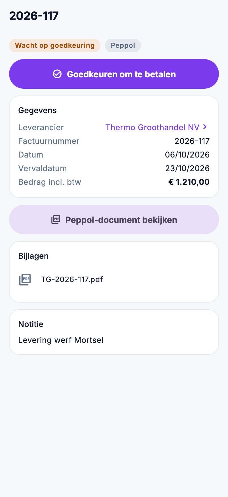

# Inkoop in de app

Een aankoopfactuur goedkeuren om te betalen terwijl u op de werf staat, nakijken wat er via Peppol binnenkwam of wat er
nog besteld staat: dat staat onder **Inkoop** in het menu.

{ width="320" }

## Wie ziet wat

| Wat | Recht |
|---|---|
| **Aankoopfacturen**, **Binnengekomen documenten** en **Bestellingen** bekijken | *Bestellingen bekijken* |
| Een aankoopfactuur goedkeuren of de goedkeuring intrekken | ook *Bestellingen bewerken* |

## Aankoopfacturen

De lijst opent op **Te keuren**: wat nog goedgekeurd moet worden, de vroegste vervaldatum bovenaan. De andere filters:
**Goedgekeurd** (goedgekeurd, nog niet betaald), **Betaald** en **Alle**. Zoek op het factuurnummer of de leverancier.

Per factuur ziet u het nummer, de leverancier, de datum en de vervaldatum, de status en het bedrag. Een creditnota draagt
**Creditnota** en staat met een minteken.

De fiche toont de leverancier, het factuurnummer, de datums en het bedrag incl. btw, en verder:

- **Peppol-document bekijken**, als de factuur via Peppol binnenkwam;
- de **bijlagen**, bijvoorbeeld de scan van een papieren factuur;
- de notitie.

### Goedkeuren om te betalen

1. Open de factuur en kijk ze na.
2. Tik op **Goedkeuren om te betalen**.
3. De app toont nog eens het nummer, de leverancier en het bedrag. Tik op **Goedkeuren**.

De status wordt **Goedgekeurd om te betalen**, net als wanneer u in de backoffice op **Goedkeuren** klikt. Bij een
goedgekeurde factuur staat **Goedkeuring intrekken**: zo zet u ze terug op *Wacht op goedkeuring*.

Goedkeuren vraagt een verbinding. Zonder bereik zegt de app dat meteen; probeer het dan opnieuw zodra u bereik hebt.

## Binnengekomen documenten

Wat via Peppol binnenkwam en nog niet verwerkt is, het jongste bovenaan, met de leverancier, het nummer, de datum en het
bedrag. Een tik opent het document. Verwerken tot een aankoopfactuur doet u in de backoffice, in
[Binnengekomen documenten](../purchasing/peppol-inbox.md).

Kon Peppol de naam van de leverancier niet lezen, dan staat er **Leverancier niet gelezen**.

## Bestellingen

De lijst opent op **Onderweg**: besteld of deels geleverd. De andere filters: **Klad**, **Ontvangen** en **Alle**. Per
bestelling ziet u het nummer, de leverancier, de besteldatum, de verwachte leverdatum, de status en het totaal excl. btw.
Staat er **onvolledig**, dan heeft minstens één regel geen prijs.

De fiche toont per regel wat er besteld, ontvangen en nog te komen is, en de leveringen. Werd een regel aan een andere
prijs geleverd dan besteld, dan staat die prijs in het oranje, met een waarschuwing om dat na te kijken vóór u de
aankoopfactuur goedkeurt.

## Veelgemaakte fouten

!!! warning "De knop Goedkeuren ontbreekt"
    U hebt *Bestellingen bewerken* niet, of de factuur is al betaald: een betaalde factuur is niet meer goed te keuren
    of in te trekken.

!!! warning "Binnengekomen documenten blijft leeg"
    Staat er dat deze omgeving niet aan een klant gekoppeld is, dan kan Nimble niet bepalen welke documenten van u zijn.
    Neem contact op met ADM Concept.

## Zie ook

- [Aankoopfacturen](../purchasing/purchase-invoices.md), [Binnengekomen documenten](../purchasing/peppol-inbox.md) en
  [Bestellingen](../purchasing/purchase-orders.md) in de backoffice
- [Voorraad](voorraad.md): wat er van een artikel besteld is
