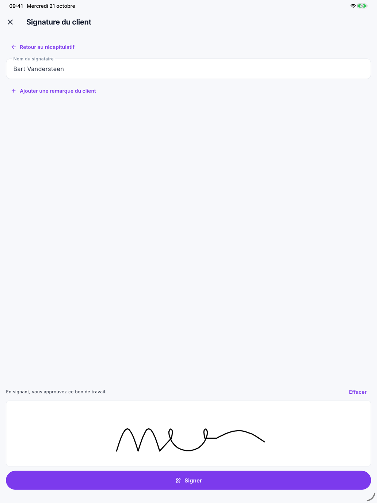

# Faire signer le client

En fin de journée, vous faites signer le bon de travail au client sur votre téléphone ou votre tablette. Le client
voit d'abord ce qu'il signe — les heures, le matériel, les travaux supplémentaires — puis signe avec le doigt. Le
bureau voit aussitôt la signature sous [Bons de travail](../work/work-sheets.md#la-signature-du-client).

## Quand le client peut-il signer ?

En bas du bon de travail, touchez **Faire signer le client**. C'est possible quand :

- le bon de travail est **enregistré** — le client signe ce qui est enregistré, pas ce que vous êtes encore en train
  de taper ;
- le **chronomètre** est arrêté — les heures d'aujourd'hui font partie de ce que le client signe ;
- le bon de travail contient quelque chose.

## Étape 1 — le client vérifie

Le client voit d'abord un récapitulatif : le jour, ce qui s'est passé, les heures par personne, le matériel consommé
et les travaux supplémentaires. Pour les travaux supplémentaires, il est précisé qu'ils ne seront exécutés et facturés
qu'après son accord.

Si tout est correct, le client touche **D'accord — signer**.

## Étape 2 — le client signe

{ width="560" }

1. Indiquez le **Nom du signataire**.
2. Si le client veut ajouter quelque chose, touchez **Ajouter une remarque du client**.
3. Le client signe avec le doigt dans le cadre blanc. En cas d'erreur, touchez **Effacer**.
4. Touchez **Signer**.

Avec **Retour au récapitulatif**, vous revenez à l'étape 1, sans signer.

## Ensuite

Le bon de travail est verrouillé : le client a signé ce qui y figure. Sur le bon figure **Signé par …**, avec qui a
présenté le bon et la remarque du client.

- **Voir le bon de travail signé** — ouvre le bon de travail signé en PDF.
- **Envoyer au client** — envoie le bon de travail signé en PDF au client, dans la langue du client. Si Nimble connaît
  l'adresse e-mail du client, elle est déjà remplie ; séparez plusieurs adresses par un point-virgule. Touchez
  **Envoyer**.

Aucun e-mail ne part tout seul : uniquement quand vous touchez **Envoyer**.

S'il faut encore changer quelque chose après la signature, demandez au bureau de retirer la signature. Vous pouvez
ensuite à nouveau modifier le bon de travail, et le client signe à nouveau.

## Sans connexion

Le client peut aussi signer sans connexion. Il est alors indiqué *Le client a signé. La signature sera envoyée dès que
la connexion revient.* Le bon de travail signé et **Envoyer au client** suivent dès que Nimble a la signature.

Si Nimble refuse la signature — parce qu'entre-temps quelque chose a changé au bureau sur le bon de travail —
**Nimble a refusé la signature de …** s'affiche. Vérifiez le bon de travail et touchez
**Faire signer le client à nouveau**. Ce n'est possible qu'avec une connexion : le client doit voir ce qui figure
maintenant dans Nimble.

## Erreurs fréquentes

!!! warning "Le chronomètre tourne encore"
    Si *Arrêtez d'abord le chronomètre* s'affiche, demandez au chef d'équipe d'arrêter le chronomètre. Toutes les
    heures d'aujourd'hui figurent alors sur le bon de travail, et le client signe aussi pour ces heures.

!!! warning "Une erreur après la signature"
    Un bon de travail signé ne se modifie plus dans l'app. Demandez au bureau de **Retirer la signature** ; corrigez
    ensuite le bon de travail et faites signer le client à nouveau.

## Voir aussi

- [Le bon de travail](werkbon.md) — remplir les heures, le matériel et les travaux supplémentaires
- [Bons de travail](../work/work-sheets.md#la-signature-du-client) — la signature telle que le bureau la voit
- [Modèles de mail](../settings/mail-templates.md) — le texte de l'e-mail avec le bon de travail signé
