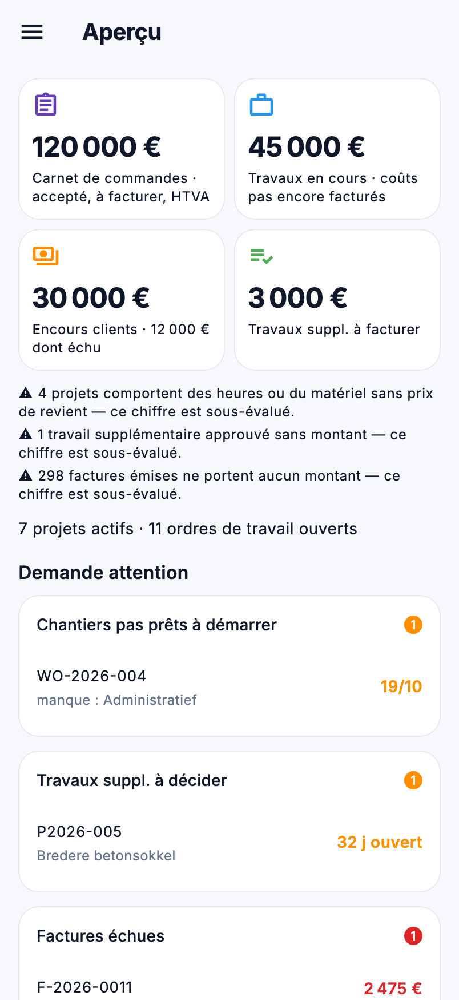

# Aperçu et planification dans l'app

Celui qui suit l'entreprise voit dans l'app bien plus que le planning du jour : les chiffres clés du
[tableau de bord](../getting-started/dashboard.md), ce qui demande attention, et la semaine des équipes. Ce sont les
mêmes chiffres que dans le back-office ; l'app ne calcule rien elle-même.

{ width="320" }

## Qui voit quoi

L'app suit les droits définis dans [Rôles](../administration/roles.md), les mêmes que dans le back-office :

| Écran | Droit |
|---|---|
| **Aperçu** | *Voir le tableau de bord* |
| La tuile **Travaux en cours** | aussi *Voir les marges et prix de revient* |
| **Planification** | *Voir le planning* |

Celui qui peut voir l'Aperçu ouvre l'app sur **Aperçu** au lieu de **Aujourd'hui**. Le menu est alors groupé, comme
dans le back-office : **Travail**, **CRM**, **Ventes**, **Achats** et **Stock**. Un groupe n'apparaît que si vous
pouvez y voir quelque chose.

## L'Aperçu

### Les tuiles

| Tuile | Quoi | Un appui ouvre |
|---|---|---|
| **Carnet de commandes** | Le travail accepté encore à facturer, HTVA | Le [carnet de commandes](verkoop.md#le-carnet-de-commandes) |
| **Travaux en cours** | Les coûts engagés pas encore facturés | |
| **Encours clients** | Ce que les clients doivent encore payer, et la part échue | Les [factures ouvertes](verkoop.md#factures) |
| **Travaux suppl. à facturer** | Les travaux supplémentaires approuvés pas encore facturés | Les [travaux approuvés](werk.md#travaux-supplementaires) |

Un appui ne fonctionne que si vous pouvez aussi voir l'écran derrière. Une phrase avec ⚠️ sous les tuiles signale un
chiffre sous-évalué : par exemple une facture sans montant ou un projet avec des heures sans prix de revient.

### Demande attention

Cinq cartes, dans l'ordre du tableau de bord :

- **Chantiers pas prêts à démarrer** : les chantiers qui démarrent bientôt et dont la préparation n'est pas terminée,
  avec ce qui manque. Un appui ouvre le projet.
- **Travaux suppl. à décider** : les travaux supplémentaires en attente de décision, avec le nombre de jours. Un appui
  ouvre le [travail supplémentaire](werk.md#decider-un-travail-supplementaire).
- **Factures échues** : avec le nombre de jours de retard. Un appui ouvre la [facture](verkoop.md#factures).
- **Points de réception échus** : les points qui ont dépassé leur échéance. Un appui ouvre le projet.
- **Sous le stock minimum** : les articles sous leur minimum, ou *déjà commandé*. Un appui ouvre
  l'[article](voorraad.md#la-fiche-article).

Une carte affiche les premières lignes ; **et … autres** la déplie. Une carte vide dit en toutes lettres qu'il n'y a rien.

## La planification

**Planification** affiche la semaine des équipes que vous suivez, avec les mêmes compteurs que le tableau de
planification : jours d'équipe planifiés, jours-homme, chantiers pas prêts cette semaine et jours qui ne tiennent pas.

- Les flèches mènent à la semaine précédente ou suivante ; **Cette semaine** vous ramène.
- Sur un téléphone, la semaine s'affiche par jour ; sur une tablette, en grille par équipe.
- Un appui sur un chantier ouvre le projet.

Les équipes que vous voyez sont choisies par le bureau sous [Accès à l'app](../administration/app-access.md).

## Erreurs fréquentes

!!! warning "Aperçu n'est pas dans le menu"
    Vous n'avez pas le droit *Voir le tableau de bord*. Demandez à votre administrateur de l'ajouter à votre rôle dans
    [Rôles](../administration/roles.md). Il s'applique aussitôt, aussi dans l'app.

!!! warning "Une tuile ne réagit pas"
    L'écran derrière demande un autre droit : le carnet de commandes et les factures demandent *Voir les factures*, les
    travaux supplémentaires *Voir les ordres et bons de travail*.

## Voir aussi

- [Tableau de bord](../getting-started/dashboard.md) : les mêmes chiffres dans le back-office
- [Planification](../work/planning.md) : le tableau de planification tel que le bureau le prépare
- [Premiers pas](aan-de-slag.md) : la connexion et le menu
