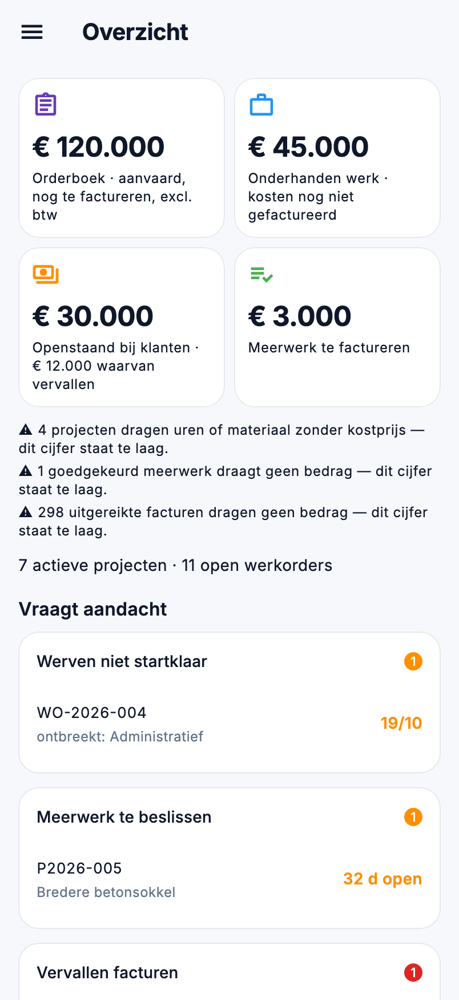

# Overzicht en planning in de app

Wie de zaak opvolgt, ziet in de app meer dan de planning van vandaag: de kerncijfers van het
[Dashboard](../getting-started/dashboard.md), wat aandacht vraagt, en de week van de ploegen. Het zijn dezelfde cijfers
als in de backoffice; de app rekent niets zelf uit.

{ width="320" }

## Wie ziet wat

De app volgt de rechten uit [Rollen](../administration/roles.md), dezelfde als in de backoffice:

| Scherm | Recht |
|---|---|
| **Overzicht** | *Dashboard bekijken* |
| De tegel **Onderhanden werk** | ook *Marges en kostprijzen bekijken* |
| **Planning** | *Planning bekijken* |

Wie het Overzicht mag zien, opent de app op **Overzicht** in plaats van op **Vandaag**. Het menu staat dan in groepen,
zoals in de backoffice: **Werk**, **CRM**, **Verkoop**, **Inkoop** en **Voorraad**. Een groep verschijnt enkel als u er
iets in mag zien.

## Het Overzicht

### De tegels

| Tegel | Wat | Een tik opent |
|---|---|---|
| **Orderboek** | Aanvaard werk dat nog gefactureerd moet worden, excl. btw | Het [orderboek](verkoop.md#het-orderboek) |
| **Onderhanden werk** | Gemaakte kosten die nog niet gefactureerd zijn | |
| **Openstaand bij klanten** | Wat klanten nog moeten betalen, en hoeveel daarvan vervallen is | De [openstaande facturen](verkoop.md#facturen) |
| **Meerwerk te factureren** | Goedgekeurd meerwerk dat nog niet gefactureerd is | Het [goedgekeurde meerwerk](werk.md#meerwerken) |

Een tik werkt enkel als u het scherm erachter ook mag zien. Staat er onder de tegels een zin met ⚠️, dan staat een cijfer
te laag: bijvoorbeeld omdat een factuur geen bedrag draagt of een project uren zonder kostprijs heeft.

### Vraagt aandacht

Vijf kaarten, in de volgorde van het Dashboard:

- **Werven niet startklaar**: werven die binnenkort starten en waarvan de voorbereiding niet rond is, met wat ontbreekt. Een
  tik opent het project.
- **Meerwerk te beslissen**: meerwerk dat op een beslissing wacht, met het aantal dagen. Een tik opent het
  [meerwerk](werk.md#een-meerwerk-beslissen).
- **Vervallen facturen**: met het aantal dagen over tijd. Een tik opent de [factuur](verkoop.md#facturen).
- **Vervallen opleverpunten**: punten over hun deadline. Een tik opent het project.
- **Onder minimumvoorraad**: artikelen onder hun minimum, of *al besteld*. Een tik opent het
  [artikel](voorraad.md#de-artikelfiche).

Een kaart toont de eerste regels; met **en nog … andere** klapt u ze open. Een lege kaart zegt in woorden dat er niets is.

## De planning

**Planning** toont de week van de ploegen die u volgt, met dezelfde tellers als het planbord: geplande ploegdagen,
mandagen, werven die deze week niet startklaar zijn en dagen die niet passen.

- Met de pijlen gaat u naar de vorige of de volgende week; **Deze week** brengt u terug.
- Op een telefoon staat de week per dag, op een tablet als rooster per ploeg.
- Een tik op een werf opent het project.

Welke ploegen u ziet, kiest kantoor bij [App-toegang](../administration/app-access.md).

## Veelgemaakte fouten

!!! warning "Overzicht staat niet in het menu"
    U hebt het recht *Dashboard bekijken* niet. Vraag uw beheerder om het aan uw rol toe te voegen in
    [Rollen](../administration/roles.md). Het geldt meteen, ook in de app.

!!! warning "Een tegel is niet aan te tikken"
    Het scherm erachter vraagt een ander recht: het orderboek en de facturen vragen *Facturen bekijken*, het meerwerk
    vraagt *Werkorders en werkbonnen bekijken*.

## Zie ook

- [Dashboard](../getting-started/dashboard.md): dezelfde cijfers in de backoffice
- [Planning](../work/planning.md): het planbord zoals kantoor het maakt
- [Aan de slag](aan-de-slag.md): aanmelden en het menu
