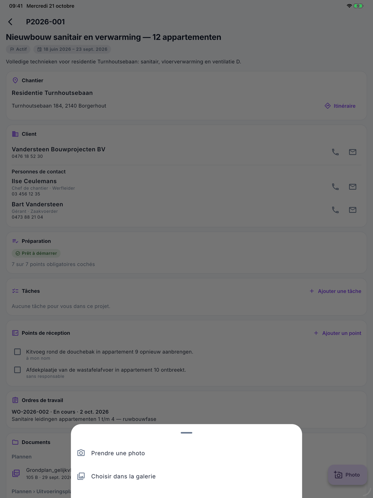

# Le projet dans l'app

L'écran **Projet** affiche ce que vous devez savoir d'un projet sur le chantier : le chantier, le client et ses
personnes de contact, la préparation, les points de réception, les ordres de travail, les documents et les notes. Les
montants n'y figurent pas. Vous y ajoutez aussi des photos, des tâches et des points de réception.

## Ouvrir le projet

Dans [Aujourd'hui](vandaag.md), touchez la carte d'un chantier. Qui n'est pas collaborateur ouvre aussi un projet via
**Projets** dans le menu.

{ width="560" }

## Chantier, client et personnes de contact

- **Chantier** — l'adresse du chantier, avec **Itinéraire** vers votre app de cartes.
- **Client** et **Personnes de contact** — avec un bouton pour appeler et un bouton pour envoyer un e-mail, s'il y a
  un numéro ou une adresse.

## Préparation

Vous voyez ici si le chantier est **Prêt à démarrer** et combien de points obligatoires sont cochés. Si vous êtes le
responsable d'un point, une case figure à côté et vous la cochez quand le point est en ordre. Les autres points, vous
les voyez seulement.

## Points de réception

Les points qui doivent encore être réglés à la réception. Toute personne qui voit le projet peut les cocher.

Ajouter un point :

1. Touchez **Ajouter un point**.
2. Décrivez sous **Quoi** ce qu'il faut faire.
3. Cochez **À mon nom** si vous vous en chargez vous-même. Sinon, il reste sans responsable et le bureau l'attribue.
4. Choisissez éventuellement une date sous **Pour le**.
5. Touchez **Enregistrer**.

Un point dont le délai est dépassé apparaît en rouge. Les points cochés restent visibles encore 14 jours.

## Tâches

Les tâches de ce projet qui vous sont attribuées ou que vous avez créées. Avec **Ajouter une tâche**, vous créez une
nouvelle tâche pour ce projet : voir [Tâches et Mes heures](taken-en-uren.md).

## Ordres de travail, documents et notes

- **Ordres de travail** — les ordres de travail du projet avec leur état.
- **Documents** — les plans et autres fichiers du projet, par dossier. Touchez un document pour l'ouvrir. Avec le
  petit bouton à côté, vous le gardez **hors ligne** : il s'ouvre alors aussi sans connexion.
- **Notes** — les notes les plus récentes du bureau. Les plus anciennes se trouvent dans Nimble au bureau.

## Ajouter une photo

{ width="560" }

1. En bas à droite, touchez **Photo**.
2. Choisissez **Prendre une photo** ou **Choisir dans la galerie**.
3. Choisissez le **Dossier** de la photo et indiquez éventuellement une **Description**, par exemple *fuite sous le
   lavabo, à gauche*.
4. Touchez **Envoyer**.

**Photo enregistrée.** s'affiche. La photo rejoint les documents du projet, même si vous n'avez pas de connexion
maintenant : elle part dès que la connexion revient.

## Erreurs fréquentes

!!! warning "Nimble n'a pas accès à l'appareil photo"
    Si vous n'avez pas donné à l'app l'accès à l'appareil photo ou aux photos, un message s'affiche. Activez-le dans
    les réglages de votre appareil, sous Nimble.

!!! warning "Un point de la préparation n'a pas de case"
    Vous ne cochez que les points dont vous êtes le responsable. Si *Ce point n'a pas pu être mis à jour* s'affiche,
    actualisez l'écran : quelqu'un d'autre en est peut-être devenu le responsable.

!!! warning "La photo ne peut pas être envoyée"
    L'app envoie les photos en JPEG ou PNG. Choisissez une autre photo, ou reprenez-la avec **Prendre une photo**.

## Voir aussi

- [Aujourd'hui](vandaag.md) — c'est de là que vous ouvrez le projet
- [Tâches et Mes heures](taken-en-uren.md)
- [Projets](../work/projects.md) — le projet tel que le bureau le voit
