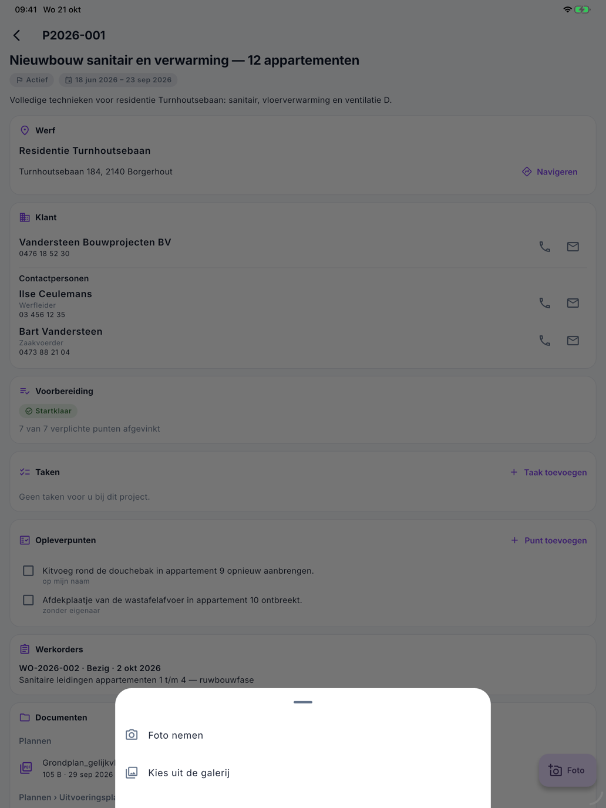

# Het project in de app

Het scherm **Project** toont wat u op de werf over een project moet weten: de werf, de klant en zijn contactpersonen,
de voorbereiding, de opleverpunten, de werkorders, de documenten en de notities. Bedragen staan er niet op. U voegt
hier ook foto's, taken en opleverpunten toe.

## Het project openen

Tik in [Vandaag](vandaag.md) op de kaart van een werf. Wie geen medewerker is, opent een project ook via
**Projecten** in het menu.

{ width="560" }

## Werf, klant en contactpersonen

- **Werf** — het werfadres, met **Navigeren** naar uw kaarten-app.
- **Klant** en **Contactpersonen** — met een knop om te bellen en een knop om te mailen, als er een nummer of adres is.

## Voorbereiding

Hier ziet u of de werf **Startklaar** is en hoeveel verplichte punten afgevinkt zijn. Bent u de verantwoordelijke van
een punt, dan staat er een vinkje bij en vinkt u het af wanneer het in orde is. De andere punten ziet u enkel.

## Opleverpunten

De punten die bij de oplevering nog in orde moeten komen. Iedereen die het project ziet, kan ze afvinken.

Een punt toevoegen:

1. Tik op **Punt toevoegen**.
2. Beschrijf bij **Wat** wat er moet gebeuren.
3. Vink **Op mijn naam** aan als u het zelf opneemt. Anders staat het zonder eigenaar en wijst kantoor het toe.
4. Kies eventueel een datum bij **Tegen**.
5. Tik op **Bewaren**.

Een punt waarvan de termijn voorbij is, staat in het rood. Afgevinkte punten blijven nog 14 dagen zichtbaar.

Een foto bij een punt, bijvoorbeeld als bewijs dat het in orde is: tik op het **camera-icoon** rechts van het punt,
neem of kies de foto en tik op **Opladen**. Er is geen map te kiezen: de foto hoort bij het punt. Het getal op het
icoon zegt hoeveel foto's het punt al heeft. Ook zonder bereik: de foto vertrekt zodra er weer bereik is. Bekijken
doet u in de backoffice, op de projectfiche.

## Taken

De taken van dit project die aan u toegewezen zijn of die u zelf aanmaakte. Met **Taak toevoegen** maakt u een nieuwe
taak bij dit project: zie [Taken en Mijn uren](taken-en-uren.md).

## Werkorders, documenten en notities

- **Werkorders** — de werkorders van het project met hun stand.
- **Documenten** — de plannen en andere bestanden van het project, per map. Tik op een document om het te openen.
  Met het knopje ernaast bewaart u het **offline**: dan opent het ook zonder bereik.
- **Notities** — de recentste notities van kantoor. De oudere staan in Nimble op kantoor.

## Een foto toevoegen

{ width="560" }

1. Tik rechtsonder op **Foto**.
2. Kies **Foto nemen** of **Kies uit de galerij**.
3. Kies de **Map** waarin de foto komt en geef eventueel een **Omschrijving**, bijvoorbeeld *lek onder de lavabo,
   links*.
4. Tik op **Opladen**.

Er staat **Foto bewaard.** De foto komt bij de documenten van het project, ook als u nu geen bereik hebt: ze vertrekt
dan zodra er weer bereik is.

## Veelgemaakte fouten

!!! warning "Nimble heeft geen toegang tot de camera"
    Gaf u de app geen toegang tot de camera of de foto's, dan staat er een melding. Zet het aan in de instellingen van
    uw toestel, bij Nimble.

!!! warning "Een punt van de voorbereiding heeft geen vinkje"
    U vinkt enkel de punten af waarvan u de verantwoordelijke bent. Staat er *Dit punt kon niet bijgewerkt worden*,
    vernieuw dan het scherm: misschien is iemand anders intussen verantwoordelijk.

!!! warning "De foto is niet op te laden"
    De app laadt foto's op in JPEG of PNG. Kies een andere foto, of neem ze opnieuw met **Foto nemen**.

## Zie ook

- [Vandaag](vandaag.md) — van daaruit opent u het project
- [Taken en Mijn uren](taken-en-uren.md)
- [Projecten](../work/projects.md) — het project zoals kantoor het ziet
