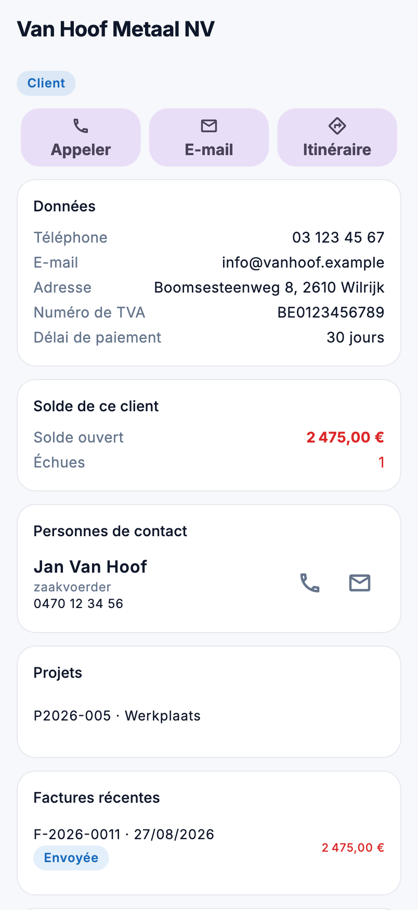

# Relations et leads dans l'app

Retrouver un client et l'appeler aussitôt, suivre un lead après une visite : sous **CRM** dans le menu se trouvent les
relations et les leads. Vous consultez et prenez contact ; modifier se fait dans le back-office.

{ width="320" }

## Qui voit quoi

| Écran | Droit |
|---|---|
| **Relations** | *Voir les relations* |
| **Leads** | *Voir les leads* |
| L'encours et les factures d'une relation | aussi *Voir les factures* |
| Les devis d'une relation | aussi *Voir les devis* |

## Relations

Cherchez par nom, numéro, commune, numéro de TVA, e-mail ou téléphone. Les filtres : **Tous**, **Clients** et
**Fournisseurs**. Si un numéro de téléphone est connu, le combiné à droite appelle sans ouvrir la fiche.

La fiche affiche :

- **Appeler**, **E-mail** et **Itinéraire** en haut. Un bouton grisé n'a pas la donnée (pas de numéro, pas d'e-mail,
  pas d'adresse).
- Les **données** : numéro, téléphone, GSM, e-mail, adresse, numéro de TVA, site web et délai de paiement.
- **Solde de ce client** : ce qui reste à payer et le nombre de factures échues. Si une facture n'a pas de montant,
  une phrase avec ⚠️ le signale : l'encours est alors sous-évalué.
- Les **personnes de contact**, chacune avec appeler et e-mail.
- Les **projets** du client. Un projet que vous pouvez voir dans l'app s'ouvre d'un appui.
- Les **factures récentes** et les **devis récents**. Un appui ouvre la pièce.

## Leads

Les filtres : **En cours** (par défaut), **À suivre**, **Mes leads**, **Gagnés**, **Perdus** et **Tous**. Les étapes
portent les noms que votre entreprise leur a donnés.

Pour un lead à suivre, la raison est indiquée : **Action suivante échue**, **Réactivation dépassée** ou **À l'arrêt**.
Ce sont les mêmes raisons que sur le tableau du back-office.

La fiche affiche **Appeler**, **E-mail** et **Itinéraire**, l'étape, le suivi (responsable, action suivante,
réactivation), la demande (type, ampleur, timing, urgence, budget et source) et les coordonnées. Si le lead a été
converti en client, **Converti en client** ouvre cette relation.

## Erreurs fréquentes

!!! warning "L'encours manque sur une relation"
    L'encours, les factures et les devis ne s'affichent que pour qui peut aussi les voir dans le back-office.

!!! warning "Un lead n'est pas dans la liste"
    La liste s'ouvre sur **En cours**. Un lead gagné ou perdu se trouve avec le filtre **Gagnés**, **Perdus** ou
    **Tous**.

## Voir aussi

- [Relations](../relations.md) et [Leads](../crm/leads.md) dans le back-office
- [Ventes](verkoop.md) : les factures et devis d'un client
