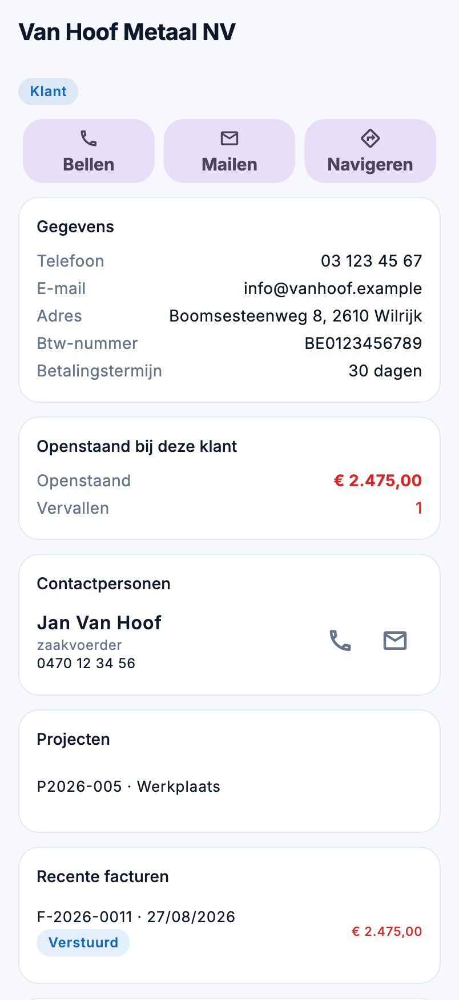

# Relaties en leads in de app

Een klant opzoeken en meteen bellen, een lead opvolgen na een plaatsbezoek: onder **CRM** in het menu staan de
relaties en de leads. U kijkt na en neemt contact op; bewerken doet u in de backoffice.

{ width="320" }

## Wie ziet wat

| Scherm | Recht |
|---|---|
| **Relaties** | *Relaties bekijken* |
| **Leads** | *Leads bekijken* |
| Het saldo en de facturen op een relatie | ook *Facturen bekijken* |
| De offertes op een relatie | ook *Offertes bekijken* |

## Relaties

Zoek op naam, nummer, gemeente, btw-nummer, e-mail of telefoon. De filters: **Alle**, **Klanten** en **Leveranciers**.
Staat er een telefoonnummer bij, dan belt u met het hoorntje rechts zonder de fiche te openen.

De fiche toont:

- **Bellen**, **Mailen** en **Navigeren** bovenaan. Een knop die grijs staat, mist het gegeven (geen nummer, geen
  e-mail, geen adres).
- De **gegevens**: nummer, telefoon, gsm, e-mail, adres, btw-nummer, website en betalingstermijn.
- **Openstaand bij deze klant**: wat er nog betaald moet worden en hoeveel facturen vervallen zijn. Draagt een factuur
  geen bedrag, dan staat er een zin met ⚠️: het saldo staat dan te laag.
- De **contactpersonen**, elk met bellen en mailen.
- De **projecten** van de klant. Een project dat u in de app mag zien, opent met een tik.
- De **recente facturen** en **recente offertes**. Een tik opent het stuk.

## Leads

De filters: **Lopend** (standaard), **Vraagt opvolging**, **Mijn leads**, **Gewonnen**, **Verloren** en **Alle**. De
fasen hebben de namen die uw bedrijf er zelf aan gaf.

Bij een lead die opvolging vraagt, staat waarom: **Volgende actie verlopen**, **Heractivatie verstreken** of **Ligt
stil**. Het zijn dezelfde redenen als op het bord in de backoffice.

De fiche toont **Bellen**, **Mailen** en **Navigeren**, de fase, de opvolging (verantwoordelijke, volgende actie,
heractivatie), de aanvraag (type, omvang, timing, urgentie, budget en leadbron) en de contactgegevens. Is de lead
omgezet naar een klant, dan opent **Omgezet naar klant** die relatie.

## Veelgemaakte fouten

!!! warning "Het saldo ontbreekt op een relatie"
    Het saldo, de facturen en de offertes staan er enkel voor wie die ook in de backoffice mag zien.

!!! warning "Een lead staat niet in de lijst"
    De lijst opent op **Lopend**. Een gewonnen of verloren lead vindt u met de filter **Gewonnen**, **Verloren** of
    **Alle**.

## Zie ook

- [Relaties](../relations.md) en [Leads](../crm/leads.md) in de backoffice
- [Verkoop](verkoop.md): de facturen en offertes van een klant
