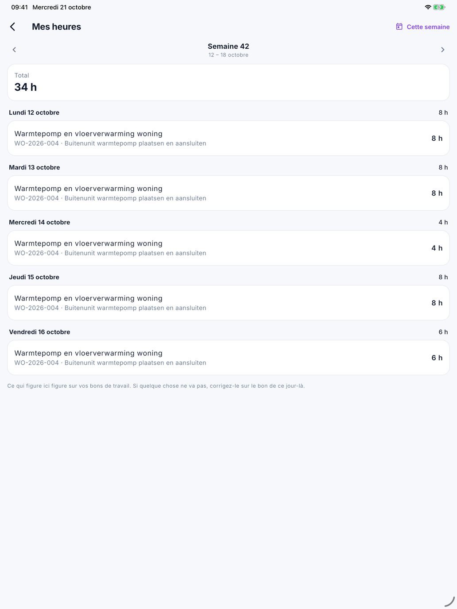

# Tâches et Mes heures dans l'app

Deux écrans du menu : **Tâches** — ce que vous devez faire et ce que vous avez demandé à d'autres — et
**Mes heures** — vos heures par semaine, telles qu'elles figurent sur les bons de travail.

## Tâches

Ouvrez ☰ et touchez **Tâches**. Une pastille sur ☰ indique combien de vos tâches arrivent à échéance aujourd'hui ou
plus tôt.

Les tâches sont réparties en trois parties :

| Partie | Quoi |
|---|---|
| **À faire** | Les tâches qui vous sont destinées. Une tâche échue apparaît en rouge |
| **Demandées à d'autres** | Les tâches que vous avez créées pour quelqu'un d'autre |
| **Terminées récemment** | Ce qui est terminé depuis peu |

- Cochez une tâche quand elle est terminée. Vous ne cochez que les tâches qui vous sont destinées.
- Touchez une tâche pour les détails : le **Statut**, pour qui elle est et qui l'a créée.

Ce sont les mêmes tâches que celles du bureau dans [Tâches](../crm/tasks.md).

### Ajouter une tâche

Une tâche est toujours liée à un projet. Vous la créez donc sur le [projet](project.md) :

1. Ouvrez le projet et, sous **Tâches**, touchez **Ajouter une tâche**.
2. Indiquez le **Sujet**, par exemple *commander encore 4 boîtes de carrelage*, et éventuellement une
   **Description**.
3. Choisissez **Pour qui** : **Moi-même** ou quelqu'un du bureau.
4. Choisissez éventuellement une **Échéance**.
5. Touchez **Enregistrer**.

## Mes heures

Ouvrez ☰ et touchez **Mes heures**. Vous voyez vos heures d'une semaine, jour par jour, avec en haut le **Total**.

{ width="560" }

- Avec **‹** et **›**, vous passez à la semaine précédente ou suivante ; **Cette semaine** vous ramène.
- Chaque jour affiche chaque ordre de travail avec vos heures. Si votre entreprise enregistre les trajets, les heures
  de trajet y figurent aussi.
- **signé** signifie que le client a déjà signé le bon de travail de ce jour-là.
- Touchez une ligne pour ouvrir le bon de travail de ce jour-là.

Ce qui figure ici figure sur vos bons de travail — via le chronomètre ou saisi. Si quelque chose ne va pas,
corrigez-le sur le bon de travail de ce jour-là. S'il est déjà signé, demandez au bureau de le corriger.

**Mes heures** n'apparaît que pour les collaborateurs. Qui utilise l'app avec un
[Accès à l'app](../administration/app-access.md) ne saisit pas d'heures.

## Erreurs fréquentes

!!! warning "Un jour sans heures"
    Si *Aucune heure* s'affiche, le bon de travail de ce jour-là ne contient pas d'heures pour vous. Si le chronomètre
    tournait pour l'équipe, vérifiez que le chef d'équipe l'a arrêté ; sinon, saisissez-les sur le
    [bon de travail](werkbon.md).

!!! warning "Impossible de cocher une tâche"
    Vous ne cochez que les tâches qui vous sont destinées. Une tâche que vous avez créée pour quelqu'un d'autre, c'est
    cette personne qui la coche.

## Voir aussi

- [Le projet](project.md) — c'est là que vous ajoutez une tâche
- [Le bon de travail](werkbon.md) — d'où viennent vos heures
- [Tâches](../crm/tasks.md) — les tâches telles que le bureau les voit
