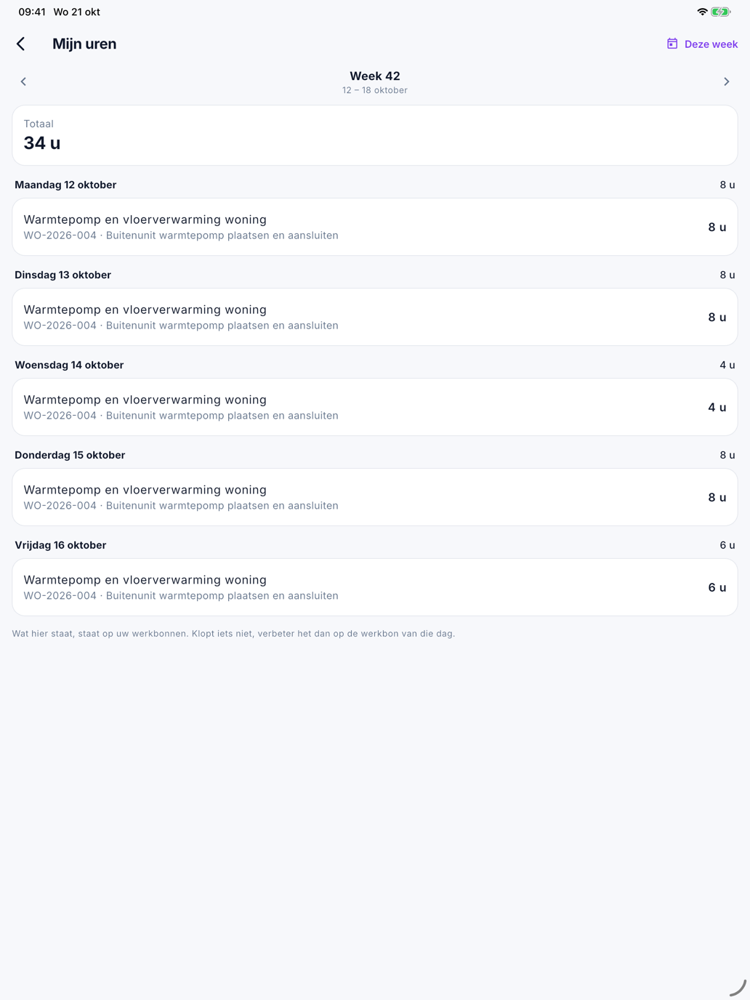

# Taken en Mijn uren in de app

Twee schermen uit het menu: **Taken** — wat u moet doen en wat u aan anderen vroeg — en **Mijn uren** — uw uren per
week, zoals ze op de werkbonnen staan.

## Taken

Open ☰ en tik op **Taken**. Een bolletje op ☰ toont hoeveel van uw taken vandaag of eerder vervallen.

De taken staan in drie delen:

| Deel | Wat |
|---|---|
| **Te doen** | De taken die voor u bestemd zijn. Een vervallen taak staat in het rood |
| **Gevraagd aan anderen** | De taken die u aanmaakte voor iemand anders |
| **Recent afgewerkt** | Wat onlangs af is |

- Vink een taak af wanneer ze af is. U vinkt enkel de taken af die voor u bestemd zijn.
- Tik op een taak voor de details: de **Status**, voor wie ze is en wie ze aanmaakte.

Dit zijn dezelfde taken als die van kantoor in [Taken](../crm/tasks.md).

### Een taak toevoegen

Een taak hangt altijd aan een project. U maakt ze dus aan op het [project](project.md):

1. Open het project en tik bij **Taken** op **Taak toevoegen**.
2. Vul het **Onderwerp** in, bijvoorbeeld *nog 4 dozen tegels bestellen*, en eventueel een **Omschrijving**.
3. Kies **Voor wie**: **Mezelf** of iemand van kantoor.
4. Kies eventueel een **Vervaldag**.
5. Tik op **Bewaren**.

## Mijn uren

Open ☰ en tik op **Mijn uren**. U ziet uw uren van één week, dag per dag, met bovenaan het **Totaal**.

{ width="560" }

- Met **‹** en **›** gaat u naar de vorige of de volgende week; **Deze week** brengt u terug.
- Per dag staat elke werkorder met uw uren. Meet uw bedrijf reistijd, dan staan de reisuren erbij.
- **getekend** betekent dat de klant de werkbon van die dag al tekende.
- Tik op een regel om de werkbon van die dag te openen.

Wat hier staat, staat op uw werkbonnen — met de klok of ingevuld. Klopt er iets niet, verbeter het dan op de werkbon
van die dag. Is die al getekend, vraag dan kantoor om het aan te passen.

**Mijn uren** staat er enkel voor medewerkers. Wie de app met [App-toegang](../administration/app-access.md) gebruikt,
schrijft zelf geen uren.

## Veelgemaakte fouten

!!! warning "Een dag zonder uren"
    Staat er *Geen uren*, dan staan er op de werkbon van die dag geen uren voor u. Stond de klok voor de ploeg, kijk dan
    of de ploegbaas ze stopte; anders vult u ze in op de [werkbon](werkbon.md).

!!! warning "Een taak afvinken lukt niet"
    U vinkt enkel taken af die voor u bestemd zijn. Een taak die u voor iemand anders aanmaakte, vinkt die persoon af.

## Zie ook

- [Het project](project.md) — daar voegt u een taak toe
- [De werkbon](werkbon.md) — waar uw uren vandaan komen
- [Taken](../crm/tasks.md) — de taken zoals kantoor ze ziet
