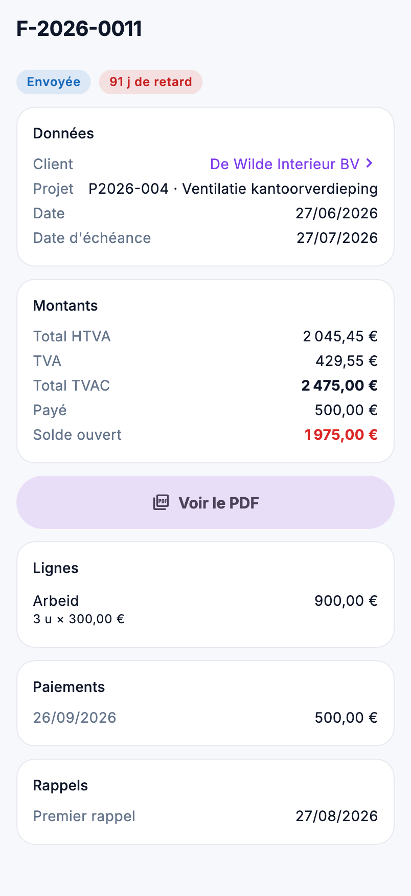

# Ventes dans l'app

Vérifier en déplacement si une facture est payée, si un devis est déjà accepté, ou ce qu'il reste à facturer : c'est
possible dans l'app, sous **Ventes** dans le menu. Vous consultez ; créer et modifier se fait dans le back-office.

{ width="320" }

## Qui voit quoi

| Écran | Droit |
|---|---|
| **Factures** et **Carnet de commandes** | *Voir les factures* |
| **Devis** | *Voir les devis* |

Le client sur une facture ou un devis ouvre la [relation](relaties-en-leads.md) si vous avez aussi *Voir les relations*.

## Rechercher et filtrer

Les trois listes fonctionnent de la même manière :

- Tapez dans le champ de recherche : l'app cherche sur le numéro, le client, et pour les devis aussi sur le projet et la
  variante. Plusieurs mots sont permis : *peeters 2026* trouve les pièces de Peeters avec un numéro de 2026.
- Choisissez un filtre avec les boutons sous le champ de recherche.
- En bas, **Charger plus** apparaît s'il y a plus de pièces que sur une page.
- Tirez la liste vers le bas pour la recharger.

Sur une tablette, la liste est à gauche et la pièce choisie à droite.

## Factures

Filtres : **Tous**, **Solde ouvert** et **Échues**. Pour chaque facture, vous voyez le numéro, le client, la date, le
statut et le solde ouvert. Une facture échue s'affiche en rouge avec le nombre de jours de retard.

La fiche affiche :

- le client, le projet, la date, l'échéance, la communication et votre référence ;
- les montants HTVA et TVAC, ce qui est payé et le solde ouvert ;
- les lignes, les paiements et les rappels envoyés ;
- **Voir le PDF** : la facture telle que le back-office la génère. Un brouillon n'a pas encore de PDF.

Le solde ouvert connaît quatre états, comme dans le back-office : un montant, **Soldée**, **Montant inconnu** (une
facture sans montant) ou un tiret (pas encore émise).

## Devis

Filtres : **Tous**, **Brouillons**, **Envoyés**, **Acceptés**, **Refusés**, **Remplacés** et **Expirés**. Un devis
envoyé dont la validité est dépassée porte **Validité dépassée**.

La fiche affiche le client, le projet, la validité, la date d'envoi, et qui l'a accepté ou refusé, quand et comment.
En dessous, les blocs et lignes comme sur le devis, avec les options à part (*hors total*), les autres versions et
variantes, et **Voir le PDF**.

## Le carnet de commandes

Par projet, ce qui est accepté, ce qui est déjà facturé et ce qui reste à facturer. C'est le même carnet que la tuile de
l'[Aperçu](overzicht.md) et l'écran [Carnet de commandes](../sales/order-book.md) du back-office. Un appui sur un projet
l'ouvre, si vous pouvez le voir dans l'app.

## Erreurs fréquentes

!!! warning "Le PDF ne s'ouvre pas"
    Une facture en brouillon n'a pas encore de PDF. Pour un devis, l'app ne génère pas de PDF tant qu'une ligne n'a pas
    de prix : complétez ce prix dans le back-office.

!!! warning "Ventes n'est pas dans le menu"
    Vous n'avez pas *Voir les factures* ni *Voir les devis*. Demandez à votre administrateur de les ajouter à votre rôle
    dans [Rôles](../administration/roles.md).

## Voir aussi

- [Factures](../sales/invoices.md), [Devis](../sales/quotes.md) et [Carnet de commandes](../sales/order-book.md) dans le back-office
- [Relations et leads](relaties-en-leads.md) : le client derrière une pièce
- [Aperçu et planification](overzicht.md)
