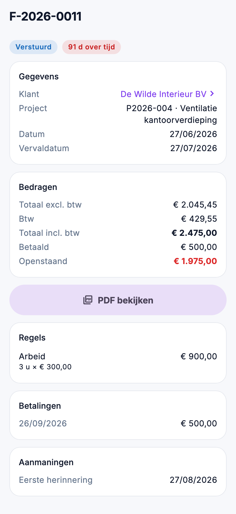

# Verkoop in de app

Onderweg nakijken of een factuur betaald is, of een offerte al aanvaard is, of wat er nog gefactureerd moet worden:
dat kan in de app, onder **Verkoop** in het menu. U kijkt na; maken en bewerken doet u in de backoffice.

{ width="320" }

## Wie ziet wat

| Scherm | Recht |
|---|---|
| **Facturen** en **Orderboek** | *Facturen bekijken* |
| **Offertes** | *Offertes bekijken* |

Een klant op een factuur of offerte opent de [relatie](relaties-en-leads.md) als u ook *Relaties bekijken* hebt.

## Zoeken en filteren

De drie lijsten werken op dezelfde manier:

- Typ in het zoekveld: de app zoekt op het nummer, de klant, en bij offertes ook op het project en de variant. Meerdere
  woorden mogen: *peeters 2026* vindt de stukken van Peeters met een nummer uit 2026.
- Kies een filter met de knoppen onder het zoekveld.
- Onderaan staat **Meer laden** als er meer stukken zijn dan op één pagina passen.
- Trek de lijst naar beneden om ze opnieuw op te halen.

Op een tablet staat de lijst links en het gekozen stuk rechts.

## Facturen

Filters: **Alle**, **Openstaand** en **Vervallen**. Per factuur ziet u het nummer, de klant, de datum, de status en wat er
openstaat. Een vervallen factuur staat in het rood met het aantal dagen over tijd.

De fiche toont:

- de klant, het project, de datum, de vervaldatum, de mededeling en uw referentie;
- de bedragen excl. en incl. btw, wat betaald is en wat openstaat;
- de regels, de betalingen en de verstuurde aanmaningen;
- **PDF bekijken**: de factuur zoals de backoffice ze maakt. Een klad heeft nog geen PDF.

Openstaand kent vier toestanden, zoals in de backoffice: een bedrag, **Voldaan**, **Bedrag onbekend** (een factuur
zonder bedrag) of een streepje (nog niet uitgereikt).

## Offertes

Filters: **Alle**, **Klad**, **Verstuurd**, **Aanvaard**, **Geweigerd**, **Vervangen** en **Verlopen**. Een verstuurde
offerte waarvan de geldigheid voorbij is, draagt **Geldigheid verstreken**.

De fiche toont de klant, het project, de geldigheid, wanneer ze verstuurd is, en wie ze aanvaardde of weigerde, wanneer
en hoe. Daaronder de blokken en regels zoals op de offerte, met de opties apart (*niet in het totaal*), de andere versies
en varianten, en **PDF bekijken**.

## Het orderboek

Per project wat er aanvaard is, wat al gefactureerd is en wat nog gefactureerd moet worden. Het is hetzelfde orderboek als
de tegel op het [Overzicht](overzicht.md) en het scherm [Orderboek](../sales/order-book.md) in de backoffice. Een tik op
een project opent het, als u het in de app mag zien.

## Veelgemaakte fouten

!!! warning "De PDF opent niet"
    Een factuur in klad heeft nog geen PDF. Bij een offerte maakt de app geen PDF zolang er een regel zonder prijs op
    staat: vul die prijs in de backoffice in.

!!! warning "Verkoop staat niet in het menu"
    U hebt *Facturen bekijken* en *Offertes bekijken* niet. Vraag uw beheerder om ze aan uw rol toe te voegen in
    [Rollen](../administration/roles.md).

## Zie ook

- [Facturen](../sales/invoices.md), [Offertes](../sales/quotes.md) en [Orderboek](../sales/order-book.md) in de backoffice
- [Relaties en leads](relaties-en-leads.md): de klant achter een stuk
- [Overzicht en planning](overzicht.md)
