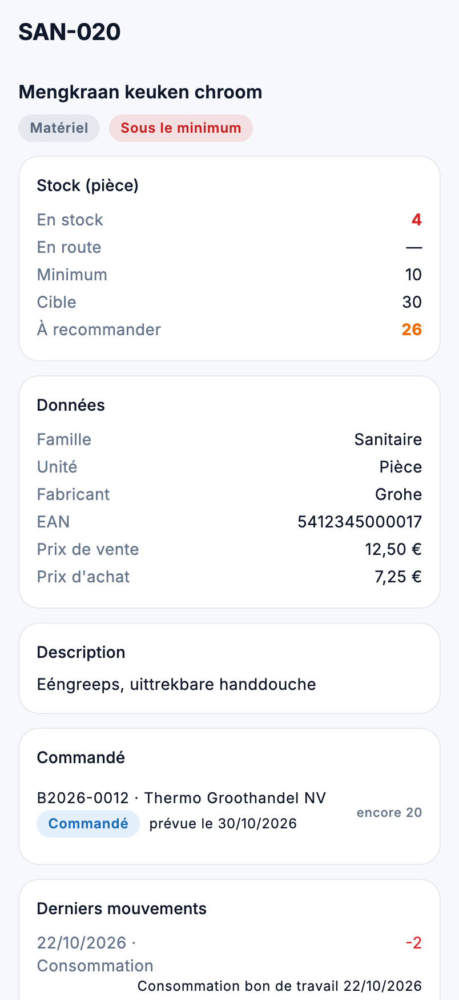

# Stock dans l'app

Combien reste-t-il d'un article, qu'est-ce qui est commandé, et que faut-il recommander ? Sous **Stock** dans le menu se
trouvent les articles et l'état du stock.

{ width="320" }

## Qui voit quoi

| Quoi | Droit |
|---|---|
| **Articles** et **État du stock** | *Voir les articles et le stock* |
| Le prix d'achat d'un article | aussi *Voir les marges et prix de revient* |
| Ce qui est commandé pour un article | aussi *Voir les commandes* |

## Articles

Cherchez par code, nom, EAN, fabricant ou famille, ou touchez l'**icône de scan** dans le champ de recherche et scannez
le code-barres : s'il y a exactement un article avec ce code, la fiche s'ouvre aussitôt. La liste s'ouvre sur **Actifs** ; avec **Tous**, vous voyez aussi
les articles qui ne sont plus actifs. Pour chaque article, vous voyez le nom, le code, la famille, le prix de vente et
la quantité en stock.

Un service ou un article de devis n'a pas de stock : la quantité reste vide, et l'article porte son type.

## La fiche article

- **Stock** : en stock, en route (commandé et pas encore livré), le minimum, le stock cible et ce qu'il faut
  recommander. S'il y a moins que le minimum, **Sous le minimum** s'affiche ; si assez est déjà commandé,
  **déjà commandé**.
- Si l'article n'a pas de minimum, la fiche indique qu'il n'y a pas de signal de commande : l'article n'est pas suivi.
- Les **données** : famille, unité, fabricant, EAN, prix de vente et, avec le droit, le prix d'achat.
- **Commandé** : les commandes en cours avec cet article, et ce qui est encore attendu. Un appui ouvre la commande.
- **Derniers mouvements** : les dix dernières réceptions, consommations et corrections, avec leur origine (par exemple
  *Consommation bon de travail 22/10/2026*).

## État du stock

La même liste que l'[état du stock](../inventory/stock-level.md) du back-office : les articles suivis qui passent sous
leur minimum. Elle s'ouvre sur **À recommander** ; avec **Tous**, vous voyez aussi ce qui est déjà commandé et attend la
livraison. Pour chaque article figurent le stock, le minimum et ce qui est en route, et à droite la quantité à
recommander. Un appui ouvre l'article.

## Erreurs fréquentes

!!! warning "L'état du stock est vide"
    Seuls les articles avec un minimum sont suivis. Définissez un minimum sur la [fiche article](../inventory/articles.md)
    dans le back-office.

!!! warning "Le prix d'achat manque"
    Il ne s'affiche que pour qui a *Voir les marges et prix de revient*, comme dans le back-office.

## Voir aussi

- [Articles](../inventory/articles.md) et [État du stock](../inventory/stock-level.md) dans le back-office
- [Achats](inkoop.md) : les commandes
- [Aperçu et planification](overzicht.md) : la carte Sous le stock minimum
