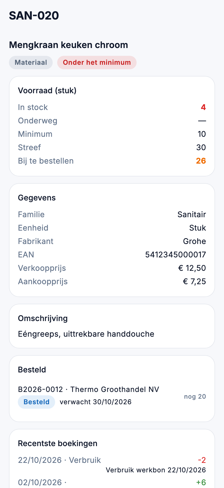

# Voorraad in de app

Hoeveel ligt er nog van een artikel, wat is er besteld, en wat moet er bijbesteld worden? Onder **Voorraad** in het
menu staan de artikelen en de voorraadstand.

{ width="320" }

## Wie ziet wat

| Wat | Recht |
|---|---|
| **Artikelen** en **Voorraadstand** | *Artikelen en voorraad bekijken* |
| De aankoopprijs van een artikel | ook *Marges en kostprijzen bekijken* |
| Wat er van een artikel besteld is | ook *Bestellingen bekijken* |

## Artikelen

Zoek op code, naam, EAN, fabrikant of familie. De lijst opent op **Actief**; met **Alle** ziet u ook de artikelen die
niet meer actief zijn. Per artikel ziet u de naam, de code, de familie, de verkoopprijs en hoeveel er in stock ligt.

Een dienst of een offerteartikel heeft geen voorraad: daar blijft de stand leeg, en het artikel draagt zijn soort.

## De artikelfiche

- **Voorraad**: in stock, onderweg (besteld en nog niet geleverd), het minimum, de streefvoorraad en wat er bij te
  bestellen is. Ligt er minder dan het minimum, dan staat er **Onder het minimum**; is er al genoeg besteld, dan
  **al besteld**.
- Staat er geen minimum op het artikel, dan zegt de fiche dat er geen bestelsignaal is: het artikel wordt niet
  opgevolgd.
- De **gegevens**: familie, eenheid, fabrikant, EAN, verkoopprijs en, met het recht erop, de aankoopprijs.
- **Besteld**: de lopende bestellingen met dit artikel, met wat er nog moet komen. Een tik opent de bestelling.
- **Recentste boekingen**: de laatste tien ontvangsten, verbruiken en correcties, met waar ze vandaan komen
  (bijvoorbeeld *Verbruik werkbon 22/10/2026*).

## Voorraadstand

Dezelfde lijst als de [voorraadstand](../inventory/stock-level.md) in de backoffice: de opgevolgde artikelen die onder
hun minimum zakken. Ze opent op **Bij te bestellen**; met **Alle** ziet u ook wat al besteld is en op levering wacht.
Per artikel staan de stand, het minimum en wat onderweg is, en rechts hoeveel er bijbesteld moet worden. Een tik opent
het artikel.

## Veelgemaakte fouten

!!! warning "De voorraadstand is leeg"
    Enkel artikelen met een minimum worden opgevolgd. Zet een minimum op de [artikelfiche](../inventory/articles.md) in
    de backoffice.

!!! warning "De aankoopprijs ontbreekt"
    Die staat er enkel voor wie *Marges en kostprijzen bekijken* heeft, zoals in de backoffice.

## Zie ook

- [Artikelen](../inventory/articles.md) en [Voorraadstand](../inventory/stock-level.md) in de backoffice
- [Inkoop](inkoop.md): de bestellingen
- [Overzicht en planning](overzicht.md): de kaart Onder minimumvoorraad
