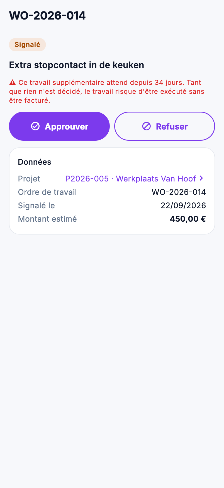

# Travail dans l'app : travaux supplémentaires, points ouverts et chiffres

Les travaux supplémentaires en attente de décision, les points encore ouverts, et la situation financière d'un projet :
vous les suivez dans l'app, sous **Travail** dans le menu et sur la fiche projet.

{ width="320" }

## Qui voit quoi

| Quoi | Droit |
|---|---|
| Consulter les **travaux supplémentaires** | *Voir les ordres et bons de travail* |
| Approuver ou refuser un travail supplémentaire | aussi *Modifier les ordres et bons de travail* |
| Les **points ouverts** et les **chiffres** d'un projet | *Voir les projets* |
| Le **post-calcul** dans ces chiffres | aussi *Voir les marges et prix de revient* |

## Travaux supplémentaires

Chaque travail supplémentaire signalé sur un bon de travail, tous projets confondus. La liste s'ouvre sur **À décider**,
celui qui attend depuis le plus longtemps en haut. Les autres filtres : **Approuvés** (encore à facturer),
**Facturés**, **Refusés** et **Tous**. Cherchez par projet, ordre de travail ou description.

Pour chaque travail, vous voyez le projet et l'ordre de travail, la description, la date, le statut, depuis combien de
jours il attend et le montant estimé. Au-delà de 14 jours, le nombre de jours s'affiche en rouge.

### Décider un travail supplémentaire

1. Ouvrez le travail supplémentaire et appuyez sur **Approuver** ou **Refuser**.
2. Pour approuver, le montant estimé par le chantier est déjà rempli. Adaptez-le si le client a accepté un autre
   montant, ou laissez-le vide : l'estimation reste alors.
3. Sous **Décidé par**, indiquez qui a décidé, par exemple le client. Ce champ peut rester vide.
4. Confirmez avec **Approuver** ou **Refuser**.

La décision figure aussitôt sur le bon de travail, avec la date du jour, comme dans le back-office. C'est possible aussi
sur un bon signé : le suivi du travail supplémentaire ne figure pas sur la feuille signée par le client.

Dans l'app, vous ne décidez qu'un travail qui attend encore une décision. Modifier une décision se fait sur le
[bon de travail](../work/work-sheets.md) dans le back-office. Décider demande une connexion.

## Points ouverts

Ce qui reste à faire sur l'ensemble des projets : les points de la préparation du chantier et de la réception, le plus
proche en premier. Les filtres : **Tous**, **Les miens** (ceux dont vous êtes responsable), **Préparation** et
**Réception**. Un point qui a dépassé sa date s'affiche en rouge. Un appui ouvre le projet ; c'est là que vous cochez le
point.

## Les chiffres d'un projet

Sur la fiche projet, l'icône des **Chiffres** se trouve en haut à droite. Elle ouvre un écran à part ; la fiche projet
elle-même n'affiche aucun montant, car l'équipe la voit aussi.

- **Financier**, TVA comprise : convenu, facturé, reste à facturer et solde ouvert, comme sur la fiche projet du
  back-office.
- **Exécution** : heures prestées, ordres de travail, travaux supplémentaires à décider et approuvés. Un appui sur ces
  travaux ouvre la liste.
- **Post-calcul**, hors TVA : coût salarial, coût matériel, produit, marge brute et marge, et l'estimation du devis
  accepté face au coût réel. La marge prend la couleur des seuils définis par votre entreprise.

S'il manque un prix de revient ou si rien n'est encore facturé, un tiret s'affiche avec la raison, et en bas ce qui
manque. Une marge qui ne mesure rien n'est jamais affichée comme un chiffre.

## Erreurs fréquentes

!!! warning "Approuver et Refuser manquent"
    Vous n'avez pas *Modifier les ordres et bons de travail*, ou la décision est déjà prise. Si l'app indique après un
    appui qu'une décision a déjà été prise, quelqu'un d'autre a décidé juste avant vous.

!!! warning "L'icône Chiffres n'est pas sur la fiche projet"
    Vous n'avez pas *Voir les projets*. Un collaborateur sur le chantier ne la voit jamais.

## Voir aussi

- [Travaux supplémentaires](../work/extra-work.md) et [Points ouverts](../work/open-points.md) dans le back-office
- [Projets](../work/projects.md) : le post-calcul sur la fiche projet
- [Le projet dans l'app](project.md)
