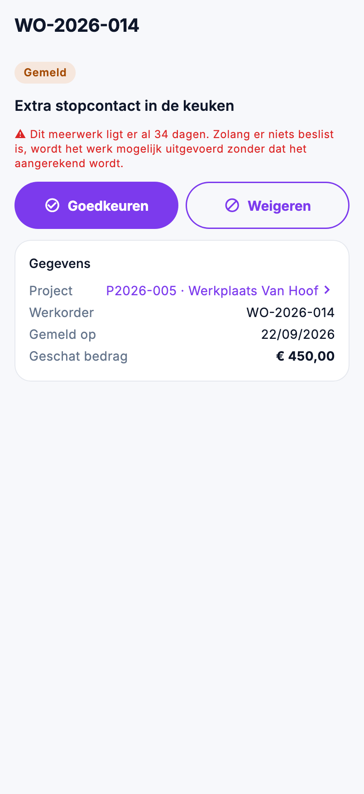

# Werk in de app: meerwerk, open punten en cijfers

Meerwerk dat op een beslissing wacht, punten die nog openstaan, en hoe een project er financieel voorstaat: dat volgt u
in de app op, onder **Werk** in het menu en op de projectfiche.

{ width="320" }

## Wie ziet wat

| Wat | Recht |
|---|---|
| **Meerwerken** bekijken | *Werkorders en werkbonnen bekijken* |
| Een meerwerk goedkeuren of weigeren | ook *Werkorders en werkbonnen bewerken* |
| **Openstaande punten** en de **cijfers** van een project | *Projecten bekijken* |
| De **nacalculatie** in die cijfers | ook *Marges en kostprijzen bekijken* |

## Meerwerken

Elk meerwerk dat op een werkbon gemeld is, over alle projecten heen. De lijst opent op **Te beslissen**, het langst
wachtende bovenaan. De andere filters: **Goedgekeurd** (nog te factureren), **Gefactureerd**, **Geweigerd** en **Alle**.
Zoek op het project, de werkorder of de omschrijving.

Per meerwerk ziet u het project en de werkorder, de omschrijving, de datum, de status, hoeveel dagen het al wacht en het
geschatte bedrag. Wacht het langer dan 14 dagen, dan staat het aantal dagen in het rood.

### Een meerwerk beslissen

1. Open het meerwerk en tik op **Goedkeuren** of **Weigeren**.
2. Bij goedkeuren staat het geschatte bedrag van de werf al ingevuld. Pas het aan als de klant een ander bedrag
   aanvaardde, of laat het leeg: dan blijft de schatting staan.
3. Vul bij **Beslist door** in wie besliste, bijvoorbeeld de klant. Dat mag ook leeg blijven.
4. Bevestig met **Goedkeuren** of **Weigeren**.

De beslissing staat meteen op de werkbon, met de datum van vandaag, net als in de backoffice. Dat kan ook op een
getekende werkbon: de opvolging van het meerwerk staat niet op het blad dat de klant tekende.

In de app beslist u enkel een meerwerk dat nog op een beslissing wacht. Een beslissing wijzigen doet u op de
[werkbon](../work/work-sheets.md) in de backoffice. Beslissen vraagt een verbinding.

## Openstaande punten

Wat er over alle projecten heen nog moet gebeuren: de punten van de werfvoorbereiding en van de oplevering, het vroegste
eerst. De filters: **Alle**, **Van mij** (waarvoor u verantwoordelijk bent), **Voorbereiding** en **Oplevering**. Een
punt over zijn datum staat in het rood. Een tik opent het project; daar vinkt u het punt af.

## De cijfers van een project

Op de projectfiche staat rechtsboven het icoon voor de **Cijfers**. Het opent een eigen scherm; de projectfiche zelf
toont geen bedragen, want de ploeg ziet ze ook.

- **Financieel**, incl. btw: afgesproken, gefactureerd, nog te factureren en openstaand, zoals op de projectfiche in de
  backoffice.
- **Uitvoering**: gewerkte uren, werkorders, meerwerk te beslissen en goedgekeurd meerwerk. Een tik op het meerwerk
  opent de lijst.
- **Nacalculatie**, excl. btw: loonkost, materiaalkost, opbrengst, brutowinst en marge, en de raming uit de aanvaarde
  offerte tegenover de werkelijke kost. De marge krijgt de kleur van de grenzen die uw bedrijf instelde.

Ontbreekt er een kostprijs of is er nog niets gefactureerd, dan staat er een streepje met de reden, en onderaan wat er
ontbreekt. Een marge die niets meet, toont de app nooit als getal.

## Veelgemaakte fouten

!!! warning "Goedkeuren en Weigeren ontbreken"
    U hebt *Werkorders en werkbonnen bewerken* niet, of er is al beslist. Staat er na een tik *intussen al beslist*,
    dan besliste iemand anders net voor u.

!!! warning "Het icoon Cijfers staat niet op de projectfiche"
    U hebt *Projecten bekijken* niet. Een medewerker op de werf ziet het nooit.

## Zie ook

- [Meerwerken](../work/extra-work.md) en [Openstaande punten](../work/open-points.md) in de backoffice
- [Projecten](../work/projects.md): de nacalculatie op de projectfiche
- [Het project in de app](project.md)
