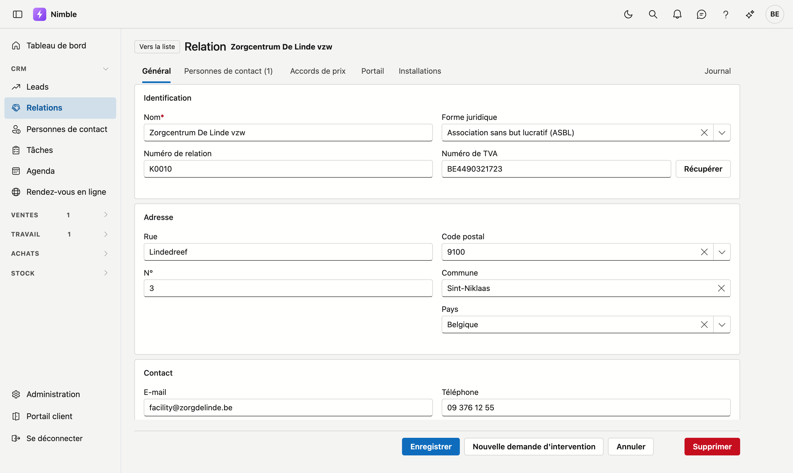
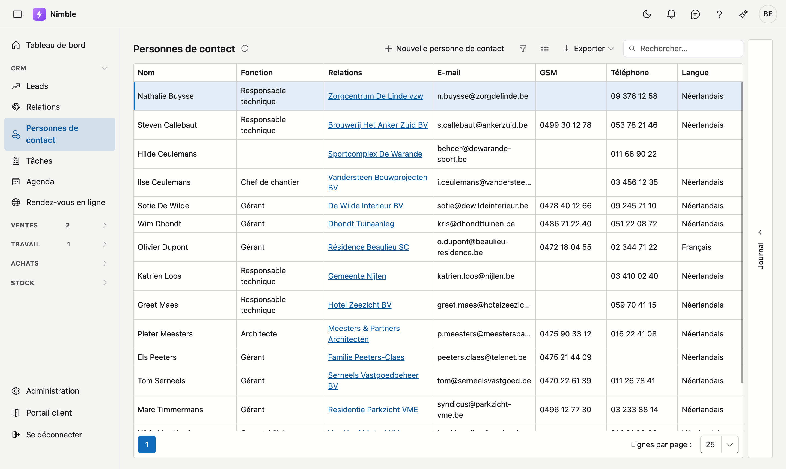
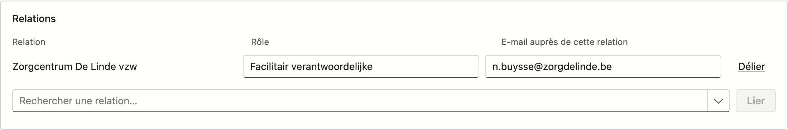

# Personnes de contact

Sur l'écran **Personnes de contact**, vous gérez les personnes derrière vos clients et fournisseurs : qui vous appelez, qui reçoit le devis, qui suit le chantier.

Une même personne peut être liée à **plusieurs relations**, chaque fois avec un rôle propre. Celui qui est gérant chez une relation peut être chef de chantier chez une autre.

## Ouvrir l'écran

Cliquez sur **CRM → Personnes de contact** dans la barre latérale.

!!! tip "Également depuis le client"
    Si vous travaillez à partir d'un client précis, c'est plus rapide via [Relations](../relations.fr.md) : l'onglet **Personnes de contact** sur la fiche, ou l'onglet **Contacts** dans le rail Journal.

## La liste

| Colonne | Signification |
|---|---|
| **Nom** | Prénom et nom de famille |
| **Fonction** | Le titre de fonction, issu de la liste [Fonctions de contact](../administration/contact-functions.fr.md) |
| **Relations** | Toutes les relations auxquelles cette personne est liée |
| **E-mail** | L'adresse personnelle |
| **Téléphone** et **GSM** | Les numéros |
| **Langue** | La langue de cette personne |

La recherche porte sur toutes les colonnes, y compris **Relations** : tapez un nom pour voir qui y travaille. Une personne liée à aucune relation affiche le message *liée à aucune relation* ; vous la retrouvez donc également ici.

- **Nouveau** — cliquez sur **Nouvelle personne de contact**. Ce bouton n'apparaît que si vous pouvez modifier les relations.
- **Modifier** — **double-cliquez** une ligne.
- **Aller au client** — cliquez un nom dans la colonne **Relations** ; la fiche client s'ouvre directement.
- **Exporter** — la liste vers Excel ou CSV.
- **Journal** — cliquez à droite sur le rail **Journal** pour le côté de la personne sélectionnée :
    - **Tâches** — ce qui doit encore être fait pour cette personne.
    - **Notes** — ce que vous notez vous-même sur cette personne. Voir [Notes](../notities.fr.md).
    - **Pièces jointes** — documents et photos liés à cette personne. Voir [Pièces jointes](../bijlagen.fr.md).
    - **Historique** — qui a modifié quel champ de cette personne, et quand. En lecture seule.

## La fiche de contact

À gauche figure l'onglet **Général** avec les blocs ci-dessous. À droite figure le journal de cette
personne : **Tâches**, **Notes**, **Pièces jointes** et **Historique** — voir
[Travailler avec une fiche](../fiches.fr.md).

### Bloc Personne

| Champ | Explication |
|---|---|
| **Formule d'appel** | Liste de choix (monsieur, madame …). Gérée via **Administration → Formules d'appel**. |
| **Prénom** | Optionnel. |
| **Nom de famille** | Obligatoire. |
| **Fonction** | Liste de choix ; recherchez en tapant. Gérée via **Administration → Fonctions de contact**. |
| **Actif** | Décocher est un marqueur de statut, pas une suppression. |

### Bloc Coordonnées

| Champ | Explication |
|---|---|
| **E-mail** | Optionnel, mais s'il est rempli, il doit être valide — le message apparaît pendant la saisie. |
| **Téléphone** et **GSM** | Optionnels, mais s'ils sont remplis, il doit s'agir d'un numéro de téléphone valide. |
| **Langue** | Pour une nouvelle personne, la langue de votre entreprise est déjà proposée. |

### Bloc Adresse privée

Rue, code postal, commune et pays. Dans le champ **Code postal**, vous cherchez par code postal ou par nom de commune ; la commune se remplit toute seule. Pour une adresse hors de Belgique, vous tapez le code postal vous-même. Ce bloc reste généralement vide pour quelqu'un que vous joignez à une adresse professionnelle ; il est surtout utile pour les clients particuliers.

### Bloc Relations

Vous liez ici la personne aux relations chez qui elle travaille.

| Colonne | Explication |
|---|---|
| **Relation** | Le client ou le fournisseur auquel vous liez la personne. |
| **Rôle** | Ce que cette personne fait chez **cette** relation — indépendamment de son titre de fonction ci-dessus. |
| **E-mail auprès de cette relation** | Une adresse différente de l'adresse personnelle. Laissez vide pour utiliser l'adresse personnelle ; elle apparaît en gris dans le champ. |

- **Lier** — choisissez une relation dans la liste de recherche et cliquez sur **Lier**.
- **Délier** — supprime le lien. La personne elle-même subsiste.

!!! note "Tout est enregistré avec Enregistrer"
    Les liens, les rôles et les adresses e-mail ne sont écrits qu'au moment où vous cliquez sur **Enregistrer**. **Annuler** laisse tout en l'état — y compris les liens.

## En bas de la fiche

- **Enregistrer** — conserve ; vous restez sur la fiche. Si le nom de famille manque, ou si une adresse e-mail ou un numéro de téléphone n'est pas valide, un message en haut de la fiche indique ce qu'il faut faire. Si l'adresse non valide est liée à une relation, le message renvoie au bloc **Relations**.
- **Annuler** — revient à la liste sans conserver.
- **Supprimer** — uniquement pour une personne existante, et uniquement si vous pouvez modifier les relations. La fiche est **archivée** dans la **Corbeille** ; les liens avec les relations subsistent, si bien que la restauration ramène la personne avec ses relations.

## Erreurs fréquentes

!!! warning
    - **Confondre fonction et rôle** — la **fonction** est ce que la personne *est* (comptable), le **rôle** est ce qu'elle fait chez une relation précise. Qui porte deux casquettes chez deux clients a une fonction et deux rôles.
    - **Remplir l'e-mail d'une relation avec la même adresse** — laissez vide ; l'adresse personnelle suivra automatiquement, même si elle change plus tard.
    - **Supprimer une personne pour la retirer d'un client** — utilisez **Délier**. Supprimer archive la personne partout.
    - **Décocher Actif pour supprimer quelqu'un** — c'est **Supprimer** qui sert à cela.

## Voir aussi

- [Relations](../relations.fr.md) — les relations auxquelles ces personnes sont liées
- [Fonctions de contact](../administration/contact-functions.fr.md) — la liste des titres de fonction
- [Travailler avec une fiche](../fiches.md) — adresse propre, onglets, enregistrer et archiver
