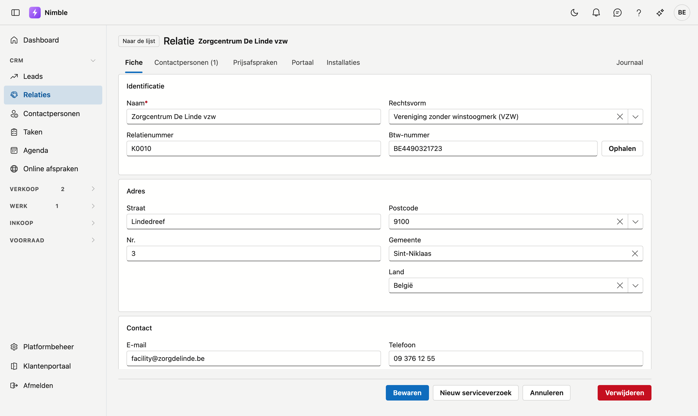
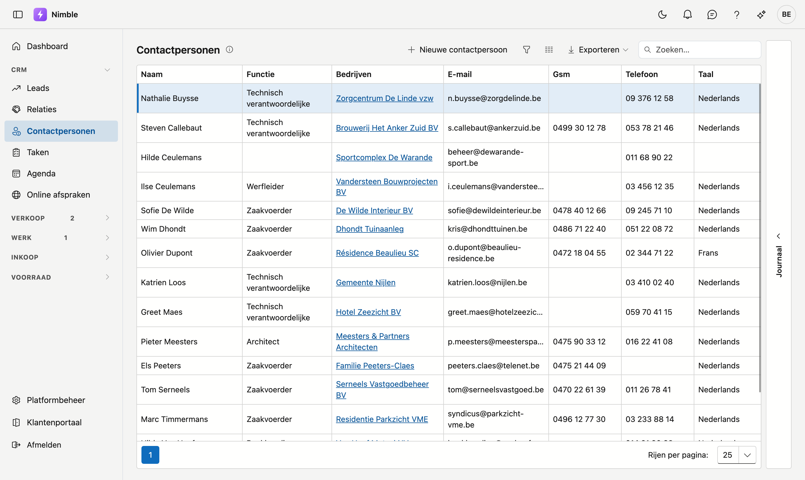
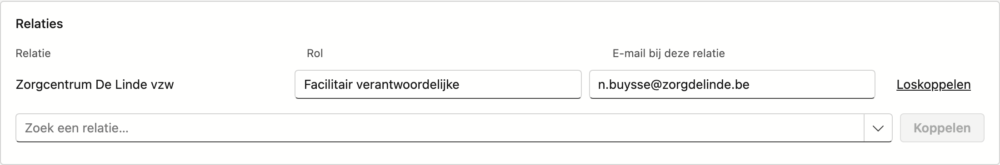

# Contactpersonen

Op het scherm **Contactpersonen** beheert u de mensen achter uw klanten en leveranciers: wie u belt, wie de offerte krijgt, wie de werf opvolgt.

Eén persoon kan aan **meerdere relaties** hangen, telkens met een eigen rol. Wie bij de ene relatie zaakvoerder is, kan bij de andere werfleider zijn.

## Het scherm openen

Klik in de zijbalk op **CRM → Contactpersonen**.

!!! tip "Ook vanuit de klant"
    Werkt u vanuit een bepaalde klant, dan gaat het sneller via [Relaties](../relations.md): het tabblad **Contactpersonen** op de fiche, of het tabblad **Contacten** in de journaal-rail.

## De lijst

| Kolom | Betekenis |
|---|---|
| **Naam** | Voornaam en achternaam |
| **Functie** | De functietitel, uit de lijst [Contactfuncties](../administration/contact-functions.md) |
| **Relaties** | Alle relaties waar deze persoon aan hangt |
| **E-mail** | Het persoonlijke adres |
| **Telefoon** en **Gsm** | De nummers |
| **Taal** | De taal van deze persoon |

De zoekbalk zoekt over alle kolommen, ook over **Relaties**: typ een naam om te zien wie daar werkt. Een persoon die aan geen enkele relatie hangt, toont de melding *aan geen relatie gekoppeld*; ook die vindt u hier terug.

- **Nieuw** — klik op **Nieuwe contactpersoon**. Die knop ziet u enkel als u relaties mag wijzigen.
- **Bewerken** — **dubbelklik** een rij.
- **Naar de klant springen** — klik een naam in de kolom **Relaties** aan; de klantenfiche opent meteen.
- **Exporteren** — de lijst naar Excel of CSV.
- **Journaal** — klik rechts op de rail **Journaal** voor de zijkant van de geselecteerde persoon:
    - **Taken** — wat er voor deze persoon nog moet gebeuren.
    - **Notities** — wat u zelf noteert over deze persoon. Zie [Notities](../notities.md).
    - **Bijlagen** — documenten en foto's bij deze persoon. Zie [Bijlagen](../bijlagen.md).
    - **Logboek** — wie welk veld van deze persoon wijzigde, en wanneer. Alleen om te lezen.

## De contactfiche

Links staat het tabblad **Algemeen** met de blokken hieronder. Rechts staat het journaal van deze persoon:
**Taken**, **Notities**, **Bijlagen** en **Logboek** — zie [Werken met een fiche](../fiches.md).

### Blok Persoon

| Veld | Uitleg |
|---|---|
| **Aanspreking** | Keuzelijst (de heer, mevrouw …). Beheerd via **Platformbeheer → Aansprekingen**. |
| **Voornaam** | Optioneel. |
| **Achternaam** | Verplicht. |
| **Functie** | Keuzelijst; zoek door te typen. Beheerd via **Platformbeheer → Contactfuncties**. |
| **Actief** | Uitvinken is een statusmarkering, geen verwijdering. |

### Blok Bereikbaarheid

| Veld | Uitleg |
|---|---|
| **E-mail** | Optioneel, maar ingevuld moet het geldig zijn — u ziet de melding tijdens het typen. |
| **Telefoon** en **Gsm** | Optioneel, maar ingevuld moet het een geldig telefoonnummer zijn. |
| **Taal** | Bij een nieuwe persoon staat de taal van uw bedrijf al voorgesteld. |

### Blok Privéadres

Straat, postcode, gemeente en land. In het veld **Postcode** zoekt u op postcode of gemeentenaam; de gemeente vult zich vanzelf in. Bij een adres buiten België typt u de postcode zelf. Dit blok blijft meestal leeg voor iemand die u op een bedrijfsadres bereikt; het is vooral nuttig bij particuliere klanten.

### Blok Relaties

Hier koppelt u de persoon aan de relaties waar hij werkt.

| Kolom | Uitleg |
|---|---|
| **Relatie** | De klant of leverancier waaraan u de persoon koppelt. |
| **Rol** | Wat deze persoon bij **deze** relatie doet — los van zijn functietitel hierboven. |
| **E-mail bij deze relatie** | Een adres dat afwijkt van het persoonlijke. Laat het leeg om het persoonlijke adres te gebruiken; dat staat als grijze suggestie in het veld. |

- **Koppelen** — kies een relatie in de zoeklijst en klik op **Koppelen**.
- **Loskoppelen** — haalt de koppeling weg. De persoon zelf blijft bestaan.

!!! note "Alles gaat pas mee bij Bewaren"
    Ook koppelingen, rollen en e-mailadressen worden pas weggeschreven wanneer u op **Bewaren** klikt. **Annuleren** laat alles zoals het was — ook de koppelingen.

## Onderaan de fiche

- **Bewaren** — bewaart; u blijft op de fiche. Ontbreekt de achternaam, of is een e-mailadres of telefoonnummer ongeldig, dan zegt een melding bovenaan de fiche wat er moet gebeuren. Staat het ongeldige adres bij een relatie, dan verwijst de melding naar het blok **Relaties**.
- **Annuleren** — gaat terug naar de lijst zonder te bewaren.
- **Verwijderen** — alleen bij een bestaande persoon, en alleen als u relaties mag wijzigen. De fiche wordt **gearchiveerd** naar de **Prullenbak**; de koppelingen met relaties blijven bestaan, zodat herstellen de persoon mét zijn relaties terugbrengt.

## Veelgemaakte fouten

!!! warning
    - **Functie en rol verwarren** — de **functie** is wat de persoon ís (boekhouder), de **rol** is wat hij bij één bepaalde relatie doet. Wie bij twee klanten een andere pet draagt, heeft één functie en twee rollen.
    - **Het e-mailadres bij een relatie invullen met hetzelfde adres** — laat het leeg; dan volgt het automatisch het persoonlijke adres, ook als dat later wijzigt.
    - **Een persoon verwijderen om hem van een klant te halen** — gebruik **Loskoppelen**. Verwijderen archiveert de persoon overal.
    - **Actief uitvinken om iemand te verwijderen** — daarvoor dient **Verwijderen**.

## Zie ook

- [Relaties](../relations.md) — de relaties waar deze personen aan hangen
- [Contactfuncties](../administration/contact-functions.md) — de lijst met functietitels
- [Werken met een fiche](../fiches.md) — eigen adres, tabbladen, bewaren en archiveren
