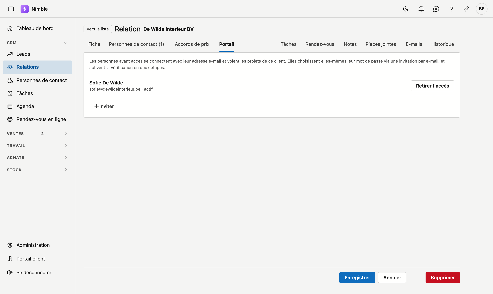
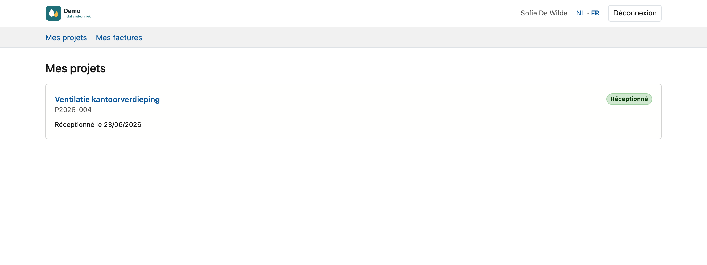
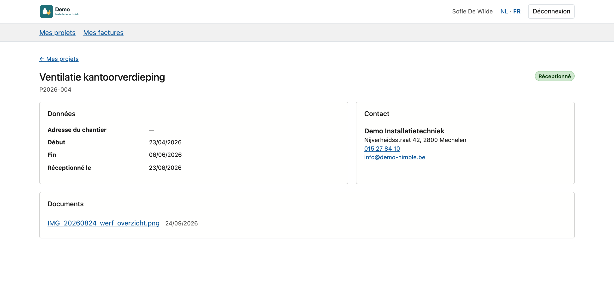
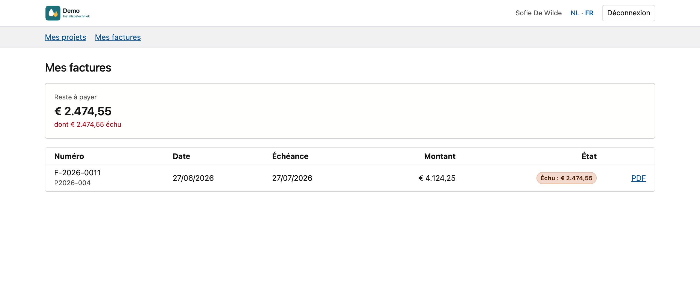

# Portail pour vos clients

Dans le **portail pour vos clients**, un client suit ses propres projets : leur avancement, sa personne de contact, les
documents que vous partagez avec lui, et ses factures avec ce qu'il reste à payer. Vous donnez l'accès par client, sur la
fiche relation. Votre client se connecte avec sa propre adresse e-mail et son mot de passe, et ne voit jamais rien du reste
de Nimble.

!!! info "À ne pas confondre avec le Portail client de la barre latérale"
    Le [Portail client](../getting-started/customer-portal.md) en bas de la barre latérale est votre propre espace chez
    ADM-Concept. Cette page concerne le portail que vous donnez à vos clients.

## Donner l'accès

1. Ouvrez la [fiche relation](../relations.md) du client.
2. Cliquez sur l'onglet **Portail**. Il ne figure que sur la fiche d'un client.
3. Cliquez sur **Inviter**.
4. Sous **Qui**, choisissez le client lui-même ou l'une de ses personnes de contact.
5. Cliquez sur **Envoyer l'invitation**.

La personne reçoit un e-mail avec un lien. Ce lien est valable **7 jours**.

La liste **Qui** ne contient que le client et ses personnes de contact qui ont une adresse e-mail et pas encore d'accès. La
personne n'y figure pas ? Ajoutez-la d'abord dans l'onglet **Personnes de contact**, avec son adresse e-mail.

Peut inviter toute personne autorisée à modifier les relations.

### Qui a accès

Sous l'explication figure chaque personne ayant accès, avec son adresse e-mail et son état :

| État | Signification |
|---|---|
| **invité, pas encore de mot de passe** | L'invitation est partie, mais la personne n'a pas encore utilisé le lien |
| **mot de passe choisi, vérification en deux étapes pas encore activée** | La personne a un mot de passe, mais ne peut pas encore entrer dans le portail |
| **actif** | La personne peut utiliser le portail |
| **compte désactivé** | Le compte de la personne est désactivé |

- **Inviter à nouveau** envoie un nouveau lien. Le bouton reste visible tant que la personne n'a pas choisi de mot de passe,
  par exemple si le premier lien a expiré.
- **Retirer l'accès** supprime l'accès à ce client, après confirmation. Si la personne est connectée à ce moment, sa session
  s'arrête dans quelques minutes.

Si une personne a déjà accès pour un autre client, elle ne reçoit pas de nouveau compte : elle voit simplement aussi les
projets de ce client.

## Ce que fait votre client

1. Il clique sur le lien de l'invitation et choisit un **mot de passe** : au moins 8 caractères, avec un chiffre, une
   majuscule et une minuscule.
2. Il se connecte avec son adresse e-mail et ce mot de passe.
3. Il active la [vérification en deux étapes](../getting-started/tweestapsverificatie.md) avec une application
   d'authentification sur son téléphone (Google Authenticator, Microsoft Authenticator, Authy). C'est obligatoire : sans
   elle, il ne peut pas entrer dans le portail.

Ensuite, le portail demande le code de cette application à chaque connexion. En haut, il choisit **NL** ou **FR**.

## Ce que voit votre client

En haut du portail figurent le logo et le nom de votre entreprise, tels qu'ils sont sur la
[fiche entreprise](../settings/company-profile.md). En dessous, le menu avec **Mes projets** et **Mes factures**.

### Mes projets

Chaque projet du client, le plus récent en premier, avec son numéro, son nom et l'un de trois états :

- **En préparation** : la date de début n'est pas encore atteinte.
- **En cours** : la date de début est passée.
- **Réceptionné** : le projet a une date de réception ou est terminé.

En dessous, la période, par exemple *Du 25/08/2026 au 18/09/2026*. Un projet archivé n'y figure pas.

### Un projet

Un clic sur un projet affiche trois blocs :

- **Données** : l'adresse du chantier, le début, la fin et la date de réception.
- **Contact** : le responsable du projet comme **Votre personne de contact**, et le nom, l'adresse, le numéro de téléphone et
  l'adresse e-mail de votre entreprise.
- **Documents** : les documents que vous partagez avec lui, avec la date. Un clic ouvre une photo ou un PDF dans le
  navigateur ; un autre fichier est téléchargé.

### Mes factures

En haut figure **Reste à payer** : le total des factures ouvertes et échues, avec la part échue. En dessous, chaque facture
avec son numéro, le projet, la date, l'échéance, le montant et l'état :

- **Ouvert** ou **Échu**, avec ce qu'il reste à payer ;
- **Payée** ;
- **Note de crédit** : elle figure dans la liste, mais ne compte pas dans ce qu'il doit encore payer ;
- **Montant inconnu** : la facture ne porte pas de montant.

Avec **PDF**, il ouvre la facture telle que vous l'envoyez. S'il reste un montant ouvert, le QR de paiement sur le PDF demande
exactement ce montant. Seules les factures émises y figurent : pas de brouillon ni de facture annulée.

## Partager des documents

Votre client ne voit que les documents que vous partagez avec lui. Jamais tout par défaut : les notes internes, les factures
d'achat et les prix des fournisseurs n'y ont pas leur place.

- **Par document** : dans l'onglet [Documents](../work/projects.md#onglet-documents) du projet, cochez dans la colonne
  **Portail** ce que le client peut voir. Décocher retire aussitôt le document de son portail.
- **Par dossier** : dans [Dossiers standard](../administration/default-folders.md), cochez pour un dossier **Nouveaux
  documents visibles par défaut dans le portail**. Un document qui arrive ensuite dans ce dossier d'un projet est aussitôt
  coché. Cela vaut aussi pour une photo de chantier qu'un monteur place dans ce dossier avec
  l'[application mobile](../app/project.md). Vous pouvez encore le modifier par document.

Le [journal des actions](../administration/audit-log.md) garde une trace de qui a rendu un document visible ou l'a masqué.

## Ce que votre client ne voit jamais

Les notes et tâches internes, l'historique, les factures d'achat et les fournisseurs, les marges, le post-calcul et le
budget, les bons de travail, les heures par monteur et les noms des monteurs, les remises et les accords de prix. Il ne voit
pas non plus les projets d'un autre client, même s'il connaissait l'adresse d'une telle page.

## Erreurs fréquentes

!!! warning
    - **La personne ne figure pas dans la liste Qui.** Elle n'a pas d'adresse e-mail, ou elle a déjà accès. Complétez
      l'adresse e-mail dans l'onglet **Personnes de contact**.
    - **L'invitation a expiré.** Cliquez sur **Inviter à nouveau** : le client reçoit un nouveau lien, de nouveau valable
      7 jours.
    - **Le client n'entre pas après avoir choisi son mot de passe.** Il doit d'abord activer la vérification en deux étapes.
      Tant que ce n'est pas fait, son état est *mot de passe choisi, vérification en deux étapes pas encore activée*.
    - **Un document n'apparaît pas dans son portail.** La case de la colonne **Portail** n'est pas cochée. La case dans
      Dossiers standard ne vaut que pour les dossiers qu'un projet reçoit ensuite, et pour les documents qui arrivent
      ensuite dans un tel dossier.
    - **Utiliser l'adresse e-mail d'un collègue.** Sur une adresse qui appartient déjà à un utilisateur de Nimble, vous ne
      pouvez pas donner accès au portail. Choisissez une autre adresse.

## Voir aussi

- [Relations](../relations.md) : la fiche relation et l'onglet Personnes de contact
- [Projets](../work/projects.md#onglet-documents) : l'onglet Documents
- [Dossiers standard](../administration/default-folders.md)
- [Factures](../sales/invoices.md#le-qr-de-paiement) : le QR de paiement
