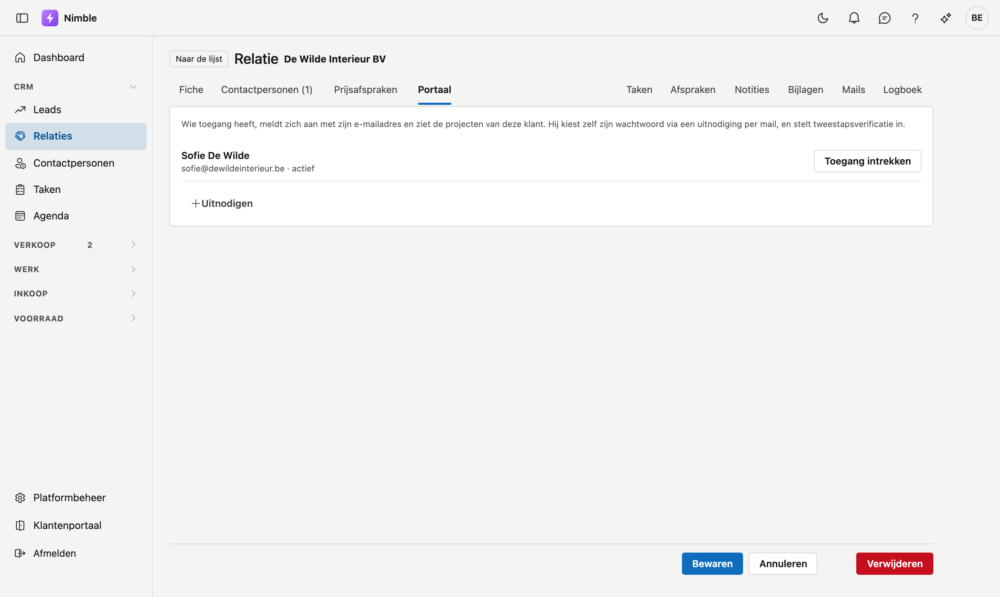
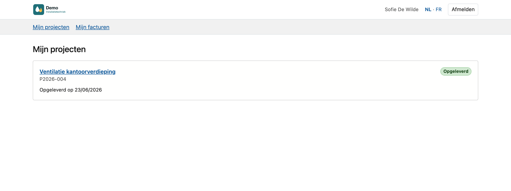
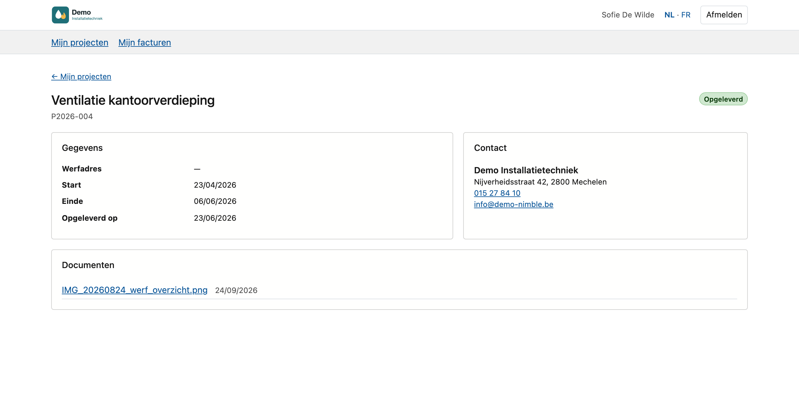
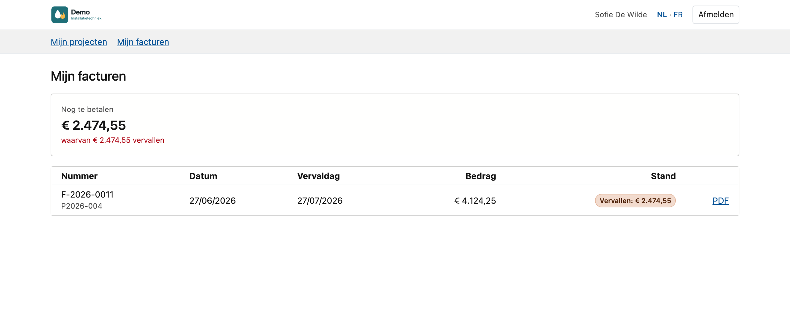

# Portaal voor uw klanten

In het **portaal voor uw klanten** volgt een klant zijn eigen projecten op: hoe ver ze staan, wie zijn contactpersoon is,
de documenten die u met hem deelt, en zijn facturen met wat er nog te betalen is. U geeft toegang per klant, op de
relatiefiche. Uw klant meldt zich aan met zijn eigen e-mailadres en wachtwoord en ziet nooit iets van de rest van Nimble.

!!! info "Niet te verwarren met het Klantenportaal in de zijbalk"
    Het [Klantenportaal](../getting-started/customer-portal.md) onderaan de zijbalk is uw eigen omgeving bij ADM-Concept.
    Deze pagina gaat over het portaal dat u aan uw klanten geeft.

## Toegang geven

1. Open de [relatiefiche](../relations.md) van de klant.
2. Klik op het tabblad **Portaal**. Het staat enkel op de fiche van een klant.
3. Klik op **Uitnodigen**.
4. Kies bij **Wie** de klant zelf of een van zijn contactpersonen.
5. Klik op **Uitnodiging versturen**.

De persoon krijgt een mail met een link. Die link is **7 dagen** geldig.

In de lijst **Wie** staan enkel de klant en zijn contactpersonen met een e-mailadres die nog geen toegang hebben. Staat de
persoon er niet bij, voeg hem dan eerst toe op het tabblad **Contactpersonen**, met zijn e-mailadres.

Uitnodigen kan wie relaties mag bewerken.

### Wie toegang heeft

Onder de uitleg staat elke persoon met toegang, met zijn e-mailadres en zijn stand:

| Stand | Wat het betekent |
|---|---|
| **uitgenodigd, nog geen wachtwoord gekozen** | De uitnodiging is vertrokken, maar de persoon heeft de link nog niet gebruikt |
| **wachtwoord gekozen, tweestapsverificatie nog niet ingesteld** | De persoon heeft een wachtwoord, maar kan het portaal nog niet in |
| **actief** | De persoon kan het portaal gebruiken |
| **account uitgeschakeld** | Het account van de persoon staat uit |

- **Opnieuw uitnodigen** stuurt een nieuwe link. De knop staat er zolang de persoon nog geen wachtwoord koos, bijvoorbeeld
  als de eerste link verlopen is.
- **Toegang intrekken** neemt de toegang tot deze klant weg, na een bevestiging. Is de persoon op dat moment aangemeld,
  dan stopt zijn sessie binnen enkele minuten.

Heeft een persoon al toegang voor een andere klant, dan krijgt hij geen nieuw account: hij ziet de projecten van deze klant
er gewoon bij.

## Wat uw klant doet

1. Hij klikt op de link in de uitnodiging en kiest een **wachtwoord**: minstens 8 tekens, met een cijfer, een hoofdletter en
   een kleine letter.
2. Hij meldt zich aan met zijn e-mailadres en dat wachtwoord.
3. Hij stelt [tweestapsverificatie](../getting-started/tweestapsverificatie.md) in met een authenticator-app op zijn telefoon (Google Authenticator, Microsoft
   Authenticator, Authy). Dat is verplicht: zonder kan hij het portaal niet in.

Daarna vraagt het portaal bij elke aanmelding de code uit die app. Bovenaan kiest hij **NL** of **FR**.

## Wat uw klant ziet

Bovenaan het portaal staan het logo en de naam van uw bedrijf, zoals op de [bedrijfsfiche](../settings/company-profile.md).
Eronder het menu met **Mijn projecten** en **Mijn facturen**.

### Mijn projecten

Elk project van de klant, het nieuwste eerst, met zijn nummer, zijn naam en een van drie standen:

- **In voorbereiding**: de startdatum is nog niet bereikt.
- **In uitvoering**: de startdatum is voorbij.
- **Opgeleverd**: het project heeft een opleverdatum of is afgerond.

Daaronder de periode, bijvoorbeeld *Van 25/08/2026 tot 18/09/2026*. Een gearchiveerd project staat er niet bij.

### Een project

Een klik op een project toont drie blokken:

- **Gegevens**: het werfadres, de start, het einde en de datum van oplevering.
- **Contact**: de verantwoordelijke van het project als **Uw contactpersoon**, en de naam, het adres, het telefoonnummer en
  het e-mailadres van uw bedrijf.
- **Documenten**: de documenten die u met hem deelt, met de datum. Een klik opent een foto of pdf in de browser; een ander
  bestand wordt gedownload.

### Mijn facturen

Bovenaan staat **Nog te betalen**: het totaal van de open en vervallen facturen, met wat daarvan vervallen is. Daaronder
elke factuur met haar nummer, het project, de datum, de vervaldag, het bedrag en de stand:

- **Open** of **Vervallen**, met wat er nog te betalen is;
- **Betaald**;
- **Creditnota**: ze staat erbij, maar telt niet mee in wat hij nog moet betalen;
- **Bedrag niet gekend**: er staat geen bedrag op de factuur.

Met **PDF** opent hij de factuur zoals u ze verstuurt. Staat er nog iets open, dan vraagt de betaal-QR op de pdf precies dat
bedrag. Enkel uitgereikte facturen staan erbij: geen klad en geen geannuleerde factuur.

## Documenten delen

Uw klant ziet enkel de documenten die u met hem deelt. Nooit standaard alles: interne nota's, aankoopfacturen en prijzen van
leveranciers horen er niet bij.

- **Per document**: op het tabblad [Documenten](../work/projects.md#tabblad-documenten) van het project vinkt u in de kolom
  **Portaal** aan wat de klant mag zien. Afvinken haalt het document meteen weer uit zijn portaal.
- **Per map**: op [Standaardmappen](../administration/default-folders.md) zet u bij een map het vinkje **Nieuwe documenten
  standaard zichtbaar in het portaal**. Een document dat daarna in die map van een project komt, staat meteen aangevinkt.
  Dat geldt ook voor een werffoto die een monteur met de [mobiele app](../app/project.md) in die map zet. Per document kunt u
  het nog omzetten.

Het [actielogboek](../administration/audit-log.md) houdt bij wie een document zichtbaar maakte of weer verborg.

## Wat uw klant nooit ziet

Interne notities en taken, het logboek, aankoopfacturen en leveranciers, marges, nacalculatie en budget, werkbonnen, uren
per monteur en de namen van monteurs, kortingen en prijsafspraken. Ook de projecten van een andere klant ziet hij niet,
ook niet als hij het adres van zo'n pagina zou kennen.

## Veelgemaakte fouten

!!! warning
    - **De persoon staat niet in de lijst Wie.** Hij heeft geen e-mailadres, of hij heeft al toegang. Vul het e-mailadres in
      op het tabblad **Contactpersonen**.
    - **De uitnodiging is verlopen.** Klik op **Opnieuw uitnodigen**: de klant krijgt een nieuwe link, weer 7 dagen geldig.
    - **De klant geraakt niet binnen na zijn wachtwoord.** Hij moet eerst tweestapsverificatie instellen. Zolang dat niet
      gebeurd is, staat bij hem *wachtwoord gekozen, tweestapsverificatie nog niet ingesteld*.
    - **Een document staat niet in zijn portaal.** Het vinkje in de kolom **Portaal** staat niet aan. Het vinkje op
      Standaardmappen geldt enkel voor mappen die een project daarna krijgt, en voor documenten die daarna in zo'n map
      komen.
    - **Een e-mailadres van een collega gebruiken.** Op een adres waarop al een gebruiker van Nimble staat, kunt u geen
      toegang tot het portaal geven. Kies een ander adres.

## Zie ook

- [Relaties](../relations.md): de relatiefiche en het tabblad Contactpersonen
- [Projecten](../work/projects.md#tabblad-documenten): het tabblad Documenten
- [Standaardmappen](../administration/default-folders.md)
- [Facturen](../sales/invoices.md#de-betaal-qr): de betaal-QR
