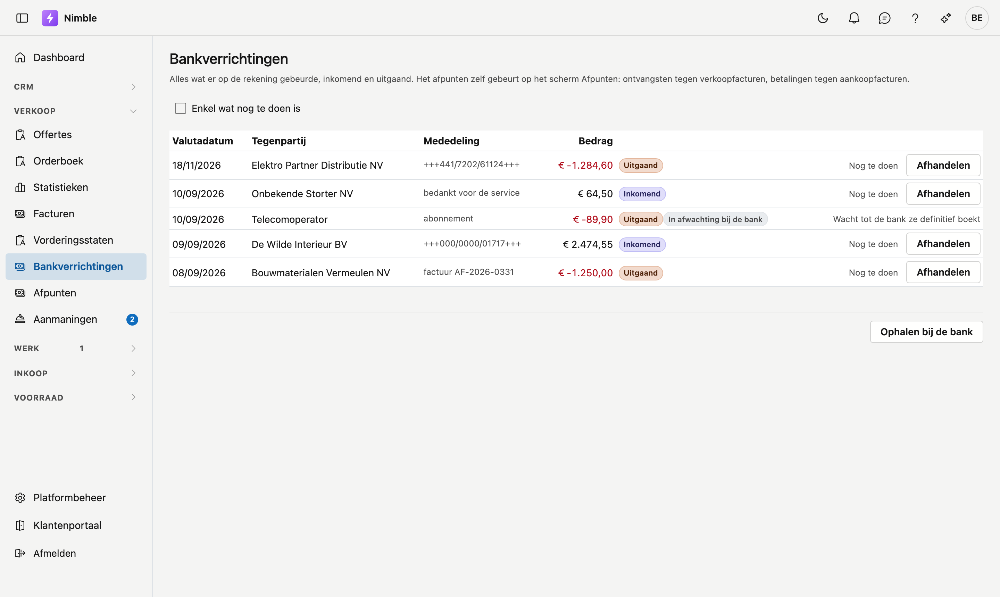

# Bankverrichtingen

Alles wat er op uw rekening gebeurde, inkomend en uitgaand. Nimble haalt het op bij ADM One; uw bank
koppelt u één keer in het klantenportaal.

## Het scherm openen

Klik in de zijbalk op **Verkoop → Bankverrichtingen**. Het scherm vraagt het recht om facturen te bewerken.

## Ophalen bij de bank

**Ophalen bij de bank** (onderaan het scherm) vraagt op wat er sinds de vorige keer bij kwam. Nimble onthoudt waar ze gebleven
was, dus u haalt nooit twee keer hetzelfde binnen.

Komt er niets, dan staat er *"Er kwam niets nieuws binnen."* Dat betekent dat de bank niets nieuws had —
niet dat er iets misging.

!!! warning "Uw bank moet eerst gekoppeld zijn"
    De koppeling gebeurt in het klantenportaal van ADM One, niet in Nimble. Zolang er geen rekening
    gekoppeld is, levert deze knop niets op.

## Wat u in de lijst ziet

| Kolom | Wat het betekent |
|---|---|
| **Valutadatum** | De dag die de bank aan de verrichting geeft. Daarop wordt een betaling geboekt |
| **Tegenpartij** | De naam zoals de bank ze aanlevert — bij een inkomende betaling dus uw klant |
| **Mededeling** | Staat er een gestructureerde mededeling, dan staat ze in de vorm +++000/0000/01717+++. Dat is de sleutel waarmee het afpunten werkt |
| **Bedrag** | Negatief en in het rood = geld dat wegging |

Naast het bedrag staat **Inkomend** of **Uitgaand**. Dat woord staat er met opzet bij: een rij die enkel
`-89,90` toont, leest bij vluchtig kijken als 89,90. Heeft de bank de verrichting nog niet definitief
geboekt, dan staat er ook **In afwachting bij de bank**.

Helemaal rechts ziet u of de rij nog iets van u vraagt:

- **Nog te doen**: er is nog niets mee gebeurd.
- **Afgepunt op** gevolgd door het factuurnummer en het bedrag: de betaling staat op die factuur. Klik op het nummer om de factuur te openen. Bij een uitgaande betaling is dat het nummer van de aankoopfactuur, zoals de leverancier het schreef.
- **Afgehandeld zonder factuur**: u zette ze op afgehandeld zonder iets te boeken.

Staat maar een deel van een verrichting op facturen, dan staat daaronder **nog toe te wijzen** met het bedrag, en een knop
**Rest afsluiten**. Een afgesloten rest toont **rest … afgesloten zonder factuur**, met **Terug openzetten**. Zie
[Meer betaald dan gevraagd](reconciliation.md#meer-betaald-dan-gevraagd).

Een uitgaande verrichting, of een betaling op een aankoopfactuur, handelt u enkel af of maakt u enkel ongedaan als u ook
aankoopfacturen mag bewerken. Zonder dat recht ziet u de stand, maar geen knoppen.

Vink **Enkel wat nog te doen is** aan om de afgehandelde verrichtingen te verbergen.

## Een verrichting afhandelen

Niet elke verrichting hoort bij een factuur. Loon, huur, een bankkost: die zet u met **Afhandelen** op
**Afgehandeld**, zonder dat er iets geboekt wordt. De rij verdwijnt dan ook van het scherm Afpunten. Hier
blijft ze staan, tenzij **Enkel wat nog te doen is** aangevinkt is. Vergist u zich, dan zet **Terug
openzetten** de rij weer op Nog te doen.

## Een afpunting ongedaan maken

Staat een betaling op de verkeerde factuur, klik dan op **Afpunting ongedaan maken** in die rij. Nimble vraagt
eerst of u zeker bent, met het bedrag en de factuur erbij. Daarna is de betaling van de factuur verdwenen en
staat de verrichting weer op het scherm Afpunten, waar u ze opnieuw kunt boeken.

Een afgepunte verrichting kunt u niet met **Terug openzetten** heropenen. Dan zou de betaling op de factuur
blijven staan, en kon hetzelfde geld een tweede keer geboekt worden. Nimble boekt ook nooit meer op een verrichting dan
er binnenkwam of vertrok: staat ze volledig op facturen, dan boekt het er niets meer op.

!!! warning "Een verrichting in afwachting kunt u niet afhandelen"
    Zolang de bank ze niet definitief geboekt heeft, kan ze nog wijzigen of verdwijnen. Ze afhandelen zou
    haar verbergen op het moment dat ze wél vastligt. U ziet daarom geen knop maar de reden: *Wacht tot de
    bank ze definitief boekt*.

## Het verschil met Afpunten

Deze lijst toont **alles**. Het scherm **Afpunten** toont enkel wat er binnenkwam, want alleen een
ontvangst kan een verkoopfactuur afpunten. Een betaling die u zelf deed, handelt u hier af.
