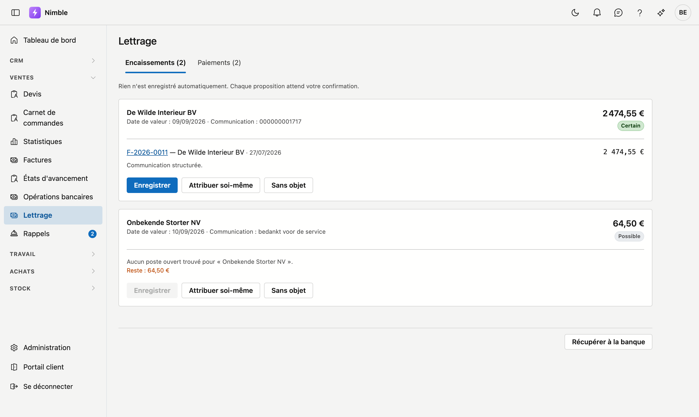

# Lettrage

Quel paiement correspond à quelle facture ouverte. Nimble propose ; **vous** confirmez.

## Ouvrir l'écran

Cliquez dans la barre latérale sur **Ventes → Lettrage**. L'écran demande le droit de modifier les factures.

L'écran compte deux onglets : **Encaissements**, l'argent reçu, face à vos factures de vente, et **Paiements**, l'argent
parti, face à vos factures d'achat. Vous voyez l'onglet Paiements si vous pouvez aussi modifier les factures d'achat. Le
nombre après un onglet indique combien d'opérations attendent. Voir [Paiements aux fournisseurs](#paiements-aux-fournisseurs).

En bas figure **Récupérer à la banque**, comme sur [Opérations bancaires](bank.md) : vous récupérez ainsi
les nouvelles opérations sans changer d'écran.

!!! warning "Rien n'est enregistré automatiquement"
    Même une proposition **Certain** attend votre clic. Un lettrage automatique erroné coûte plus cher qu'un
    poste ouvert qui subsiste : ce poste reste visible, un paiement erroné se perd dans les chiffres.

## Les trois niveaux de certitude

| | Sur quoi cela repose |
|---|---|
| **Certain** | La communication structurée désigne une seule facture. Ce numéro figure sur votre facture et le client l'a repris |
| **Probable** | Le montant correspond exactement à une seule facture ouverte de ce client |
| **Possible** | Le montant est la somme de plusieurs factures, ou un paiement partiel — ou Nimble n'a trouvé aucun poste ouvert |

!!! tip "Nimble reconnaît un client à son numéro de compte"
    Lorsque vous enregistrez un paiement sur des factures d'un seul client, Nimble retient le numéro de compte d'où il
    provient. Si de l'argent arrive plus tard de ce compte, Nimble cherche chez ce client, même si la banque écrit son nom
    autrement que dans Nimble. La proposition indique alors **Client reconnu grâce au numéro de compte du payeur.** Les
    numéros appris figurent sur la [fiche du client](../relations.md#bloc-numeros-de-compte-de-ce-client), où vous pouvez
    en supprimer un.

Chaque proposition affiche la contrepartie, la date de valeur, la communication et le montant. En dessous
figurent les factures sur lesquelles Nimble veut enregistrer ; cliquez un numéro de facture pour l'ouvrir.
Sous chaque proposition figure **pourquoi** Nimble la propose. Lisez cette phrase pour *Probable* et
*Possible* — elle dit précisément ce qui n'est pas établi.

!!! warning "Un abonnement produit des montants identiques"
    Si un client paie chaque mois le même montant, plusieurs factures ouvertes portent exactement ce
    montant. Le montant seul ne permet alors **pas** de déterminer laquelle est visée. L'explication indique
    combien il y en a : deux, c'est une vérification ; douze signifie qu'il vous faut la communication.

## Enregistrer

**Enregistrer** comptabilise un paiement sur la facture, à la **date de valeur de la banque** — pas au jour
où vous cliquez. Si le client solde ainsi la facture, celle-ci passe d'elle-même à *Payée*.

En cas de paiement partiel, le solde reste ouvert, et le paiement suivant de ce client réapparaîtra
simplement dans cette liste.

Si le montant ne se répartit pas entièrement sur les factures proposées, **Reste :** indique le montant
restant. Si Nimble n'a trouvé aucune facture, **Enregistrer** est grisé : il n'y a rien sur quoi enregistrer.
Utilisez alors **Attribuer soi-même**.

### La différence : escompte ou garantie

Si le client paie un peu moins que ce qui reste ouvert sur **une seule** facture, la proposition demande ce qu'il faut
faire de **La différence de** ce montant. Ce sont les mêmes choix que pour un paiement sur la facture elle-même :

| Choix | Ce qui se passe |
|---|---|
| **Reste ouverte** | La différence reste sur la facture. C'est le choix par défaut. |
| **Comptabiliser comme escompte pour paiement comptant** | La différence est comptabilisée comme escompte et la facture est entièrement payée. Seulement si la différence ne dépasse pas 5 % du total de la facture. |
| **Garantie retenue** | La différence reste ouverte comme garantie : ni en retard, ni dans les rappels. Seulement s'il n'y a pas encore de garantie sur la facture. Si le projet de la facture est réceptionné, la garantie reçoit comme date de libération la réception plus un an. |

Si le paiement porte sur plus d'une facture, il n'y a pas de choix : personne ne sait alors à quelle facture la
différence appartient.

## Attribuer soi-même

Si Nimble ne trouve pas la bonne facture, par exemple parce que le client a payé sans communication structurée,
cliquez sur **Attribuer soi-même**. Une fenêtre s'ouvre avec toutes les factures de vente ouvertes.

1. Recherchez par numéro de facture ou client.
2. Cochez les factures auxquelles le montant se rapporte. Nimble propose pour chaque facture ce qui reste ouvert,
   jusqu'à épuisement du montant. Vous pouvez modifier chaque montant.
3. En bas, vous voyez combien a été attribué et combien il reste.
4. Cliquez sur **Enregistrer**.

Sur une facture, cela ne peut pas dépasser ce qui reste ouvert, et au total pas plus que le montant reçu. Si vous ne
choisissez qu'une facture et qu'il reste un solde, vous pouvez ici aussi enregistrer la différence comme escompte ou
garantie.

## Paiements aux fournisseurs

Dans l'onglet **Paiements**, Nimble propose la facture d'achat à laquelle correspond un paiement sortant. Cela fonctionne
comme pour les encaissements, avec trois différences.

- **Seules les factures d'achat approuvées.** Une facture qui attend encore son approbation ne peut pas être lettrée. Sous la
  liste figure le nombre de ces factures ouvertes, avec un lien vers [Factures d'achat](../purchasing/purchase-invoices.md).
- **Certain** signifie ici : la communication de votre paiement est la **référence de paiement** de la facture d'achat. Elle
  figure sur la fiche de la facture ; pour une facture venue de Peppol, Nimble la remplit d'office.
- **Pour la différence, seulement un escompte.** Si vous avez payé moins que le solde ouvert, le reste demeure par défaut sur
  la facture. Si le paiement porte sur une seule facture et que la différence ne dépasse pas 5 % du total de la facture, vous
  pouvez la comptabiliser comme **escompte pour paiement comptant** : la facture est alors entièrement payée, avec l'escompte
  sur une ligne à part sur la fiche. Une garantie retenue n'existe pas ici.

**Enregistrer** comptabilise le paiement sur la facture d'achat, à la date de valeur de la banque. Si tout est ainsi payé, la
facture passe à *Payée*. **Attribuer soi-même** et **Sans objet** fonctionnent comme ci-dessus ; un salaire, un loyer ou des
frais bancaires se traitent avec **Sans objet**.

Lorsque vous enregistrez un paiement sur des factures d'un seul fournisseur, Nimble retient le numéro de compte vers lequel
l'argent est parti. Un paiement suivant vers ce compte est reconnu comme destiné à ce fournisseur : la proposition indique
alors **Fournisseur reconnu grâce au numéro de compte du bénéficiaire.**

## Sans objet

Si une recette ne correspond à aucune facture — un remboursement, un versement d'un tiers — **Sans objet**
la retire de la liste sans rien comptabiliser. Elle reste visible dans **Opérations bancaires**, où vous
pouvez au besoin la rouvrir.

!!! note "Corriger un lettrage"
    Si un paiement a été enregistré sur la mauvaise facture, annulez le lettrage dans
    [Opérations bancaires](bank.md). L'opération revient alors dans cette liste. Nimble n'enregistre jamais deux
    fois la même opération bancaire. Un escompte pour paiement comptant disparaît avec le paiement ; une garantie
    retenue reste sur la facture. Modifiez-la au besoin avec **Garantie retenue…** sur la facture. Un paiement d'une
    facture d'achat s'annule au même endroit.

## Ce que vous ne trouverez pas ici

L'imputation des notes de crédit. Une note de crédit d'un client ou d'un fournisseur ne se lettre pas ici face à une facture.

Seule une recette peut lettrer une facture de vente, et seul un paiement sortant une facture d'achat.
