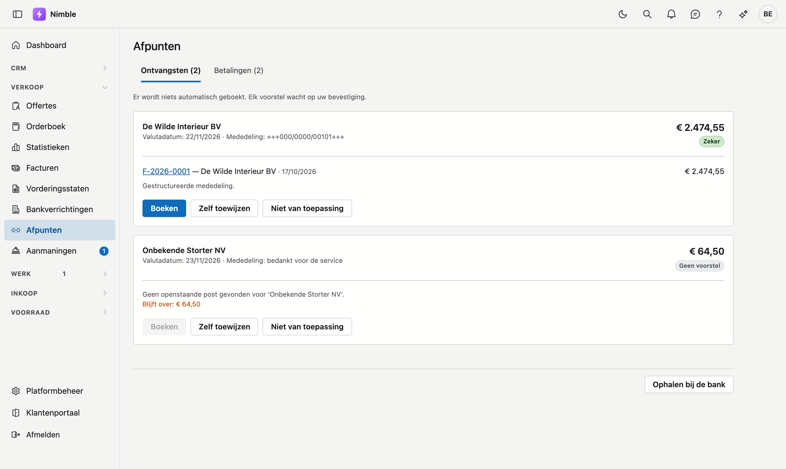

# Afpunten

Welke betaling hoort bij welke openstaande factuur. Nimble stelt voor; **u** bevestigt.

## Het scherm openen

Klik in de zijbalk op **Verkoop → Afpunten**. Het scherm vraagt het recht om facturen te bewerken.

Onderaan staat **Ophalen bij de bank**, net als op [Bankverrichtingen](bank.md): daarmee haalt u nieuwe
verrichtingen binnen zonder van scherm te wisselen.

!!! warning "Er wordt niets automatisch geboekt"
    Ook een voorstel met zekerheid **Zeker** wacht op uw klik. Een verkeerde automatische afpunting is
    duurder dan een openstaande post die blijft staan: die post blijft zichtbaar, een verkeerde betaling
    verdwijnt in de cijfers.

## De drie zekerheden

| | Waarop het berust |
|---|---|
| **Zeker** | De gestructureerde mededeling wijst één factuur aan. Dat nummer staat op uw factuur en de klant nam het over |
| **Waarschijnlijk** | Het bedrag klopt exact met één openstaande factuur van deze klant |
| **Mogelijk** | Het bedrag is de som van meerdere facturen, of een deelbetaling — of Nimble vond geen enkele openstaande post |

!!! tip "Nimble herkent een klant aan zijn rekeningnummer"
    Wanneer u een betaling boekt op facturen van één klant, onthoudt Nimble het rekeningnummer waarvan ze kwam. Komt er
    later geld van die rekening binnen, dan zoekt Nimble bij die klant, ook als de bank zijn naam anders schrijft dan in
    Nimble. Het voorstel zegt dan **Klant herkend aan het rekeningnummer van de betaler.** De geleerde nummers staan op de
    [fiche van de klant](../relations.md#blok-rekeningnummers-van-deze-klant), waar u er een kunt verwijderen.

Elk voorstel toont de tegenpartij, de valutadatum, de mededeling en het bedrag. Daaronder staan de facturen
waarop Nimble wil boeken; klik een factuurnummer om die factuur te openen. Onder elk voorstel staat
**waarom** Nimble het voorstelt. Lees die zin bij *Waarschijnlijk* en *Mogelijk* —
ze zegt precies wat er niet zeker is.

!!! warning "Een abonnement geeft identieke bedragen"
    Betaalt een klant elke maand hetzelfde, dan staan er meerdere openstaande facturen met exact dat bedrag.
    Uit het bedrag alleen is dan **niet** af te leiden welke bedoeld is. De uitleg zegt hoeveel het er zijn:
    twee is een controle, twaalf betekent dat u de mededeling nodig hebt.

## Boeken

**Boeken** registreert een betaling op de factuur, met de **valutadatum van de bank** — niet de dag waarop u
klikt. Betaalt de klant daarmee alles, dan gaat de factuur vanzelf naar *Betaald*.

Bij een deelbetaling blijft de rest openstaan, en de volgende betaling van die klant komt gewoon opnieuw in
deze lijst.

Past het bedrag niet volledig op de voorgestelde facturen, dan staat er **Blijft over:** met het restbedrag.
Vond Nimble geen enkele factuur, dan staat **Boeken** grijs: er is niets om op te boeken. Gebruik dan
**Zelf toewijzen**.

### Het verschil: korting of borg

Betaalt de klant iets minder dan er op **één** factuur openstaat, dan vraagt het voorstel wat er met
**Het verschil van** dat bedrag moet gebeuren. Het zijn dezelfde keuzes als bij een betaling op de factuur zelf:

| Keuze | Wat er gebeurt |
|---|---|
| **Blijft openstaan** | Het verschil blijft op de factuur staan. Dat is de standaard. |
| **Afboeken als korting contante betaling** | Het verschil wordt als korting afgeboekt en de factuur is volledig betaald. Enkel als het verschil hoogstens 5 % van het factuurtotaal is. |
| **Ingehouden borg** | Het verschil blijft openstaan als borg: niet als achterstallig en niet in de aanmaningen. Enkel als er nog geen borg op de factuur staat. Is het project van de factuur opgeleverd, dan krijgt de borg als vrijgavedatum de oplevering plus één jaar. |

Gaat de betaling over meer dan één factuur, dan is er geen keuze: niemand weet dan op welke factuur het verschil hoort.

## Zelf toewijzen

Vindt Nimble de juiste factuur niet, bijvoorbeeld omdat de klant zonder gestructureerde mededeling betaalde, klik
dan **Zelf toewijzen**. Er opent een venster met alle openstaande verkoopfacturen.

1. Zoek op factuurnummer of klant.
2. Vink de facturen aan waarop het bedrag hoort. Nimble vult bij elke factuur voor wat er openstaat, tot het bedrag op is.
   U kunt elk bedrag aanpassen.
3. Onderaan ziet u hoeveel er toegewezen is en hoeveel er overblijft.
4. Klik **Boeken**.

Op één factuur kan dat niet meer zijn dan er openstaat, en samen niet meer dan er binnenkwam. Kiest u maar één factuur
en blijft er iets open, dan kunt u ook hier het verschil als korting of borg boeken.

## Niet van toepassing

Hoort een ontvangst bij geen enkele factuur — een teruggave, een storting van een derde — dan haalt **Niet
van toepassing** ze uit de lijst zonder te boeken. Ze blijft zichtbaar bij **Bankverrichtingen**, waar u ze
desnoods weer openzet.

!!! note "Een afpunting rechtzetten"
    Werd een betaling op de verkeerde factuur geboekt, maak de afpunting dan ongedaan op
    [Bankverrichtingen](bank.md). De verrichting komt dan terug in deze lijst. Nimble boekt dezelfde
    bankverrichting nooit twee keer. Een korting voor contante betaling verdwijnt mee; een ingehouden borg blijft
    op de factuur staan. Die past u zo nodig aan met **Ingehouden borg…** op de factuur.

## Wat u hier niet vindt

Uitgaande betalingen. Alleen een ontvangst kan een verkoopfactuur afpunten; wat u zelf betaalde, staat bij
**Bankverrichtingen**.
