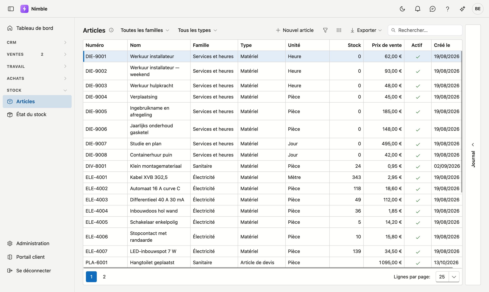
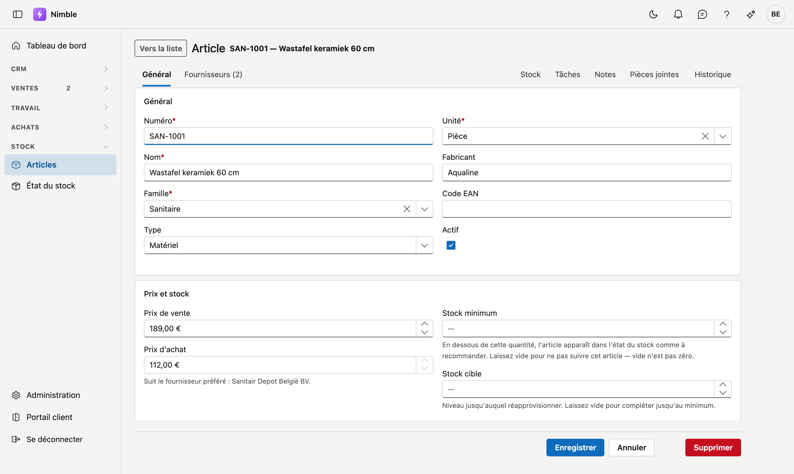
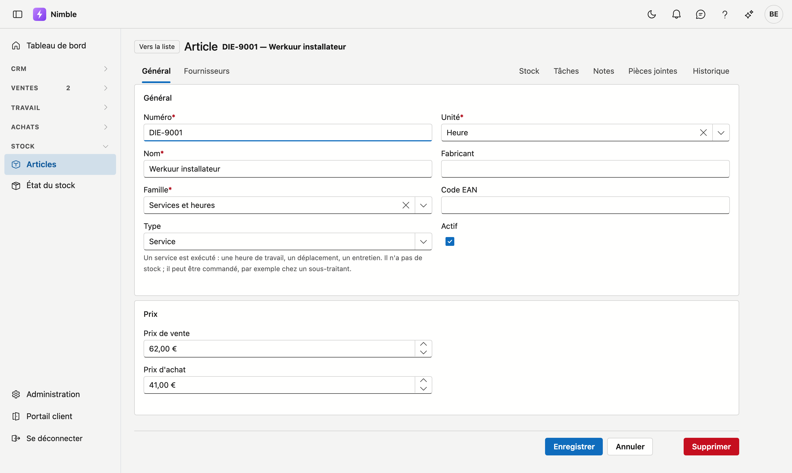
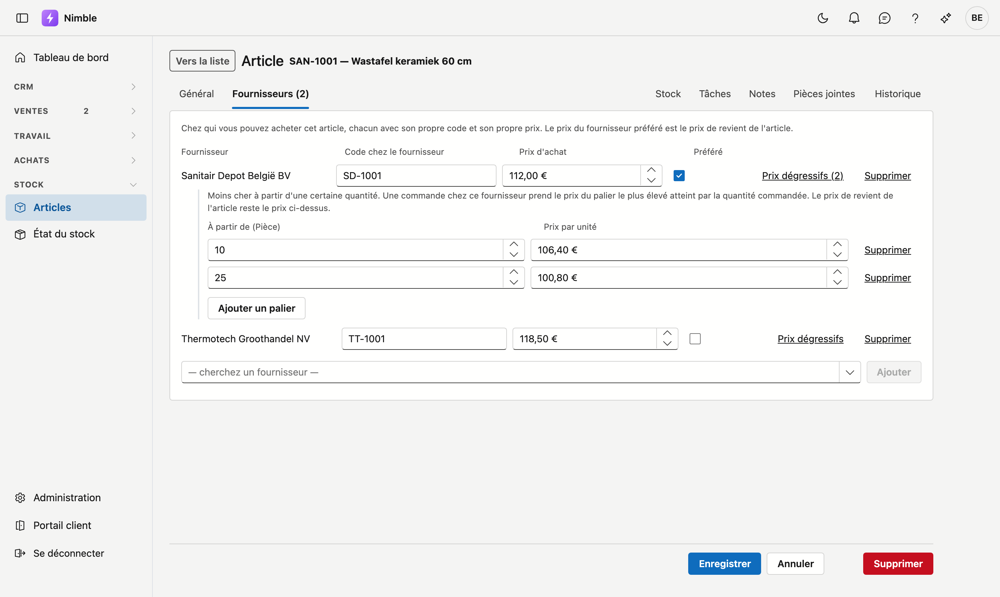
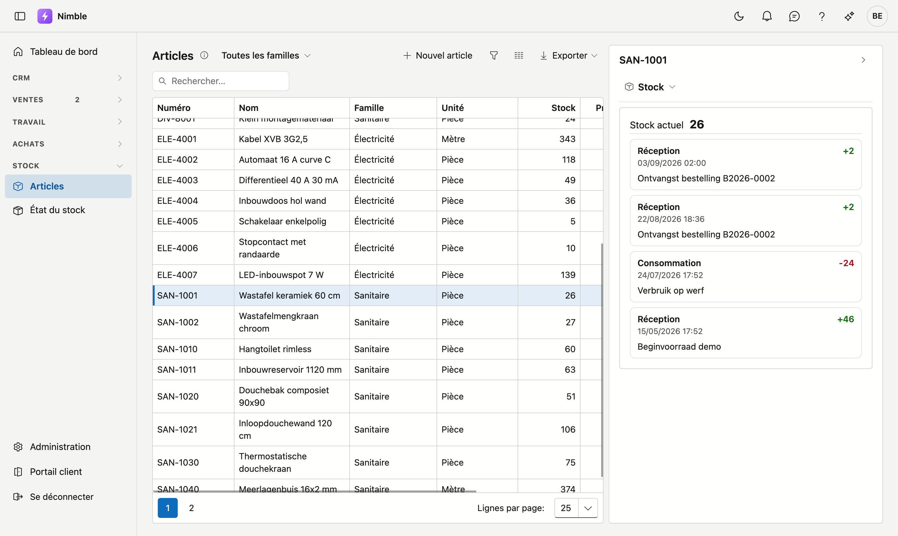

# Articles

L'écran **Articles** contient tout ce que vous livrez ou posez : la description, les prix et la famille à
laquelle l'article appartient. C'est la liste à partir de laquelle vous composez vos devis et vos commandes.

## Ouvrir l'écran

Dans la barre latérale, cliquez sur **Stock → Articles**.

## La liste

| Colonne | Ce que c'est |
|---|---|
| **Numéro** | Votre propre numéro d'article |
| **Nom** | Dénomination courte |
| **Famille** | Le groupe auquel l'article appartient |
| **Type** | Matériel, service ou article de devis — voir [Le type d'un article](#le-type-dun-article) |
| **Unité** | Pièce, mètre, heure … |
| **Stock** | Le stock actuel — voir la remarque ci-dessous. Vide pour un service et pour un article de devis |
| **Prix de vente** | Prix par unité. Vide si aucun prix n'est renseigné |
| **Actif** | Une coche pour les articles que vous utilisez encore |
| **Créé le** | Le jour où l'article a été créé |

Les listes de choix **Toutes les familles** et **Tous les types** en haut limitent la liste aux articles
d'une seule famille ou d'un seul type. Vous
pouvez aussi rechercher, trier, filtrer et exporter comme dans les autres listes. Double-cliquez une ligne
pour ouvrir l'article.

## Créer ou modifier un article

Cliquez sur **Nouvel article**, ou double-cliquez une ligne existante.

À gauche figurent les onglets propres de la fiche : **Général**, et à côté **Fournisseurs** pour le matériel et
pour un service, ou **Composition** pour un article de devis. L'onglet **Général** contient trois cartes.

**Général**

| Champ | Remarque |
|---|---|
| **Numéro** | Obligatoire et unique — voir ci-dessous |
| **Nom** | Obligatoire |
| **Famille** | Obligatoire — gérée via [Familles d'articles](../administration/article-families.md) |
| **Type** | Matériel, service ou article de devis — voir [Le type d'un article](#le-type-dun-article) |
| **Unité** | Obligatoire — gérée via [Unités](../administration/units.md) |
| **Fabricant** | La marque ou le fabricant de l'article |
| **Code EAN** | Le code-barres de l'article |
| **Actif** | Décochez pour les articles que vous n'utilisez plus ; ils restent visibles sur les anciens documents |

**Prix et stock**

| Champ | Remarque |
|---|---|
| **Prix de vente** | Ce que paie le client |
| **Prix d'achat** | Le prix de revient de l'article : c'est avec lui que calculent le pré- et le post-calcul d'un projet et la marge du tableau de bord. Si l'article a des fournisseurs, c'est le prix du **fournisseur préféré** et vous le modifiez dans l'onglet **Fournisseurs** — le champ indique alors de quel fournisseur il s'agit. Sans fournisseur, vous le saisissez vous-même ici |
| **Stock minimum** | En dessous de cette quantité, l'article apparaît dans l'[état du stock](stock-level.md) comme à recommander. Laissez vide pour ne pas suivre l'article — vide n'est pas zéro |
| **Stock cible** | Niveau jusqu'auquel réapprovisionner. Laissez vide pour compléter jusqu'au minimum |

**Description** — texte plus long, par exemple pour un devis.

Cliquez sur **Enregistrer**. S'il manque un champ obligatoire, le message en haut le cite par son nom. Après
l'enregistrement, vous restez sur la fiche.

!!! info "La famille et l'unité sont obligatoires"
    Un article sans famille est introuvable dans toute liste, et sans unité personne ne sait si « 10 »
    signifie dix pièces ou dix mètres. D'où l'obligation des deux. Si la famille ou l'unité dont vous avez
    besoin n'existe pas, créez-la d'abord via l'administration.

!!! info "Le numéro est unique"
    Deux articles avec le même numéro, c'est impossible : Nimble refuse d'enregistrer et en donne la raison.
    Cela vaut aussi pour le numéro d'un article qui se trouve dans la corbeille.

À droite de la fiche figurent les onglets **Stock**, **Tâches**, **Notes**, **Pièces jointes** et
**Historique** — les mêmes que dans le journal à côté de la liste.

## Le type d'un article

Chaque article a un **Type**. Il détermine où vous pouvez utiliser l'article.

| Type | Ce que c'est |
|---|---|
| **Matériel** | Ce que vous achetez, tenez en stock et consommez sur chantier. Un nouvel article est du matériel |
| **Service** | Ce qui est exécuté : une heure de travail, un déplacement, un entretien, un conteneur. Un service n'a pas de stock ; il peut être commandé, par exemple chez un sous-traitant |
| **Article de devis** | Ce que le client achète : une ligne du devis, comme *Hangtoilet geplaatst* (un WC suspendu, posé). Il n'a pas de stock et ne se commande pas. Ce qu'il contient, vous le définissez dans sa [composition](#la-composition-dun-article-de-devis) |

| Où | Matériel | Service | Article de devis |
|---|---|---|---|
| Une ligne d'un [devis](../sales/quotes.md) ou d'une [facture](../sales/invoices.md) | oui | oui | oui |
| Une ligne d'une [commande](../purchasing/purchase-orders.md) | oui | oui | non |
| Le matériel consommé sur un [bon de travail](../work/work-sheets.md) | oui | non | non |
| Le stock et l'[état du stock](stock-level.md) | oui | non | non |
| Les articles d'un [projet](../work/projects.md#articles-du-projet) | oui | oui | non |
| Un composant d'une [composition](#la-composition-dun-article-de-devis) | oui | oui | non |

Là où un type n'est pas possible, il ne figure pas dans la liste de choix. Dans la fenêtre de recherche,
**Service** ou **Article de devis** figure après l'article ; pour le matériel, rien.

### La fiche d'un service

La fiche d'un service n'affiche ni **Stock minimum** ni **Stock cible** : un service n'a pas de stock. La carte
des prix s'appelle **Prix**, et l'onglet **Stock** indique qu'un service n'a pas de stock. L'onglet
**Fournisseurs** reste : si vous commandez un service chez un sous-traitant ou un loueur, vous l'y indiquez,
comme pour le matériel.

### La fiche d'un article de devis

La fiche d'un article de devis n'affiche ni **Stock minimum** ni **Stock cible**, et n'a pas d'onglet
**Fournisseurs** mais un onglet **Composition**. La carte des prix s'appelle **Prix**. L'onglet **Stock**
indique qu'un article de devis n'a pas de stock.

Le **Prix d'achat** est le prix de revient de l'article de devis : ce qu'il vous coûte de le livrer et de le
poser. S'il a une composition, Nimble le calcule et indique en dessous *Calculé à partir de la composition* ;
vous ne le saisissez alors pas vous-même. Sans composition, vous le saisissez vous-même.

### Changer le type

Sur la fiche, choisissez un autre **Type** et cliquez sur **Enregistrer**.

- **Vers article de devis** : uniquement pour un article sans fournisseur et sans mouvement de stock. S'il en
  a, Nimble n'enregistre pas et le message indique ce qui l'en empêche. Retirez d'abord le fournisseur dans
  l'onglet **Fournisseurs**. Un article pour lequel du stock a déjà été enregistré reste du matériel. Un article
  qui est un composant d'une composition ne peut pas non plus devenir un article de devis.
- **Vers service** : pour un article sans mouvement de stock. Un fournisseur ne l'en empêche pas.
- **Vers matériel** : toujours possible.

Un article de devis qui a une composition reste un article de devis : retirez d'abord les composants dans
l'onglet **Composition**.

Un article de devis ne peut pas recevoir de fournisseur. Si vous l'achetez malgré tout, mettez d'abord son type
sur matériel.

Si vous passez en service ou en article de devis un article qui a un stock minimum ou un stock cible, ces deux
champs sont vidés.

## La composition d'un article de devis

Derrière un article de devis se trouvent de vrais articles. Derrière *Hangtoilet geplaatst* se trouvent un WC
suspendu, un réservoir encastré et trois heures de travail. Vous l'indiquez dans l'onglet **Composition** de la
fiche. Nimble en calcule le prix de revient de l'article de devis, et
[Reprendre du devis](../work/projects.md#reprendre-du-devis) s'en sert ensuite pour placer les vrais articles
dans les articles du projet.

| Colonne | Ce que c'est |
|---|---|
| **Composant** | Un article de type matériel ou service. Un article de devis ne peut pas être un composant |
| **Quantité** | Combien de ce composant contient **une** unité de l'article de devis, dans l'unité du **composant** : 0,4 pot de colle par m² |
| **Unité** | L'unité du composant |
| **Perte (%)** | Le pourcentage perdu, par exemple en chutes ou en pertes. Avec 8 %, Nimble compte 8 % de plus que la quantité |
| **Coût** | La quantité, plus la perte, multipliée par le prix d'achat du composant |

Pour l'utiliser :

1. Enregistrez d'abord un nouvel article de devis ; vous pourrez ensuite en établir la composition.
2. Cliquez sur **Ajouter un composant**, recherchez-le par numéro ou description et choisissez-le. La fenêtre de
   recherche n'affiche que du matériel et des services.
3. Indiquez la **Quantité** et, si nécessaire, la **Perte (%)**.
4. Cliquez sur **Enregistrer**. La composition est enregistrée avec le reste de la fiche ; avec **Annuler**,
   tout reste comme avant.

Sous la liste figure le **prix de revient** par unité de l'article de devis, avec le prix de vente et la marge.
Le nom de l'onglet indique le nombre de composants : **Composition (3)**. **Supprimer** sur une ligne retire
un composant.

Si le prix d'achat d'un composant change par la suite — sur sa fiche, chez son fournisseur préféré ou par une
liste de prix importée — le prix de revient de chaque article de devis qui le contient suit automatiquement.

!!! info "S'il manque le prix d'achat d'un composant, il n'y a pas de prix de revient"
    Nimble n'additionne pas alors le reste : un prix de revient sans un composant est trop bas et embellit la
    marge. L'onglet indique quel composant n'a pas de prix ; indiquez-le sur la fiche de cet article. En
    attendant, le prix d'achat de l'article de devis reste vide.

!!! info "Ce qu'une composition exige"
    Chaque composant a une quantité supérieure à 0, la perte est comprise entre 0 et 100 %, et un article ne
    figure qu'une fois dans la composition — regroupez les quantités sur une seule ligne. Un article ne peut
    pas être un composant de lui-même. Si quelque chose ne va pas, le message en haut le signale à
    l'enregistrement.

Le prix d'achat et le coût par composant ne sont visibles qu'avec le droit *Voir les marges et prix de revient*.
Sans ce droit, vous voyez les composants, leur quantité et leur perte.

## Fournisseurs d'un article

Vous pouvez acheter un article chez plus d'un fournisseur, chacun avec son propre numéro d'article et son
propre prix. Vous l'enregistrez dans l'onglet **Fournisseurs** de la fiche. Pour un nouvel article,
enregistrez d'abord la fiche ; l'onglet apparaît ensuite.

| Colonne | Ce que c'est |
|---|---|
| **Fournisseur** | Une relation marquée comme fournisseur |
| **Code chez le fournisseur** | Le numéro d'article qu'utilise ce fournisseur. Il figure à côté de l'article lorsque vous créez une commande |
| **Prix d'achat** | Ce que coûte cet article chez ce fournisseur, hors TVA |
| **Préféré** | Le fournisseur chez qui vous achetez habituellement. Son prix est le prix d'achat de l'article |

Voici comment procéder :

1. Choisissez un fournisseur en bas dans **— cherchez un fournisseur —** et cliquez sur **Ajouter**. Le
   premier fournisseur devient aussitôt le préféré.
2. Saisissez le **code** et le **prix d'achat**.
3. Pour acheter chez un autre fournisseur, cochez **Préféré** chez ce fournisseur. Le prix d'achat de
   l'onglet Général suit.
4. Cliquez sur **Enregistrer**. Les fournisseurs sont enregistrés avec le reste de la fiche ; avec
   **Annuler**, tout reste tel quel.

**Supprimer** sur une ligne retire un fournisseur. Si vous retirez tous les fournisseurs, le dernier prix
d'achat reste en place et vous le saisissez à nouveau vous-même dans l'onglet Général.

!!! info "Exactement un fournisseur préféré"
    Si un article a des fournisseurs, exactement un doit être le préféré : son prix est le prix de revient.
    Si vous supprimez le fournisseur préféré, Nimble n'en choisit pas un autre lui-même — le message en haut
    vous demande d'indiquer un **Fournisseur préféré** avant d'enregistrer.

### Prix dégressifs

Si un fournisseur accorde un prix plus bas à partir d'une certaine quantité, vous l'enregistrez dans ses
**prix dégressifs**. Cliquez sur **Prix dégressifs** derrière le fournisseur. S'il y a déjà des paliers, leur
nombre figure sur le bouton : **Prix dégressifs (2)**.

| Champ | Ce que c'est |
|---|---|
| **À partir de** | La quantité à partir de laquelle le prix s'applique, dans l'unité de l'article |
| **Prix par unité** | Le prix par unité à partir de cette quantité, hors TVA |

**Ajouter un palier** ajoute une ligne ; **Supprimer** derrière une ligne la retire. Les prix dégressifs sont
enregistrés lorsque vous enregistrez la fiche.

Une commande chez ce fournisseur prend le prix du palier le plus élevé atteint par la quantité commandée. En
dessous de la plus petite quantité, c'est le **Prix d'achat** du fournisseur qui s'applique. Ce prix d'achat
reste aussi le prix de revient de l'article : le pré- et le post-calcul et la marge ne tiennent pas compte
d'un prix dégressif.

Le prix d'achat et **Prix dégressifs** ne sont visibles qu'avec le droit *Voir les marges et prix de revient*.

!!! info "Ce dont un palier a besoin"
    Chaque palier a une quantité supérieure à 0 et un prix, et une quantité ne figure qu'une seule fois dans
    les prix dégressifs d'un fournisseur. Si quelque chose ne va pas, le message en haut le signale lorsque
    vous enregistrez.

## Supprimer un article

Cliquez sur **Supprimer** sur la fiche et confirmez. L'article disparaît de la liste et arrive dans la
[corbeille](../administration/recycle-bin.md). De là, **Restaurer** le remet en place.

Si vous n'utilisez simplement plus un article, mettez-le plutôt sur **non actif**.

Un article qui est un composant d'une composition ne peut pas être supprimé. Le message indique dans quelle
composition il se trouve ; retirez-le d'abord de celle-ci.

## Le journal à côté de la liste

Cliquez sur le rail **Journal** à droite et choisissez un article dans la liste. Le panneau affiche alors le
dossier de cet article, réparti sur cinq onglets :

- **Stock** — le solde actuel et tous les mouvements de cet article. Pour un service ou un article de devis,
  l'onglet indique qu'il n'a pas de stock.
- **Tâches** — ce qu'il reste à faire pour cet article.
- **Notes** — des notes libres sur cet article. Voir [Notes](../notities.md).
- **Pièces jointes** — documents et photos liés à cet article, par exemple une fiche technique. Voir
  [Pièces jointes](../bijlagen.md).
- **Historique** — qui a modifié quel champ de cet article, et quand. En lecture seule.

Vous consultez ainsi le stock article après article sans ouvrir chaque fiche.

!!! info "D'où viennent les mouvements"
    Nimble tient le stock. Une **commande réceptionnée** s'ajoute ; le matériel utilisé sur un **bon de
    travail** est déduit. Le stock actuel est la somme de tous les mouvements de l'article.

### Les trois types de mouvement

| Type | Ce qu'il signifie |
|---|---|
| **Réception** | Des marchandises entrent — par exemple une commande réceptionnée. La quantité est positive |
| **Consommation** | Des marchandises sortent — utilisées sur un bon de travail ou un projet. La quantité est négative |
| **Correction** | Une rectification manuelle après un inventaire. Le signe dépend du sens |

Chaque mouvement indique son type, la quantité, la date et l'heure, et une éventuelle note. Une commande
réceptionnée y figure par exemple comme *Ontvangst bestelling* suivi du numéro de commande.

Le registre n'est **jamais modifié** : une erreur se corrige par un nouveau mouvement, pas en retouchant
l'ancien. Ce qui s'est passé, et quand, reste ainsi visible. Les mouvements se suivent, le plus récent en
haut ; un plus signifie une entrée, un moins une sortie.

## Erreurs fréquentes

!!! warning
    - **Croire que le stock est erroné** parce qu'il affiche 0 — le stock est la somme des mouvements. À 0,
      rien n'a encore été réceptionné ni consommé pour cet article.
    - **Supprimer un article que vous n'utilisez simplement plus** — mettez-le sur **non actif**. Il reste
      alors lisible sur l'existant.
    - **Indiquer un minimum de 0 pour ne pas suivre un article** — laissez alors le champ vide. Avec 0,
      Nimble suit bien l'article.
    - **Chercher le prix d'achat dans l'onglet Général** alors que l'article a des fournisseurs — vous le
      modifiez alors chez le fournisseur préféré dans l'onglet **Fournisseurs**.
    - **Chercher un article de devis dans la liste de choix d'une commande ou d'un bon de travail** — il n'y
      figure pas. Choisissez le matériel ou le service que vous achetez ou consommez réellement.
    - **Mettre des heures de travail comme matériel sur un bon de travail** — un service ne figure pas dans la
      liste de choix du matériel consommé. Les heures s'encodent sur le bon de travail comme heures.
    - **Vouloir saisir le prix d'achat d'un article de devis qui a une composition** — il est calculé.
      Modifiez les composants, leur quantité ou leur prix d'achat.

## Voir aussi

- [État du stock](stock-level.md)
- [Commandes](../purchasing/purchase-orders.md) — le prix d'une ligne de commande vient du fournisseur, avec ses prix dégressifs
- [Relations](../relations.md) — un fournisseur est une relation cochée Fournisseur
- [Familles d'articles](../administration/article-families.md)
- [Unités](../administration/units.md)
- [Filtrer les listes](../lijsten-filteren.md) — le bouton entonnoir, le générateur de filtres et la barre de filtre
- [Travailler avec une fiche](../fiches.md) — adresse propre, onglets, enregistrer et archiver
