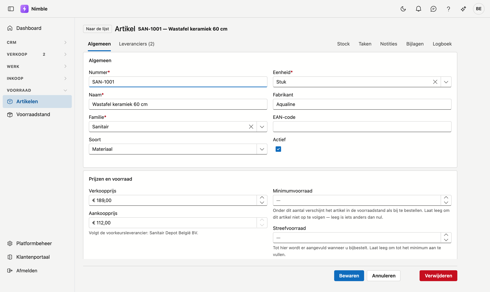
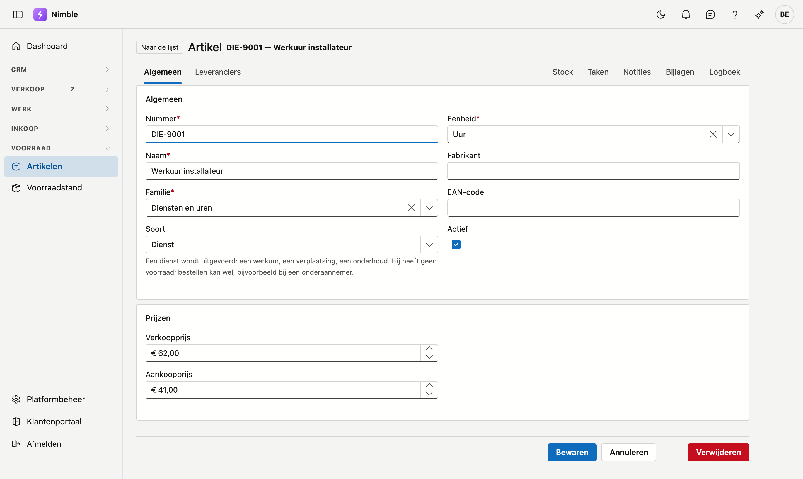
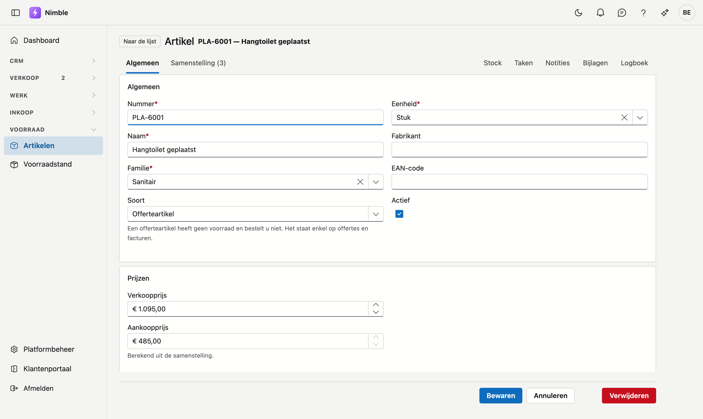
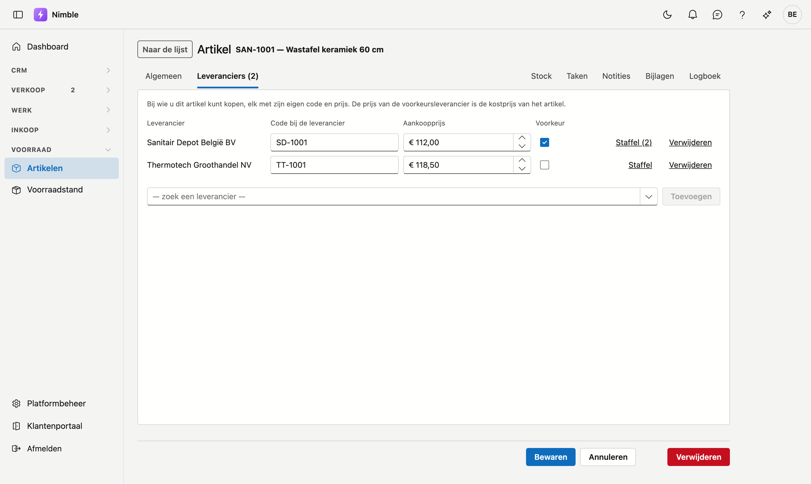
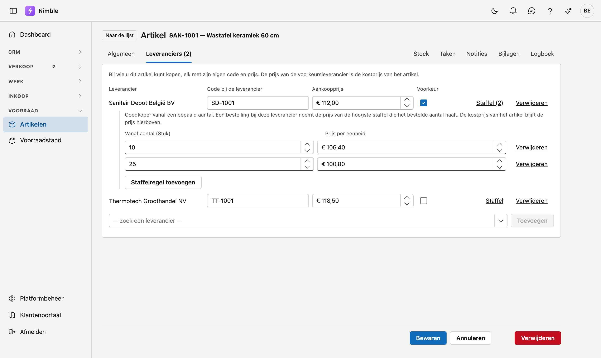
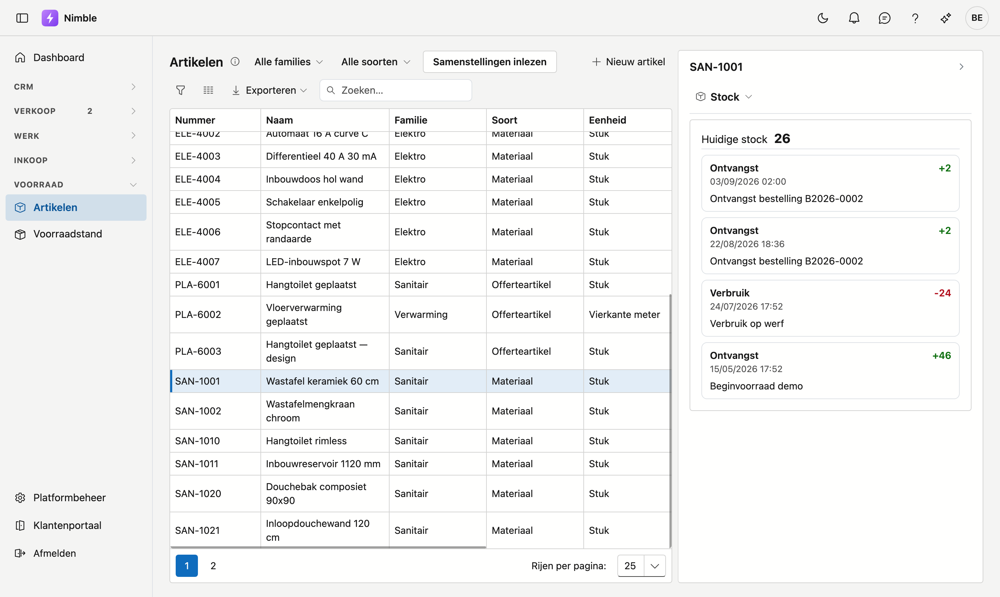

# Artikelen

Op het scherm **Artikelen** staat alles wat u levert of plaatst: de omschrijving, de prijzen en de familie
waarin het hoort. Het is de lijst waaruit u offertes en bestellingen samenstelt.

## Het scherm openen

Klik in de zijbalk op **Voorraad → Artikelen**.

## De lijst

| Kolom | Wat het is |
|---|---|
| **Nummer** | Uw eigen artikelnummer |
| **Naam** | Korte benaming |
| **Familie** | De groep waarin het artikel hoort |
| **Soort** | Materiaal, dienst of offerteartikel — zie [De soort van een artikel](#de-soort-van-een-artikel) |
| **Eenheid** | Stuk, meter, uur … |
| **Stock** | De huidige voorraad — zie de opmerking onderaan. Leeg bij een dienst en bij een offerteartikel |
| **Verkoopprijs** | Prijs per eenheid. Leeg wanneer er geen prijs is ingevuld |
| **Actief** | Een vinkje bij artikelen die u nog gebruikt |
| **Aangemaakt** | De dag waarop het artikel is aangemaakt |

Met de keuzelijsten **Alle families** en **Alle soorten** bovenaan toont u enkel de artikelen van één familie
of van één soort. U kunt ook zoeken, sorteren, filteren en exporteren zoals in de andere lijsten. Dubbelklik een rij om het artikel te
openen.

## Een artikel aanmaken of bewerken

Klik **Nieuw artikel**, of dubbelklik een bestaande rij.

Links staan de eigen tabbladen van de fiche: **Algemeen**, en daarnaast **Leveranciers** bij materiaal en bij een
dienst, of **Samenstelling** bij een offerteartikel. Op **Algemeen** staan drie kaarten.

**Algemeen**

| Veld | Opmerking |
|---|---|
| **Nummer** | Verplicht en uniek — zie hieronder |
| **Naam** | Verplicht |
| **Familie** | Verplicht — beheerd via [Artikelfamilies](../administration/article-families.md) |
| **Soort** | Materiaal, dienst of offerteartikel — zie [De soort van een artikel](#de-soort-van-een-artikel) |
| **Eenheid** | Verplicht — beheerd via [Eenheden](../administration/units.md) |
| **Fabrikant** | Het merk of de fabrikant van het artikel |
| **EAN-code** | De streepjescode van het artikel |
| **Actief** | Zet dit uit voor artikelen die u niet meer gebruikt; ze blijven bestaan op oude documenten |

**Prijzen en voorraad**

| Veld | Opmerking |
|---|---|
| **Verkoopprijs** | Wat de klant betaalt |
| **Aankoopprijs** | De kostprijs van het artikel: ermee rekenen de voor- en nacalculatie van een project en de marge op het dashboard. Heeft het artikel leveranciers, dan is dit de prijs van de **voorkeursleverancier** en wijzigt u ze op het tabblad **Leveranciers** — het veld zegt dan welke leverancier het is. Zonder leveranciers vult u ze hier zelf in |
| **Minimumvoorraad** | Onder dit aantal verschijnt het artikel op de [Voorraadstand](stock-level.md) als bij te bestellen. Laat leeg om het artikel niet op te volgen — leeg is iets anders dan nul |
| **Streefvoorraad** | Tot hier wordt er aangevuld wanneer u bijbestelt. Laat leeg om tot het minimum aan te vullen |

**Omschrijving** — langere tekst, bijvoorbeeld voor op een offerte.

Klik **Bewaren**. Ontbreekt er een verplicht veld, dan noemt de melding bovenaan het veld bij naam. U blijft
na het bewaren op de fiche.

!!! info "Familie en eenheid zijn verplicht"
    Een artikel zonder familie is in geen enkele lijst terug te vinden, en zonder eenheid weet niemand of
    "10" tien stuks of tien meter betekent. Vandaar dat beide moeten. Ontbreekt de familie of eenheid die u
    nodig hebt, maak ze dan eerst aan via Platformbeheer.

!!! info "Het nummer is uniek"
    Twee artikelen met hetzelfde nummer kan niet: Nimble weigert te bewaren en zegt waarom. Dat geldt ook
    voor een nummer van een artikel in de prullenbak.

Rechts op de fiche staan de tabbladen **Stock**, **Taken**, **Notities**, **Bijlagen** en **Logboek** —
dezelfde als in het journaal naast de lijst.

## De soort van een artikel

Elk artikel heeft een **Soort**. Ze bepaalt waar u het artikel kunt gebruiken.

| Soort | Wat het is |
|---|---|
| **Materiaal** | Wat u aankoopt, in voorraad houdt en op de werf verbruikt. Een nieuw artikel is materiaal |
| **Dienst** | Wat er uitgevoerd wordt: een werkuur, een verplaatsing, een onderhoud, een container. Een dienst heeft geen voorraad; bestellen kan wel, bijvoorbeeld bij een onderaannemer |
| **Offerteartikel** | Wat de klant koopt: één regel op de offerte, zoals *Hangtoilet geplaatst*. Het heeft geen voorraad en u bestelt het niet. Wat erachter zit, legt u vast in zijn [samenstelling](#de-samenstelling-van-een-offerteartikel) |

| Waar | Materiaal | Dienst | Offerteartikel |
|---|---|---|---|
| Een regel op een [offerte](../sales/quotes.md) of een [factuur](../sales/invoices.md) | ja | ja | ja |
| Een regel op een [bestelling](../purchasing/purchase-orders.md) | ja | ja | nee |
| Verbruikt materiaal op een [werkbon](../work/work-sheets.md) | ja | nee | nee |
| De voorraad en de [voorraadstand](stock-level.md) | ja | nee | nee |
| De projectartikelen van een [project](../work/projects.md#projectartikelen) | ja | ja | nee |
| Een onderdeel van een [samenstelling](#de-samenstelling-van-een-offerteartikel) | ja | ja | nee |

Waar een soort niet kan, staat ze niet in de keuzelijst. In het zoekvenster staat **Dienst** of
**Offerteartikel** achter het artikel; bij materiaal staat er niets.

### De fiche van een dienst

Op de fiche van een dienst staan **Minimumvoorraad** en **Streefvoorraad** niet: een dienst heeft geen
voorraad. De kaart met de prijzen heet **Prijzen**, en het tabblad **Stock** zegt dat een dienst geen voorraad
heeft. Het tabblad **Leveranciers** blijft: bestelt u een dienst bij een onderaannemer of een verhuurder, dan legt
u die daar vast, zoals bij materiaal.

### De fiche van een offerteartikel

Op de fiche van een offerteartikel staan **Minimumvoorraad** en **Streefvoorraad** niet, en is er geen
tabblad **Leveranciers** maar een tabblad **Samenstelling**. De kaart met de prijzen heet **Prijzen**. Het
tabblad **Stock** zegt dat een offerteartikel geen voorraad heeft.

De **Aankoopprijs** is de kostprijs van het offerteartikel: wat het u kost om het te leveren en te plaatsen.
Heeft het een samenstelling, dan rekent Nimble ze uit en staat eronder *Berekend uit de samenstelling*; u
tikt ze dan niet zelf in. Zonder samenstelling vult u ze zelf in.

### De soort wijzigen

Kies op de fiche een andere **Soort** en klik **Bewaren**.

- **Naar offerteartikel** kan enkel een artikel zonder leverancier en zonder voorraadbeweging. Heeft het er
  wel, dan bewaart Nimble niet en zegt de melding wat het tegenhoudt. Een leverancier haalt u eerst weg op het
  tabblad **Leveranciers**. Een artikel waarvoor ooit voorraad geboekt is, blijft materiaal. Een artikel dat een
  onderdeel is van een samenstelling, kan evenmin een offerteartikel worden.
- **Naar dienst** kan een artikel zonder voorraadbeweging. Een leverancier houdt het niet tegen.
- **Naar materiaal** kan altijd.

Een offerteartikel met een samenstelling blijft offerteartikel: haal eerst de onderdelen weg op het tabblad
**Samenstelling**.

Een offerteartikel kan geen leverancier krijgen. Koopt u het toch aan, zet de soort dan eerst op materiaal.

Zet u een artikel met een minimum- of een streefvoorraad op dienst of op offerteartikel, dan worden die twee
velden leeggemaakt.

### Soorten nakijken

Staan er veel offerteartikelen nog als materiaal, dan zet u ze in één keer om met **Soorten nakijken**. U vindt de
knop boven de artikellijst; u ziet hem als u artikelen mag bewerken.

Het scherm toont de artikelen die nooit als materiaal gebruikt zijn: zonder leverancier, zonder voorraadbeweging en
niet in bestelling. Wat een leverancier of een beweging heeft, is materiaal en staat er niet. Een uur- of
verplaatsingsartikel staat er evenmin.

| Kolom | Wat |
|---|---|
| **Nummer**, **Naam**, **Familie** | Zoals in de artikellijst |
| **Eenheid** | Een uur of een dag wijst meestal op een dienst, niet op een offerteartikel |
| **Op offertes** | Op hoeveel offerteregels het artikel staat |
| **Voorstel** | *Offerteartikel* als het op minstens één offerte staat, anders *Te beslissen* |

1. Kies eventueel bovenaan een voorstel, bijvoorbeeld enkel *Offerteartikel*.
2. Vink de artikelen aan die een offerteartikel zijn. Het vakje in de kop van de lijst vinkt alle rijen aan die aan de
   zoekterm en de filter voldoen, ook op de volgende pagina's.
3. Klik **Zet op Offerteartikel**. Het getal tussen haakjes is hoeveel artikelen u omzet.

Nimble vraagt geen bevestiging: de knop zegt wat er gebeurt, en terugzetten kan op de fiche van het artikel. Elke
wijziging staat in het **Logboek** van het artikel. Staat er niets meer na te kijken, dan meldt het scherm dat.

## De samenstelling van een offerteartikel

Achter een offerteartikel zitten echte artikelen. Achter *Hangtoilet geplaatst* zitten een hangtoilet, een
inbouwreservoir en drie werkuren. Dat legt u vast op het tabblad **Samenstelling** van de fiche. Nimble rekent er de
kostprijs van het offerteartikel mee uit, en [Overnemen uit offerte](../work/projects.md#overnemen-uit-offerte)
zet er later de echte artikelen mee bij de projectartikelen van een project.

| Kolom | Wat het is |
|---|---|
| **Onderdeel** | Een artikel van de soort materiaal of dienst. Een offerteartikel kan geen onderdeel zijn |
| **Aantal** | Hoeveel van het onderdeel er in **één** eenheid van het offerteartikel zit, in de eenheid van het **onderdeel**: 0,4 pot lijm per m² |
| **Eenheid** | De eenheid van het onderdeel |
| **Verlies (%)** | Hoeveel procent er verloren gaat, bijvoorbeeld snijverlies of morsen. Bij 8 % rekent Nimble met 8 % meer dan het aantal |
| **Kost** | Aantal, plus het verlies, maal de aankoopprijs van het onderdeel |

Zo werkt u ermee:

1. Bewaar een nieuw offerteartikel eerst; daarna kunt u de samenstelling opbouwen.
2. Klik **Onderdeel toevoegen**, zoek het onderdeel op nummer of omschrijving en kies het. Het zoekvenster
   toont enkel materiaal en diensten.
3. Vul het **Aantal** in en, als dat nodig is, het **Verlies (%)**.
4. Klik **Bewaren**. De samenstelling wordt samen met de rest van de fiche bewaard; met **Annuleren** blijft
   alles zoals het was.

Onder de lijst staat de **kostprijs** per eenheid van het offerteartikel, met de verkoopprijs en de marge. Op
het tabblad bij de naam staat het aantal onderdelen: **Samenstelling (3)**. Met **Verwijderen** op een regel
haalt u een onderdeel weg.

Wijzigt later de aankoopprijs van een onderdeel — op zijn fiche, bij zijn voorkeursleverancier of door een
ingelezen prijslijst — dan volgt de kostprijs van elk offerteartikel waarin het zit vanzelf.

!!! info "Mist een onderdeel een aankoopprijs, dan is er geen kostprijs"
    Nimble telt dan niet de rest op: een kostprijs zonder één onderdeel staat te laag en maakt de marge te
    mooi. Het tabblad noemt welk onderdeel een prijs mist; vul die in op de fiche van dat artikel. Tot dan staat
    de aankoopprijs van het offerteartikel leeg.

!!! info "Wat een samenstelling nodig heeft"
    Elk onderdeel heeft een aantal groter dan 0, het verlies ligt tussen 0 en 100 %, en een artikel staat maar
    één keer in de samenstelling — zet de aantallen samen op één regel. Een artikel kan geen onderdeel van
    zichzelf zijn. Klopt er iets niet, dan zegt de melding bovenaan het wanneer u bewaart.

De aankoopprijs en de kost per onderdeel ziet u alleen met het recht *Marges en kostprijzen bekijken*. Zonder
dat recht ziet u de onderdelen, hun aantal en hun verlies.

### Kopiëren van een ander offerteartikel

Lijkt een offerteartikel sterk op een ander — dezelfde opbouw, een andere kwaliteit — neem dan diens samenstelling
over en pas enkel aan wat verschilt. Klik op het tabblad **Samenstelling** op **Kopiëren van…** en kies het
offerteartikel. Het venster toont enkel offerteartikelen die al een samenstelling hebben.

De onderdelen komen met hun aantal en verlies op het tabblad. Er is dan nog **niets bewaard**: pas aan wat nodig is
en klik **Bewaren**. Staan er al onderdelen op het tabblad, dan vraagt Nimble eerst of die vervangen mogen worden.

### Samenstellingen inlezen uit Excel

Heeft u veel offerteartikelen, lees de samenstellingen dan in uit een Excel-bestand in plaats van ze één voor één
in te tikken. Klik boven de artikellijst op **Samenstellingen inlezen**.

1. Klik **Sjabloon downloaden**. U krijgt een Excel-bestand met al uw offerteartikelen en hun huidige samenstelling;
   een offerteartikel zonder samenstelling staat er als regel met enkel zijn nummer.
2. Vul het aan: één regel per onderdeel.
3. Sleep het bestand in het vak, of klik erop om het te kiezen. U ziet eerst een voorbeeld.
4. Klopt het voorbeeld, klik dan **Inlezen** en bevestig.

| Kolom | Wat u invult |
|---|---|
| **Offerteartikel** | Het artikelnummer van het offerteartikel |
| **Onderdeel** | Het artikelnummer van het onderdeel: materiaal of een dienst |
| **Aantal** | Hoeveel er in één eenheid van het offerteartikel zit, in de eenheid van het onderdeel |
| **Verlies (%)** | Mag leeg blijven. *8* en *8 %* betekenen allebei 8 % |
| **Eenheid** | Mag leeg blijven. Vult u ze in, dan controleert Nimble of ze die van het onderdeel is — zo valt een vergissing tussen *m* en *m²* op |

De kolommen **Naam offerteartikel** en **Naam onderdeel** van het sjabloon dienen enkel om het bestand leesbaar te
houden; Nimble leest ze niet. Vul altijd artikelnummers in, geen namen. De volgorde van de kolommen speelt geen rol:
Nimble herkent ze aan de kopregel, in het Nederlands of het Frans.

In het voorbeeld staat per offerteartikel wat er gebeurt:

| Wat gebeurt er | Betekenis |
|---|---|
| **Nieuw** | Het had nog geen samenstelling en krijgt die uit het bestand |
| **Wijzigt** | De samenstelling uit het bestand **vervangt** wat er stond: wat niet in het bestand staat, verdwijnt |
| **Ongewijzigd** | Het bestand zegt hetzelfde als wat er staat, eventueel in een andere volgorde |
| **Niet ingevuld** | Het offerteartikel staat in het bestand zonder onderdelen. Er gebeurt niets: zo wist u geen samenstelling per ongeluk |
| **Overgeslagen** | Er is iets mis; de toelichting zegt wat, met het regelnummer in het bestand |

Een offerteartikel dat niet in het bestand staat, blijft ongemoeid.

!!! info "Eén foute regel slaat het hele offerteartikel over"
    Nimble leest nooit een halve samenstelling in: een kostprijs zonder één onderdeel staat te laag. Is er één regel
    van een offerteartikel fout, dan blijft dat hele offerteartikel zoals het was. Een regel is fout als het
    artikelnummer niet bestaat, als het onderdeel zelf een offerteartikel is, als het aantal ontbreekt of 0 is, als het
    verlies niet tussen 0 en 100 ligt, als een onderdeel twee keer bij hetzelfde offerteartikel staat, of als de
    eenheid niet klopt.

!!! info "De soort wordt niet omgezet"
    Staat er in de kolom **Offerteartikel** een artikel dat materiaal of een dienst is, dan wordt het overgeslagen.
    Zet de soort eerst op de artikelfiche — zie [De soort wijzigen](#de-soort-wijzigen).

U hebt het recht nodig om artikelen te bewerken én om marges en kostprijzen te bekijken.

## Leveranciers van een artikel

Een artikel kunt u bij meer dan één leverancier kopen, elk met zijn eigen artikelnummer en zijn eigen prijs.
Dat legt u vast op het tabblad **Leveranciers** van de fiche. Bij een nieuw artikel bewaart u eerst de fiche;
daarna verschijnt het tabblad.

| Kolom | Wat het is |
|---|---|
| **Leverancier** | Een relatie die als leverancier is aangeduid |
| **Code bij de leverancier** | Het artikelnummer dat deze leverancier gebruikt. Het staat bij het artikel wanneer u een bestelling maakt |
| **Aankoopprijs** | Wat dit artikel bij deze leverancier kost, excl. btw |
| **Voorkeur** | De leverancier bij wie u gewoonlijk koopt. Zijn prijs is de aankoopprijs van het artikel |

Zo werkt u ermee:

1. Kies onderaan een leverancier in **— zoek een leverancier —** en klik **Toevoegen**. De eerste leverancier
   wordt meteen de voorkeur.
2. Vul de **code** en de **aankoopprijs** in.
3. Wilt u bij een andere leverancier kopen, vink dan bij die leverancier **Voorkeur** aan. De aankoopprijs op
   het tabblad Algemeen volgt mee.
4. Klik **Bewaren**. De leveranciers worden samen met de rest van de fiche bewaard; met **Annuleren** blijft
   alles zoals het was.

Met **Verwijderen** op een regel haalt u een leverancier weg. Haalt u alle leveranciers weg, dan blijft de
laatste aankoopprijs staan en vult u ze weer zelf in op het tabblad Algemeen.

!!! info "Precies één voorkeursleverancier"
    Heeft een artikel leveranciers, dan moet er precies één de voorkeur hebben: zijn prijs is de kostprijs.
    Verwijdert u de voorkeursleverancier, dan kiest Nimble niet zelf een andere — de melding bovenaan vraagt
    u een **Voorkeursleverancier** aan te duiden voor u bewaart.

### Staffelprijzen

Geeft een leverancier een lagere prijs vanaf een bepaald aantal, dan legt u dat vast in zijn **staffel**. Klik
achter de leverancier op **Staffel**. Staan er al regels in, dan staat hun aantal op de knop: **Staffel (2)**.

| Veld | Wat het is |
|---|---|
| **Vanaf aantal** | Het aantal vanaf waar de prijs geldt, in de eenheid van het artikel |
| **Prijs per eenheid** | De prijs per eenheid vanaf dat aantal, excl. btw |

Met **Staffelregel toevoegen** komt er een regel bij; met **Verwijderen** achter een regel haalt u ze weg. De
staffel wordt bewaard wanneer u de fiche bewaart.

Een bestelling bij deze leverancier neemt de prijs van de hoogste staffel die het bestelde aantal haalt. Onder
het laagste vanaf-aantal geldt de **Aankoopprijs** van de leverancier. Die aankoopprijs blijft ook de kostprijs
van het artikel: de voor- en nacalculatie en de marge rekenen niet met een staffelprijs.

De aankoopprijs en **Staffel** ziet u alleen met het recht *Marges en kostprijzen bekijken*.

!!! info "Wat een staffelregel nodig heeft"
    Elke regel heeft een vanaf-aantal groter dan 0 én een prijs, en een vanaf-aantal staat maar één keer in
    de staffel van een leverancier. Klopt er iets niet, dan zegt de melding bovenaan het wanneer u bewaart.

## Een artikel verwijderen

Klik op de fiche op **Verwijderen** en bevestig. Het artikel verdwijnt uit de lijst en komt in de
[prullenbak](../administration/recycle-bin.md). Van daaruit zet u het met **Herstellen** terug.

Gebruikt u een artikel enkel niet meer, zet het dan liever op **niet actief**.

Een artikel dat een onderdeel is van een samenstelling, kunt u niet verwijderen. De melding zegt in welke
samenstelling het zit; haal het daar eerst uit.

## Het journaal naast de lijst

Klik rechts op de rail **Journaal** en kies een artikel in de lijst. Het paneel toont dan de zijkant van dát
artikel, verdeeld over vijf tabbladen:

- **Stock** — de huidige stand en alle bewegingen van dit artikel. Bij een dienst of een offerteartikel staat
  er dat het geen voorraad heeft.
- **Taken** — wat er voor dit artikel nog moet gebeuren.
- **Notities** — vrije notities bij dit artikel. Zie [Notities](../notities.md).
- **Bijlagen** — documenten en foto's bij dit artikel, bijvoorbeeld een technische fiche. Zie
  [Bijlagen](../bijlagen.md).
- **Logboek** — wie welk veld van dit artikel wijzigde, en wanneer. Alleen om te lezen.

Zo bekijkt u de voorraad van artikel na artikel zonder telkens een fiche te openen.

!!! info "Waar de bewegingen vandaan komen"
    Nimble houdt de voorraad bij. Een **ontvangen bestelling** telt erbij; materiaal dat op een **werkbon**
    verwerkt is, gaat eraf. De huidige stock is de som van alle bewegingen van het artikel.

### De drie soorten beweging

| Soort | Wat het betekent |
|---|---|
| **Ontvangst** | Goederen komen binnen — bijvoorbeeld een ontvangen bestelling. Het aantal is positief |
| **Verbruik** | Goederen gaan eruit — verwerkt op een werkbon of een project. Het aantal is negatief |
| **Correctie** | Een handmatige rechtzetting na een telling. Het teken hangt af van de richting |

Elke beweging toont haar soort, het aantal, de datum en het uur, en een eventuele notitie. Een ontvangen
bestelling staat er bijvoorbeeld als *Ontvangst bestelling* gevolgd door het bestelnummer.

Het grootboek wordt **nooit gewijzigd**: een fout zet u recht met een nieuwe beweging, niet door de oude aan
te passen. Zo blijft zichtbaar wat er wanneer gebeurd is. De bewegingen staan onder elkaar, met de jongste
bovenaan; een plus betekent erbij, een min eraf.

## Veelgemaakte fouten

!!! warning
    - **Denken dat de voorraad fout staat** omdat er 0 staat — de stand is de som van de bewegingen. Bij 0
      is er voor dit artikel nog niets ontvangen of verbruikt.
    - **Een artikel verwijderen dat u enkel niet meer gebruikt** — zet het op **niet actief**. Dan blijft
      het leesbaar op wat er al was.
    - **Een minimum van 0 invullen om een artikel niet op te volgen** — laat het veld dan leeg. Met 0 volgt
      Nimble het artikel wél op.
    - **De aankoopprijs zoeken op het tabblad Algemeen** terwijl het artikel leveranciers heeft — u wijzigt
      ze dan bij de voorkeursleverancier op het tabblad **Leveranciers**.
    - **Een offerteartikel zoeken in de keuzelijst van een bestelling of een werkbon** — het staat er niet in.
      Kies het materiaal of de dienst die u werkelijk koopt of verbruikt.
    - **Werkuren als materiaal op een werkbon zetten** — een dienst staat niet in de keuzelijst van het
      verbruikte materiaal. Uren boekt u op de werkbon als uren.
    - **De aankoopprijs van een offerteartikel met een samenstelling willen intikken** — ze wordt berekend.
      Wijzig de onderdelen, hun aantal of hun aankoopprijs.

## Zie ook

- [Voorraadstand](stock-level.md)
- [Bestellingen](../purchasing/purchase-orders.md) — de prijs op een bestelregel komt van de leverancier, met zijn staffel
- [Relaties](../relations.md) — een leverancier is een relatie met het vinkje Leverancier
- [Artikelfamilies](../administration/article-families.md)
- [Eenheden](../administration/units.md)
- [Lijsten filteren](../lijsten-filteren.md) — de trechterknop, de filterbouwer en de filterbalk
- [Werken met een fiche](../fiches.md) — eigen adres, tabbladen, bewaren en archiveren
