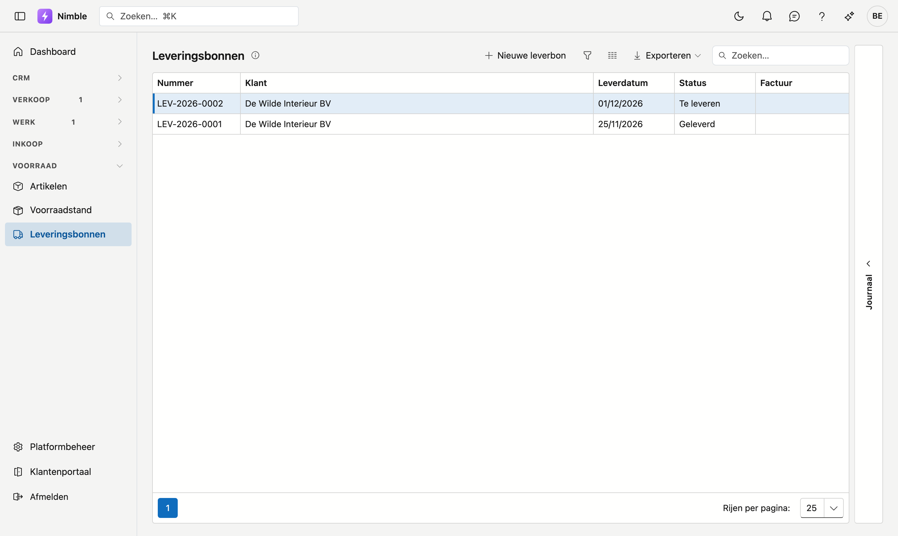

# Leveringsbonnen

Met een leverbon legt u vast wat u aan een klant levert, zonder prijzen: bij het leveren gaan de artikelen uit de voorraad, en geleverde leverbonnen zet u later samen op een factuur.

## Het scherm openen

Klik in de zijbalk op **Voorraad → Leveringsbonnen**.

U ziet het scherm wanneer u de voorraad mag bekijken. Een leverbon maken, wijzigen, leveren of mailen vraagt het recht om
de voorraad te bewerken. **Factuur maken** vraagt het recht om facturen te bewerken.

## De lijst

| Kolom | Wat u ziet |
|---|---|
| **Nummer** | Het nummer van de leverbon, bijvoorbeeld `LEV-2026-0001`. Leverbonnen hebben een eigen nummerreeks; een nieuwe leverbon krijgt zijn nummer bij het eerste bewaren |
| **Klant** | Aan wie u levert |
| **Leverdatum** | De dag van de levering |
| **Status** | **Te leveren** of **Geleverd** |
| **Factuur** | Het nummer van de factuur waarop de leverbon staat, of *klad* als die factuur nog een klad is. Leeg zolang de leverbon niet gefactureerd is |

- **Nieuwe leverbon** opent een lege leverbon.
- **Dubbelklik** een rij om de leverbon te openen.
- Rechts van de lijst staat de smalle balk **Journaal**: klap ze open voor de taken, notities, bijlagen, mails en het logboek
  van de leverbon die u in de lijst aangeklikt hebt.

## De leverbon

Bovenaan staan het nummer en de status. De fiche heeft het tabblad **Algemeen** en rechts het **Journaal**, zie
[Werken met een fiche](../fiches.md).

### De kaart Leverbongegevens

| Veld | Uitleg |
|---|---|
| **Klant** | Verplicht. Kies uit uw klanten |
| **Adres** | Enkel zichtbaar als de klant extra [adressen](../relations.md#tabblad-adressen) heeft. Leeg = het standaard leveradres van de klant, of zijn hoofdadres als hij er geen heeft; de grijze tekst zegt welk adres het is. Of kies een ander adres van de klant |
| **Project** | Optioneel. U kiest enkel uit de projecten van deze klant. Kiest u een andere klant, dan valt een project van de vorige klant weg |
| **Leverdatum** | Verplicht. Bij een nieuwe leverbon staat ze op vandaag |
| **Uw referentie** | Optioneel. Het kenmerk van de klant, bijvoorbeeld zijn bestelnummer |
| **Notitie** | Een tekst die onder de regels op de leverbon komt |

### De kaart Regels

Een regel is een artikel of een vrije tekst, met een aantal en een eenheid. Op een leverbon staan geen prijzen.

1. Kies onderaan een **Artikel**. U kiest uit het materiaal en de diensten van uw [catalogus](articles.md).
2. Vul eventueel een **Omschrijving** in: bij een artikel een aanvulling, zonder artikel de tekst van de regel.
3. Vul het **Aantal** in en klik op **Toevoegen**. De eenheid komt mee met het artikel.

Het aantal van een regel past u in de lijst aan; met het rode kruisje haalt u een regel weg. Klik daarna op **Bewaren**.

## Leveren

Klik op **Leveren** wanneer de goederen vertrekken. Nimble vraagt eerst een bevestiging. Daarna:

- gaan de artikelen met voorraad uit de voorraad. Een dienst en een regel met vrije tekst hebben geen voorraad;
- ligt het adres vast op de leverbon;
- staat de leverbon op **Geleverd** en kunt u hem niet wijzigen: de velden zijn vergrendeld.

Hebt u nog niet bewaard, dan zegt Nimble *Bewaar de leverbon eerst.* Een leverbon zonder regels kan niet geleverd worden.

Op een geleverde leverbon staan de knoppen **Levering ongedaan maken**, **Afdrukken**, **Mailen naar de klant** en
**Factuur maken**.

**Levering ongedaan maken** vraagt eerst een bevestiging. De artikelen komen terug in de voorraad en de leverbon staat
weer op **Te leveren**, zodat u hem kunt aanpassen. Het adres volgt dan weer de relatiefiche, tot u opnieuw levert. Staat de
leverbon op een factuur, dan kan dat niet.

## De knoppen

| Knop | Wanneer | Wat ze doet |
|---|---|---|
| **Bewaren** | Te leveren | Bewaart uw wijzigingen |
| **Leveren** | Te leveren, na het bewaren | Boekt de artikelen uit de voorraad en legt het adres vast |
| **Levering ongedaan maken** | Geleverd, zolang de leverbon op geen factuur staat | Zet de artikelen terug in de voorraad en maakt de leverbon weer bewerkbaar |
| **Afdrukken** | Zodra de leverbon bewaard is | Opent het afdrukvoorbeeld |
| **Mailen naar de klant** | Zodra de leverbon bewaard is | Opent het verzendvenster met de leverbon als pdf |
| **Factuur maken** | Geleverd, zolang de leverbon op geen factuur staat | Maakt een kladfactuur, zie hieronder |
| **Annuleren** | Te leveren | Terug naar de lijst zonder te bewaren |
| **Verwijderen** | Te leveren | Na bevestiging gaat de leverbon naar de **Prullenbak**, waar u hem kunt herstellen |

Op een geleverde leverbon gaat u terug met **Naar de lijst** bovenaan.

## Afdrukken en mailen

**Afdrukken** toont de leverbon zoals de klant hem krijgt. Bovenaan staan uw briefhoofd en het leveradres, daaronder de
leverdatum, **Uw referentie** en het project, met het werfadres als het project er een heeft. Dan komen de regels met hun
omschrijving, aantal en eenheid, en onderaan een vak **Voor ontvangst** met plaats voor de naam, de datum en de
handtekening van wie de goederen ontvangt. Zolang de leverbon niet geleverd is, staat *ONTWERP* naast het nummer. De
leverbon volgt de **Documenttaal** van de klant.

**Mailen naar de klant** opent het verzendvenster met het e-mailadres van de klant en de leverbon als bijlage. De tekst
stelt u in bij [Mailsjablonen](../settings/mail-templates.md), onder *Leverbon naar de klant*.

## Een factuur maken

Klik op een geleverde leverbon op **Factuur maken**. Het venster toont deze leverbon en de andere geleverde leverbonnen van
dezelfde klant die nog op geen factuur staan. Deze leverbon is aangevinkt; vink de andere aan die mee op de factuur
moeten. Klik daarna op **Klad maken**. Nimble maakt een kladfactuur en opent ze.

- Per leverbon staat er een titelregel met het nummer en de leverdatum, met de regels eronder.
- Elke regel met een artikel krijgt een prijs: eerst een geldende [prijsafspraak](../sales/price-agreements.md) met de
  klant, dan de [verkoopstaffel](articles.md#de-verkoopstaffel) van het artikel bij dat aantal, en anders de verkoopprijs.
- Een regel zonder artikel krijgt geen prijs: die vult u zelf in op de klad.
- Horen alle leverbonnen bij hetzelfde project, dan gaat het project mee. Hetzelfde geldt voor **Uw referentie**.

Kijk de klad na en maak ze definitief zoals elke [factuur](../sales/invoices.md). Een gefactureerde leverbon toont bovenaan
*Deze leverbon staat op factuur …* met de link **Naar de factuur**, en komt niet nog eens op een factuur. Gooit u de
kladfactuur weg, dan is de leverbon weer vrij om te factureren.

## Een leverbon vanuit een project

Op het tabblad [Materiaal](../work/projects.md#tabblad-materiaal) van een project staat boven de projectartikelen de knop
**Leverbon maken**. U ziet ze wanneer het project projectartikelen heeft en u de voorraad mag bewerken. Ze opent een nieuwe
leverbon met de klant, het project en de projectartikelen al ingevuld. Pas de aantallen aan op wat u nu levert, en bewaar.

Een artikel dat via een geleverde leverbon naar het project ging, stelt de werkbon in de mobiele app niet voor als
materiaal: het verliet het magazijn al.

## Veelgemaakte fouten

!!! warning
    - **Leveren zonder te bewaren.** Nimble levert enkel wat bewaard is. Klik eerst op **Bewaren**.
    - **Een geleverde leverbon willen wijzigen.** Maak eerst de levering ongedaan; daarna kunt u hem aanpassen en opnieuw
      leveren.
    - **Een gefactureerde leverbon willen terugdraaien.** Zolang hij op een factuur staat, kan de levering niet ongedaan.
      Is die factuur nog een klad, verwijder ze dan eerst.
    - **Hetzelfde materiaal ook op de werkbon zetten.** Wat via een leverbon vertrok, is al uit de voorraad. Zet u het ook
      op een werkbon, dan gaat het een tweede keer uit de voorraad.

## Zie ook

- [Artikelen](articles.md): de verkoopstaffel en de voorraad van een artikel
- [Relaties](../relations.md#tabblad-adressen): het leveradres van een klant
- [Facturen](../sales/invoices.md): de factuur die u uit leverbonnen maakt
- [Projecten](../work/projects.md#tabblad-materiaal): een leverbon maken vanuit de projectartikelen
