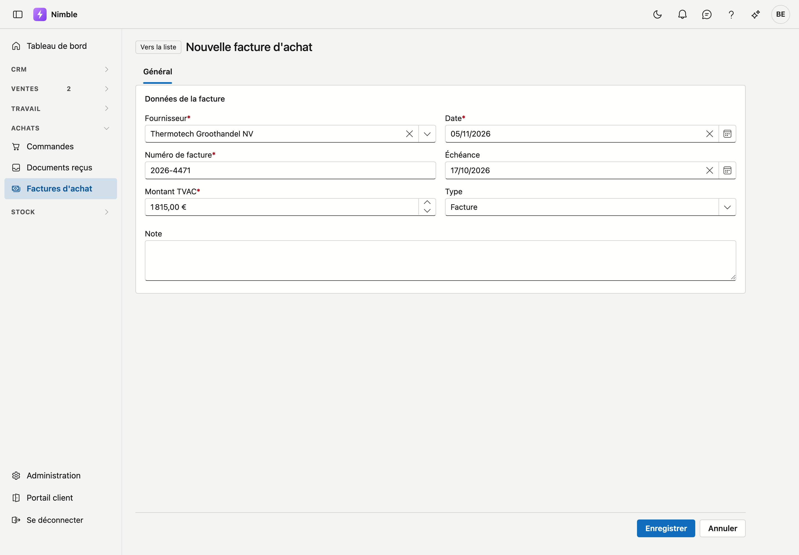

# Factures d'achat

Ce que vos fournisseurs vous facturent, et ce qu'ils vous créditent. Une facture ne devient payable qu'après approbation.

## Ouvrir l'écran

Cliquez dans la barre latérale sur **Achats → Factures d'achat**.

## La liste

| Colonne | Ce qu'elle indique |
|---|---|
| **Numéro de facture** | Le numéro que le fournisseur a mis sur sa facture |
| **Fournisseur** | De qui vient la facture |
| **Date** | La date de la facture |
| **Échéance** | La date à laquelle elle doit être payée |
| **Montant** | Le total, TVA comprise. Une note de crédit y figure avec un signe moins |
| **Type** | **Facture** ou **Note de crédit** — voir ci-dessous |
| **Origine** | D'où vient la facture — voir ci-dessous |
| **Statut** | Où en est l'approbation |

En fin de ligne figure le bouton **Approuver** ou **Payée** : l'action qui vient ensuite. Double-cliquez une ligne pour ouvrir la
facture. Vous pouvez rechercher, trier, filtrer et exporter comme dans les autres listes.

### D'où vient une facture

| Origine | Signification |
|---|---|
| **Peppol** | Arrivée par le réseau et traitée sur l'écran [Documents reçus](peppol-inbox.md). Cliquez sur le mot pour ouvrir dans une fenêtre le document original tel que le fournisseur l'a envoyé ; fermez la fenêtre pour revenir à la liste |
| **Saisie** | Saisie à la main, ou reprise de votre logiciel précédent |

### Une facture Peppol

Une facture arrivée via Peppol contient plus que le total :

- Sous **Montant TVAC** figurent le **montant HTVA** et la **TVA**, tels que sur le document. Si vous modifiez le
  montant TVAC, ils disparaissent : ils ne correspondent alors plus au total.
- L'onglet **Lignes** affiche les lignes de la facture et la **TVA par taux**, telles que le fournisseur les a
  envoyées. Vous ne pouvez pas les modifier.
- Sous **Pièces jointes** se trouvent le pdf du fournisseur et le fichier Peppol (UBL). Le pdf est ce que vous
  vérifiez avant d'approuver. L'UBL est ce que votre comptable importe.

S'il manque ces données à une facture Peppol, par exemple parce qu'elle a été traitée avant que Nimble ne les
reprenne, choisissez sur la fiche sous **Plus…** l'action **Récupérer les données Peppol**. Nimble récupère à nouveau
le document. Un pdf que vous avez déjà joint vous-même n'est pas ajouté une seconde fois.

### Notes de crédit

Lorsqu'un fournisseur vous crédite un montant, il s'agit d'une **note de crédit**. Dans Nimble, c'est une facture
d'achat du type **Note de crédit**. Son montant figure dans la liste avec un signe moins, de sorte que chaque total
de vos achats est juste d'office. Sur la fiche, vous voyez le montant tel qu'il figure sur la pièce, sans signe moins.

Une note de crédit arrivée via Peppol devient automatiquement une note de crédit lors du traitement.

Factures et notes de crédit figurent ensemble dans la liste. Avec la liste déroulante à côté du titre, vous affichez
**Factures uniquement** ou **Notes de crédit uniquement** ; choisissez **Factures et notes de crédit** pour tout revoir.

### Les trois statuts

| Statut | Signification |
|---|---|
| **En attente d'approbation** | Elle est enregistrée, mais ne peut pas encore être payée |
| **Approuvée au paiement** | Quelqu'un l'a vérifiée et l'a libérée |
| **Payée** | Le montant est acquitté |

**Approuver** libère une facture, dans la liste ou sur la fiche. Dans la liste, chaque facture a un seul bouton :
l'action qui vient ensuite. Une approbation se retire sur la fiche, sous **Plus…** avec **Retirer l'approbation**,
tant que la facture n'est pas payée. Une facture payée n'a pas de bouton dans la liste.

### Indiquer un paiement

Si vous avez payé une facture approuvée, cliquez dans la liste sur **Payée**, ou sur la fiche sur **Marquer comme payée**.
La facture est alors **Payée**, pour le montant total. Seule une facture approuvée peut être payée : approuvez-la d'abord.

En cas d'erreur, ouvrez la fiche et choisissez sous **Plus…** l'action **Annuler le paiement**. Nimble demande une
confirmation ; la facture reste approuvée. Qui a fait quoi figure dans l'historique de la fiche.

Avec la seconde liste déroulante à côté du titre, **Tous les statuts**, vous n'affichez que les factures d'achat
**En attente d'approbation**, **Non payées**, **Payées**, **Approuvées au paiement** ou **Échues**. Ce que vous devez encore
vérifier figure sous **En attente d'approbation** ; ce que vous devez encore payer, sous **Approuvées au paiement**. Elle se combine avec la liste des factures et notes
de crédit : choisissez par exemple **Factures uniquement** et **Échues** pour les factures qui auraient déjà dû être payées.

**Échue** signifie : pas encore payée, et la date d'échéance est dépassée. Une note de crédit n'est jamais échue. Une
facture non payée sans date d'échéance n'y figure pas ; le nombre de ces factures est alors indiqué sous la liste.

!!! warning "Approuver ne dit rien du contenu"
    Le drapeau signifie uniquement : *cette facture peut être payée*. Il n'affirme pas que les prix sont
    corrects ni que la livraison était conforme. Cette distinction compte si vous contestez une facture par
    la suite.

!!! warning "Une facture Peppol n'arrive jamais approuvée"
    Une facture issue des documents reçus est toujours d'abord *En attente d'approbation*. C'est
    intentionnel : le réseau livre un document, pas une décision.

### Le journal à côté de la liste

Cliquez sur le rail **Journal** à droite et choisissez une facture dans la liste. Le panneau affiche les
onglets **Tâches**, **Notes**, **Pièces jointes** et **Historique** de cette facture, sans l'ouvrir.

## Saisir une facture

Vous recevez une facture sur papier ou par courriel ? Saisissez-la vous-même. Cliquez sur **Nouvelle facture
d'achat**.

Complétez la carte **Données de la facture** :

| Champ | Remarque |
|---|---|
| **Fournisseur** | Obligatoire — choisissez parmi vos relations marquées comme fournisseur |
| **Numéro de facture** | Obligatoire — le numéro du fournisseur |
| **Montant TVAC** | Obligatoire — supérieur à zéro, tel qu'il figure sur la pièce. Aussi pour une note de crédit : Nimble ajoute lui-même le signe moins |
| **Date** | Obligatoire — aujourd'hui par défaut |
| **Échéance** | Reprenez-la de la facture |
| **Type** | **Facture** ou **Note de crédit**. Par défaut : Facture |
| **Note** | Texte libre |

Cliquez sur **Enregistrer**. S'il manque un champ obligatoire, le message en haut le cite par son nom. Après
l'enregistrement, la fiche reste ouverte : vous pouvez ajouter le scan tout de suite.

Une nouvelle facture est *En attente d'approbation* et son origine est *Saisie*.

!!! info "Le même numéro chez le même fournisseur est refusé"
    Un numéro de facture est unique **par fournisseur**. Deux fournisseurs peuvent chacun avoir une facture
    *2026-001* ; un même fournisseur non. Nimble refuse la deuxième avec un message — sinon la même dette
    serait ouverte deux fois. Cela vaut aussi quand la facture existante est dans la corbeille : restaurez-la
    alors au lieu de la saisir à nouveau.

!!! info "Pas encore de fournisseurs ?"
    L'écran n'affiche alors pas de formulaire, mais un message qui vous invite à ajouter d'abord un
    fournisseur dans **Relations**. Une facture est toujours liée à un fournisseur.

## La fiche

Double-cliquez une facture dans la liste pour ouvrir sa fiche. En haut figurent le numéro de facture et le
fournisseur. Si la facture vient de Peppol, l'étiquette **Peppol** y figure aussi ; s'il s'agit d'une note de
crédit, l'étiquette **Note de crédit**.

À gauche se trouve l'onglet **Général**, avec les mêmes champs que lors de la saisie. Une facture Peppol a aussi l'onglet
**Lignes**, et toute facture enregistrée l'onglet **Projets** (voir [Attribuer une facture à un projet](#attribuer-une-facture-a-un-projet)). À droite figurent
**Tâches**, **Notes**, **Pièces jointes** et **Historique**. Voir [Travailler avec une fiche](../fiches.md).

En bas se trouvent **Enregistrer** et **Annuler**, et à leur droite **Archiver**.

En haut de la fiche figure le statut. À côté se trouve **Approuver** ou **Marquer comme payée** ; sous **Plus…**, vous retirez
une approbation ou annulez un paiement. Voir [Indiquer un paiement](#indiquer-un-paiement).

### Ajouter le scan

Placez une facture scannée ou le courriel qui l'accompagnait sous l'onglet **Pièces jointes**. Voir
[Pièces jointes](../bijlagen.md).

### Attribuer une facture à un projet

Dans l'onglet **Projets**, vous indiquez quelle partie de la facture est un coût pour quel projet : un sous-traitant, la
location d'un échafaudage, du matériel livré directement sur le chantier. Cette partie entre alors dans le [post-calcul du
projet](../work/projects.md#le-bloc-post-calcul), sous **Achats**.

- **Toute la facture vers un projet…** attribue tout en une fois à un seul projet. Pour une facture dont la TVA n'est pas
  connue, vous saisissez vous-même le montant hors TVA.
- Pour une facture Peppol, chaque ligne figure séparément. Avec **Répartir…** à côté d'une ligne, vous choisissez un projet,
  ou vous répartissez la ligne entre plusieurs projets, en montant ou en pourcentage.
- Pour une facture sans lignes (papier ou scan), vous ajoutez vous-même une partie avec **Ajouter une partie**, avec une
  description.

Ce qui n'est pas attribué reste simplement sur la facture : c'est du stock ou un frais général. En haut figure combien est
attribué, et combien ne l'est pas. Une attribution ne change rien au montant ni au statut de la facture ; elle est donc
aussi possible sur une facture payée.

!!! warning "Le matériel du magasin ne s'attribue pas ici"
    Le matériel que l'équipe emporte du magasin entre dans le projet via le [bon de travail](../work/work-sheets.md). Si vous
    attribuez aussi au projet la facture de ce même matériel, il compte deux fois. Sur le projet, Nimble avertit lorsqu'une
    ligne attribuée porte le même article qu'un bon de travail de ce projet.

## Archiver une facture

Une facture a été saisie par erreur ? Cliquez sur **Archiver** sur la fiche et confirmez. La facture
disparaît de la liste et arrive dans la [corbeille](../administration/recycle-bin.md). De là, **Restaurer**
la remet en place.

Une facture d'achat est une pièce comptable : elle n'est jamais effacée. Ce qui a été saisi reste ainsi
visible.

Si vous ouvrez une facture archivée via un ancien lien, la fiche indique qu'elle est dans la corbeille.

!!! warning "Une facture Peppol archivée ne revient pas"
    Nimble retient de quel document la facture est issue, même dans la corbeille. Le document ne réapparaît
    donc pas dans les documents reçus. Pour récupérer la facture, restaurez-la depuis la corbeille.

## Ce que vous ne faites pas ici

Effectuer le virement. Vous indiquez ici qu'une facture est payée ; le paiement lui-même se fait dans votre banque.

## Voir aussi

- [Documents reçus](peppol-inbox.md)
- [Pièces jointes](../bijlagen.md)
- [Corbeille](../administration/recycle-bin.md)
- [Filtrer les listes](../lijsten-filteren.md)
- [Travailler avec une fiche](../fiches.md)
