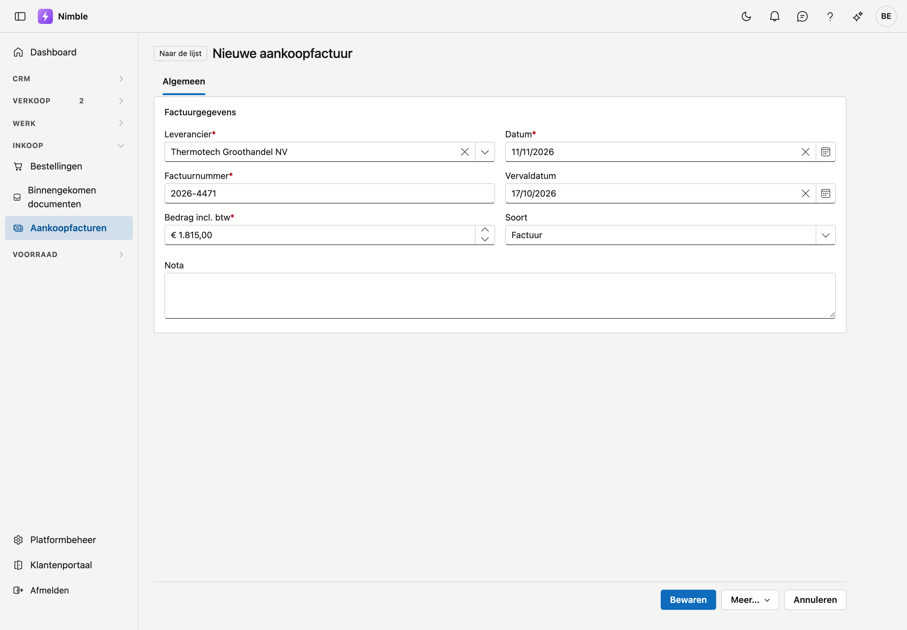

# Aankoopfacturen

Wat uw leveranciers u aanrekenen, en wat ze u crediteren. Een factuur wordt pas betaalbaar nadat iemand ze goedkeurt.

## Het scherm openen

Klik in de zijbalk op **Inkoop → Aankoopfacturen**.

## De lijst

| Kolom | Wat het zegt |
|---|---|
| **Factuurnummer** | Het nummer dat de leverancier op zijn factuur zette |
| **Leverancier** | Van wie de factuur komt |
| **Datum** | De factuurdatum |
| **Vervaldatum** | Wanneer ze betaald moet zijn |
| **Bedrag** | Het totaal, btw inbegrepen. Een creditnota staat er met een minteken |
| **Soort** | **Factuur** of **Creditnota** — zie hieronder |
| **Herkomst** | Waar de factuur vandaan komt — zie hieronder |
| **Status** | Waar de factuur staat in de goedkeuring |

Achteraan elke rij staat de knop **Goedkeuren** of **Betaald**: de handeling die aan de beurt is. Dubbelklik een rij om de factuur te
openen. U kunt zoeken, sorteren, filteren en exporteren zoals in de andere lijsten.

### Waar een factuur vandaan komt

| Herkomst | Wat het betekent |
|---|---|
| **Peppol** | Binnengekomen via het netwerk en verwerkt op het scherm [Binnengekomen documenten](peppol-inbox.md). Klik op het woord om het originele document zoals de leverancier het stuurde in een venster te openen; sluit het venster om terug te keren naar de lijst |
| **Ingebracht** | Met de hand ingebracht, of overgezet uit uw vorige pakket |

### Een factuur uit Peppol

Een factuur die via Peppol binnenkwam, draagt meer dan het totaal:

- Onder **Bedrag incl. btw** staan het **bedrag excl. btw** en de **btw**, zoals op het document. Wijzigt u het
  bedrag incl. btw, dan verdwijnen ze: ze horen dan niet meer bij het totaal.
- Het tabblad **Regels** toont de factuurregels en de **btw per tarief**, zoals de leverancier ze stuurde. U kunt ze
  niet wijzigen.
- Onder **Bijlagen** staan de pdf van de leverancier en het Peppol-bestand (UBL). De pdf is wat u nakijkt vóór u
  goedkeurt. De UBL is wat uw boekhouder inleest.

Draagt het document een bestelnummer dat precies één bestelling van dezelfde leverancier aanwijst, dan koppelt Nimble de
factuur vanzelf aan die bestelling en zegt het dat in een melding. Hoofdletters en spaties rond het nummer tellen niet. Een
bestelling die u zelf al koppelde, blijft staan.

Mist een Peppol-factuur die gegevens, bijvoorbeeld omdat ze verwerkt werd vóór Nimble ze overnam, kies dan op de
fiche onder **Meer…** de handeling **Gegevens uit Peppol ophalen**. Nimble haalt het document opnieuw op. Een pdf die
u zelf al koppelde, komt er geen tweede keer bij.

### Creditnota's

Crediteert een leverancier u een bedrag, dan is dat een **creditnota**. In Nimble is dat een aankoopfactuur van de
soort **Creditnota**. Haar bedrag staat in de lijst met een minteken, zodat elk totaal over uw aankopen vanzelf
klopt. Op de fiche ziet u het bedrag zoals het op het stuk staat, zonder minteken.

Een creditnota die via Peppol binnenkomt, wordt bij het verwerken vanzelf een creditnota.

Facturen en creditnota's staan samen in de lijst. Met de keuzelijst naast de titel toont u **Enkel facturen** of
**Enkel creditnota's**; kies **Facturen en creditnota's** om weer alles te zien.

### De drie statussen

| Status | Wat het betekent |
|---|---|
| **Wacht op goedkeuring** | Ze staat er, maar mag nog niet betaald worden |
| **Goedgekeurd om te betalen** | Iemand heeft ze nagekeken en vrijgegeven |
| **Betaald** | Het bedrag is voldaan |

Met **Goedkeuren** zet u een factuur vrij, in de lijst of op de fiche. In de lijst staat per factuur één knop: de
handeling die aan de beurt is. Een goedkeuring trekt u in op de fiche, onder **Meer…** met **Goedkeuring intrekken**,
zolang de factuur niet betaald is. Een betaalde factuur heeft in de lijst geen knop.

### Een betaling aanduiden

Hebt u een goedgekeurde factuur betaald, klik dan in de lijst op **Betaald**, of op de fiche op **Markeren als betaald**.
De factuur staat dan op **Betaald**, voor het volledige bedrag. Enkel een goedgekeurde factuur kan betaald worden: keur
ze eerst goed.

Was het een vergissing, open dan de fiche en kies onder **Meer…** de handeling **Betaling ongedaan maken**. Nimble vraagt
een bevestiging; de factuur blijft goedgekeurd. Wie wat deed, staat in het logboek van de fiche.

Met de tweede keuzelijst naast de titel, **Alle statussen**, toont u enkel de aankoopfacturen die **Wacht op
goedkeuring**, **Niet betaald**, **Betaald**, **Goedgekeurd om te betalen** of **Vervallen** zijn. Wat u nog moet
nakijken, staat onder **Wacht op goedkeuring**; wat u nog moet betalen, onder **Goedgekeurd om te betalen**. Ze werkt samen met de keuzelijst voor facturen en
creditnota's: kies bijvoorbeeld **Enkel facturen** en **Vervallen** voor de facturen die al betaald hadden moeten zijn.

**Vervallen** betekent: nog niet betaald, en de vervaldatum is voorbij. Een creditnota vervalt nooit. Een factuur die
nog niet betaald is maar geen vervaldatum heeft, staat er niet bij; onder de lijst staat dan hoeveel zulke facturen er zijn.

!!! warning "Goedkeuren zegt niets over de inhoud"
    De vlag betekent alleen: *deze factuur mag betaald worden*. Ze zegt niet dat de prijzen kloppen of dat
    de levering in orde was. Dat verschil telt wanneer u achteraf een factuur betwist.

!!! warning "Uit Peppol komt nooit goedgekeurd binnen"
    Een factuur die uit de binnengekomen documenten ontstaat, staat altijd eerst op *Wacht op goedkeuring*.
    Dat is met opzet: het netwerk levert een document af, niet een beslissing.

### Het journaal naast de lijst

Klik rechts op de rail **Journaal** en kies een factuur in de lijst. Het paneel toont de tabbladen
**Taken**, **Notities**, **Bijlagen** en **Logboek** van die factuur, zonder dat u ze opent.

## Een factuur inbrengen

Krijgt u een factuur op papier of per e-mail, dan brengt u ze zelf in. Klik **Nieuwe aankoopfactuur**.

Vul in de kaart **Factuurgegevens** in:

| Veld | Opmerking |
|---|---|
| **Leverancier** | Verplicht — kies uit uw relaties die als leverancier gemarkeerd zijn |
| **Factuurnummer** | Verplicht — het nummer van de leverancier |
| **Bedrag incl. btw** | Verplicht — groter dan nul, zoals het op het stuk staat. Ook bij een creditnota: Nimble zet er zelf het minteken voor |
| **Datum** | Verplicht — staat standaard op vandaag |
| **Vervaldatum** | Neem ze over van de factuur |
| **Soort** | **Factuur** of **Creditnota**. Staat standaard op Factuur |
| **Bestelling** | Optioneel. De [bestelling](purchase-orders.md) waar de factuur bij hoort; de keuzelijst toont de bestellingen van de gekozen leverancier. Met **Naar de bestelling** opent u ze |
| **Nota** | Vrije tekst |

Klik **Bewaren**. Ontbreekt er een verplicht veld, dan noemt de melding bovenaan het veld bij naam. Na het
bewaren blijft de fiche open, zodat u meteen de scan kunt toevoegen.

Een nieuwe factuur staat op *Wacht op goedkeuring* en heeft als herkomst *Ingebracht*.

### Laten lezen door de AI

Hebt u in het portaal van ADM One een eigen **AI-sleutel** ingesteld en toestemming gegeven voor documentanalyse (met
het vinkje *Scans, foto's en pdf's*), dan staat bovenaan een nieuwe aankoopfactuur de kaart **Laten lezen door de AI**.
Sleep de scan of pdf van de factuur erin, of klik om ze te kiezen (pdf, JPG, PNG of WebP).

- De AI leest de leverancier, het factuurnummer, de datum, de vervaldatum, het totaal en de btw per tarief, en vult
  de velden voor. **Niets wordt bewaard tot u op Bewaren klikt.** Kijk alles na: de AI kan zich vergissen.
- De **leverancier** zoekt Nimble op zijn btw-nummer. Vindt het er geen (of meer dan één), dan blijft het veld leeg en
  noemt de melding de gelezen naam en het btw-nummer. Nimble maakt nooit zelf een leverancier aan.
- De **btw per tarief** neemt Nimble enkel over als ze optelt tot het totaal. Ze staat daarna onder het bedrag.
- Het document hangt na het bewaren als bijlage aan de factuur, met de omschrijving *Gelezen door de AI*.
- De kosten van de AI betaalt u **rechtstreeks aan uw AI-leverancier**, via uw eigen sleutel.

Staat iets nog niet in orde in het portaal (geen sleutel, geen toestemming, of het vinkje voor scans uit), dan zegt
de kaart wat er ontbreekt.

!!! info "Hetzelfde nummer bij dezelfde leverancier kan niet"
    Een factuurnummer is uniek **per leverancier**. Twee leveranciers mogen elk een factuur *2026-001*
    hebben; dezelfde leverancier niet. Nimble weigert het tweede met een melding — anders stond dezelfde
    schuld twee keer open. Dat geldt ook wanneer de bestaande factuur in de prullenbak staat: herstel ze
    dan daar in plaats van ze opnieuw in te brengen.

!!! info "Nog geen leveranciers?"
    Dan toont het scherm geen formulier maar de melding dat u eerst een leverancier moet toevoegen bij
    **Relaties**. Een factuur hangt altijd aan een leverancier.

## De fiche

Dubbelklik een factuur in de lijst om haar fiche te openen. Bovenaan staan het factuurnummer en de
leverancier. Komt de factuur uit Peppol, dan staat er ook het label **Peppol**; is het een creditnota, het
label **Creditnota**.

Links staat het tabblad **Algemeen**, met dezelfde velden als bij het inbrengen. Een factuur uit Peppol heeft ook het tabblad
**Regels**, en elke bewaarde factuur het tabblad **Projecten** (zie [Een factuur aan een project toewijzen](#een-factuur-aan-een-project-toewijzen)). Rechts staan **Taken**,
**Notities**, **Bijlagen** en **Logboek**. Zie [Werken met een fiche](../fiches.md).

Onderaan staan **Bewaren** en **Annuleren**, en rechts daarvan **Archiveren**.

Bovenaan de fiche staat de status. Daarnaast staat **Goedkeuren** of **Markeren als betaald**; onder **Meer…** trekt u een
goedkeuring in of maakt u een betaling ongedaan. Zie [Een betaling aanduiden](#een-betaling-aanduiden).

### De scan toevoegen

Een gescande factuur of de e-mail waarmee ze kwam, zet u onder het tabblad **Bijlagen**. Zie
[Bijlagen](../bijlagen.md).

Hangt er een scan of pdf aan een factuur die niet uit Peppol komt, dan kan de AI ze lezen met **Uit bijlage lezen** in de
kaart **Laten lezen door de AI** (zie [Laten lezen door de AI](#laten-lezen-door-de-ai)). Op een bestaande factuur vult de AI
enkel **lege** velden in, zoals een ontbrekende vervaldatum of de btw per tarief. Staat er op het document iets anders dan op
de fiche, dan zegt de melding dat, en blijft de fiche zoals ze was.

### Een factuur aan een project toewijzen

Op het tabblad **Projecten** zegt u welk deel van de factuur een kost is voor welk project: een onderaannemer, de huur van een
stelling, materiaal dat rechtstreeks op de werf geleverd werd. Dat deel komt dan in de [nacalculatie van het
project](../work/projects.md#het-blok-nacalculatie), onder **Aankopen**.

- **Hele factuur naar project…** wijst alles in één keer toe aan één project. Bij een factuur zonder gekende btw vult u
  het bedrag exclusief btw zelf in.
- Bij een factuur uit Peppol staat elke regel er apart. Met **Verdelen…** naast een regel kiest u een project, of verdeelt
  u de regel over meerdere projecten, in een bedrag of een percentage.
- Bij een factuur zonder regels (papier of scan) voegt u met **Deel toevoegen** zelf een deel toe, met een omschrijving.
- Is de factuur aan een bestelling gekoppeld waarvan regels een project dragen, dan staat er **Overnemen uit bestelling …**
  zolang er nog niets toegewezen is. Het venster dat opent, staat ingevuld met een deel per project en het bedrag van de
  bestelling: wat ontvangen is, anders wat besteld is, maal de prijs. Pas aan waar de factuur afwijkt en klik **Bewaren**.
  Heeft een projectregel geen prijs, dan zegt het venster dat en vult u dat bedrag zelf in.

Bij een factuur uit Peppol staan delen die aan geen factuurregel hangen, zoals het voorstel uit een bestelling, onder de
regels apart, onder **Delen zonder factuurregel**.

Wat niet toegewezen is, blijft gewoon op de factuur: dat is voorraad of een algemene kost. Bovenaan staat hoeveel er
toegewezen is, en hoeveel niet. Een toewijzing wijzigt niets aan het bedrag of de status van de factuur; ze kan dus ook
op een betaalde factuur.

!!! warning "Materiaal uit het magazijn wijst u hier niet toe"
    Materiaal dat de ploeg uit het magazijn meeneemt, komt in het project via de [werkbon](../work/work-sheets.md). Wijst u de
    factuur van datzelfde materiaal ook nog aan het project toe, dan telt het twee keer. Op het project waarschuwt Nimble
    wanneer een toegewezen regel hetzelfde artikel draagt als een werkbon van dat project.

## Een factuur archiveren

Is een factuur verkeerd ingebracht, klik dan op de fiche op **Archiveren** en bevestig. De factuur
verdwijnt uit de lijst en komt in de [prullenbak](../administration/recycle-bin.md). Van daaruit zet u ze
met **Herstellen** terug.

Een aankoopfactuur is een boekstuk en wordt dus nooit gewist. Zo blijft zichtbaar wat er ingebracht was.

Opent u een gearchiveerde factuur via een oude link, dan zegt de fiche dat ze in de prullenbak staat.

!!! warning "Een gearchiveerde Peppol-factuur komt niet opnieuw binnen"
    Nimble onthoudt uit welk document de factuur ontstond, ook in de prullenbak. Het document verschijnt dus
    niet opnieuw bij de binnengekomen documenten. Wilt u de factuur terug, herstel ze dan uit de prullenbak.

## Wat u hier niet doet

Het geld overmaken. U duidt hier aan dat een factuur betaald is; de betaling zelf doet u in uw bank.

## Zie ook

- [Binnengekomen documenten](peppol-inbox.md)
- [Bijlagen](../bijlagen.md)
- [Prullenbak](../administration/recycle-bin.md)
- [Lijsten filteren](../lijsten-filteren.md)
- [Werken met een fiche](../fiches.md)
