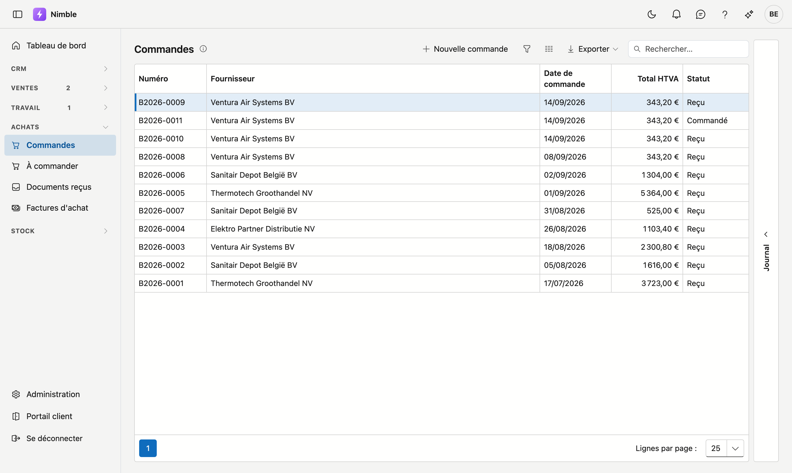
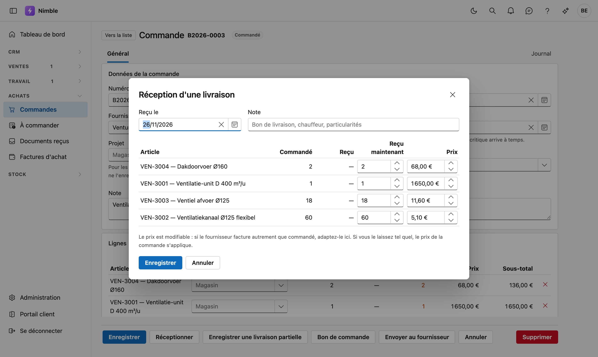

# Commandes

Une **commande** consigne ce que vous avez commandé chez un fournisseur et où en est la livraison. Lors de
la réception, Nimble comptabilise les marchandises dans le stock — vous ne devez pas le suivre séparément. Ce qui va
directement sur un chantier n'entre pas dans le stock : voir [Directement vers le chantier](#directement-vers-le-chantier).

## Ouvrir l'écran

Cliquez dans la barre latérale sur **Achats** puis sur **Commandes**.

## La liste

| Colonne | Ce qu'elle indique |
|---|---|
| **Numéro** | Votre numéro de commande |
| **Fournisseur** | Chez qui vous avez commandé |
| **Date de commande** | Quand vous avez commandé |
| **Total HTVA** | Quantité × prix, additionnés sur les lignes. Si *incomplet* s'affiche, au moins une ligne n'a pas de prix — complétez-le sur la commande |
| **Statut** | Où en est la commande — voir [Le statut](#le-statut) |

Double-cliquez une ligne pour ouvrir la commande. Vous pouvez rechercher, trier, filtrer et exporter comme
dans les autres listes.

Cliquez sur le rail **Journal** à droite et choisissez une commande dans la liste. Le panneau affiche les
onglets **Tâches**, **Notes**, **Pièces jointes** et **Historique** de cette commande.

!!! info "Pas encore de fournisseur ou d'article ?"
    L'écran n'affiche alors pas de liste, mais un message qui vous invite à ajouter d'abord un fournisseur
    et un article. Sans eux, il n'y a rien à commander.

## Créer une commande

Cliquez sur **Nouvelle commande**. Complétez la carte **Données de la commande** :

| Champ | Remarque |
|---|---|
| **Numéro** | Obligatoire — vous le choisissez vous-même |
| **Fournisseur** | Obligatoire — choisissez parmi vos relations marquées comme fournisseur |
| **Projet** | Vide signifie **Magasin**. Choisissez un projet si les marchandises vont directement au chantier : les nouvelles lignes reçoivent ce projet. Voir [Directement vers le chantier](#directement-vers-le-chantier) |
| **Date de commande** | Obligatoire — aujourd'hui par défaut |
| **Date de livraison prévue** | Quand le fournisseur livre. Vous voyez ainsi si le matériel critique arrive à temps |
| **Statut** | Une nouvelle commande est en **Brouillon** |
| **Note** | Accords avec le fournisseur, adresse de livraison, particularités |

Cliquez sur **Enregistrer**. S'il manque un champ obligatoire, le message en haut le cite par son nom. Après
l'enregistrement, vous restez sur la fiche.

## Ajouter des lignes

Sous la carte **Lignes** figure une rangée pour ajouter une ligne. Choisissez un **Article**, indiquez la
**Quantité** et cliquez sur **Ajouter une ligne**. La liste de choix affiche le matériel et les services — un
service se commande par exemple chez un sous-traitant ou un loueur. Un
[article de devis](../inventory/articles.md#le-type-dun-article) ne se commande pas.

Dès que vous choisissez un article, Nimble remplit le **Prix** :

- **Si le fournisseur de cette commande livre l'article**, c'est son prix. Son code figure entre parenthèses
  après le nom de l'article, pour que vous voyiez dans la liste de choix sous quel numéro il le connaît.
- **Si l'article n'a pas de fournisseur**, c'est le prix d'achat de l'article.
- **Si l'article a d'autres fournisseurs, mais pas celui-ci**, le prix reste vide : Nimble ne connaît pas le
  prix de ce fournisseur. Saisissez-le vous-même.

Si le fournisseur a des [prix dégressifs](../inventory/articles.md#prix-degressifs) pour l'article, le prix
proposé suit la **Quantité**. Si la quantité atteint un palier, le prix de ce palier s'affiche et vous lisez
sous le champ du prix à partir de quelle quantité il s'applique, par exemple *Prix dégressif à partir de 10*.
Si vous modifiez la quantité, le prix s'adapte ; un prix que vous avez saisi vous-même reste alors en place.

Les fournisseurs d'un article et leurs prix figurent dans l'onglet **Fournisseurs** de la
[fiche article](../inventory/articles.md#fournisseurs-dun-article). Si cette livraison a un autre tarif,
adaptez le prix avant d'ajouter la ligne. Si vous choisissez un autre fournisseur alors qu'un article est
déjà choisi, le prix proposé s'adapte.

| Colonne | Ce qu'elle indique |
|---|---|
| **Article** | Numéro et nom de l'article |
| **Projet** | **Magasin**, ou le projet où la ligne va directement |
| **Quantité** | Ce que vous avez commandé |
| **Reçu** | Ce qui est déjà arrivé |
| **Encore attendu** | Ce qui est encore en route pour cette ligne |
| **Prix** | Le prix unitaire |
| **Sous-total** | Quantité fois prix |

Sous les lignes figure le **Total**. La croix en fin de ligne supprime une ligne. Une ligne dont une partie est déjà
réceptionnée n'a pas de croix. Pour revenir sur une réception, voir [Annuler une livraison](#annuler-une-livraison).

N'oubliez pas d'**enregistrer** : une ligne pas encore enregistrée ne peut pas être réceptionnée.

## Directement vers le chantier

Vous commandez du matériel que le fournisseur livre sur le chantier, ou un service pour un seul projet ? Donnez alors un
**Projet** à la ligne. Une telle ligne ne passe pas par le magasin :

- À la réception, la quantité compte pour le statut de la commande, mais la ligne **n'entre pas dans le stock**. L'équipe
  ne la sort donc pas non plus du magasin avec un bon de travail.
- Le coût arrive sur le projet via la [facture d'achat](purchase-invoices.fr.md#attribuer-une-facture-a-un-projet). Si la
  facture est liée à cette commande, Nimble propose les projets et montants de la commande.
- Dans l'[état du stock](../inventory/stock-level.fr.md), une telle ligne ne compte pas comme **En route** : elle ne vient
  pas au magasin.

Le **Projet** de la carte **Données de la commande** vaut pour les nouvelles lignes. Si vous le modifiez, les lignes qui
portaient le projet précédent suivent. Une ligne à laquelle vous avez donné sciemment un autre projet ou **Magasin** reste
inchangée. Par ligne, vous choisissez dans la colonne **Projet** un autre projet, ou **Magasin**.

!!! info "Après une réception, le projet est fixé"
    Dès que quelque chose a été réceptionné sur une ligne, le projet de cette ligne ne peut plus changer. Ce qui est déjà
    dans le stock passerait sinon vers un projet sans écriture, ou inversement. Annulez d'abord la livraison dans ce cas
    (voir [Annuler une livraison](#annuler-une-livraison)).

## Réceptionner des marchandises

Sur une commande enregistrée qui n'est ni **Reçu** ni **Annulé**, deux boutons figurent en bas de la fiche.
La différence compte :

- **Réceptionner** comptabilise en une fois tout ce qui reste ouvert. Utilisez-le quand la livraison est
  complète.
- **Enregistrer une livraison partielle** ouvre la fenêtre **Réception d'une livraison**, où vous indiquez
  par ligne ce qui est arrivé. La commande reste ensuite ouverte pour le reste.

Dans la fenêtre, complétez :

| Champ | Remarque |
|---|---|
| **Reçu le** | Aujourd'hui par défaut |
| **Note** | Bon de livraison, chauffeur, particularités |
| **Reçu maintenant** | Par ligne. Déjà rempli avec ce qui reste ouvert — adaptez-le s'il en est arrivé moins |
| **Prix** | Si le fournisseur facture autrement que commandé, adaptez le prix ici. Si vous le laissez tel quel, le prix de la commande s'applique |

Cliquez sur **Enregistrer**. Si aucune ligne ne porte de quantité, la fenêtre vous le signale. **Annuler**
ferme la fenêtre sans rien comptabiliser.

Après l'enregistrement, les marchandises sont dans le stock, sauf les lignes avec un projet (elles sont allées
directement au chantier), et le statut s'adapte : **Partiellement livré**
tant qu'il reste quelque chose d'ouvert, **Reçu** quand tout est arrivé. Un service se réceptionne comme toute
autre ligne, mais n'entre pas dans le stock : un service n'en a pas.

### Les livraisons

Dès qu'une réception a eu lieu, la carte **Livraisons** apparaît. Elle indique par ligne reçue la **Date**,
l'**Article**, la **Quantité** et le **Prix**.

Si une ligne a été livrée à un autre prix que celui commandé, ce prix apparaît en orange. En dessous, un
message vous invite à le vérifier avant d'approuver la facture d'achat.

### Annuler une livraison

Si vous avez mal encodé une livraison (une mauvaise quantité, la mauvaise commande), cliquez à côté de cette
livraison sur **Annuler la réception** et confirmez. Vous annulez toujours une livraison entière, avec toutes ses lignes.

- Ce qui est entré en stock est contre-passé. L'onglet Stock de l'article montre alors les deux écritures : la
  réception et la contre-passation *Réception annulée*.
- Une ligne avec un projet n'est jamais entrée en stock et n'est donc pas contre-passée.
- Le statut suit : **Partiellement livré** s'il reste une autre livraison, sinon de nouveau **Commandé**.
- Ensuite, vous réceptionnez à nouveau avec **Réceptionner** ou **Enregistrer une livraison partielle**.

Le journal des actions note qui a annulé quelle livraison. Si la fiche contient des modifications non
enregistrées, enregistrez-les d'abord.

## Imprimer et envoyer le bon de commande

**Bon de commande** affiche la commande enregistrée en pdf : votre en-tête, le fournisseur, la date de commande et la
livraison souhaitée, l'adresse de livraison, et par ligne le code du fournisseur (s'il figure sur la fiche article), la
quantité, le prix et le total. L'**adresse de livraison** est le chantier du projet de la commande, et sans projet
l'adresse de votre entreprise. La **Note** figure en bas : n'y mettez donc que ce que le fournisseur peut lire. Une
commande en **Brouillon** porte le mot *PROJET* dans le titre.

**Envoyer au fournisseur** ouvre une fenêtre avec son adresse e-mail, l'objet et le texte du modèle de mail **Bon de
commande au fournisseur** (voir [Modèles de mail](../settings/mail-templates.md)), et le bon de commande en pièce jointe.
Adaptez ce qu'il faut et cliquez sur **Envoyer**.

- Si la commande est encore en **Brouillon**, elle passe à **Commandé** après l'envoi : qui envoie, commande. Le bon dans
  l'e-mail ne porte donc jamais *PROJET*.
- L'e-mail figure ensuite sous **Journal** › **E-mails** de la commande, et une copie du pdf dans les **Pièces jointes**.
- Enregistrez d'abord : le bon de commande vient de la commande enregistrée. Avec des modifications non enregistrées,
  Nimble vous demande d'enregistrer d'abord.
- Le bon et l'e-mail suivent la **langue des documents** du fournisseur.

## Le statut

| Statut | Signification |
|---|---|
| **Brouillon** | Pas encore envoyée au fournisseur |
| **Commandé** | Envoyée, rien encore reçu |
| **Partiellement livré** | Une partie est arrivée, il reste quelque chose d'ouvert |
| **Reçu** | Tout est arrivé et comptabilisé dans le stock |
| **Annulé** | N'aura pas lieu |

Dans le champ **Statut**, vous choisissez vous-même uniquement **Brouillon**, **Commandé** ou **Annulé**.
**Partiellement livré** et **Reçu** découlent de l'enregistrement d'une livraison ; vous ne pouvez pas les
choisir à la main.

!!! info "Ce qui compte comme en route"
    Sur l'[état du stock](../inventory/stock-level.md), seul ce qui reste ouvert sur une commande au statut
    **Commandé** ou **Partiellement livré** est compté. Une commande en **Brouillon** n'est pas encore
    comptée.

Sur une commande **annulée**, plus rien ne peut être réceptionné.

## Supprimer une commande

Cliquez sur **Supprimer** sur la fiche et confirmez. La commande disparaît de la liste et arrive dans la
[corbeille](../administration/recycle-bin.md). De là, **Restaurer** la remet en place.

## Où le stock est visible

Après une réception, vous voyez le résultat sous **Stock → Articles**, dans l'onglet **Stock** de l'article.
Chaque réception y figure comme *Ontvangst bestelling* suivi du numéro de commande. Voir
[Articles](../inventory/articles.md).

## Voir aussi

- [État du stock](../inventory/stock-level.md)
- [Factures d'achat](purchase-invoices.md)
- [Corbeille](../administration/recycle-bin.md)
- [Travailler avec une fiche](../fiches.md)
