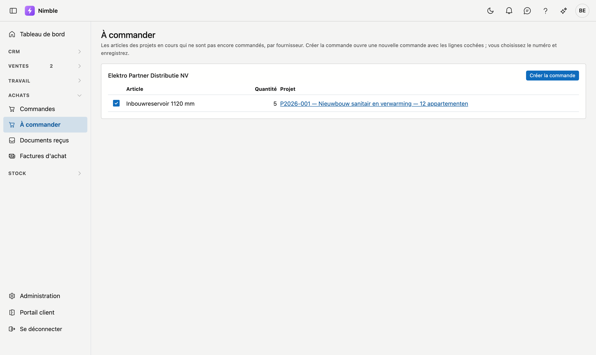

# À commander

**À commander** reprend les articles de vos projets en cours qui ne sont pas encore commandés, par fournisseur. En un clic, vous en
faites une commande.

## Ouvrir l'écran

Dans la barre latérale, cliquez sur **Achats → À commander**. Vous avez besoin du droit de consulter les achats ; pour créer une
commande, du droit de les modifier.

## Ce qui y figure

Un article de l'onglet **Matériel** d'un [projet](../work/projects.md) figure ici tant que :

- il n'est pas coché comme commandé ;
- il ne vient pas de votre propre stock ;
- le projet n'est ni terminé ni supprimé.

Chaque fournisseur a un bloc, par nom. Les articles sans fournisseur figurent en bas, sous **Sans fournisseur** : choisissez d'abord un
fournisseur dans l'onglet Matériel de leur projet. Les lignes de matériel libres, sans article, n'apparaissent pas ici.

## Créer une commande

1. Dans le bloc d'un fournisseur, cochez les articles à commander. Par défaut, ils sont tous cochés.
2. Cliquez sur **Créer la commande**. Une nouvelle [commande](purchase-orders.md) s'ouvre avec le fournisseur, les lignes, le projet par
   ligne et le prix de ce fournisseur.
3. Saisissez le **Numéro**, vérifiez les lignes et cliquez sur **Enregistrer**.

Ce n'est qu'après l'enregistrement que les articles passent à commandé et disparaissent de cette liste. Si vous quittez sans
enregistrer, ils restent.

## Erreurs fréquentes

!!! warning
    - **Chercher un article qui n'est pas dans la liste.** Vérifiez s'il est coché comme commandé sur le projet, ou s'il vient de votre
      stock.
    - **Créer une commande pour des articles sans fournisseur.** Ce n'est pas possible depuis cette liste ; choisissez d'abord un
      fournisseur sur le projet.

## Voir aussi

- [Commandes](purchase-orders.md)
- [Projets](../work/projects.md)
