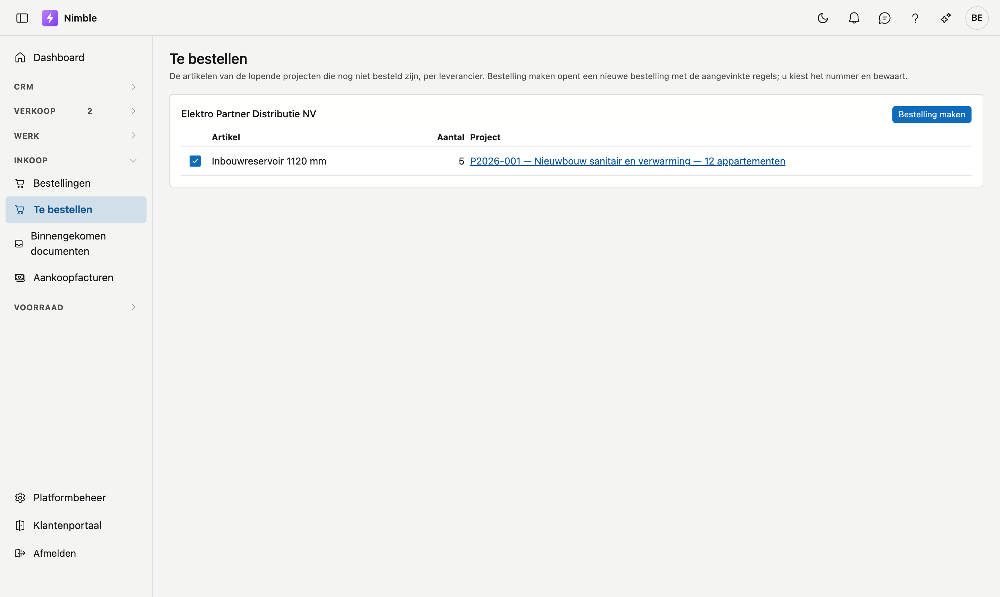

# Te bestellen

Op **Te bestellen** staan de artikelen van uw lopende projecten die nog niet besteld zijn, per leverancier. Met één klik maakt u er
een bestelling van.

## Het scherm openen

Klik in de zijbalk op **Inkoop → Te bestellen**. U hebt het recht nodig om de inkoop te bekijken; om een bestelling te maken, het
recht om ze te bewerken.

## Wat erop staat

Een artikel van het tabblad **Materiaal** van een [project](../work/projects.md) staat hier zolang:

- het niet als besteld aangevinkt is;
- het niet uit uw eigen voorraad komt;
- het project niet afgerond of verwijderd is.

Per leverancier staat een blok, op naam. Artikelen zonder leverancier staan onderaan, bij **Zonder leverancier**: kies eerst een
leverancier op het tabblad Materiaal van hun project. Losse materiaalregels zonder artikel staan hier niet.

## Een bestelling maken

1. Vink in het blok van een leverancier de artikelen aan die u wilt bestellen. Standaard staan ze allemaal aangevinkt.
2. Klik **Bestelling maken**. Een nieuwe [bestelling](purchase-orders.md) opent met de leverancier, de regels, het project per regel
   en de prijs van die leverancier.
3. Vul het **Nummer** in, kijk de regels na en klik **Bewaren**.

Pas na het bewaren gaan de artikelen op besteld en verdwijnen ze van deze lijst. Klikt u weg zonder te bewaren, dan blijven ze staan.

## Veelgemaakte fouten

!!! warning
    - **Een artikel zoeken dat niet op de lijst staat.** Kijk of het op het project als besteld aangevinkt is, of uit uw voorraad komt.
    - **Een bestelling maken voor artikelen zonder leverancier.** Dat kan niet vanuit deze lijst; kies eerst een leverancier op het
      project.

## Zie ook

- [Bestellingen](purchase-orders.md)
- [Projecten](../work/projects.md)
