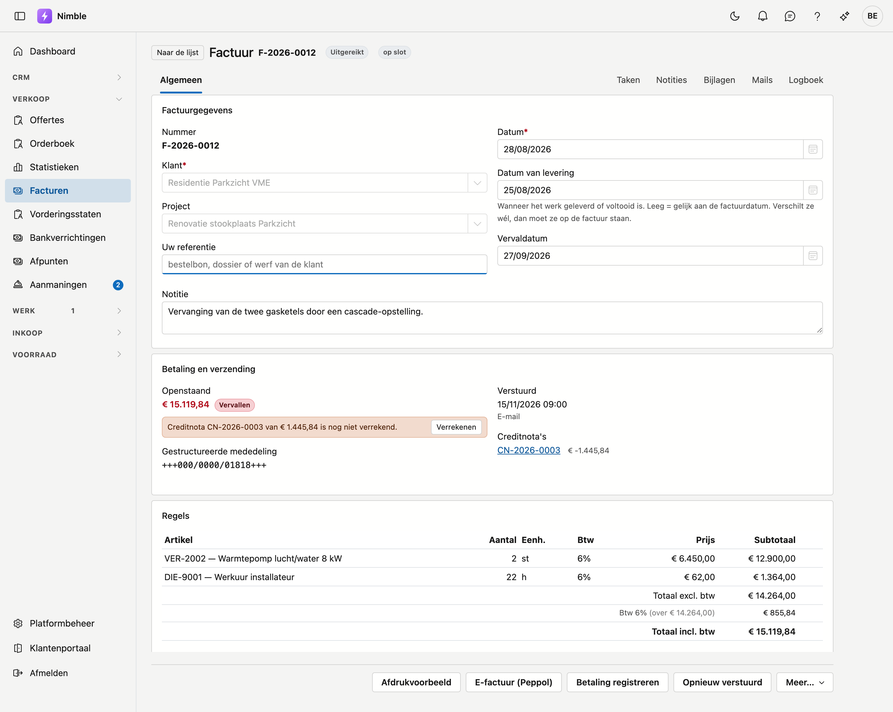
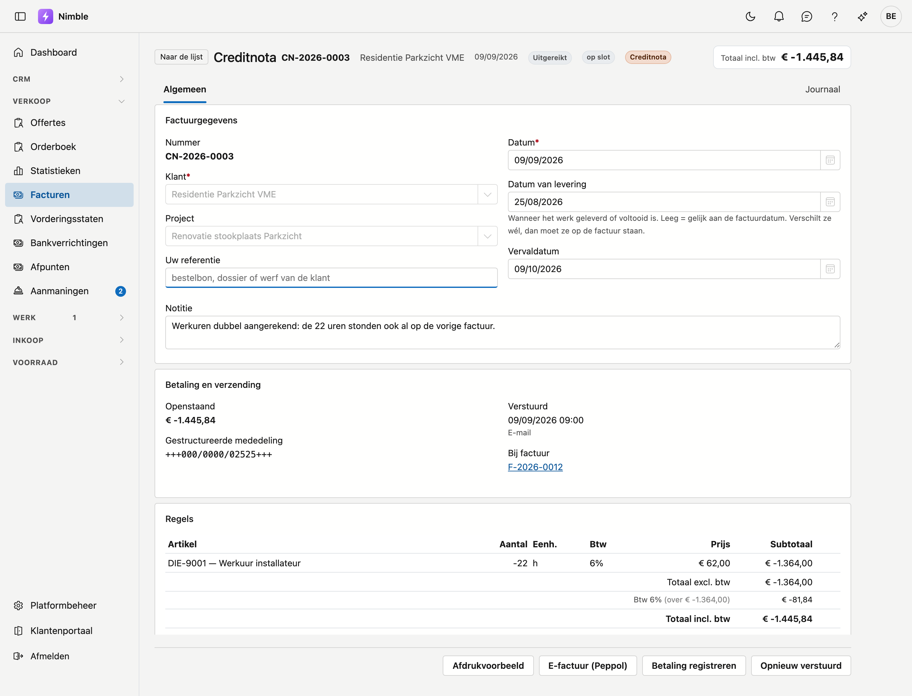
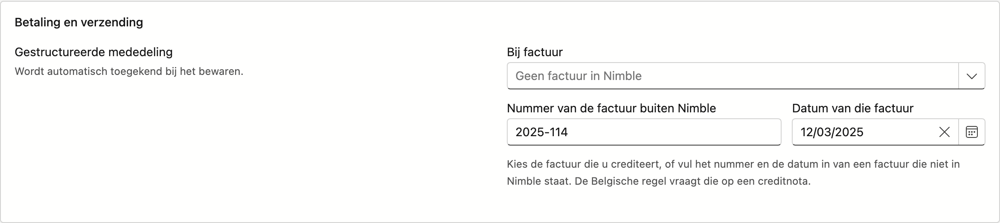
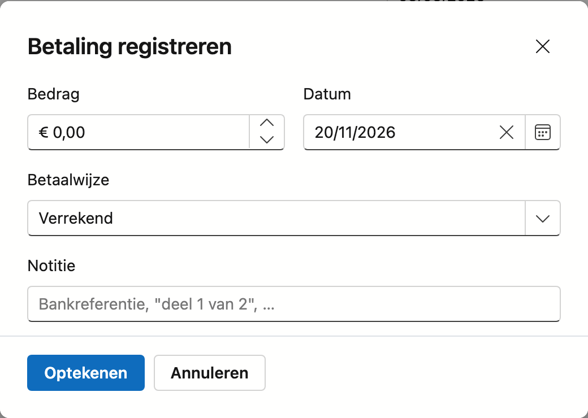

# Facturen

Een verkoopfactuur is wat u naar de klant stuurt om betaald te worden. Nimble houdt bij wat er nog
openstaat, wanneer de factuur vertrokken is en met welke mededeling de klant betaalt. Een creditnota werkt op
hetzelfde scherm.

## Het scherm openen

Klik in de zijbalk op **Verkoop → Facturen**.

## De lijst

| Kolom | Wat u ziet |
|---|---|
| **Nummer** | Het factuurnummer. Een klad heeft er nog geen; een creditnota begint met `CN-` |
| **Soort** | **Factuur**, **Creditnota** of **Voorschot** (een voorschotfactuur, zie [Offertes](quotes.md)) |
| **Klant** | Voor wie de factuur is |
| **Datum** | De factuurdatum |
| **Mededeling** | De gestructureerde mededeling waarmee de klant betaalt |
| **Vervaldatum** | Wanneer u het geld verwacht |
| **Openstaand** | Wat er nog betaald moet worden, na aftrek van de geregistreerde betalingen |
| **Status** | Klad, Uitgereikt of Betaald, met een label wanneer er iets aandacht vraagt |

In de kolom **Openstaand** kunt u dit tegenkomen:

- **—** bij een klad: die is nog niet bij de klant geweest, dus er staat niets open.
- **Betaald**: alles is binnen.
- Een bedrag in het **rood**: de factuur is over haar vervaldatum.
- Een **negatief** bedrag bij een creditnota: wat er nog verrekend of terugbetaald moet worden.
- Het label **Bedrag onbekend** bij een uitgereikte factuur van € 0,00. Beweeg de muis erover voor de uitleg. Is zo'n factuur
  afgehandeld, zie dan [Een factuur zonder bedrag afsluiten](#een-factuur-zonder-bedrag-afsluiten).

In de kolom **Status** komt het label **Vervallen** bij een uitgereikte factuur die over haar vervaldatum
is, en **Geen vervaldag** wanneer er geen vervaldatum ingevuld is. Een creditnota krijgt geen van beide
labels: zij vervalt niet, en haar bedrag staat nooit in het rood.

Hield de klant een borg in, dan staat er het label **Borg**. Beweeg de muis erover voor het bedrag en de datum
waarop de borg vrijkomt. Na die datum heet het label **Borg vrij**. Zie [Een ingehouden borg](#een-ingehouden-borg).

Vertrok de factuur via Peppol, dan staat er ook de afleverstatus: **Afgeleverd** (groen), **Onderweg** (blauw) of **Niet
afgeleverd** (rood). Beweeg de muis erover voor de status zoals op de fiche. Zie [Versturen via Peppol](#versturen-via-peppol).

Boven de lijst staan:

- **Factuur uit offerte** — maakt een factuur op basis van een aanvaarde offerte.
- **Nieuwe factuur** — opent een lege fiche. Bij **Soort** kiest u Factuur of Creditnota.
- Een keuzelijst naast de titel: **Facturen en creditnota's**, **Openstaande facturen**, **Enkel facturen**,
  **Enkel creditnota's**, **Facturen met borg** of **Mogelijk een borg (5 % open)**. **Openstaande facturen**
  toont enkel de facturen waarop nog iets te betalen is, een ingehouden borg inbegrepen. Creditnota's staan er niet in.
- **Exporteren**, de filterknoppen en het zoekveld.

Bij een uitgereikte factuur met een openstaand bedrag staat rechts de knop **Markeren als betaald**: zie
[Met één klik vanuit de lijst](#met-een-klik-vanuit-de-lijst).

**Dubbelklik** een rij om de factuur te openen. Rechts van de lijst staat de smalle balk **Journaal**: klap
ze open voor de taken, notities, bijlagen, mails en het logboek van de factuur die u in de lijst aangeklikt hebt.

### De statussen

| Status | Wat het betekent |
|---|---|
| **Klad** | Nog niet uitgereikt. De factuur heeft nog géén nummer en u kunt alles nog wijzigen |
| **Uitgereikt** | Ze heeft een nummer gekregen en staat op slot |
| **Betaald** | Het volledige bedrag is ontvangen |
| **Geannuleerd** | Uitgereikt maar nooit verstuurd, en nadien geannuleerd. Zie [Een factuur annuleren](#een-factuur-annuleren) |

De tekst van de statussen stelt u zelf in onder [Factuurstatus](../administration/invoice-status.md).

!!! warning "Een klad heeft met opzet nog geen nummer"
    Het factuurnummer wordt pas toegekend wanneer u de factuur definitief maakt. Zo houdt de reeks geen
    gaten: een klad die u weggooit, heeft nooit een nummer gehad. Een gat in een factuurreeks is
    boekhoudkundig een factuur die iemand moet verantwoorden.

## Factuur uit offerte

Klik op **Factuur uit offerte**. In het venster kiest u bij **Offerte** een aanvaarde offerte die nog niet
gefactureerd is, en klikt u op **Aanmaken**. Nimble maakt een kladfactuur met de regels van de offerte en
opent ze. Het project en **Uw referentie** van de offerte gaan mee.

Wilt u eerst een voorschot factureren, kies dan bij **Soort** de keuze **Voorschotfactuur** en klik op **Verder**. De
offerte opent met het venster van het voorschot: zie [Een voorschot factureren](quotes.md#een-voorschot-factureren).
Factureert het project per vorderingsstaat, dan kan er geen voorschot, en dat zegt Nimble ook.

Staat er geen enkele offerte klaar, dan leest u dat in het venster: alleen een aanvaarde offerte die nog
niet gefactureerd is, komt in de lijst.

U kunt een aanvaarde offerte ook factureren vanaf de offerte zelf, met **Factureren** — zie
[Offertes](quotes.md).

## De factuurfiche

Bovenaan staan het nummer, de klant, de datum en de status, en rechts het **Totaal incl. btw**. Na de status staat
bij een uitgereikte factuur **op slot**, bij een creditnota het label **Creditnota** en bij een voorschotfactuur het
label **Voorschot**.

De fiche heeft de tabbladen **Algemeen** en **Journaal**. Onder **Journaal** staan **Taken**, **Notities**,
**Bijlagen**, **Mails** en **Logboek**; hoe die werken, leest u in [Werken met een fiche](../fiches.md). Bij **Mails**
staan de mails waarmee u de factuur naar de klant stuurde en de [aanmaningen](reminders.md) voor deze factuur.

### Het blok Factuurgegevens

| Veld | Opmerking |
|---|---|
| **Nummer** | Op een klad staat *— krijgt een nummer bij Definitief maken* |
| **Klant** | Verplicht. Voor wie de factuur is |
| **Project** | Optioneel. Hangt de factuur aan een project, dan telt ze mee in het financiële overzicht van dat project |
| **Uw referentie** | Het kenmerk van de klant: zijn bestelbonnummer, dossier of werf. Komt mee uit de offerte; een creditnota neemt het over van haar factuur. Het staat op de factuur bij de datums, en de e-factuur draagt het als referentie van de klant. U kunt het ook op een uitgereikte factuur nog invullen of wijzigen — daar wordt het meteen bewaard |
| **Datum** | Verplicht. De factuurdatum; bij een nieuwe factuur staat ze op vandaag |
| **Datum van levering** | Wanneer het werk geleverd of voltooid is. Leeg = gelijk aan de factuurdatum |
| **Vervaldatum** | Wanneer u het geld verwacht. Kiest u een klant, dan stelt Nimble ze voor |
| **Notitie** | Een interne notitie. Ze komt niet op de factuur |

!!! info "Hoe de vervaldatum voorgesteld wordt"
    Nimble rekent vanaf de factuurdatum met de betalingstermijn van de klant. Heeft de klant geen eigen
    termijn, dan geldt die van de [bedrijfsfiche](../settings/company-profile.md). Is er nergens een termijn,
    dan blijft het veld leeg en staat eronder dat u de vervaldag zelf moet invullen. Zonder vervaldag kan de
    factuur niet definitief gemaakt worden.

!!! warning "De datum van levering is niet zomaar een veld"
    Verschilt de datum waarop u geleverd hebt van de factuurdatum, dan **moet** die datum op de factuur
    staan. Bij een aannemer die in maart legt en in april factureert is dat regel, geen uitzondering — en
    die datum bepaalt in welke btw-aangifte de handeling thuishoort.

### Het blok Betaling en verzending

| Veld | Wat het is |
|---|---|
| **Openstaand** | Wat de klant nog moet betalen, in het rood met **Vervallen** erbij als de vervaldatum voorbij is — niet op een creditnota. Is alles binnen, dan staat er **Betaald**. Zijn er betalingen, dan staat eronder *Al betaald* met het bedrag; op een creditnota *Terugbetaald* of *Verrekend*. Hield de klant een borg in, dan staat eronder *Waarvan ingehouden borg* met het bedrag en de datum waarop hij vrijkomt |
| **Gestructureerde mededeling** | Het nummer waarmee de klant betaalt. Nimble kent het automatisch toe bij het bewaren; het is niet te wijzigen |
| **Verstuurd** | Wanneer, langs welke weg en naar wie de factuur vertrokken is. Staat het veld er niet, dan is ze nog niet als verstuurd gemarkeerd |
| **Creditnota's** | De creditnota's die bij deze factuur horen, met hun bedrag. Klik een nummer om ze te openen |
| **Bij factuur** | Alleen op een creditnota: naar welke factuur ze verwijst |

Het openstaande bedrag komt pas bij een factuur met een nummer.

### Het blok Regels

Per regel ziet u het artikel of de omschrijving, het aantal, de eenheid, de btw-code, de eenheidsprijs en
het subtotaal. Kopregels uit een offerte staan er zonder bedrag. Onderaan staan het totaal exclusief btw, de
btw per tarief en het totaal inclusief btw, met de wettelijke vermelding van de btw-code eronder.

!!! info "Hoe de btw gerekend wordt"
    Nimble rekent de btw één keer per tarief: over de som van de regels aan dat tarief, afgerond op de cent.
    Zo rekent ook de Europese norm voor e-facturen. Facturen en offertes die vroeger gemaakt zijn, rekenden de
    btw per regel en houden hun bedragen — een uitgereikte factuur verandert nooit. Een creditnota rekent zoals
    de factuur die ze corrigeert.

Op een klad kunt u de regels nog aanpassen:

- Wijzig de **omschrijving** rechtstreeks in de regel. Klik op **+ toelichting** onder de omschrijving voor een
  langere tekst, over meerdere lijnen. Die toelichting komt op de factuur onder de omschrijving te staan.
- Vul de **eenheid** in of wijzig ze rechtstreeks in de regel (m², st, h, …). Aantal en prijs liggen vast: wilt u die
  anders, verwijder de regel en voeg ze opnieuw toe.
- Kies per regel een andere **Btw**-code, of verwijder de regel met het rode ✕.
- Moeten alle regels een andere btw krijgen, kies dan **Meer…** → **Btw voor alle regels…**. Kies de code, klik
  **Toepassen** en daarna **Bewaren**. Kopregels blijven zoals ze zijn.
- Voeg een regel toe met de invoerrij onderaan: **Artikel**, **Omschrijving**, **Aantal**, **Eenh.**, **Prijs**
  en **Btw**, en klik op **Regel toevoegen**.

Bij het toevoegen geldt:

- Een artikel is niet verplicht. Een post als "Voorschot" of "Werfinrichting" typt u gewoon bij Omschrijving.
- Een negatief **Aantal** trekt af, bijvoorbeeld "Verrekening voorschot factuur …" met aantal −1 en het bedrag als prijs. Enkel
  aantal 0 kan niet.
- Laat u Omschrijving leeg, dan wordt het de naam van het artikel.
- Laat u Prijs leeg, dan geldt de verkoopprijs van het artikel. Laat u Eenh. leeg, dan komt de eenheid uit het
  artikel; een regel zonder artikel krijgt de eenheid die u invult.
- Kiest u geen btw-code, dan krijgt de regel de code van de laatste regel op de factuur.
- De knop werkt pas wanneer het aantal groter is dan nul.

Rekent een btw-code 0 % zonder wettelijke vermelding, dan staat er een waarschuwing onder de totalen.

### Het blok Betalingen

Zodra er een betaling geregistreerd is, staat onderaan het blok **Betalingen**: datum, betaalwijze, notitie
en bedrag, met onderaan wat er nog openstaat. Met het rode ✕ verwijdert u een betaling, na bevestiging.

## De knoppen onderaan

Welke knoppen er staan, hangt af van de status en van uw rechten. Van links naar rechts. Minder gebruikte
handelingen staan onder **Meer…**.

| Knop | Wanneer | Wat ze doet |
|---|---|---|
| **Bewaren** | Klad | Bewaart uw wijzigingen |
| **Afdrukvoorbeeld** | Altijd, ook op een klad | Toont de factuur als PDF, zoals de klant ze krijgt |
| **E-factuur (Peppol)** | Zodra de factuur een nummer heeft | Bouwt het elektronische bestand |
| **Mailen naar de klant** | Uitgereikt of betaald | Mailt de factuur als pdf naar de klant. Zie [Mailen naar de klant](#mailen-naar-de-klant) |
| **Definitief maken** | Klad | Kent het nummer toe en zet de factuur op Uitgereikt |
| **Betaling registreren** | Uitgereikt | Boekt een ontvangst |
| **Meer…** → **Markeren als verstuurd** | Uitgereikt | Schrijft op dát en hoe de factuur langs een andere weg vertrokken is. Daarna heet het **Opnieuw verstuurd** |
| **Meer…** → **Creditnota maken** | Factuur met een nummer | Maakt een creditnota bij deze factuur |
| **Meer…** → **Btw voor alle regels…** | Klad | Zet één btw-code op alle regels. Bewaar daarna om het vast te leggen |
| **Meer…** → **Ingehouden borg…** | Uitgereikt | Zet, wijzigt of wist de borg die de klant inhield. Zie [Een ingehouden borg](#een-ingehouden-borg) |
| **Meer…** → **Terug naar klad** | Uitgereikt, nooit verstuurd, zonder betalingen | Maakt er opnieuw een klad van, met hetzelfde nummer. Zie [Een factuur terug naar klad zetten](#een-factuur-terug-naar-klad-zetten) |
| **Meer…** → **Factuur annuleren** | Uitgereikt, nooit verstuurd, zonder betalingen | Annuleert de factuur. Zie [Een factuur annuleren](#een-factuur-annuleren) |
| **Meer…** → **Markeren als betaald** | Uitgereikt, totaal € 0,00, zonder betalingen | Zet de factuur op Betaald. Zie [Een factuur zonder bedrag afsluiten](#een-factuur-zonder-bedrag-afsluiten) |
| **Terug naar openstaand** | Betaald | Zet de factuur terug op Uitgereikt |
| **Annuleren** | Klad | Laat uw wijzigingen vallen. Op een uitgereikte of betaalde factuur staat de knop er niet: er valt niets te bewaren, en u gaat terug met **Naar de lijst** bovenaan |
| **Verwijderen** | Klad zonder nummer | Zet de klad in de Prullenbak, na bevestiging. Daar kunt u ze terugzetten |

Afdrukvoorbeeld kan iedereen die facturen mag bekijken. Alle andere knoppen vragen het recht om facturen te
bewerken.

!!! info "Op een klad staat een KLAD-merk"
    Het afdrukvoorbeeld werkt ook vóór u de factuur definitief maakt. Zo controleert u het blad terwijl u nog
    kunt wijzigen. Het voorbeeld draagt dan een KLAD-merk.

### De betaal-QR

Naast de betaalgegevens staat een **QR-code**. De klant scant hem met zijn bankapp, en die vult de overschrijving in:
uw naam, uw rekeningnummer, het bedrag en de gestructureerde mededeling (zonder mededeling: het factuurnummer). Zo komt
de betaling met de juiste mededeling binnen en punt Nimble ze vanzelf af.

Het bedrag is **wat nog openstaat**. Is er al een deel betaald, dan staan in het betaalvak **Reeds betaald** en **Nog te
betalen**, en vraagt de QR enkel dat laatste bedrag. Het totaal van de factuur blijft erboven staan. Is alles betaald, dan
staat er geen QR meer.

De QR staat **niet** op een klad, een betaalde of geannuleerde factuur, en een creditnota. Op een klad of een betaalde
factuur zou hij tot een betaling uitnodigen die niet hoort. Staat er geen rekeningnummer in het
[bedrijfsprofiel](../settings/company-profile.md), dan is er ook geen QR. Is het rekeningnummer geen geldige IBAN, dan staat
er in de plaats van de QR een melding op het blad: vul het bedrijfsprofiel aan.

## Definitief maken

**Definitief maken** trekt het volgende nummer uit de reeks en zet de factuur op **Uitgereikt**. Daarna staat
ze **op slot**: velden en regels zijn niet aan te passen, en het nummer blijft van deze factuur. Ging ze nog niet
naar de klant, dan kan ze [terug naar klad](#een-factuur-terug-naar-klad-zetten) om aan te passen; daarna corrigeert
u een fout met een creditnota.

**Bewaar eerst.** Definitief maken neemt wat bewaard is. Heeft u nog wijzigingen die niet bewaard zijn, bijvoorbeeld
een regel die u net toevoegde, dan vraagt Nimble om eerst te bewaren. Let op: het **Afdrukvoorbeeld** toont wat er op
het scherm staat, ook wat nog niet bewaard is.

Omdat het nummer vastligt, vraagt Nimble eerst om bevestiging. De vraag noemt de klant en het bedrag, en zegt wat
er vastligt. Pas wanneer u daar opnieuw op **Definitief maken** klikt, krijgt de factuur haar nummer.

**Annuleren** laat ze in klad.

Draagt de factuur een datum vóór die van een factuur die al uitgereikt is, dan zegt de vraag dat erbij: welke
factuur, en met welke datum. Factuurnummers horen in de tijd op te lopen. Pas eerst de factuurdatum aan, of klik op
**Toch uitreiken** als de datum klopt.

Nimble weigert en zegt waarom, wanneer:

- de factuur geen enkele regel heeft, of alleen kop- en witregels;
- er een regel zonder eenheidsprijs op staat — vul een prijs in, of 0 als de regel echt gratis is;
- er geen vervaldag ingevuld is;
- de factuurdatum in een ander jaar valt dan vandaag — het nummer komt uit de reeks van het huidige jaar;
- een creditnota meer zou crediteren dan er op de factuur nog te crediteren valt;
- een klad uit een offerte die u uit de prullenbak terugzette, terwijl die offerte intussen al een andere factuur heeft, of
  een voorschot dat later uitgereikt werd. Die klad trekt dat voorschot niet af. Verwijder ze en factureer de offerte
  opnieuw met **Factureren**: dan staat de aftrek erop.

## Een factuur versturen

Een factuur of creditnota bezorgt u op een van deze manieren:

- **Mailen naar de klant:** Nimble mailt de pdf en houdt zelf bij dat ze vertrokken is. Zie hieronder.
- **Via Peppol**, naar een Belgische onderneming: zie [Versturen via Peppol](#versturen-via-peppol). Ook dan houdt
  Nimble het zelf bij.
- **Langs een andere weg**, bijvoorbeeld afgedrukt en gepost: schrijf daarna op dát ze vertrokken is, met
  [Markeren als verstuurd](#markeren-als-verstuurd).

### Mailen naar de klant

Klik op **Mailen naar de klant**, onderaan de fiche of in het afdrukvoorbeeld. De knop staat er op een uitgereikte of
betaalde factuur, niet op een klad. Hebt u iets gewijzigd zonder te bewaren, dan vraagt Nimble om eerst te bewaren: de
klant krijgt het blad zoals het bewaard staat.

| Veld | Inhoud |
|---|---|
| **Van** | Het adres waarmee de mail vertrekt: de afzender van het mailsjabloon |
| **Aan** | Het e-mailadres van de klant, dat u kunt wijzigen. Meerdere adressen scheidt u met een puntkomma: vanaf het tweede adres gaan ze in kopie |
| **Onderwerp** en **Tekst** | Uit het mailsjabloon **Factuur naar de klant** of **Creditnota naar de klant** (zie [Mailsjablonen](../settings/mail-templates.md)), in de **documenttaal** van de klant. Nummer, bedrag, vervaldag en mededeling staan al ingevuld; bij een creditnota de factuur die ze rechtzet. Met **Tekst aanpassen** wijzigt u de tekst voor deze ene mail |
| **Bijlage** | De factuur als pdf, dezelfde als in het afdrukvoorbeeld |

Klik op **Versturen**. Daarna:

- staat op de fiche onder **Verstuurd** de datum, *E-mail* en het adres. Mailt u de factuur later opnieuw, dan staat
  daar de laatste keer;
- staat de mail onder **Journaal** › **Mails**, en een kopie van de pdf bij de **Bijlagen**;
- kan de factuur niet meer terug naar klad of geannuleerd worden: ze is vertrokken. Rechtzetten gaat met een creditnota.

Lukt het versturen niet, bijvoorbeeld door een ongeldig e-mailadres, dan zegt Nimble waarom en blijft het venster open.

!!! warning "Een klant met een Belgisch btw-nummer"
    Heeft de klant een Belgisch btw-nummer, dan staat bovenaan het venster een waarschuwing: een factuur aan een
    Belgische onderneming hoort via Peppol te vertrekken, en een gemailde pdf is geen geldige e-factuur. Versturen kan
    wel, bijvoorbeeld als kopie voor de klant. Zie [Versturen via Peppol](#versturen-via-peppol).

### Markeren als verstuurd

Is de factuur langs een andere weg vertrokken, kies dan **Meer…** → **Markeren als verstuurd**. In het venster vult u in:

| Veld | Inhoud |
|---|---|
| **Langs welke weg** | **E-mail**, **Peppol** of **Afgedrukt en gepost** |
| **Naar** | Het e-mailadres of de naam van de ontvanger. Mag leeg blijven |

Klik op **Opschrijven**. Op de fiche verschijnt **Verstuurd** met datum, weg en ontvanger. Dat is een
registratie, geen bewijs van ontvangst.

Bezorgt u de factuur later nog eens, gebruik dan **Opnieuw verstuurd**.

### De e-factuur

**E-factuur (Peppol)** bouwt de elektronische versie van de factuur, in het formaat dat Peppol en de overheid
vragen. Dat duurt enkele seconden: de factuur gaat er ook als PDF in mee, zoals de klant ze krijgt.

Het venster toont bovenaan **Downloaden**, en daaronder de totalen van het bestand. Die zijn altijd gelijk aan
die van de factuur: wijkt er één cent af, dan wordt het bestand niet gebouwd. Dien het bestand in via uw
boekhoudpakket of een portaal, of verstuur het rechtstreeks via Peppol (hieronder).

#### Versturen via Peppol

Staat [Verkoopfacturen via Peppol versturen](../settings/company-profile.md#verkoopfacturen-via-peppol-versturen) aan op de
bedrijfsfiche, dan kijkt Nimble bij het openen van het venster of de klant op Peppol staat, en zegt het dat in woorden:

- **De klant staat op Peppol** en kan e-facturen (of creditnota's) ontvangen: de knop **Versturen via Peppol** werkt. Na een
  bevestiging vertrekt de factuur naar het boekhoudpakket van de klant. Dat kan niet ongedaan gemaakt worden.
- **De klant staat niet op Peppol**, of kan dit soort document er niet ontvangen: [mail de factuur](#mailen-naar-de-klant).
- **Geen Belgisch ondernemingsnummer:** Nimble verstuurt via Peppol enkel naar Belgische ondernemingen.
- **Niet gecontroleerd:** ADM One antwoordde niet. Dat is iets anders dan "niet op Peppol"; probeer het later opnieuw.
- **Factuur uit de vorige toepassing:** de gewone knop staat er niet. Zo'n factuur kan daar al via Peppol vertrokken zijn, en
  Nimble weet niet welke. Kwam ze toen niet aan, of vraagt de klant ze opnieuw? Dan verstuurt u ze met **Toch via Peppol
  versturen**. De bevestiging waarschuwt dat de klant ze een tweede keer krijgt als ze toen al vertrok, en wie ze verstuurde,
  staat in het actielogboek. Het bestand downloaden kan altijd.

Na het versturen staat onder **Verstuurd** op de fiche *Peppol* met de afleverstatus: **Aanvaard door het netwerk**, daarna
doorgaans binnen een minuut **Afgeleverd**. De status wordt bijgewerkt telkens u de factuur opent, en elke nacht. Het verstuurde
bestand staat onder **Journaal** › **Bijlagen**. Mislukt de aflevering of weigert de ontvanger, dan staat de reden erbij en kunt u opnieuw versturen.
Eenzelfde factuur vertrekt nooit twee keer: biedt u ze opnieuw aan terwijl de eerste verzending nog loopt, dan krijgt u die
eerste verzending terug, en Nimble meldt dat ze al eerder vertrokken was.

Is de factuur afgeleverd, dan staat naast **Afgeleverd** de link **Afleverbewijs**. Die toont het bewijs van het Peppol-netwerk dat
de factuur bij de ontvanger aankwam, als pdf in uw taal, met het ondertekende origineel als bijlage in de pdf. Dat is het stuk dat u
doorstuurt als een klant zegt dat hij de factuur niet kreeg. Nimble bewaart het bewijs ook zelf, één keer, op het tabblad
**Bijlagen**, in de taal van de klant.

Een bewijs bestaat voor facturen die afgeleverd zijn sinds 23/11/2026. Bij een oudere factuur zegt de link dat er (nog) geen
bewijs is. Kan Nimble het bewijs niet ophalen, dan leest u dat ook: probeer het later opnieuw. Dat betekent niet dat er geen bewijs
is.

Een e-factuur moet een referentie van de klant dragen. Nimble neemt **Uw referentie**; is dat veld leeg, dan
de code van het project.

Het bestand wordt niet gebouwd, en u leest waarom, wanneer:

- uw ondernemingsnummer, uw land of — bij een factuur — uw IBAN ontbreekt in de
  [bedrijfsfiche](../settings/company-profile.md);
- de klant geen btw- of ondernemingsnummer heeft — Peppol is voor bedrijven onderling;
- het land van de klant ontbreekt. Vul het in op de [relatiefiche](../relations.md);
- de factuur geen **Uw referentie** heeft en aan geen project hangt. Vul **Uw referentie** in — dat kan ook
  nog op een uitgereikte factuur;
- er regels zonder btw-code of zonder prijs op staan. Bij een regel zonder btw-code leest u over welk bedrag
  het gaat;
- de klant een buitenlands btw-nummer heeft. Peppol bereikt hem dan niet via een Belgisch
  ondernemingsnummer, en een ander Peppol-adres kent Nimble nog niet;
- de factuur de btw nog per regel rekent (zie *Hoe de btw gerekend wordt* hierboven) en de Europese norm
  daardoor een ander totaal geeft. De factuur zelf blijft geldig; bezorg ze dan als PDF.

!!! tip "De e-factuur weigert een geraden btw-regime"
    Een geraden btw-regime op een elektronische factuur is een fout die pas bij uw boekhouder opvalt. Vul de
    btw-code dus in op de factuur zelf.

## Betalingen registreren

Klik op **Betaling registreren**. Het venster vraagt:

| Veld | Inhoud |
|---|---|
| **Bedrag** | Staat al op wat er openstaat, min een creditnota die nog niet verrekend is. Pas het aan bij een deelbetaling |
| **Datum** | De dag waarop het geld binnenkwam, niet de dag waarop u het intikt |
| **Betaalwijze** | **Overschrijving**, **Contant**, **Kaart / Bancontact**, **Verrekend** of **Korting contante betaling** |
| **Notitie** | Bijvoorbeeld een bankreferentie of "deel 1 van 2" |

Klik op **Optekenen**. U kunt meerdere betalingen registreren; het openstaande bedrag past zich aan. Is alles
betaald, dan gaat de factuur vanzelf naar **Betaald**.

Betalingen die via de bank binnenkomen, boekt u het makkelijkst op het scherm
[Afpunten](../finance/reconciliation.md).

!!! tip "Verkeerd geboekt?"
    Verwijder de betaling in het blok Betalingen; de status past zich aan het openstaande bedrag aan. Staat
    een factuur toch ten onrechte op Betaald, dan zet **Terug naar openstaand** ze terug op Uitgereikt.

### Korting voor contante betaling

Betaalde de klant vroeg en hield hij een paar procent in, dan boekt u dat verschil af als korting. Vul in
**Bedrag** in wat er werkelijk binnenkwam. Is dat minder dan wat er openstaat, dan verschijnt het veld
**Het verschil van €** …, met de keuzes **Blijft openstaan**, **Afboeken als korting contante betaling** (met
het percentage) en **Ingehouden borg**. Kies de korting en klik op **Optekenen**.

Nimble registreert dan twee regels op dezelfde datum: de betaling, en de korting met de betaalwijze
**Korting contante betaling**. De factuur gaat naar **Betaald**.

Voorbeeld: een factuur van € 1.947,18, betaald met € 1.908,24. Het veld heet *Het verschil van € 38,94* en de
keuze voor de korting toont *2,00 %*.

- De korting staat enkel tussen de keuzes als het verschil hoogstens 5 % van het factuurtotaal is. Is het
  meer, dan is het een gewone deelbetaling en blijft de rest openstaan.
- Bleef er al een klein bedrag openstaan, bijvoorbeeld na het afpunten van de bank, dan registreert u een
  betaling met de betaalwijze **Korting contante betaling** voor dat bedrag. Dezelfde grens van 5 % geldt.
- De factuur zelf verandert niet: geen creditnota, geen ander totaal, geen andere btw. Hoe de korting in de
  boekhouding komt, regelt uw boekhouder.

### Een ingehouden borg

Sommige klanten houden een deel van het bedrag in als borg, vaak 5 % tot de oplevering. Die borg is geen
betaling en geen korting: de klant blijft hem verschuldigd. Hij blijft dus openstaan tot hij betaald is.

Wat verandert: tot de datum waarop de borg vrijkomt, is dat deel niet eisbaar.

- De factuur wordt niet rood en krijgt geen label **Vervallen** als enkel nog de borg openstaat.
- De borg komt niet in de [aanmaningen](reminders.md).
- In de lijst staat het label **Borg**, op de fiche *Waarvan ingehouden borg*.

Na de datum waarop de borg vrijkomt, telt hij weer gewoon mee: rood na de vervaldatum, en in de aanmaningen.
Zonder datum blijft de borg niet eisbaar tot u er een invult.

**Bij de betaling.** Vul in **Bedrag** in wat er binnenkwam. Is dat minder dan wat er openstaat, kies dan bij
**Het verschil van €** … voor **Ingehouden borg**. Vul eventueel **Vrij te geven op** in en klik op **Optekenen**. Is de oplevering van het project ingevuld, dan stelt Nimble die datum plus één jaar voor.

**Achteraf.** Klik onderaan de factuur op **Meer…** → **Ingehouden borg…**. Daar zet of wijzigt u het bedrag en de
datum, of wist u de borg met **Borg wissen**. Het bedrag is hoogstens wat er openstaat.

**Wanneer de borg binnenkomt**, registreert u een gewone betaling. De factuur gaat naar **Betaald**.

**De lijst van uitstaande borgen**: kies in de keuzelijst boven de lijst **Facturen met borg**.

!!! tip "Facturen waar nog precies 5 % openstaat"
    Kies in de keuzelijst **Mogelijk een borg (5 % open)**. U ziet de uitgereikte facturen zonder borg waarop
    nog precies 5 % van het totaal openstaat, incl. of excl. btw. Klik bij elke factuur die een borg is op
    **Als borg**: het openstaande bedrag wordt de borg, nog zonder datum. Die zet u later op de fiche. Nimble
    markeert niets uit zichzelf.

### Met één klik vanuit de lijst

Weet u dat een factuur volledig betaald is, dan hoeft u ze niet te openen. Klik in de lijst op **Markeren als betaald**
naast de factuur. Nimble registreert één betaling voor het volledige openstaande bedrag, met de datum van
vandaag, de betaalwijze **Overschrijving** en de notitie *Als betaald gemarkeerd in de facturenlijst*. De
factuur gaat naar **Betaald** en de knop verdwijnt.

De knop staat enkel bij een uitgereikte factuur met een openstaand bedrag: niet bij een klad, niet bij een
creditnota, en niet bij een factuur die al betaald is.

Kent u de dag waarop het geld binnenkwam, of was het een deelbetaling, gebruik dan **Betaling registreren** op
de fiche. Verkeerd gemarkeerd? Verwijder de betaling in het blok Betalingen op de fiche.

## Creditnota's

Een creditnota corrigeert een factuur die al een nummer heeft. Klik onderaan de factuur op **Meer…** →
**Creditnota maken**. Nimble maakt een creditnota in klad en opent ze.

Een creditnota is hetzelfde scherm als een factuur, met deze verschillen:

- Bovenaan staat het label **Creditnota**.
- Ze krijgt bij Definitief maken een *eigen* nummerreeks, die met `CN-` begint.
- Haar regels staan *negatief*, en haar totaal dus ook.
- Bij **Bij factuur** staat naar welke factuur ze verwijst. De Belgische regel vraagt die verwijzing.
- Er staat geen knop **Creditnota maken**: een creditnota crediteert u niet.

De creditnota begint als klad, zodat u regels kunt schrappen wanneer u maar een **deel** crediteert. In het
beeld hierboven zijn alleen de werkuren gecrediteerd. Crediteert u maar een deel, dan kunt u later een
tweede creditnota maken voor de rest — tot het totaal van de factuur.

Nimble weigert een creditnota op een klad (pas die gewoon aan) en op een factuur die al volledig
gecrediteerd is.

Voegt u op een creditnota een regel toe, typ het aantal dan positief: Nimble zet het minteken. Een nieuwe regel op
een creditnota is altijd een creditering.

### Een creditnota zonder factuur in Nimble

Staat de factuur niet in Nimble, of geeft u een korting achteraf, dan maakt u de creditnota zelf:

1. Klik op de facturenlijst op **Nieuwe factuur**.
2. Kies bij **Soort** de keuze **Creditnota**.
3. Kies de klant.
4. Vul onder **Bij factuur** in naar welke factuur ze verwijst:
    - een factuur in Nimble: kies ze in de lijst met de uitgereikte facturen van deze klant;
    - een factuur buiten Nimble: vul het **nummer** en de **datum** in, zoals ze op die factuur staan.
5. Voeg de regels toe met een positief aantal, en bewaar.

De verwijzing is niet nodig om de creditnota uit te reiken, maar de Belgische regel vraagt het nummer en de datum van de
factuur die u crediteert. Ze staan op het blad (*Bij factuur 2025-114 van 12/03/2025*) en in de e-factuur. Laat u ze
leeg, dan zegt het afdrukvoorbeeld van de klad dat.

Kiest u een factuur in Nimble, dan is het hetzelfde als **Creditnota maken** op die factuur, maar zonder haar regels:
Nimble bewaakt dat u niet meer crediteert dan de factuur, en u verrekent vanaf die factuur.

## Een factuur terug naar klad zetten

Moet er na **Definitief maken** nog iets veranderen, en ging de factuur nog niet naar de klant, dan zet u ze terug naar klad.

Klik onderaan de factuur op **Meer…** → **Terug naar klad** en bevestig.

- De factuur wordt opnieuw een klad die u kunt aanpassen. Ze **houdt haar nummer**.
- Bij **Definitief maken** krijgt ze hetzelfde nummer terug. Er komt geen gat in de nummering, en geen nummer gaat naar een andere
  factuur.
- Laat de factuurdatum staan als er al facturen met een hoger nummer zijn. Draagt ze een latere datum dan een factuur met een hoger
  nummer, dan waarschuwt Nimble bij **Definitief maken**: factuurnummers horen in de tijd op te lopen.

De knop staat er onder dezelfde voorwaarden als **Factuur annuleren** hieronder. Een creditnota die nooit vertrok, zet u op dezelfde
manier terug met **Meer…** → **Creditnota terug naar klad**.

## Een factuur annuleren

Kreeg een factuur een nummer maar ging ze nooit naar de klant, bijvoorbeeld een proef of een vergissing, dan
annuleert u ze. Een creditnota is daar niet de juiste weg: dat is een officieel stuk voor een factuur die de klant
en uw boekhouder nooit zagen.

Klik onderaan de factuur op **Meer…** → **Factuur annuleren** en bevestig.

- De factuur blijft in de lijst staan, **met haar nummer** en de status **Geannuleerd**. Er komt dus geen gat
  in de nummering.
- Ze telt niet meer mee in wat openstaat, in de aanmaningen en in de statistieken.
- Annuleren is definitief: een geannuleerde factuur kan niet terug.

De knop staat er enkel wanneer het mag:

- de factuur heeft een nummer en staat op **Uitgereikt**;
- ze werd in Nimble gemaakt: een overgezette factuur ging destijds naar de klant, dus die corrigeert u met een creditnota;
- ze werd nooit verstuurd: niet gemarkeerd als verstuurd en niet via Peppol;
- er staat geen betaling op, en er hangt geen creditnota aan;
- ze werd niet als voorschot afgetrokken op een andere factuur.

Ging de factuur wél naar de klant, maak dan een [creditnota](#creditnotas). Een creditnota die nooit vertrok,
annuleert u op dezelfde manier, met **Meer…** → **Creditnota annuleren**.

## Een factuur zonder bedrag afsluiten

Een overgezette factuur of creditnota kan in Nimble op **€ 0,00** staan, omdat haar bedrag bij het overzetten niet meekwam. In de lijst
staat dan **Bedrag onbekend**, en ze blijft bij de **Openstaande facturen** staan. Een betaling registreren kan niet: een
betaling van € 0,00 bestaat niet.

Kent uw boekhouding het stuk als afgehandeld, klik dan onderaan op **Meer…** → **Markeren als betaald** en bevestig.

- Het stuk staat daarna op **Betaald** en telt niet meer mee bij wat openstaat.
- In het actielogboek staat wie het markeerde en wanneer.
- Vergist? Klik op **Terug naar openstaand**.

De knop staat er enkel bij een uitgereikt stuk met een totaal van € 0,00 en zonder betalingen. Een factuur met een bedrag
sluit u af door de betaling te registreren.

## Een creditnota verrekenen

Een creditnota heft de factuur niet op en wordt **niet vanzelf** van haar openstaand bedrag afgetrokken. De
factuur blijft haar volle bedrag tonen, en de creditnota toont een negatief openstaand bedrag. Zo ziet u dat
er nog iets te regelen valt.

Maakt u een creditnota definitief die bij een factuur hoort die nog openstaat, dan vraagt Nimble meteen of u ze
ermee wilt verrekenen. Kiest u **Verrekenen**, dan registreert Nimble de verrekening op beide stukken (zie hieronder).
Kiest u **Niet nu**, bijvoorbeeld omdat u de klant terugbetaalt, dan blijft alles zoals het was en kunt u later
nog verrekenen.

Zolang een creditnota niet verrekend is, staat ze onder het openstaande bedrag van de factuur, bijvoorbeeld
*Creditnota CN-2026-0001 van € 1.445,84 is nog niet verrekend.* Klikt u **Betaling registreren**, dan stelt
Nimble het openstaande bedrag **min** die creditnota voor: wat de klant nog werkelijk moet betalen.

Trekt u de creditnota af van wat de klant moet betalen, klik dan naast die melding op **Verrekenen**. Nimble
registreert dan in één keer de twee betalingen met betaalwijze **Verrekend**, één op de factuur en één op
de creditnota, voor het kleinste van de twee openstaande bedragen. Verrekenen is terug te draaien: verwijder
dan de twee betalingen.

Dezelfde twee betalingen kunt u ook zelf registreren:

1. Op de **factuur**: een betaling ter waarde van de creditnota. Het openstaande bedrag van de factuur daalt
   met dat bedrag.
2. Op de **creditnota**: een betaling Verrekend. Het bedrag staat al op het negatieve openstaande bedrag.
   Daarna staat de creditnota op **Betaald**.

Betaalt u het bedrag van de creditnota integendeel terug aan de klant, registreer dan op de creditnota een
betaling met de betaalwijze waarmee u terugbetaalde. Nimble stelt het negatieve openstaande bedrag voor.

Een creditnota bij een factuur **buiten Nimble**, of zonder verwijzing, heeft geen factuur om vanaf te verrekenen.
Klik dan op de creditnota op **Meer…** → **Verrekenen met een factuur…**, kies een openstaande factuur van dezelfde
klant en klik op **Verrekenen**. Nimble registreert dezelfde twee betalingen Verrekend.

!!! warning "Een onverrekende creditnota houdt de aanmaning tegen"
    Zolang een creditnota niet verrekend is, kunt u voor die factuur geen aanmaning versturen of optekenen.
    Anders vraagt de aanmaning geld dat de klant niet meer verschuldigd is. Zie
    [Aanmaningen](reminders.md).

## Zie ook

- [Offertes](quotes.md) — waar een factuur meestal uit voortkomt
- [Aanmaningen](reminders.md) — openstaande facturen opvolgen
- [Afpunten](../finance/reconciliation.md) — betalingen van de bank op facturen boeken
- [Projecten](../work/projects.md) — het project waaraan een factuur kan hangen
- [Factuurstatus](../administration/invoice-status.md) — de tekst van de statussen aanpassen
- [Werken met een fiche](../fiches.md) — hoe de tabbladen en knoppen op elke fiche werken
