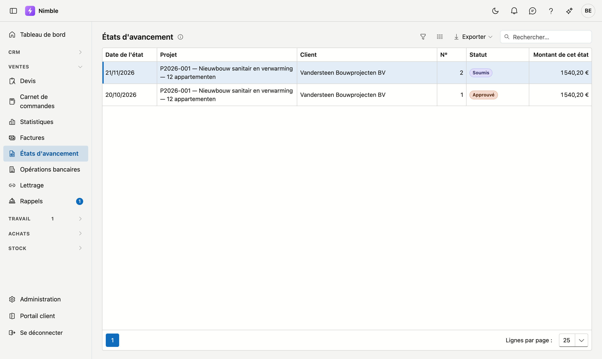
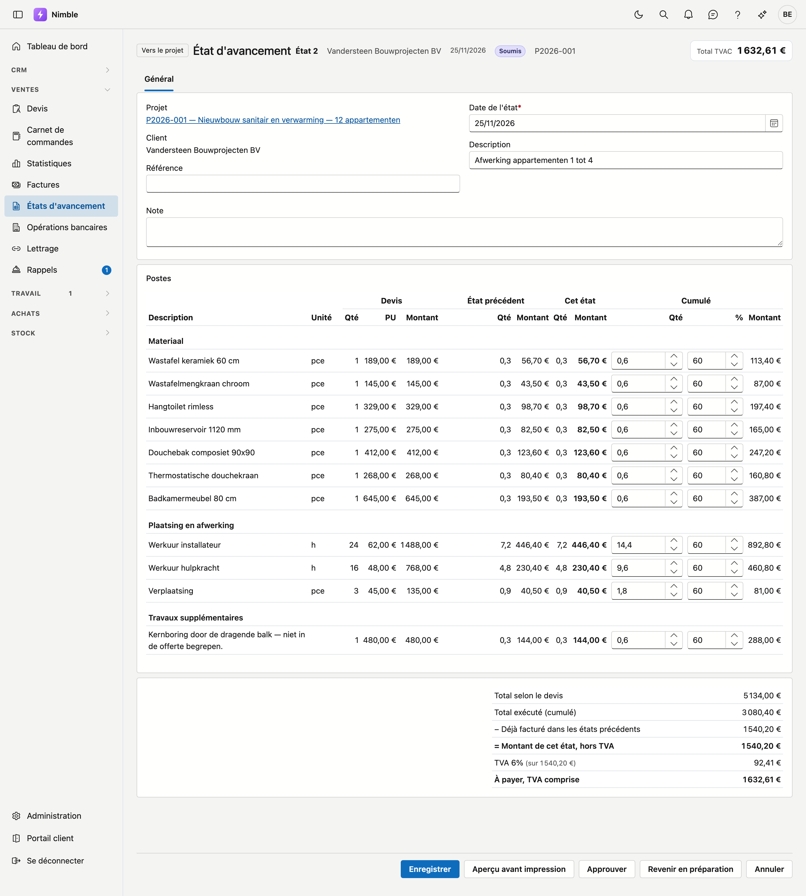

# États d'avancement

Avec un **état d'avancement**, vous facturez un chantier au fur et à mesure de son exécution. Pour chaque état,
vous indiquez ce qui a été réalisé jusqu'ici, le maître d'ouvrage ou son architecte l'approuve, puis il est
facturé.

## Ouvrir l'écran

Cliquez dans la barre latérale sur **Ventes → États d'avancement** pour tous les états, tous projets confondus.
Les états d'un projet figurent sur la fiche projet, onglet **États d'avancement**. Cet onglet apparaît pour un
projet avec un devis accepté.

## Un nouvel état

Sur la fiche projet, onglet **États d'avancement**, cliquez sur **Nouvel état d'avancement**. L'état reprend :

- les lignes du **devis accepté** du projet, avec leurs titres — chaque ligne est un **poste** ;
- les **travaux supplémentaires approuvés** du projet, chacun comme poste distinct sous le titre **Travaux
  supplémentaires**.

Les lignes en option et les lignes vides du devis n'y figurent pas. Un état suivant reprend les postes du
précédent, plus les travaux supplémentaires approuvés entre-temps.

Un nouvel état n'est possible que lorsque le précédent est **approuvé** : il poursuit le calcul à partir de ce
que cet état a figé. Sinon, l'onglet indique quel état est encore ouvert.

## L'en-tête de l'état

En haut de l'état figurent le numéro (par exemple *État 2*), le client, la date, le statut et le projet. Si l'état
est facturé, le lien **Vers la facture** y figure aussi. À droite figure le **Total TVAC** : ce que le client paie
pour cet état. Un devis et une facture ont le même en-tête. Avec **Vers la liste** en haut, vous revenez au projet.

## Compléter les postes

Par poste, vous indiquez combien a été exécuté **au total**, jusqu'à cet état inclus — pas seulement pour
cette période :

- dans la colonne **Qté** sous **Cumulé**, en quantité (m², ml, pièces …) ;
- ou dans la colonne **%**, en pourcentage du devis. Nimble calcule alors la quantité lui-même. C'est pratique
  pour un poste forfaitaire.

Nimble calcule le reste par poste :

| Colonne | Ce qu'elle indique |
|---|---|
| **Devis** | Quantité, prix unitaire et montant selon le devis |
| **État précédent** | Ce qui était exécuté jusqu'à l'état précédent inclus |
| **Cet état** | La différence : ce que cet état facture en plus |
| **Cumulé** | Ce qui est exécuté au total, avec le pourcentage du devis |

Si vous avez facturé trop la fois précédente, indiquez simplement le bon total : **Cet état** devient alors
négatif et le poste porte l'étiquette *Moins que l'état précédent : une correction*. Exécuter plus que prévu
au devis est aussi possible — pour un poste métré, c'est courant — et le poste porte alors l'étiquette *Plus
exécuté que prévu au devis*.

### Le premier état d'un projet

Si des avancements ont déjà été facturés pour ce projet avant de commencer dans Nimble, indiquez sur le
**premier** état, sous **État précédent**, combien avait déjà été facturé par poste. Sur un état suivant, cette
colonne est figée : elle provient de l'état précédent.

Si le projet a des états de l'application précédente, le bouton **Reprendre de l'application précédente** figure
au-dessus des postes. Il remplit **État précédent** pour vous :

- Nimble additionne par poste ce que les états **facturés** de l'application précédente ont avancé. Un état qui y
  attend encore une approbation n'est pas pris en compte : refaites cet avancement sur cet état, et facturez-le dans
  Nimble.
- Une ligne est placée sur un poste si la description et le prix sont identiques, ou sinon l'article et le prix, et
  uniquement si exactement un poste correspond.
- Ce qui ne correspond à aucun poste figure en dessous, avec la description, le prix, la quantité et le montant.
  Souvent, il s'agit de travaux supplémentaires absents du devis. Placez-les vous-même, ou ignorez-les s'ils ont déjà
  été réglés.
- Si **Cumulé** était inférieur au nouvel état précédent, il est relevé. Indiquez ensuite ce qui s'est ajouté depuis
  le dernier état.

Le bouton n'enregistre rien. Comparez le résultat à votre dernier état de l'application précédente, puis cliquez sur
**Enregistrer**.

## Le total

Sous les postes figurent :

- **Total selon le devis** et **Total exécuté (cumulé)** ;
- **Déjà facturé dans les états précédents** ;
- **Montant de cet état, hors TVA** — ce qui est facturé ;
- la TVA par taux, comme sur le devis, avec la mention légale en cas d'autoliquidation ;
- **À payer, TVA comprise**.

## De la préparation à la facture

| Étape | Bouton | Ce qui se passe |
|---|---|---|
| **En préparation** | **Enregistrer** | Vous complétez les postes. Un état en préparation peut encore être supprimé |
| **Soumis** | **Soumettre** | L'état est chez le maître d'ouvrage ou l'architecte. Il peut encore être modifié |
| **Approuvé** | **Approuver** | L'état est figé. **Retirer l'approbation** le ramène à Soumis |
| **Facturé** | **Facturer** | Une facture existe pour cet état |

**Revenir en préparation** ramène un état soumis en préparation. Si le maître d'ouvrage signe sur le chantier,
vous pouvez passer directement de **En préparation** à **Approuvé**.

Si vous cliquez sur une étape alors qu'une saisie n'est pas encore enregistrée, Nimble l'enregistre d'abord.

## Imprimer

**Aperçu avant impression** crée l'état en PDF pour le maître d'ouvrage : votre en-tête, le client, tous les
postes avec les colonnes devis, état précédent, cet état et cumulé, le total avec la TVA, et une case *pour
accord* à signer. Le document suit la langue du client. Un état en préparation porte la mention **PROJET**.

## Facturer

Sur un état approuvé, **Facturer** crée un **brouillon de facture** : une ligne par taux de TVA avec le montant
de cet état, par exemple *État d'avancement 3 — travaux exécutés jusqu'au 30/09/2026*. Le PDF de l'état est
joint à la facture. Le numéro de facture est attribué lorsque vous finalisez la facture — voir
[Factures](invoices.md).

Si vous supprimez le brouillon de facture, l'état redevient **Approuvé** et peut être facturé à nouveau.

!!! note "Par état ou en une fois"
    Un projet facturé par état d'avancement ne facture pas son devis une seconde fois en une fois : sur le
    devis, **Facturer** est alors grisé, avec la raison à côté. Le travail restant se facture via un état
    suivant.

## États avec le statut Ancienne application

Un état avec le statut **Ancienne application** est en lecture seule. Vous en voyez la date, la référence et le
montant ; il ne comporte pas de postes et ne compte pas comme état précédent. Ce que ces états ont déjà facturé est
repris par **Reprendre de l'application précédente** sur le premier état dans Nimble (voir ci-dessus).

### Un ancien état facturé dans Nimble

Si vous facturez un ancien état dans Nimble, par exemple avec une ou plusieurs factures que vous établissez vous-même, l'ancien
état ne le sait pas : son statut provient de l'ancienne application. Marquez-le alors comme facturé :

1. Ouvrez l'état et cliquez sur **Marquer comme facturé**.
2. Indiquez sous **Facturé avec** la ou les factures, par exemple *2026-208 et 2026-209*.
3. Cliquez sur **Enregistrer**.

L'état s'appelle ensuite **Facturé (ancien état)** et compte comme facturé pour **Reprendre de l'application précédente** sur
un état suivant. Une erreur ? Cliquez sur **Facturé avec…** puis sur **Effacer le marquage**.

Le bouton n'apparaît pas pour un ancien état déjà facturé dans l'ancienne application : il compte déjà.

## Voir aussi

- [Projets](../work/projects.md) — l'onglet États d'avancement sur la fiche projet
- [Devis](quotes.md) — les postes d'un état proviennent du devis accepté
- [Travaux supplémentaires](../work/extra-work.md) — les travaux approuvés deviennent un poste de l'état
- [Factures](invoices.md) — finaliser la facture issue d'un état
