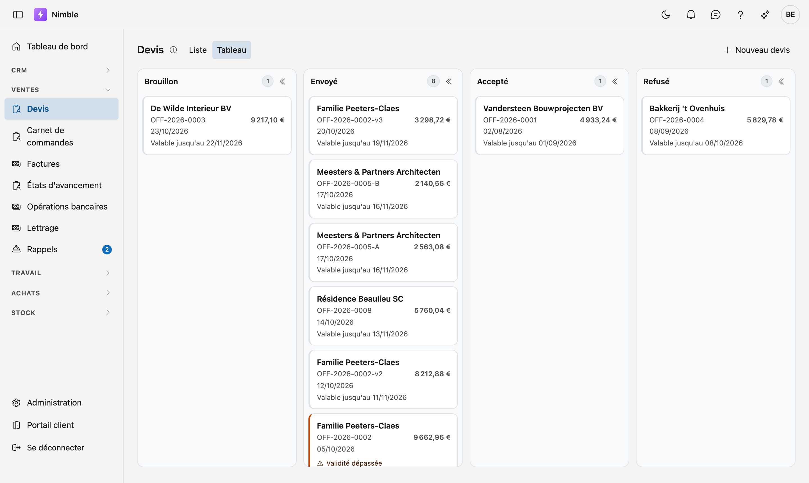
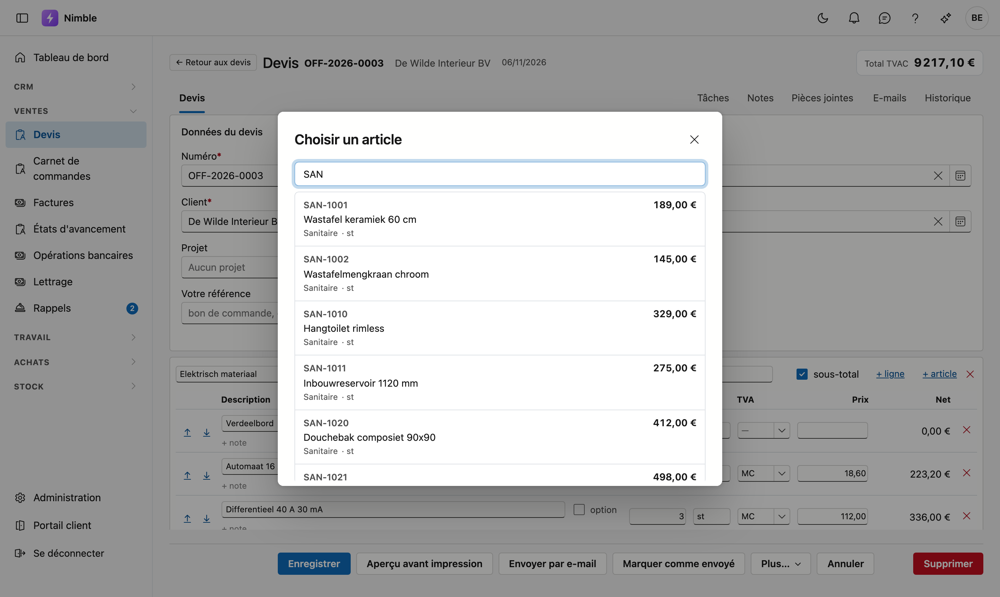
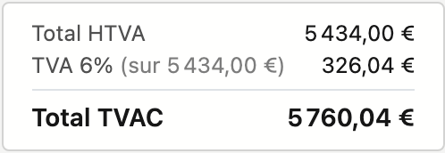
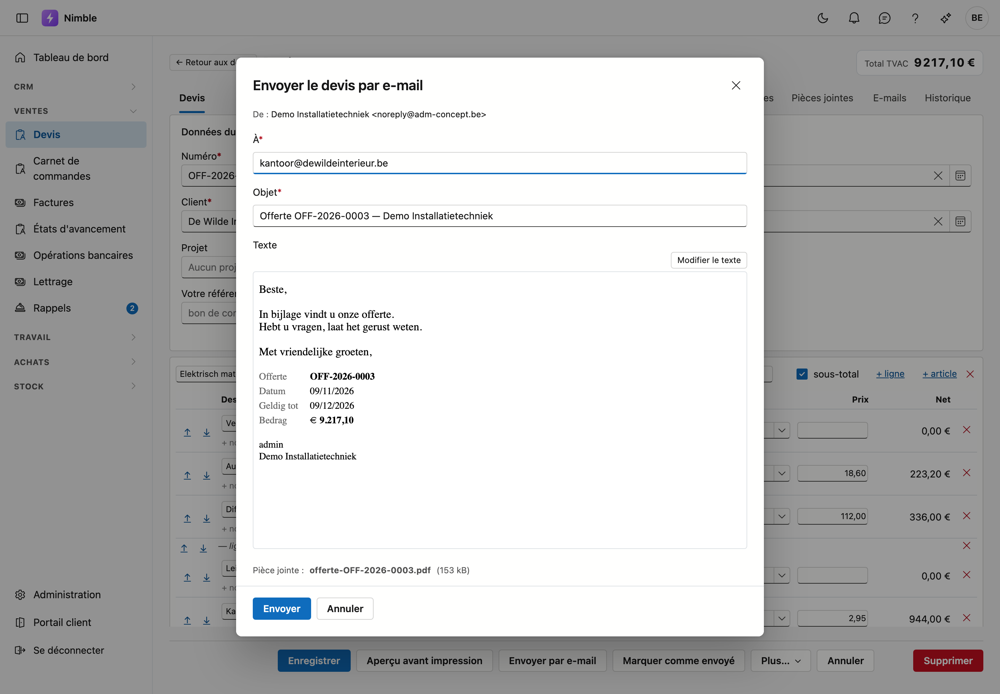
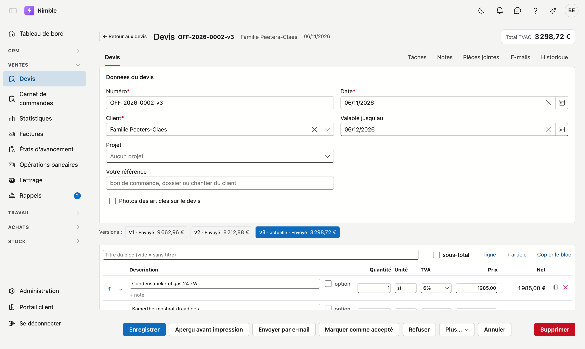

# Devis

Un devis est votre proposition de prix à un client. Vous le composez à partir de **blocs** contenant des
lignes — travaux, matériaux et heures. Ensuite, vous suivez si le client l'accepte, et vous le facturez.

## Ouvrir l'écran

Dans la barre latérale, cliquez sur **Ventes → Devis**.

## La liste et le tableau

En haut à gauche, vous choisissez entre deux vues : **Liste** et **Tableau**. Votre choix est conservé : si
vous rouvrez l'écran plus tard, il se présente dans la vue que vous avez utilisée en dernier.

### Liste

| Colonne | Ce que vous voyez |
|---|---|
| **Numéro** | Le numéro du devis. Les variantes et versions portent un suffixe, comme `-A` ou `-v2` |
| **Client** | Pour qui est le devis |
| **Date** | La date de la proposition |
| **Valable jusqu'au** | Jusqu'à quand le prix s'applique. Si un devis envoyé a dépassé cette date, la durée du dépassement s'affiche en rouge — *10 jours*, *2 mois* |
| **Montant** | Le total TVA comprise |
| **Statut** | Brouillon, Envoyé, Accepté, Refusé ou Remplacé |

À côté des boutons de vue, une liste déroulante permet de restreindre rapidement l'affichage : **Brouillon**,
**Envoyé**, **Accepté**, **Refusé**, **Remplacé** ou **Échus**, chaque fois suivi du nombre. Un choix qui ne concerne aucun
devis n'apparaît pas. À droite figurent **Nouveau devis**, **Exporter** et le champ de recherche.

**Double-cliquez** une ligne pour ouvrir le devis.

À droite de la liste se trouve la barre étroite **Journal**. Dépliez-la pour voir les tâches, notes, pièces
jointes, e-mails et l'historique du devis sélectionné dans la liste, sans l'ouvrir.

### Tableau

Le tableau répartit les mêmes devis sur quatre colonnes : **Brouillon**, **Envoyé**, **Accepté** et
**Refusé**. Chaque carte affiche le client, le numéro, le montant, la date et la date de validité. Si la
validité d'un devis envoyé est dépassée, la carte indique *Validité dépassée*.

Une version **remplacée** n'apparaît pas sur le tableau : il montre ce qui reste à faire. Vous la trouvez
dans la liste, avec le choix **Remplacé**.

- **Cliquez** une carte pour ouvrir le devis.
- **Glissez** une carte vers une autre colonne pour changer le statut. Si ce changement n'est pas permis,
  vous lisez pourquoi et la carte reste en place.
- Avec la double flèche à droite de l'en-tête, vous **repliez** une colonne : elle devient une bande étroite avec son nom
  et le nombre de cartes. Cliquez à nouveau sur la flèche pour la déplier. Nimble retient par utilisateur les colonnes
  repliées.

## Un nouveau devis

Cliquez sur **Nouveau devis**. Vous complétez d'abord le bloc **Données du devis** :

| Champ | Signification |
|---|---|
| **Numéro** | Obligatoire. Attribué automatiquement (`OFF-2026-0001`) ; vous pouvez le modifier. Il doit rester unique |
| **Client** | Obligatoire. À choisir parmi vos [relations](../relations.md) |
| **Projet** | Facultatif. Si le devis se rattache à un projet, il fait partie du dossier de ce projet. Il vaut pour toutes les versions et variantes du devis, et vous pouvez encore le choisir ou le modifier après l'acceptation |
| **Date** | Obligatoire. La date de la proposition ; aujourd'hui par défaut |
| **Valable jusqu'au** | Facultatif. Jusqu'à quand votre prix s'applique |
| **Votre référence** | Facultatif. La référence du client : son numéro de bon de commande, son dossier ou son chantier. Elle figure sur le devis près des dates et suit vers la facture. Vous pouvez encore la compléter après l'acceptation — le client envoie souvent son bon de commande avec son accord. Sur un devis accepté, elle est enregistrée aussitôt |
| **Lead** | Visible uniquement sur un devis créé avec **Créer un devis** sur un lead : le lead dont il provient, avec un lien vers sa fiche. Lorsque ce devis — ou une nouvelle version — est accepté, ce lead passe automatiquement à **Gagné**. Voir [Leads](../crm/leads.md#creer-un-devis-pour-un-lead) |

Cliquez ensuite sur **Enregistrer**.

!!! info "D'abord enregistrer, ensuite les blocs et les lignes"
    Les blocs et les lignes appartiennent à un devis enregistré. Tant qu'il ne l'est pas, vous lisez
    *Enregistrez d'abord le devis ; vous pourrez ensuite ajouter des blocs et des lignes.*

S'il manque un champ obligatoire, le haut de la fiche indique lequel. Si vous avez modifié quelque chose sans
enregistrer, *Non enregistré* s'affiche à côté du numéro.

## La fiche du devis

En haut figurent le numéro, le client et la date. En haut à droite figure le **Total TVAC** ; il reste
visible lorsque vous faites défiler la page.

La fiche comporte les onglets **Devis**, **Tâches**, **Notes**, **Pièces jointes**, **E-mails** et
**Historique**. Le fonctionnement des cinq derniers est décrit dans [Travailler avec une fiche](../fiches.md).

Si le devis est arrivé via la connexion avec un autre logiciel (l'API), **Créé via** suivi du nom de ce logiciel figure à côté du numéro. Un tel devis est toujours en brouillon : vous le finalisez et l'envoyez vous-même. Tant que personne pouvant modifier les devis n'a ouvert la fiche, la cloche en haut à droite indique combien de devis de ce type il y a.

Si le devis a été envoyé par e-mail ou proposé en ligne, le bloc Données du devis comporte des lignes
supplémentaires :

- **Envoyé le** — quand et à quelle adresse le devis a été envoyé.
- **Proposé en ligne** — le lien que reçoit le client, avec sa date de validité. Vous pouvez copier ce lien
  et le transmettre vous-même.

## Blocs et lignes

Un devis est un **document**, pas une liste de courses. Vous répartissez le travail en blocs avec un titre
— « Travaux préparatoires », « Couverture », « Finitions » — pour que le client lise ce qu'il achète.

- **+ Ajouter un bloc** (sous le dernier bloc) crée un nouveau bloc.
- Le **titre** du bloc se saisit en haut. Si vous le laissez vide, le devis n'affiche pas de titre.
- Cocher **sous-total** affiche le total de ce bloc sous les lignes, comme *Sous-total du bloc*.
- Le ✕ rouge à côté du titre supprime le bloc avec ses lignes. Ce bouton apparaît dès qu'il y a plus d'un
  bloc.

Chaque bloc offre deux façons d'ajouter une ligne :

- **+ ligne** — une ligne vide que vous décrivez vous-même.
- **+ article** — choisissez un article dans votre [catalogue](../inventory/articles.md). La description,
  l'unité et le prix de vente suivent. La ligne arrive dans ce bloc-là.

Pour copier :

- L'**icône de copie** à côté du ✕ rouge d'une ligne place une copie de cette ligne juste en dessous, avec l'article, la
  quantité, le prix, la TVA et l'option. La quantité est prête à être modifiée.
- **Copier le bloc** dans le titre d'un bloc place une copie du bloc avec toutes ses lignes juste sous l'original.

!!! tip "Recherchez par numéro ou par description"
    Dans la fenêtre **Choisir un article**, saisissez un numéro d'article, une partie de la description, ou
    les deux. « DIE weekend » trouve l'article `DIE-9002 — Heure installateur — week-end`. Pour un service,
    **Service** figure après la famille et l'unité ; pour un
    [article de devis](../inventory/articles.md#le-type-dun-article), **Article de devis**.

### Charger un accord de prix

Si un [accord de prix](price-agreements.md) s'applique au client à la date du devis, au-dessus des lignes figure
*Un accord de prix s'applique à ce client à la date du devis :* avec un bouton **Charger « … »**. Il place tous les
postes de l'accord dans le devis, au prix convenu et avec la quantité 0, chacun sous son chapitre. Un article que
vous choisissez avec **+ article** reçoit lui aussi le prix convenu. Une telle ligne porte la mention **Accord de
prix**, jusqu'à ce que vous modifiiez le prix manuellement.

S'il reste des lignes avec la quantité 0 au moment d'imprimer ou d'envoyer, Nimble vous avertit.

### Importer une offre fournisseur

Vous recevez pour une partie des travaux une offre d'un fournisseur (fenêtres, pompe à chaleur, cuisine) ? L'IA en lit les
lignes pour vous. Choisissez sous **Plus…** l'action **Importer une offre fournisseur** et glissez l'offre du fournisseur dans
la fenêtre (PDF, JPG, PNG ou WebP).

- L'IA lit pour chaque ligne la description, la quantité, l'unité et le prix net. Vous les voyez dans une liste, avec le
  **prix d'achat** et le **prix de vente**.
- Indiquez votre **marge** en pour cent : le prix de vente est le prix d'achat plus la marge. Décochez ce qui ne doit pas suivre.
- Avec **Ajouter au devis**, les lignes arrivent dans un bloc portant le nom du fournisseur et le numéro de son offre (vous
  pouvez adapter ce nom). Elles reçoivent le taux de TVA de la dernière ligne, comme avec **+ ligne**.
- **Rien n'est enregistré avant que vous enregistriez le devis.** Vérifiez les lignes : l'IA peut se tromper. Si la somme des
  lignes diffère du total de l'offre du fournisseur, ou si l'IA n'a pas pu lire un prix, la fenêtre le signale.
- Le prix d'achat et le code article du fournisseur n'apparaissent **pas** sur le devis du client.
- L'offre du fournisseur est ensuite jointe à ce devis (*Offre fournisseur, lue par l'IA*).

Cela n'est possible qu'avec votre propre **clé IA** dans le portail ADM One et l'autorisation d'analyse de documents, comme pour
[faire lire une facture d'achat](../purchasing/purchase-invoices.md#faire-lire-par-lia). Vous payez les coûts directement à votre
fournisseur d'IA.

### Utiliser un modèle

Si vous faites souvent un devis semblable, enregistrez les blocs et les lignes comme **modèle**.

- **Plus…** → **Enregistrer comme modèle** : donnez un nom, par exemple *Salle de bain standard*, et cliquez sur **Enregistrer**. Le
  modèle conserve les blocs et les lignes de ce devis, sans client.
- **Plus…** → **Insérer un modèle** : choisissez un modèle et cliquez sur **Insérer**. Les blocs et les lignes s'ajoutent en bas de ce
  devis. Une ligne avec un article reçoit le prix du jour : l'accord de prix du client, sinon le prix de vente. Une ligne sans article
  garde le prix enregistré. Enregistrez ensuite le devis.
- Un modèle dont vous n'avez plus besoin se supprime avec le ✕ rouge dans la fenêtre **Insérer un modèle**. Il va dans la
  [corbeille](../administration/recycle-bin.md). Les devis créés avec lui restent inchangés.

**Insérer un modèle** apparaît dès que le devis a été enregistré une fois.

### Les champs d'une ligne

| Champ | Signification |
|---|---|
| **Description** | Ce que le client lit. Librement modifiable, même pour un article du catalogue |
| **option** | La ligne figure au devis **avec** son prix mais ne compte **pas** dans le total |
| **+ note** | Un texte supplémentaire sous la description, par exemple une marque ou une condition |
| **Quantité** | Peut contenir des décimales (0,25 heure) |
| **Unité** | Pièces, heures, mètres — reprise de l'article |
| **TVA** | Le [code TVA](../administration/vat-codes.md) de cette ligne. La liste ouverte indique ce que signifie chaque code |
| **Prix** | Le prix unitaire |
| **Net** | Quantité × prix, calculé |

Les flèches ↑ et ↓ déplacent une ligne dans son bloc. Le ✕ rouge la supprime. Une ligne *— ligne vide —*
n'est qu'un espace sur le document ; vous pouvez aussi la déplacer ou la supprimer.

!!! tip "Une nouvelle ligne reprend la TVA de la précédente"
    Une nouvelle ligne reçoit le code TVA de la dernière ligne du devis. Si vous travaillez en cocontractant,
    vous ne devez donc pas le choisir sur chaque ligne. Sur un devis vide, la première ligne reçoit le
    premier code de votre liste de codes TVA.

## Les totaux

Sous les blocs figure le détail :

- **Total HTVA**.
- Une ligne par taux de TVA, avec la base sur laquelle cette TVA est calculée — par exemple *TVA 6% (sur
  2 418,00 €)*.
- **Total TVAC**.
- En dessous, la mention légale liée à un code TVA, comme le texte en cas d'autoliquidation. Cette mention
  figure aussi sur le document.

!!! info "Comment la TVA est calculée"
    Nimble calcule la TVA une fois par taux : sur la somme des lignes à ce taux, arrondie au cent. C'est aussi
    le calcul de la norme européenne pour les factures électroniques, et ainsi devis et facture restent égaux
    au cent près. Les devis établis auparavant calculaient la TVA par ligne et gardent leurs montants.

Si un code TVA applique 0 % sans mention légale, un avertissement s'affiche. Vérifiez alors : en cas
d'autoliquidation, de livraison intracommunautaire ou d'exportation, le motif doit figurer sur le document.

Si le devis comporte des lignes en option, **Options (TVA comprise, hors total)** s'affiche en dessous. Deux
choses à savoir sur ce montant :

- Il n'entre **pas** dans le total ci-dessus. Si le client retient l'option, le montant vient s'y ajouter. Si
  vous [proposez le devis en ligne](#les-options-sur-le-devis-en-ligne), le client y coche lui-même les options.
- Il est **TVA comprise**, alors que la ligne en option affiche son montant hors TVA — comme toute autre
  ligne. Les deux chiffres diffèrent donc, et c'est normal.

## Les boutons du bas

Les boutons affichés dépendent du statut du devis et de vos droits. De gauche à droite. Les actions moins
utilisées se trouvent sous **Plus…**, avant Annuler.

| Bouton | Quand | Ce qu'il fait |
|---|---|---|
| **Enregistrer** | Brouillon et Envoyé | Enregistre vos modifications |
| **Aperçu avant impression** | Toujours | Affiche le document tel que le client le reçoit |
| **Envoyer par e-mail** | Toujours | Ouvre la fenêtre d'envoi |
| **Plus…** → **Proposer en ligne** | Brouillon et Envoyé | Met le devis en ligne, pour que le client puisse l'accepter ou le refuser |
| **Plus…** → **Proposer à nouveau en ligne** | Brouillon et Envoyé, dès que le devis est en ligne | Affiche le devis tel qu'il est maintenant, derrière le même lien |
| **Plus…** → **Retirer la version en ligne** | Dès que le devis est en ligne | Supprime la version en ligne |
| **Marquer comme envoyé** | Brouillon et Refusé | Change uniquement le statut ; rien n'est envoyé |
| **Marquer comme accepté** · **Refuser** | Envoyé | Enregistre la réponse du client. Si le devis n'est lié à aucun projet, Nimble en crée un lors de l'acceptation — voir *Le travail accepté est lié à un projet* ci-dessous |
| **Créer un projet** | Accepté, sans projet | Ouvre un nouveau projet avec le client et l'adresse du chantier du devis déjà remplis. À l'enregistrement, le devis et toutes ses versions sont rattachés à ce projet |
| **Facturer** | Accepté | Crée un brouillon de facture avec les lignes du devis |
| **Plus…** → **Nouvelle version** | Accepté, Refusé et Remplacé | Crée une copie modifiable |
| **Plus…** → **Envoyer un rappel** | Envoyé | Ouvre la fenêtre d'envoi avec le rappel, voir *Le suivi du devis* |
| **Plus…** → **Insérer un modèle** · **Enregistrer comme modèle** | Brouillon et Envoyé · toujours | Voir *Utiliser un modèle* |
| **Annuler** | Brouillon et Envoyé | Abandonne vos modifications. Sur un devis clôturé, le bouton n'y figure pas : vous revenez avec **← Retour aux devis** en haut |
| **Supprimer** | Brouillon, Envoyé et Refusé | Après confirmation, place le devis dans la corbeille. Un devis accepté, remplacé ou facturé ne peut pas être supprimé |

Toute personne autorisée à consulter les devis peut utiliser l'aperçu avant impression. Les autres boutons
demandent le droit de modifier les devis.

!!! info "Les boutons reprennent les termes de votre entreprise"
    Les boutons *Marquer comme …* utilisent les noms de statut que vous définissez vous-même dans
    [Statuts de devis](../administration/quote-status.md).

## Imprimer le devis

Cliquez sur **Aperçu avant impression**. Vous voyez le document tel que le client le recevra. La barre
d'outils au-dessus du document vous permet de feuilleter les pages, de zoomer et d'imprimer. En haut de la
fenêtre figurent **Télécharger** — le devis arrive en PDF dans votre dossier de téléchargements — et
**Envoyer par courriel**.

En haut du document figurent vos propres coordonnées — nom, adresse, téléphone, numéro de TVA et votre logo.
Elles proviennent de la [fiche d'entreprise](../settings/company-profile.md) dans l'administration.
L'en-tête, la formule d'appel et les conditions se règlent dans les
[modèles de documents](../settings/document-templates.md).

!!! info "Le devis suit la langue du client"
    Le document est établi dans la langue indiquée sur la fiche client sous **Langue des documents**, et non
    dans celle où vous travaillez. Si ce champ est vide, le devis suit la langue de votre entreprise.

Si vous cochez **Photos des articles sur le devis** dans les données du devis, chaque ligne avec un article affiche la photo de
cet article. Vous choisissez cette photo sur la [fiche article](../inventory/articles.md#la-photo-dun-article). Un article sans photo
n'en reçoit pas.

Les lignes de titre et les lignes vides apparaissent sur le document comme intertitre et comme espace, sans
quantité ni montant. Le sous-total figure sous chaque bloc, et le détail en bas de page.

Si l'impression échoue, la fenêtre *L'impression n'a pas pu être générée* s'ouvre avec la cause technique.
Transmettez ce texte lorsque vous demandez de l'aide.

## Envoyer le devis par e-mail

Cliquez sur **Envoyer par e-mail**. Si vous avez des modifications non enregistrées, Nimble vous demande
d'abord d'enregistrer : ce que vous envoyez doit aussi figurer dans le dossier.

La fenêtre **Envoyer le devis par e-mail** est déjà remplie avec le mail de votre [modèle de
mail](../settings/mail-templates.md) *Devis*, avec les données de ce devis :

| Champ | Contenu |
|---|---|
| **De** | L'expéditeur du modèle de mail, ou votre expéditeur par défaut — voir [Expéditeurs de mail](../settings/mail-senders.md) |
| **À** | Obligatoire. L'adresse e-mail du client |
| **Objet** | Obligatoire. Issu du modèle de mail, avec votre numéro de devis |
| **Texte** | Le mail tel qu'il partira |
| **Pièce jointe** | Le devis en PDF, avec sa taille |

Vous modifiez **À** et **Objet** directement. Pour adapter aussi le texte, cliquez sur **Modifier le texte** :
le mail passe dans un éditeur. Ce que vous y changez ne vaut que pour ce mail — le modèle de mail reste tel
quel. L'e-mail part dans la langue du client, comme le devis lui-même.

Si le modèle de mail contient le lien vers le devis en ligne, le client reçoit ce lien dans le mail :

- Si le devis est déjà en ligne, c'est ce lien-là.
- S'il n'est pas encore en ligne, si le lien est expiré, ou si le devis a changé depuis sa mise en ligne, la fenêtre indique : *Cet e-mail contient le lien
  vers le devis en ligne. À l'envoi, Nimble met le devis en ligne.* Cela se fait seulement quand vous cliquez
  sur **Envoyer**, et uniquement si le lien figure encore dans le mail.

Après l'envoi, quatre choses se produisent :

- Si le devis était en **Brouillon**, il passe automatiquement à **Envoyé**.
- Une copie du PDF envoyé est ajoutée aux **Pièces jointes** du devis, avec l'adresse.
- La fiche affiche **Envoyé le**, avec la date et l'adresse.
- Le mail lui-même figure sous **E-mails** sur le devis, tel qu'il est parti.

!!! tip "Déjà remis vous-même ? Utilisez Marquer comme envoyé"
    Si vous avez remis le devis par courrier ou depuis votre propre messagerie, utilisez **Marquer comme
    envoyé**. Ce bouton ne fait que changer le statut ; il n'envoie rien.

!!! warning "Devis trop volumineux"
    Au-delà de 10 Mo, Nimble refuse d'envoyer. Au-dessus, l'e-mail partirait sans le devis. Mieux vaut un
    devis qui ne part pas qu'un devis qui arrive vide.

## Proposer le devis en ligne

Avec **Plus…** → **Proposer en ligne**, Nimble publie le devis sur une page à part. Le client peut l'y consulter et
l'accepter ou le refuser. Les modifications non enregistrées sont d'abord enregistrées.

- Le lien figure ensuite sur la fiche sous **Proposé en ligne**. Transmettez-le vous-même, ou placez la
  variable `{{online_link}}` dans votre [modèle de mail](../settings/mail-templates.md#le-lien-vers-le-devis-en-ligne) :
  le client reçoit alors le lien dans le mail.
- Le lien est valable jusqu'à la date indiquée sous **Valable jusqu'au**. Sans date, il est valable trente
  jours.
- Si **Valable jusqu'au** est dans le passé, Nimble refuse de mettre le devis en ligne et vous lisez
  pourquoi.
- Si le client accepte ou refuse en ligne, Nimble adapte le statut du devis. Si vous avez entre-temps déjà
  mis le devis sur Accepté ou Refusé, votre décision est conservée.
- Si le client accepte en ligne un devis sans projet, Nimble en crée un, comme décrit ci-dessous.
- **Vous êtes averti.** La **cloche** en haut à droite affiche *2 devis ont reçu une réponse en ligne du
  client* — à qui peut modifier les devis. La notification disparaît dès que quelqu'un ouvre le devis.
- **Et par e-mail :** la personne qui a envoyé le devis, et l'adresse de **Réponses en ligne aux devis vers**
  sur la [Fiche d'entreprise](../settings/company-profile.md#reponses-en-ligne-aux-devis-vers). L'e-mail reprend
  le devis, le client, le nom qu'il a indiqué, en cas d'acceptation les options qu'il a choisies et, en cas de
  refus, son motif, avec un lien vers le devis. Un devis envoyé avant la version 0.5.108 ne connaît pas son
  expéditeur : l'e-mail part alors uniquement vers la fiche d'entreprise.
- **Le lien ne fonctionne qu'une fois.** Une fois que le client a répondu, le lien n'affiche plus le formulaire, mais
  un message l'invitant à contacter sa personne de contact. S'il doit répondre à nouveau, proposez à nouveau le devis
  en ligne. Un lien déjà envoyé avant la version 0.5.121 continue de fonctionner comme avant, jusqu'à ce que vous
  proposiez à nouveau le devis.

**Si vous modifiez le devis alors qu'il est en ligne**, la page continue d'afficher l'ancien contenu jusqu'à ce que vous
choisissiez **Plus…** → **Proposer à nouveau en ligne**. La fiche le signale tant que c'est le cas, et le message disparaît
dès que la page correspond de nouveau. Une modification que le client ne voit pas, comme une note interne, ne donne pas de
message. Pour un lien antérieur à la version 0.5.121, Nimble ne peut pas le voir. Le lien reste le même : qui a déjà reçu le mail
voit le nouveau contenu. Si le client avait encore l'ancienne page ouverte et y répond, Nimble ne l'applique pas et vous en êtes averti,
comme décrit ci-dessous.

**Plus…** → **Retirer la version en ligne** supprime la page. Le lien ne fonctionne plus, pas même celui déjà envoyé.

### Une réponse en ligne que Nimble ne traite pas

Il arrive que le client réponde en ligne, voie une confirmation, et que Nimble n'applique pourtant pas sa réponse :

- Le devis était déjà décidé ou clôturé, par exemple parce que vous l'aviez entre-temps mis sur Accepté.
- Le client avait encore un onglet ouvert avec une **version antérieure** de la page, d'avant que vous proposiez à
  nouveau le devis.
- Le client a choisi une option qui ne figure plus sur le devis.
- Une autre version du devis est déjà facturée.

Le devis ne change pas. Le client pense toutefois que c'est réglé : Nimble vous avertit donc comme pour une réponse
normale, par la cloche et par e-mail. Sur la fiche, un bloc de couleur *Réponse en ligne du client non traitée* indique
quand il a répondu, ce qu'il a choisi et pourquoi cela n'a pas abouti. Contactez le client. Si le devis est encore
ouvert et qu'il doit répondre à nouveau, proposez-le à nouveau en ligne : le bloc disparaît et le lien se rouvre.

### Les options sur le devis en ligne

Si le devis comporte des [lignes en option](#les-champs-dune-ligne), le client les choisit lui-même sur la page
en ligne.

- En haut figure le devis avec son total sans options, marqué *Inclus* : le client ne peut pas le décocher. En
  dessous, chaque option apparaît par bloc avec une case à cocher, sa description, la quantité et son montant TVA
  comprise.
- Les options sont **décochées**. Si le client en coche une, la page ajoute son montant au total.
- S'il accepte, les options qu'il a cochées deviennent des **lignes ordinaires** du devis : elles comptent dans le
  total, sur la facture et dans l'état d'avancement. Les options qu'il n'a pas choisies restent en option.
  L'Historique montre les lignes ainsi modifiées, et le journal d'audit cite les options choisies.

!!! warning "Si vous modifiez les options alors que le devis est en ligne"
    Si vous supprimez une option ou décochez **option** alors que le devis est en ligne, et que le client choisit
    justement cette option, Nimble ne passe **pas** le devis en Accepté. C'est [une réponse que Nimble ne
    traite pas](#une-reponse-en-ligne-que-nimble-ne-traite-pas). Contactez le client et enregistrez vous-même sa réponse.
    Si vous adaptez les options, choisissez aussitôt **Plus…** → **Proposer à nouveau en ligne** : le lien reste le
    même et affiche dès lors les nouvelles options.

## Faire signer le devis

Si votre entreprise a un contrat OKSign, lié dans ADM One, la fiche du devis affiche un bloc **Signature via
OKSign**. Le client signe alors le PDF du devis avec une vraie signature, par exemple pour de gros travaux. C'est une
deuxième voie à côté du devis en ligne : vous choisissez par devis.

Cliquez dans le bloc sur **Faire signer**. La fenêtre montre qui peut signer : le client lui-même et ses personnes
de contact. Choisissez le signataire et cliquez sur **Envoyer pour signature**.

- OKSign demande au signataire une **adresse e-mail** et un **numéro de GSM**. S'il en manque un, ou si le numéro est
  un fixe, c'est indiqué à côté de la personne et vous ne pouvez pas la choisir. Complétez la relation ou la
  personne de contact.
- Le signataire reçoit un e-mail avec un lien personnel, issu du [modèle d'e-mail](../settings/mail-templates.md)
  **Devis à signer (OKSign)**. La page de signature est dans sa langue.
- En bas du PDF figure un cadre **Pour accord** avec son nom : c'est là qu'il signe.
- Si le devis était en brouillon, il passe à **Envoyé**.

Ce n'est pas possible pour :

- un devis avec des **options** : proposez-le [en ligne](#proposer-le-devis-en-ligne), le client y coche les options ;
- un devis qui est **en ligne** : retirez d'abord le devis en ligne ;
- un devis déjà accepté, refusé ou remplacé ;
- un devis avec une ligne sans prix unitaire.

Tant qu'une demande est en attente, le bloc affiche le lien du signataire. Vous pouvez alors :

- **Renvoyer** — le même lien une nouvelle fois ;
- **Vérifier l'état** — vérifie tout de suite s'il a signé ;
- **Retirer** — si le client dit non, ou si vous voulez modifier le devis. OKSign supprime le document et le lien ne
  fonctionne plus. OKSign n'a pas de bouton pour refuser : notez ensuite un refus avec **Refuser**.

**Dès que le client a signé**, Nimble passe le devis à **Accepté**. Sous le message en haut, vous lisez *signé par
le client via OKSign*, et le PDF signé se trouve dans les **Pièces jointes**. Vous êtes averti comme pour une réponse
en ligne : par la cloche et par e-mail. Nimble vérifie l'état quand vous ouvrez le devis, et chaque matin.

!!! warning "Si vous modifiez le devis après son envoi pour signature"
    Le client signe le document tel qu'il est parti. Si vous modifiez le devis ensuite, Nimble ne le passe **pas**
    automatiquement à Accepté après la signature : le bloc indique *Signé, mais PAS accepté*. Consultez le PDF signé
    et enregistrez la décision vous-même, ou retirez la demande avant que le client signe et renvoyez le devis.

## Le suivi du devis

| Statut | Ce que vous pouvez faire |
|---|---|
| **Brouillon** | Modifier, envoyer par e-mail, proposer en ligne, ou **Marquer comme envoyé** |
| **Envoyé** | Encore modifier, ou enregistrer la réponse avec **Marquer comme accepté** ou **Refuser** |
| **Accepté** | **Facturer**, ou créer une **Nouvelle version** sous **Plus…** |
| **Refusé** | **Marquer comme envoyé** si le client revient, ou créer une **Nouvelle version** sous **Plus…** |
| **Remplacé** | Plus rien : une version plus récente du même devis a été acceptée. Elle reste conservée pour vérifier ce que le client a reçu auparavant |

!!! warning "Un devis accepté ou refusé est clôturé"
    Dès que le client a répondu, le document est figé. En haut figure *Ce devis est clôturé et ne peut plus
    être modifié.* Les champs, blocs et lignes ne sont pas modifiables, et en bas ne figurent ni
    Enregistrer ni Annuler : vous revenez avec **← Retour aux devis** en haut. C'est voulu : le client a reçu un prix, et celui-ci ne doit pas changer en
    silence.

    Si une modification s'impose malgré tout, cliquez sous **Plus…** sur **Nouvelle version**. Vous obtenez une copie avec
    les lignes actuelles, en Brouillon, avec un numéro de version de plus et une validité de trente jours.
    L'ancienne version subsiste, ce qui vous permet de vérifier ce que le client a reçu.

    Le numéro suit la version la plus élevée, même archivée : son numéro n'est pas réutilisé. Après
    `…-v2` et une v3 archivée, vous obtenez donc `…-v4`.

Un devis accepté ne change pas de statut, pas même sur le tableau. Un devis refusé, si : remettez-le avec
**Marquer comme envoyé**.

### Une tâche de suivi et un rappel

Si le suivi des devis est activé, Nimble crée la nuit une tâche **Suivre le devis** pour la personne qui l'a envoyé, dès qu'un devis
envoyé par e-mail reste une semaine sur **Envoyé** sans réponse. Par défaut, il est désactivé. La tâche figure dans l'onglet **Tâches** du devis et dans votre [liste de tâches](../crm/tasks.md). Si vous
renvoyez le devis, le compte recommence. L'activation, et après combien de jours, se règlent dans
[Suivi des leads et des devis](../administration/lead-follow-up.md).

Nimble n'envoie rien au client. Pour lui rappeler le devis, cliquez sur **Plus…** → **Envoyer un rappel**. La fenêtre d'envoi s'ouvre
avec le texte du rappel et le devis en pièce jointe ; adaptez le texte et cliquez sur **Envoyer**. Ce texte se règle dans
[Modèles de mail](../settings/mail-templates.md), sous *Rappel d'un devis*.

### Enregistrer la réponse du client

Si vous cliquez sur **Marquer comme accepté** ou **Refuser**, ou si vous faites glisser une carte du tableau
vers **Accepté** ou **Refusé**, Nimble vous demande d'abord trois choses :

| Champ | Ce que vous indiquez |
|---|---|
| **Date de la décision** | Le jour où le client a décidé. Aujourd'hui par défaut ; si le client a appelé lundi et que vous le notez mercredi, indiquez lundi |
| **Qui chez le client** | La personne qui a dit oui ou non. Facultatif |
| **Motif** | Uniquement pour un refus : pourquoi, si vous le savez. Facultatif |

Ensuite, sous le message en haut du devis, figure par exemple *Accepté le 22/09/2026 par Jan Peeters — noté
par un collaborateur.* Si le client décide en ligne, vous lisez *en ligne, par le client* ; s'il a signé via
[OKSign](#faire-signer-le-devis), *signé par le client via OKSign*. **Annuler** laisse
le devis tel quel ; sur le tableau, la carte revient à sa place.

Si vous remettez un devis refusé avec **Marquer comme envoyé**, ce refus est annulé. Le Journal conserve ce
qui figurait auparavant.

## Le travail accepté est lié à un projet

Un devis accepté appartient à un projet : le carnet de commandes, le planning et le post-calcul se calculent par
projet. Si vous acceptez un devis sans projet — avec **Marquer comme accepté**, sur le tableau, ou parce que le client
l'accepte en ligne — Nimble en crée un lui-même :

| | Ce que reçoit le nouveau projet |
|---|---|
| **Numéro** | Le numéro suivant de votre série de projets. Si vous n'avez pas défini de série, le numéro du devis |
| **Nom** | La première ligne de la note du devis. Si elle est vide, le nom du client et le numéro du devis |
| **Client** et **adresse du chantier** | Le client du devis et son adresse |

Si une autre version ou variante du même devis est déjà liée à un projet, le devis rejoint ce projet. Nimble indique
à quel projet le devis est lié. Complétez ensuite sur la fiche du projet ce qui manque encore : la vraie
adresse du chantier, le responsable, la phase.

## Facturer

Sur un devis accepté, **Facturer** crée un brouillon de facture avec les lignes du devis et l'ouvre
aussitôt. Le projet et **Votre référence** suivent. Le numéro de facture n'est attribué qu'à la finalisation — voir [Factures](invoices.md).

Si ce n'est pas possible, le bouton est grisé et la raison figure à côté :

- *Ce devis a déjà été facturé.*
- *Ce devis ne contient aucune ligne facturable.* — par exemple lorsqu'il ne contient que des lignes en
  option.
- *Ce projet est facturé par état d'avancement.* — le travail restant se facture via un état suivant ; voir
  [États d'avancement](progress-reports.md).

## Versions et variantes

Si le devis fait partie d'une série, des boutons avec les montants côte à côte figurent en haut de l'onglet
Devis. Cliquez-en un pour ouvrir ce devis ; celui que vous consultez est mis en couleur.

- Les **versions** (v1, v2, v3) sont des propositions successives pour la même demande. La plus élevée fait
  foi et porte la mention *actuelle*.
- Les **variantes** sont des réponses différentes à la même demande — par exemple « A — douche à
  l'italienne » à côté de « B — baignoire ». Chaque variante a ses propres numéros de version, et donc sa
  propre mention *actuelle*.

Chaque bouton indique aussi le statut de cette version.

### Lorsqu'une nouvelle version est acceptée

Il n'y a qu'un seul accord valable par devis. Lorsqu'une nouvelle version est acceptée — avec le bouton, ou
par le client en ligne — la version acceptée précédente de la même variante passe à **Remplacé**. Elle reste
conservée, mais ne compte plus dans le montant *Convenu* du projet, et ne peut pas être facturée.

!!! warning "Si une version précédente est déjà facturée, une nouvelle ne peut pas être acceptée"
    Nimble refuse alors avec le message *La version … de ce devis a déjà été facturée.* Une modification
    après facturation passe par des [travaux supplémentaires](../work/extra-work.md) ou une note de crédit,
    pas par une nouvelle version — sinon vous facturez deux fois le même travail.

    Si le client accepte une telle version en ligne, elle n'est pas appliquée. Vous la retrouvez dans le
    journal d'audit sous *Acceptation bloquée*.

## Erreurs fréquentes

!!! warning
    - **Une ligne sans code TVA** calcule 0 % de TVA. Vérifiez que les
      [codes TVA](../administration/vat-codes.md) sont complétés dans l'administration.
    - **Vouloir qu'une ligne en option compte dans le total** — ce n'est pas le cas, et c'est voulu. Si vous
      souhaitez inclure le montant, décochez **option**.
    - **Vouloir modifier un devis accepté** — créez une nouvelle version plutôt que de retoucher l'ancienne.
    - **Vouloir supprimer un devis accepté** — ce n'est pas possible : le client l'a accepté. S'il n'est
      plus correct, créez une nouvelle version ; l'ancienne devient *Remplacé* dès que la nouvelle est
      acceptée.
    - **Deux fois le même numéro** — si vous modifiez le numéro à la main, choisissez-en un qui n'existe pas
      encore.

## Voir aussi

- [Factures](invoices.md) — ce qui suit un devis accepté
- [Articles](../inventory/articles.md) — le catalogue d'où proviennent vos lignes
- [Accords de prix](price-agreements.md) — charger les prix convenus par client
- [Relations](../relations.md) — vos clients et leur langue des documents
- [Codes TVA](../administration/vat-codes.md) — les taux et leur mention légale
- [Statuts de devis](../administration/quote-status.md) — modifier le texte des quatre statuts
- [Modèles de documents](../settings/document-templates.md) — en-tête, formule d'appel et conditions
- [Travailler avec une fiche](../fiches.md) — onglets, enregistrement et suppression
- [Filtrer les listes](../lijsten-filteren.md) — l'entonnoir et le générateur de filtres
- [Lorsque votre compte est limité](../getting-started/account-restricted.md) — quand créer ou envoyer un devis n'est pas possible
