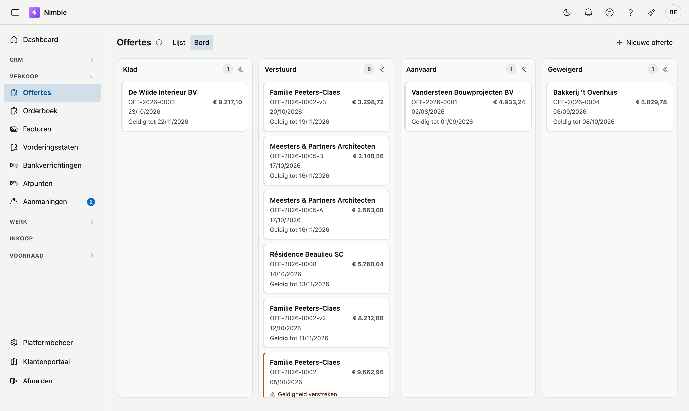
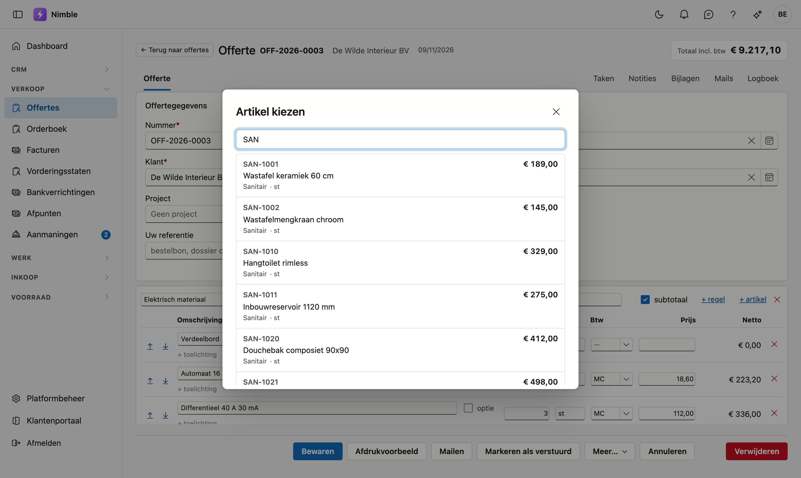
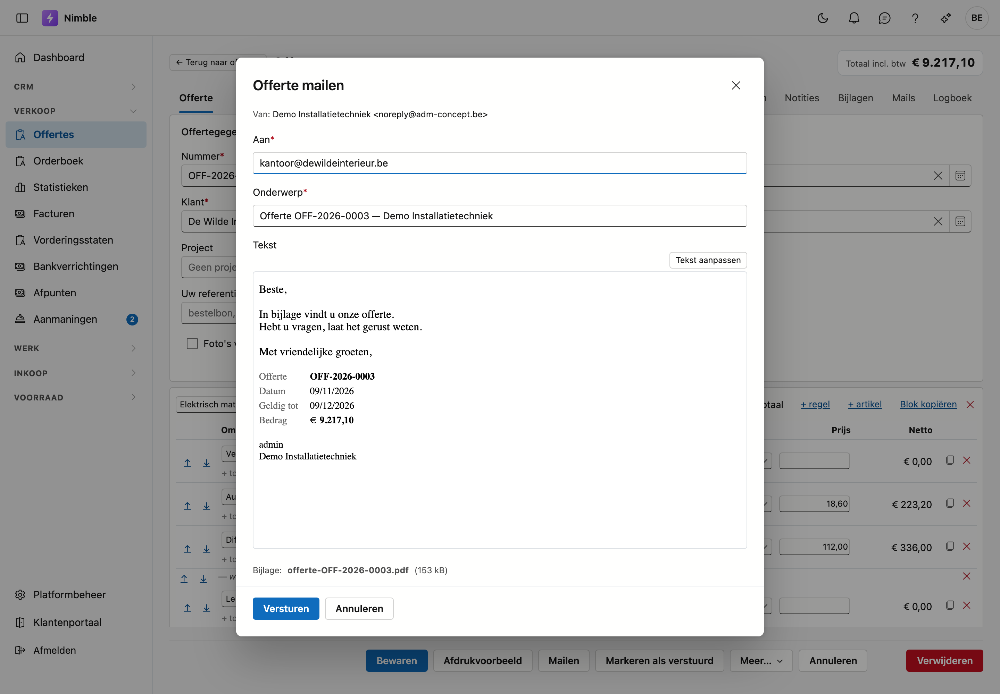
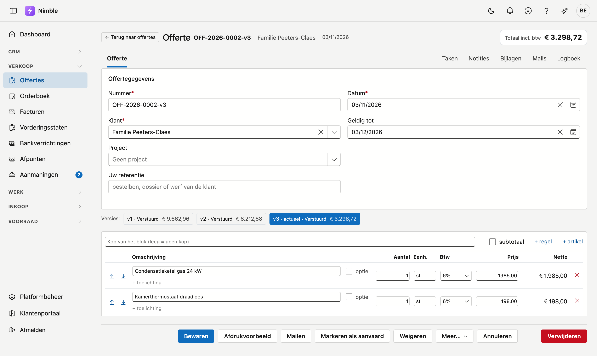

# Offertes

Een offerte is uw prijsvoorstel aan een klant. U bouwt ze op uit **blokken** met daarin regels — werken,
materialen en uren. Daarna volgt u op of de klant ze aanvaardt, en maakt u er een factuur van.

## Het scherm openen

Klik in de zijbalk op **Verkoop → Offertes**.

## De lijst en het bord

Links bovenaan kiest u tussen twee weergaven: **Lijst** en **Bord**. Uw keuze wordt bewaard: opent u het
scherm later opnieuw, dan staat het op de weergave die u het laatst gebruikte.

### Lijst

| Kolom | Wat u ziet |
|---|---|
| **Nummer** | Het offertenummer. Varianten en versies dragen een achtervoegsel, zoals `-A` of `-v2` |
| **Klant** | Voor wie de offerte is |
| **Datum** | De datum van het voorstel |
| **Geldig tot** | Tot wanneer de prijs geldt. Is een verstuurde offerte over die datum, dan staat er in het rood hoelang al — *10 dagen*, *2 maanden* |
| **Bedrag** | Het totaal inclusief btw |
| **Status** | Klad, Verstuurd, Aanvaard, Geweigerd of Vervangen |

Naast de weergaveknoppen staat een keuzelijst om snel af te bakenen: **Klad**, **Verstuurd**, **Aanvaard**,
**Geweigerd**, **Vervangen** of **Verlopen**, telkens met het aantal erachter. Een keuze die nergens voorkomt, staat er
niet bij. Rechts staan **Nieuwe offerte**, **Exporteren** en het zoekveld.

**Dubbelklik** een rij om de offerte te openen.

Rechts van de lijst staat de smalle balk **Journaal**. Klapt u die open, dan ziet u de taken, notities,
bijlagen, mails en het logboek van de offerte die u in de lijst aangeklikt hebt, zonder ze te openen.

### Bord

Het bord verdeelt dezelfde offertes over vier kolommen: **Klad**, **Verstuurd**, **Aanvaard** en
**Geweigerd**. Elke kaart toont de klant, het nummer, het bedrag, de datum en tot wanneer de offerte geldig
is. Is de geldigheid van een verstuurde offerte verstreken, dan staat er *Geldigheid verstreken*.

Een **vervangen** versie staat niet op het bord: het bord toont wat nog moet gebeuren. U vindt ze in de
lijst, met de keuze **Vervangen**.

- **Klik** een kaart om de offerte te openen.
- **Sleep** een kaart naar een andere kolom om de status te wijzigen. Mag die wissel niet, dan leest u
  waarom en blijft de kaart staan.
- Met de dubbele pijl rechts in de kolomkop klapt u een kolom **in**: ze wordt een smalle strook met haar naam en het
  aantal kaarten. Klik de pijl opnieuw om ze uit te klappen. Welke kolommen ingeklapt zijn, onthoudt Nimble per gebruiker.

## Een nieuwe offerte

Klik op **Nieuwe offerte**. U vult eerst het blok **Offertegegevens** in:

| Veld | Betekenis |
|---|---|
| **Nummer** | Verplicht. Wordt automatisch toegekend (`OFF-2026-0001`); u mag het aanpassen. Het moet uniek blijven |
| **Klant** | Verplicht. Kies uit uw [relaties](../relations.md) |
| **Project** | Optioneel. Hangt de offerte aan een project, dan hoort ze bij het dossier van dat project. Het geldt voor alle versies en varianten van de offerte, en u kunt het ook na het aanvaarden nog kiezen of wijzigen |
| **Datum** | Verplicht. De datum van het voorstel; staat standaard op vandaag |
| **Geldig tot** | Optioneel. Tot wanneer uw prijs geldt |
| **Uw referentie** | Optioneel. Het kenmerk van de klant: zijn bestelbonnummer, dossier of werf. Het staat op de offerte bij de datums en gaat mee naar de factuur. U kunt het ook na het aanvaarden nog invullen — de klant stuurt zijn bestelbon vaak samen met zijn akkoord. Op een aanvaarde offerte wordt het meteen bewaard |
| **Lead** | Enkel zichtbaar bij een offerte die u met **Offerte maken** op een lead maakte: de lead waaruit ze komt, met een link naar zijn fiche. Wordt deze offerte — of een nieuwe versie ervan — aanvaard, dan gaat die lead vanzelf naar **Gewonnen**. Zie [Leads](../crm/leads.md#een-offerte-maken-voor-een-lead) |

Klik daarna op **Bewaren**.

!!! info "Eerst bewaren, dan blokken en regels"
    Blokken en regels horen bij een bewaarde offerte. Zolang ze niet bewaard is, staat er *Bewaar eerst de
    offerte; daarna kunt u blokken en regels toevoegen.*

Ontbreekt er een verplicht veld, dan staat bovenaan de fiche welk. Hebt u iets gewijzigd en nog niet bewaard,
dan staat *Niet bewaard* naast het nummer.

## De offertefiche

Bovenaan staan het nummer, de klant en de datum. Rechtsboven staat het **Totaal incl. btw**; dat blijft
staan wanneer u naar beneden scrolt.

De fiche heeft de tabbladen **Offerte**, **Taken**, **Notities**, **Bijlagen**, **Mails** en **Logboek**. Hoe
die laatste vijf werken, leest u in [Werken met een fiche](../fiches.md).

Kwam de offerte binnen via de koppeling met een ander programma (de API), dan staat naast het nummer **Aangemaakt via** met de naam van dat programma. Zo'n offerte staat altijd in klad: u werkt ze verder af en verstuurt ze zelf. Zolang niemand die offertes mag bewerken de fiche opende, meldt het belletje rechtsboven hoeveel zulke offertes er zijn.

Is de offerte gemaild of online voorgelegd, dan staan er in het blok Offertegegevens extra regels:

- **Verstuurd op** — wanneer en naar welk adres de offerte gemaild is.
- **Online voorgelegd** — de link die de klant krijgt, met de datum tot wanneer ze geldig is. U kunt die
  link kopiëren en zelf doorsturen.

## Blokken en regels

Een offerte is een **document**, geen boodschappenlijstje. U verdeelt het werk in blokken met een kop
erboven — "Voorbereidende werken", "Dakbedekking", "Afwerking" — zodat de klant leest wat hij koopt.

- **+ Blok toevoegen** (onder het laatste blok) maakt een nieuw blok.
- De **kop** van het blok typt u bovenin. Laat u die leeg, dan toont de offerte geen kop.
- **subtotaal** aanvinken toont het totaal van dat blok onder de regels, als *Subtotaal blok*.
- Het rode ✕ naast de kop verwijdert het blok met zijn regels. Die knop staat er zodra er meer dan één blok
  is.

Per blok hebt u twee manieren om een regel toe te voegen:

- **+ regel** — een lege regel die u zelf beschrijft.
- **+ artikel** — kies een artikel uit uw [catalogus](../inventory/articles.md). Omschrijving, eenheid en
  verkoopprijs komen mee. De regel komt in dát blok terecht.

Kopiëren gaat zo:

- Het **kopieericoon** naast het rode ✕ van een regel zet een kopie van die regel er meteen onder, met artikel, aantal,
  prijs, btw en optie. Het aantal is meteen klaar om aan te passen.
- **Blok kopiëren** in de kop van een blok zet een kopie van het blok met al zijn regels meteen onder het origineel.

!!! tip "Zoek op nummer of op omschrijving"
    In het venster **Artikel kiezen** typt u een artikelnummer, een deel van de omschrijving, of allebei.
    "DIE weekend" vindt het artikel `DIE-9002 — Werkuur installateur — weekend`. Bij een dienst staat
    **Dienst** achter de familie en de eenheid, bij een
    [offerteartikel](../inventory/articles.md#de-soort-van-een-artikel) **Offerteartikel**.

### Een prijsafspraak inladen

Geldt er voor de klant op de offertedatum een [prijsafspraak](price-agreements.md), dan staat boven de regels
*Voor deze klant geldt op de offertedatum een prijsafspraak:* met een knop **'…' inladen**. Die zet alle posten
van de afspraak op de offerte, met de afgesproken prijs en hoeveelheid 0, elk onder zijn hoofdstuk. Een artikel dat
u met **+ artikel** kiest, krijgt ook de afgesproken prijs. Zo'n regel draagt het kenmerk **Prijsafspraak**, tot u
de prijs met de hand wijzigt.

Staan er bij het afdrukken of mailen nog regels met hoeveelheid 0 op, dan waarschuwt Nimble.

### Een leveranciersofferte inlezen

Krijgt u voor een deel van het werk een offerte van een leverancier (ramen, een warmtepomp, een keuken), dan leest de AI
haar regels voor u. Kies onder **Meer…** de handeling **Leveranciersofferte inlezen** en sleep de offerte van de
leverancier in het venster (pdf, JPG, PNG of WebP).

- De AI leest per regel de omschrijving, het aantal, de eenheid en de netto prijs. U ziet ze in een lijst, met de
  **inkoopprijs** en de **verkoopprijs**.
- Vul uw **marge** in procent in: de verkoopprijs is de inkoopprijs plus de marge. Vink af wat niet mee moet.
- Met **Toevoegen aan de offerte** komen de regels in een blok met de naam van de leverancier en zijn offertenummer
  (die naam kunt u aanpassen). Ze krijgen het btw-tarief van de laatste regel, zoals bij **+ regel**.
- **Niets wordt bewaard tot u de offerte bewaart.** Kijk de regels na: de AI kan zich vergissen. Wijkt de som van de
  regels af van het totaal op de offerte van de leverancier, of kon de AI een prijs niet lezen, dan zegt het venster dat.
- De inkoopprijs en de artikelcode van de leverancier komen **niet** op de offerte van de klant.
- De offerte van de leverancier hangt daarna als bijlage aan deze offerte (*Leveranciersofferte, gelezen door de AI*).

Dit kan enkel met een eigen **AI-sleutel** in het portaal van ADM One en toestemming voor documentanalyse, zoals bij het
[laten lezen van een aankoopfactuur](../purchasing/purchase-invoices.md#laten-lezen-door-de-ai). De kosten betaalt u
rechtstreeks aan uw AI-leverancier.

### Een sjabloon gebruiken

Maakt u vaak een gelijkaardige offerte, bewaar dan de blokken en regels als **sjabloon**.

- **Meer…** → **Opslaan als sjabloon**: geef een naam, bijvoorbeeld *Badkamer standaard*, en klik **Bewaren**. Het sjabloon
  bewaart de blokken en regels van deze offerte, zonder klant.
- **Meer…** → **Sjabloon invoegen**: kies een sjabloon en klik **Invoegen**. De blokken en regels komen onderaan deze offerte bij.
  Een regel met een artikel krijgt de prijs van vandaag: de prijsafspraak van de klant, anders de verkoopprijs. Een regel zonder
  artikel houdt de bewaarde prijs. Bewaar daarna de offerte.
- Een sjabloon dat u niet meer nodig hebt, verwijdert u met het rode ✕ in het venster **Sjabloon invoegen**. Het gaat naar de
  [prullenbak](../administration/recycle-bin.md). Offertes die ermee gemaakt zijn, blijven zoals ze zijn.

**Sjabloon invoegen** staat er zodra de offerte één keer bewaard is.

### De regelvelden

| Veld | Betekenis |
|---|---|
| **Omschrijving** | Wat de klant leest. Vrij aanpasbaar, ook bij een artikel uit de catalogus |
| **optie** | De regel staat mét prijs op de offerte maar telt **niet** mee in het totaal |
| **+ toelichting** | Een extra tekst onder de omschrijving, bijvoorbeeld een merk of een voorwaarde |
| **Aantal** | Mag decimalen bevatten (0,25 uur) |
| **Eenh.** | Stuks, uren, meter — komt mee met het artikel |
| **Btw** | De [btw-code](../administration/vat-codes.md) van deze regel. De open lijst toont wat elke code betekent |
| **Prijs** | De eenheidsprijs |
| **Netto** | Aantal × prijs, berekend |

Met de pijltjes ↑ en ↓ verplaatst u een regel binnen zijn blok. Het rode ✕ verwijdert ze. Een regel
*— witregel —* is enkel witruimte op het document; ook die kunt u verplaatsen of verwijderen.

!!! tip "Een nieuwe regel krijgt de btw van de vorige"
    Een nieuwe regel krijgt de btw-code van de laatste regel op de offerte. Werkt u met medecontractant, dan
    hoeft u dat dus niet op elke regel opnieuw te kiezen. Op een lege offerte krijgt de eerste regel de
    eerste code uit uw lijst met btw-codes.

## De totalen

Onder de blokken staat de opsplitsing:

- **Totaal excl. btw**.
- Eén regel per btw-tarief, met het bedrag waarover die btw berekend is — bijvoorbeeld *Btw 6% (over
  € 2.418,00)*.
- **Totaal incl. btw**.
- Daaronder de wettelijke vermelding die bij een btw-code hoort, zoals de tekst bij verlegde btw. Die
  vermelding staat ook op het document.

!!! info "Hoe de btw gerekend wordt"
    Nimble rekent de btw één keer per tarief: over de som van de regels aan dat tarief, afgerond op de cent.
    Zo rekent ook de Europese norm voor e-facturen, en zo blijven offerte en factuur tot op de cent gelijk.
    Offertes die vroeger gemaakt zijn, rekenden de btw per regel en houden hun bedragen.

Rekent een btw-code 0 % zonder wettelijke vermelding, dan staat er een waarschuwing. Kijk dan na of dat
klopt: bij verlegde btw, een intracommunautaire levering of uitvoer hoort de reden op het document te staan.

Staan er optieregels op de offerte, dan komt daar **Opties (incl. btw, niet in het totaal)** onder. Twee
dingen om te weten bij dat bedrag:

- Het telt **niet** mee in het totaal erboven. Kiest de klant de optie, dan komt het bedrag er nog bij. Legt u
  de offerte [online voor](#opties-op-de-online-offerte), dan vinkt de klant de opties daar zelf aan.
- Het is **inclusief btw**, terwijl de optieregel zelf haar bedrag exclusief btw toont — net als elke
  andere regel. De twee getallen horen dus te verschillen.

## De knoppen onderaan

Welke knoppen er staan, hangt af van de status van de offerte en van uw rechten. Van links naar rechts. Minder
gebruikte handelingen staan onder **Meer…**, vóór Annuleren.

| Knop | Wanneer | Wat ze doet |
|---|---|---|
| **Bewaren** | Klad en Verstuurd | Bewaart uw wijzigingen |
| **Afdrukvoorbeeld** | Altijd | Toont het document zoals de klant het krijgt |
| **Mailen** | Altijd | Opent het verzendvenster |
| **Meer…** → **Online voorleggen** | Klad en Verstuurd | Zet de offerte online, zodat de klant ze kan aanvaarden of weigeren |
| **Meer…** → **Opnieuw online voorleggen** | Klad en Verstuurd, zodra de offerte online staat | Toont de offerte zoals ze nu is, achter dezelfde link |
| **Meer…** → **Online intrekken** | Zodra de offerte online staat | Haalt de online versie weg |
| **Markeren als verstuurd** | Klad en Geweigerd | Zet enkel de status om; er vertrekt niets |
| **Markeren als aanvaard** · **Weigeren** | Verstuurd | Legt het antwoord van de klant vast. Hangt de offerte nog aan geen project, dan maakt Nimble er bij het aanvaarden een aan — zie *Aanvaard werk hangt aan een project* hieronder |
| **Project maken** | Aanvaard, zonder project | Opent een nieuw project met de klant en het werfadres van de offerte al ingevuld. Bij het bewaren hangt de offerte, met al haar versies, aan dat project |
| **Factureren** | Aanvaard | Maakt een kladfactuur met de regels van de offerte, min de voorschotten |
| **Meer…** → **Voorschotfactuur** | Aanvaard, zolang Factureren kan | Maakt een kladfactuur voor een deel van de offerte, zie *Een voorschot factureren* |
| **Meer…** → **Nieuwe versie** | Aanvaard, Geweigerd en Vervangen | Maakt een bewerkbare kopie |
| **Meer…** → **Herinnering sturen** | Verstuurd | Opent het verzendvenster met de herinnering, zie *De offerte opvolgen* |
| **Meer…** → **Sjabloon invoegen** · **Opslaan als sjabloon** | Klad en Verstuurd · altijd | Zie *Een sjabloon gebruiken* |
| **Annuleren** | Klad en Verstuurd | Laat uw wijzigingen vallen. Op een afgesloten offerte staat de knop er niet: u gaat terug met **← Terug naar offertes** bovenaan |
| **Verwijderen** | Klad, Verstuurd en Geweigerd | Verplaatst de offerte na bevestiging naar de prullenbak. Een aanvaarde, vervangen of gefactureerde offerte kan niet weg |

Afdrukvoorbeeld kan iedereen die offertes mag bekijken. Alle andere knoppen vragen het recht om offertes te
bewerken.

!!! info "In de knoppen staat het woord van uw bedrijf"
    De knoppen *Markeren als …* gebruiken de statusnamen die u zelf instelt onder
    [Offertestatus](../administration/quote-status.md).

## De offerte afdrukken

Klik op **Afdrukvoorbeeld**. U ziet het document zoals de klant het krijgt. Met de werkbalk boven het
document bladert u door de bladzijden, zoomt u in en drukt u af. Bovenaan het venster staan **Downloaden**
— de offerte belandt als PDF in uw downloadmap — en **Doorsturen per mail**.

Bovenaan het document staan uw eigen gegevens — naam, adres, telefoon, btw-nummer en uw logo. Die komen uit
de [bedrijfsfiche](../settings/company-profile.md) in het platformbeheer. Briefhoofd, aanhef en voorwaarden
stelt u in bij [Documentsjablonen](../settings/document-templates.md).

!!! info "De offerte volgt de taal van de klant"
    Het document wordt opgemaakt in de taal die op de klantenfiche bij **Documenttaal** staat, niet in de
    taal waarin u zelf werkt. Is dat veld leeg, dan volgt de offerte de taal van uw bedrijf.

Vinkt u bij de offertegegevens **Foto's van de artikelen op de offerte** aan, dan staat bij elke regel met een artikel de foto
van dat artikel. Welke foto dat is, kiest u op de [artikelfiche](../inventory/articles.md#de-foto-van-een-artikel). Een artikel
zonder foto krijgt er geen.

Kopregels en witregels komen op het blad als tussentitel en als witruimte, zonder aantal of bedrag. Per blok
staat het subtotaal eronder, en onderaan de opsplitsing.

Lukt het afdrukken niet, dan opent het venster *De afdruk kon niet gemaakt worden* met de technische
oorzaak. Geef die tekst door wanneer u hulp vraagt.

## De offerte mailen

Klik op **Mailen**. Hebt u nog onbewaarde wijzigingen, dan vraagt Nimble u eerst te bewaren: wat u mailt,
moet ook in het dossier staan.

Het venster **Offerte mailen** staat al ingevuld met de mail uit uw [mailsjabloon](../settings/mail-templates.md)
*Offerte*, met de gegevens van deze offerte:

| Veld | Inhoud |
|---|---|
| **Van** | De afzender van het mailsjabloon, of uw standaardafzender — zie [Mailafzenders](../settings/mail-senders.md) |
| **Aan** | Verplicht. Het e-mailadres van de klant |
| **Onderwerp** | Verplicht. Uit het mailsjabloon, met uw offertenummer erin |
| **Tekst** | De mail zoals ze vertrekt |
| **Bijlage** | De offerte als PDF, met de grootte erbij |

**Aan** en **Onderwerp** past u rechtstreeks aan. Wilt u ook de tekst aanpassen, klik dan op **Tekst
aanpassen**: de mail komt in een editor. Wat u daar wijzigt, geldt enkel voor deze mail — het mailsjabloon
blijft zoals het is. De mail vertrekt in de taal van de klant, net als de offerte zelf.

Staat in het mailsjabloon de link naar de online offerte, dan krijgt de klant die link in de mail:

- Staat de offerte al online, dan is het die link.
- Staat ze nog niet online, is de link vervallen, of wijzigde de offerte sinds het voorleggen, dan meldt het venster: *Deze mail bevat de link naar de
  online offerte. Bij het versturen zet Nimble de offerte online.* Dat gebeurt pas wanneer u op
  **Versturen** klikt, en enkel als de link dan nog in de mail staat.

Na het versturen gebeuren er vier dingen:

- Stond de offerte op **Klad**, dan gaat ze vanzelf naar **Verstuurd**.
- Een kopie van de verstuurde PDF komt bij de **Bijlagen** van de offerte, met het adres erbij.
- Op de fiche verschijnt **Verstuurd op**, met datum en adres.
- De mail zelf staat bij **Mails** op de offerte, zoals ze vertrok.

!!! tip "Zelf al bezorgd? Gebruik Markeren als verstuurd"
    Hebt u de offerte per post of vanuit uw eigen mailprogramma bezorgd, gebruik dan **Markeren als
    verstuurd**. Die knop zet alleen de status om en stuurt niets.

!!! warning "Te grote offerte"
    Boven 10 MB weigert Nimble te versturen. Daarboven zou de mail vertrekken zónder offerte. Liever een
    offerte die niet vertrekt dan een die leeg aankomt.

## De offerte online voorleggen

Met **Meer…** → **Online voorleggen** zet Nimble de offerte op een eigen pagina. De klant kan ze daar bekijken en
aanvaarden of weigeren. Onbewaarde wijzigingen worden eerst bewaard.

- De link staat daarna op de fiche bij **Online voorgelegd**. Stuur ze zelf door, of zet de variabele
  `{{online_link}}` in uw [mailsjabloon](../settings/mail-templates.md#de-link-naar-de-online-offerte): dan
  krijgt de klant de link in de mail.
- De link geldt tot de datum bij **Geldig tot**. Staat daar niets, dan geldt ze dertig dagen.
- Ligt **Geldig tot** in het verleden, dan weigert Nimble de offerte online te zetten en leest u waarom.
- Aanvaardt of weigert de klant online, dan past Nimble de status van de offerte aan. Hebt u de offerte
  intussen zelf al op Aanvaard of Geweigerd gezet, dan blijft uw beslissing staan.
- Aanvaardt de klant online een offerte zonder project, dan maakt Nimble er een aan, zoals hieronder beschreven.
- **U wordt verwittigd.** Het **belletje** rechtsboven toont *2 offertes online beantwoord door de klant* —
  aan wie offertes mag bewerken. De melding verdwijnt zodra iemand de offerte opent.
- **En per mail:** wie de offerte mailde, en het adres bij **Online offerte-antwoorden naar** op de
  [Bedrijfsfiche](../settings/company-profile.md#online-offerte-antwoorden-naar). In de mail staan de offerte,
  de klant, de naam die hij opgaf, bij een aanvaarding de opties die hij koos en bij een weigering zijn reden,
  met een link naar de offerte. Een offerte die u mailde vóór versie 0.5.108 kent haar verzender niet: dan gaat
  de mail enkel naar de bedrijfsfiche.
- **De link werkt één keer.** Heeft de klant geantwoord, dan toont de link geen formulier meer, maar een melding
  om contact op te nemen met zijn contactpersoon. Moet hij opnieuw antwoorden, leg de offerte dan opnieuw online
  voor. Een link die u al verstuurde vóór versie 0.5.121 blijft werken zoals toen, tot u de offerte opnieuw voorlegt.

**Wijzigt u de offerte nadat ze online staat**, dan blijft de pagina de oude inhoud tonen tot u **Meer…** → **Opnieuw
online voorleggen** kiest. De fiche meldt dat zolang het zo is, en de melding verdwijnt zodra de pagina weer klopt. Een
wijziging die de klant niet ziet, zoals een interne notitie, geeft geen melding. Voor een link van vóór versie 0.5.121
kan Nimble dit niet zien. De link blijft dezelfde: wie de mail al kreeg, ziet de nieuwe inhoud. Had de klant de oude
pagina nog open en antwoordt hij daarop, dan past Nimble dat niet toe en verneemt u het, zoals hieronder beschreven.

**Meer…** → **Online intrekken** haalt de pagina weg. De link werkt dan niet meer, ook niet de verstuurde.

### Een online antwoord dat Nimble niet verwerkt

Soms antwoordt de klant online, ziet hij een bevestiging, en past Nimble het antwoord toch niet toe:

- De offerte was al beslist of afgesloten, bijvoorbeeld omdat u ze intussen zelf op Aanvaard zette.
- De klant had nog een tabblad open met een **oudere versie** van de pagina, van vóór u de offerte opnieuw voorlegde.
- De klant koos een optie die niet meer op de offerte staat.
- Een andere versie van de offerte is al gefactureerd.

De offerte verandert dan niet. De klant denkt wel dat het geregeld is, dus Nimble verwittigt u op dezelfde manier
als bij een gewoon antwoord: via het belletje en per mail. Op de fiche staat een gekleurd blok *Online antwoord van de
klant niet verwerkt*, met wanneer hij antwoordde, wat hij koos en waarom het niet doorging. Neem contact op met de
klant. Staat de offerte nog open en moet hij opnieuw antwoorden, leg ze dan opnieuw online voor: het blok verdwijnt
en de link gaat weer open.

### Opties op de online offerte

Staan er [optieregels](#de-regelvelden) op de offerte, dan kiest de klant ze zelf op de online pagina.

- Bovenaan staat de offerte met haar totaal zonder opties, gemarkeerd als *Inbegrepen*: die kan de klant niet
  uitvinken. Daaronder staat per blok elke optie met een vinkje, haar omschrijving, het aantal en haar bedrag
  inclusief btw.
- De opties staan **uitgevinkt**. Vinkt de klant er een aan, dan telt de pagina haar bedrag bij het totaal.
- Aanvaardt hij, dan worden de opties die hij aanvinkte **gewone regels** van de offerte: ze tellen mee in het
  totaal, op de factuur en in de vorderingsstaat. De opties die hij niet koos, blijven optie. Het Logboek
  toont welke regels zo veranderden, en het actielogboek noemt de gekozen opties of zegt *zonder de opties*.

!!! warning "Wijzigt u de opties nadat de offerte online staat"
    Haalt u een optie weg of zet u het vinkje **optie** af terwijl de offerte online staat, en kiest de klant
    net die optie, dan zet Nimble de offerte **niet** op Aanvaard. Dat is [een antwoord dat Nimble niet
    verwerkt](#een-online-antwoord-dat-nimble-niet-verwerkt). Neem contact op met de klant en leg zijn antwoord zelf vast.
    Past u de opties aan, kies dan meteen **Meer…** → **Opnieuw online voorleggen**: de link blijft dezelfde en toont
    vanaf dan de nieuwe opties.

## De offerte laten ondertekenen

Heeft uw bedrijf een OKSign-contract, gekoppeld in ADM One, dan staat er op de offertefiche een blok **Ondertekenen
via OKSign**. Daarmee tekent de klant de pdf van de offerte met een echte handtekening, bijvoorbeeld voor grote
werken. Het is een tweede weg naast de online offerte: u kiest per offerte welke.

Klik in het blok op **Laten ondertekenen**. Het venster toont wie kan tekenen: de klant zelf en zijn
contactpersonen. Kies wie tekent en klik op **Ter ondertekening versturen**.

- OKSign vraagt van de ondertekenaar een **e-mailadres** en een **gsm-nummer**. Ontbreekt er een, of is het nummer
  een vast nummer, dan staat dat bij die persoon en kunt u hem niet kiezen. Vul het aan op de relatie of de
  contactpersoon.
- De ondertekenaar krijgt een mail met een persoonlijke link, uit het [mailsjabloon](../settings/mail-templates.md)
  **Offerte ondertekenen (OKSign)**. De tekenpagina staat in zijn taal.
- Onderaan de pdf staat een vak **Voor akkoord** met zijn naam: daar tekent hij.
- Stond de offerte op Klad, dan gaat ze naar **Verstuurd**.

Dit kan niet bij:

- een offerte met **opties**: leg die [online voor](#de-offerte-online-voorleggen), want daar vinkt de klant de opties aan;
- een offerte die **online staat**: trek eerst de online offerte in;
- een offerte die al aanvaard, geweigerd of vervangen is;
- een offerte met een regel zonder eenheidsprijs.

Zolang een verzoek wacht, toont het blok de link van de ondertekenaar. Daarmee kunt u:

- **Opnieuw mailen** — dezelfde link nog eens;
- **Stand nakijken** — vraagt meteen na of hij al tekende;
- **Intrekken** — als de klant nee zegt, of als u de offerte wil aanpassen. OKSign verwijdert het document en de
  link werkt niet meer. OKSign heeft zelf geen knop om te weigeren: noteer een weigering daarna met **Weigeren**.

**Zodra de klant tekende**, zet Nimble de offerte op **Aanvaard**. Onder de melding bovenaan staat dan *door de
klant ondertekend via OKSign*, en de getekende pdf staat bij de **Bijlagen**. U wordt verwittigd zoals bij een online
antwoord: via het belletje en per mail. Nimble kijkt de stand na wanneer u de offerte opent, en elke ochtend.

!!! warning "Wijzigt u de offerte nadat ze ter ondertekening vertrok"
    De klant tekent het document zoals het vertrok. Wijzigt u de offerte daarna, dan zet Nimble ze na de
    handtekening **niet** vanzelf op Aanvaard: het blok meldt *Getekend, maar NIET aanvaard*. Bekijk de getekende
    pdf en leg de beslissing zelf vast, of trek het verzoek in vóór de klant tekent en verstuur de offerte opnieuw.

## De offerte opvolgen

| Status | Wat u kunt doen |
|---|---|
| **Klad** | Aanpassen, mailen, online voorleggen, of **Markeren als verstuurd** |
| **Verstuurd** | Nog aanpassen, of het antwoord vastleggen met **Markeren als aanvaard** of **Weigeren** |
| **Aanvaard** | **Factureren**, of onder **Meer…** een **Nieuwe versie** maken |
| **Geweigerd** | **Markeren als verstuurd** als de klant toch terugkomt, of onder **Meer…** een **Nieuwe versie** maken |
| **Vervangen** | Niets meer: een nieuwere versie van dezelfde offerte is aanvaard. Ze blijft bewaard om na te kijken wat de klant eerder kreeg |

!!! warning "Een aanvaarde of geweigerde offerte is afgesloten"
    Zodra de klant geantwoord heeft, staat het document vast. Bovenaan staat *Deze offerte is afgesloten en
    kan niet meer gewijzigd worden.* Velden, blokken en regels zijn niet aan te passen, en onderaan staan geen
    Bewaren en Annuleren: u gaat terug met **← Terug naar offertes** bovenaan. Dat is met opzet: de klant heeft een
    prijs gekregen, en die hoort niet stilzwijgend te veranderen.

    Moet er toch iets wijzigen, klik dan onder **Meer…** op **Nieuwe versie**. U krijgt een kopie met de regels van nu, in
    Klad, één versienummer hoger en dertig dagen geldig. De oude versie blijft bestaan, zodat u kunt nakijken
    wat de klant gekregen heeft.

    Het nummer volgt op de hoogste versie, ook als die gearchiveerd is: haar nummer wordt niet opnieuw
    gebruikt. Na `…-v2` en een gearchiveerde v3 krijgt u dus `…-v4`.

Een aanvaarde offerte wisselt niet van status, ook niet op het bord. Een geweigerde wel: die zet u
terug met **Markeren als verstuurd**.

### Een opvolgtaak en een herinnering

Staat de offerteopvolging aan, dan maakt Nimble 's nachts een taak **Offerte opvolgen** voor wie de offerte mailde, zodra een
gemailde offerte een week op **Verstuurd** staat zonder antwoord. Standaard staat ze uit. De taak staat op het tabblad **Taken** van de offerte en in uw [takenlijst](../crm/tasks.md). Mailt u de
offerte opnieuw, dan begint de telling opnieuw. Aanzetten, en na hoeveel dagen, doet u bij
[Opvolging van leads en offertes](../administration/lead-follow-up.md).

Nimble stuurt de klant zelf niets. Wilt u hem herinneren, klik dan **Meer…** → **Herinnering sturen**. Het verzendvenster opent
met de tekst van de herinnering en de offerte als bijlage; u past de tekst aan en klikt **Versturen**. Die tekst stelt u in bij
[Mailsjablonen](../settings/mail-templates.md), onder *Herinnering bij een offerte*.

### Het antwoord van de klant vastleggen

Klikt u **Markeren als aanvaard** of **Weigeren**, of sleept u een kaart op het bord naar **Aanvaard** of
**Geweigerd**, dan vraagt Nimble eerst drie dingen:

| Veld | Wat u invult |
|---|---|
| **Datum van de beslissing** | De dag waarop de klant besliste. Staat op vandaag; belde de klant maandag en noteert u het woensdag, zet dan maandag |
| **Wie bij de klant** | Wie ja of nee zei. Niet verplicht |
| **Reden** | Enkel bij weigeren: waarom, als u het weet. Niet verplicht |

Daarna staat onder de melding bovenaan de offerte bijvoorbeeld *Aanvaard op 22/09/2026 door Jan Peeters —
genoteerd door een medewerker.* Beslist de klant online, dan staat er *online, door de klant*; tekende hij via
[OKSign](#de-offerte-laten-ondertekenen), dan *door de klant ondertekend via OKSign*. **Annuleren**
laat de offerte zoals ze was; op het bord springt de kaart terug.

Zet u een geweigerde offerte terug met **Markeren als verstuurd**, dan vervalt die weigering. Het Logboek
bewaart wat er eerder stond.

## Aanvaard werk hangt aan een project

Een aanvaarde offerte hoort bij een project: het orderboek, de planning en de nacalculatie rekenen per project.
Aanvaardt u een offerte zonder project — met **Markeren als aanvaard**, op het bord, of doordat de klant ze online
aanvaardt — dan maakt Nimble er zelf een aan:

| | Wat het nieuwe project krijgt |
|---|---|
| **Nummer** | Het volgende nummer uit uw projectreeks. Hebt u geen projectreeks ingesteld, dan het offertenummer |
| **Naam** | De eerste regel van de notitie van de offerte. Is die leeg, dan de klantnaam en het offertenummer |
| **Klant** en **werfadres** | De klant van de offerte en zijn adres |

Hangt een andere versie of variant van dezelfde offerte al aan een project, dan komt de offerte bij dát project.
Nimble meldt aan welk project de offerte nu hangt. Vul daarna op de projectfiche aan wat nog ontbreekt: het echte
werfadres, de verantwoordelijke, de fase.

## Factureren

Op een aanvaarde offerte maakt **Factureren** een kladfactuur met de regels van de offerte, en opent die
meteen. Het project en **Uw referentie** gaan mee. Het factuurnummer komt pas wanneer u de factuur definitief maakt — zie [Facturen](invoices.md).

Kan het niet, dan staat de knop grijs en staat de reden ernaast:

- *Deze offerte is al gefactureerd.*
- *Deze offerte bevat geen enkele factureerbare regel.* — bijvoorbeeld wanneer er enkel optieregels op
  staan.
- *Dit project wordt per vorderingsstaat gefactureerd.* — het resterende werk factureert u via een volgende
  staat; zie [Vorderingsstaten](progress-reports.md).

### Een voorschot factureren

Vraagt u een voorschot bij de bestelling, dan factureert u dat vóór het werk klaar is:

1. Open de aanvaarde offerte en kies onder **Meer…** de keuze **Voorschotfactuur**.
2. Kies bij **Voorschot als** een **Percentage van de offerte** (standaard 30 %) of een **Vast bedrag (excl. btw)**.
   Het venster toont meteen het bedrag excl. en incl. btw.
3. Klik op **Voorschot maken**. Nimble maakt een kladfactuur "Voorschot 30 % op offerte …" en opent ze. Maak ze
   definitief en verstuur ze zoals elke factuur.

Draagt de offerte meer dan één btw-tarief, dan verdeelt Nimble het voorschot in dezelfde verhouding over die
tarieven: één regel per tarief, met de btw-code van de offerte. Ook medecontractant en de vermelding bij 6 % komen
zo mee.

Naast **Factureren** staan de voorschotten van de offerte, met een link naar elk. U kunt er meer dan één maken,
zolang ze samen niet boven het offertebedrag uitkomen.

Is het werk klaar, dan klikt u zoals gewoonlijk op **Factureren**. De kladfactuur bevat alle regels van de offerte
en onderaan, per voorschot en per btw-tarief, een regel **Verrekening voorschotfactuur F-… van …** met een negatief
bedrag. Het totaal is wat de klant nog moet betalen, en het blad zegt in één zin hoeveel er al als voorschot
gefactureerd is.

- Enkel een voorschotfactuur die **definitief** is, wordt verrekend. Staat er nog een in klad, dan vraagt Nimble
  of u toch wilt factureren.
- Een voorschot dat al verrekend is, kunt u niet meer crediteren. Crediteer eerst de factuur die het verrekent;
  dan komt het voorschot weer vrij.
- Een project dat per vorderingsstaat gefactureerd wordt, krijgt geen voorschot: de staten zouden het nooit
  aftrekken.

## Versies en varianten

Hoort de offerte bij een reeks, dan staan er bovenaan het tabblad Offerte knoppen met de bedragen naast
elkaar. Klik er één aan om naar die offerte te gaan; de offerte die u bekijkt, is ingekleurd.

- **Versies** (v1, v2, v3) zijn opeenvolgende voorstellen voor dezelfde vraag. De hoogste is de geldige en
  draagt de vermelding *actueel*.
- **Varianten** zijn verschillende antwoorden op dezelfde vraag — bijvoorbeeld "A — inloopdouche" naast
  "B — ligbad". Elke variant heeft haar eigen versienummers, en dus haar eigen *actueel*.

Elke knop toont ook de status van die versie.

### Wanneer een nieuwe versie aanvaard wordt

Er is maar één geldig akkoord per offerte. Wordt een nieuwe versie aanvaard — met de knop, of door de klant
online — dan springt de vorige aanvaarde versie van dezelfde variant op **Vervangen**. Ze blijft bestaan,
maar telt niet meer mee in het bedrag *Afgesproken* op het project, en ze kan niet gefactureerd worden.

!!! warning "Is een vorige versie al gefactureerd, dan kan een nieuwe niet aanvaard worden"
    Nimble weigert dan met de melding *Versie … van deze offerte is al gefactureerd.* Een wijziging na de
    facturatie hoort in een [meerwerk](../work/extra-work.md) of een creditnota, niet in een nieuwe versie —
    anders factureert u hetzelfde werk twee keer.

    Aanvaardt de klant zo'n versie online, dan wordt dat niet toegepast. U vindt het terug in het
    actielogboek als *Aanvaarding tegengehouden*.

## Veelgemaakte fouten

!!! warning
    - **Een regel zonder btw-code** rekent 0 % btw. Controleer dat de
      [btw-codes](../administration/vat-codes.md) in Platformbeheer ingevuld zijn.
    - **Een optieregel meetellen in het totaal** — dat gebeurt niet, en dat is de bedoeling. Wilt u het
      bedrag wél in het totaal, haal dan het vinkje **optie** weg.
    - **Een aanvaarde offerte willen aanpassen** — maak een nieuwe versie in plaats van de oude te
      wijzigen.
    - **Een aanvaarde offerte willen verwijderen** — dat kan niet: de klant heeft ze aanvaard. Klopt ze
      niet meer, maak dan een nieuwe versie; de oude wordt *Vervangen* zodra de nieuwe aanvaard is.
    - **Twee keer hetzelfde nummer** — past u het nummer met de hand aan, kies dan iets dat nog niet
      bestaat.

## Zie ook

- [Facturen](invoices.md) — wat er na een aanvaarde offerte komt
- [Artikelen](../inventory/articles.md) — de catalogus waaruit u regels kiest
- [Prijsafspraken](price-agreements.md) — afgesproken prijzen per klant inladen
- [Relaties](../relations.md) — uw klanten en hun documenttaal
- [Btw-codes](../administration/vat-codes.md) — de tarieven en hun wettelijke vermelding
- [Offertestatus](../administration/quote-status.md) — de tekst van de vier statussen aanpassen
- [Documentsjablonen](../settings/document-templates.md) — briefhoofd, aanhef en voorwaarden
- [Werken met een fiche](../fiches.md) — tabbladen, bewaren en verwijderen
- [Lijsten filteren](../lijsten-filteren.md) — de trechterknop en de filterbouwer
- [Wanneer uw account beperkt is](../getting-started/account-restricted.md) — wanneer een nieuwe offerte aanmaken of mailen niet kan
