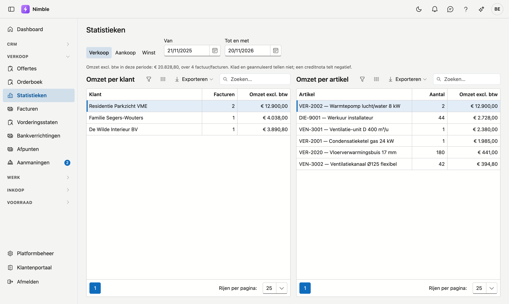

# Statistieken

De **statistieken** tonen uw omzet per klant en per artikel, uw aankopen per leverancier en uw brutowinst per maand, over een periode
die u kiest.

## Het scherm openen

Klik in de zijbalk op **Verkoop → Statistieken**. U hebt het recht nodig om facturen te bekijken. Het tabblad **Aankoop** ziet u
enkel met het recht om de inkoop te bekijken, het tabblad **Winst** enkel met het recht om marges en kostprijzen te bekijken.

## De periode

**Van** en **Tot en met** kiezen de periode, op factuurdatum. Standaard staat dit jaar tot vandaag.

## Verkoop

Bovenaan staat de omzet excl. btw van de periode en het aantal facturen. Daaronder:

- **Omzet per klant**: de omzet excl. btw en het aantal facturen per klant, hoogste eerst.
- **Omzet per artikel**: het aantal en de omzet excl. btw per artikel, hoogste eerst. Enkel regels met een artikel tellen; een vrije
  tekstregel niet.

Een factuur in klad en een geannuleerde factuur tellen niet. Een creditnota telt negatief. Dat is dezelfde regel als op het
[dashboard](../getting-started/dashboard.md).

## Aankoop

**Aankoop per leverancier** toont per leverancier het aantal aankoopfacturen en hun totaal **incl. btw**, hoogste eerst. Incl. btw,
omdat bij een papieren factuur de splitsing excl. btw niet altijd gekend is. Een creditnota telt negatief.

Per artikel kan hier niet: een aankoopfactuur kent haar artikelen niet.

## Winst

**Brutowinst per maand** zet per maand de omzet op projecten tegenover wat het werk die maand kostte:

- **Omzet excl. btw**: wat er die maand op projecten gefactureerd is, op factuurdatum.
- **Loonkost**: de uren op de werkbonnen van die maand, tegen het tarief van de medewerker.
- **Materiaalkost**: het materiaal op de werkbonnen van die maand, tegen de aankoopprijs van het artikel.
- **Aankopen**: wat er van de aankoopfacturen van die maand aan een project toegewezen is.
- **Brutowinst** en **Marge**: wat overblijft, en welk deel van de omzet dat is.

Bovenaan staat het totaal over de hele periode. Werk en factuur vallen niet altijd in dezelfde maand: een maand met veel werk en
weinig facturen kan dus verlies tonen. Over een langere periode valt dat weg. Algemene kosten tellen niet mee.

Een maand zonder omzet, zonder één geboekte kost of met enkel een creditnota krijgt geen marge: dat getal zou niets betekenen.

Ontbreekt er iets, dan staat er een melding boven de lijst: uren van een medewerker zonder tarief, materiaal zonder aankoopprijs, of
facturen zonder project. Die laatste tellen niet mee in de winst, want er staat geen kost tegenover. Zolang er een melding over uren
of materiaal staat, is de winst te hoog.

## Exporteren

Elke lijst heeft **Exporteren**, naar Excel of CSV.

## Zie ook

- [Facturen](invoices.md)
- [Aankoopfacturen](../purchasing/purchase-invoices.md)
- [Orderboek](order-book.md)
- [Projecten](../work/projects.md): de nacalculatie per project
