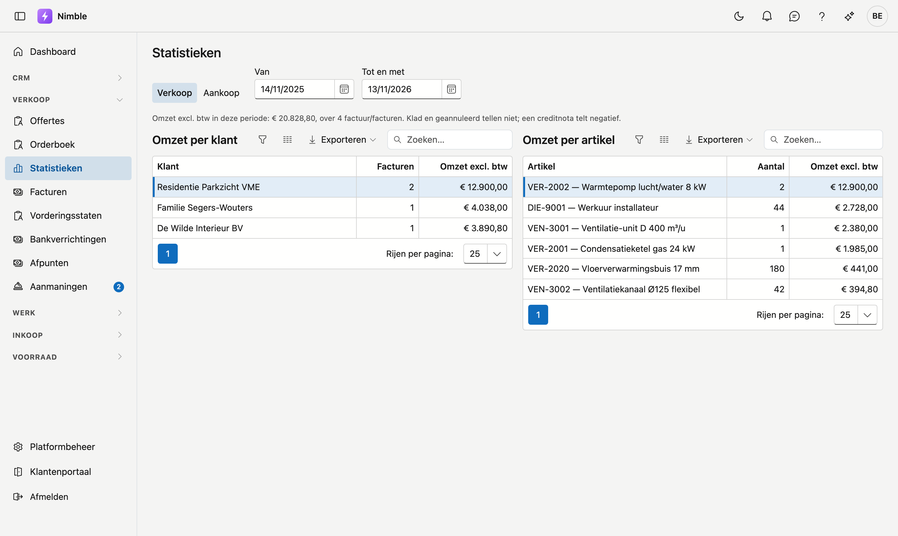

# Statistieken

De **statistieken** tonen uw omzet per klant en per artikel, en uw aankopen per leverancier, over een periode die u kiest.

## Het scherm openen

Klik in de zijbalk op **Verkoop → Statistieken**. U hebt het recht nodig om facturen te bekijken. Het tabblad **Aankoop** ziet u
enkel met het recht om de inkoop te bekijken.

## De periode

**Van** en **Tot en met** kiezen de periode, op factuurdatum. Standaard staat dit jaar tot vandaag.

## Verkoop

Bovenaan staat de omzet excl. btw van de periode en het aantal facturen. Daaronder:

- **Omzet per klant**: de omzet excl. btw en het aantal facturen per klant, hoogste eerst.
- **Omzet per artikel**: het aantal en de omzet excl. btw per artikel, hoogste eerst. Enkel regels met een artikel tellen; een vrije
  tekstregel niet.

Een factuur in klad en een geannuleerde factuur tellen niet. Een creditnota telt negatief. Dat is dezelfde regel als op het
[dashboard](../getting-started/dashboard.md).

## Aankoop

**Aankoop per leverancier** toont per leverancier het aantal aankoopfacturen en hun totaal **incl. btw**, hoogste eerst. Incl. btw,
omdat bij een papieren factuur de splitsing excl. btw niet altijd gekend is. Een creditnota telt negatief.

Per artikel kan hier niet: een aankoopfactuur kent haar artikelen niet.

## Exporteren

Elke lijst heeft **Exporteren**, naar Excel of CSV.

## Zie ook

- [Facturen](invoices.md)
- [Aankoopfacturen](../purchasing/purchase-invoices.md)
- [Orderboek](order-book.md)
