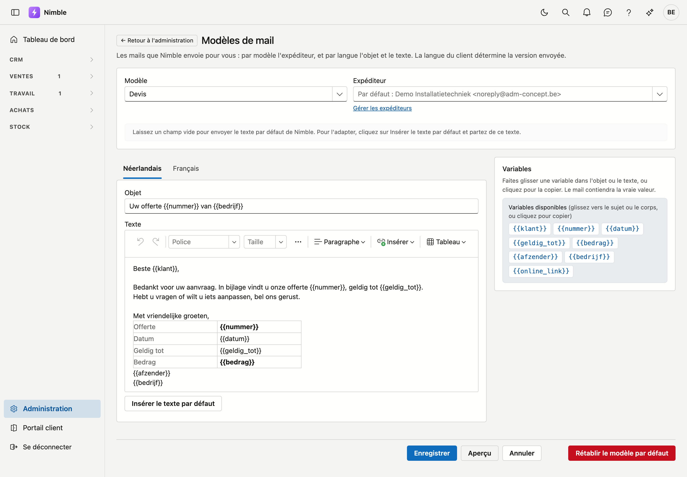
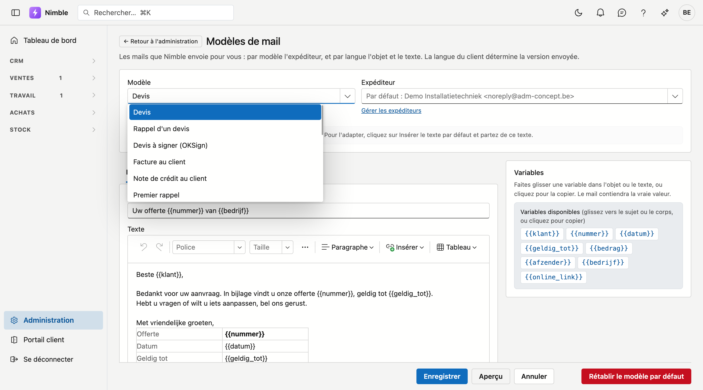
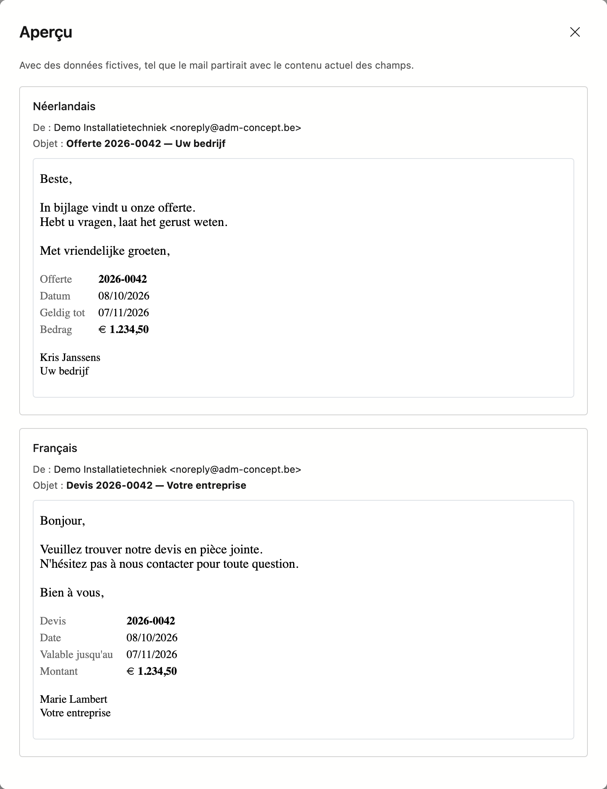

# Modèles de mail

Nimble envoie pour vous le mail d'un devis, d'une facture et d'une note de crédit, les rappels, le bon de travail signé et l'avis d'une tâche attribuée. C'est ici
que vous
déterminez l'adresse depuis laquelle ces mails partent, et pour chaque langue l'objet et le texte.

## Ouvrir l'écran

1. Cliquez sur **Administration** en bas de la barre latérale.
2. Dans le groupe **Ventes**, cliquez sur la tuile **Modèles de mail**.

Le droit *Gérer les modèles de documents* est nécessaire.

## Modèle et expéditeur

En haut, vous choisissez le **Modèle** :

| Modèle | Quand il part |
|---|---|
| **Devis** | Avec **Envoyer par e-mail** sur un devis |
| **Rappel d'un devis** | Avec **Plus…** → **Envoyer un rappel** sur un devis envoyé — voir [Le suivi du devis](../sales/quotes.md#une-tache-de-suivi-et-un-rappel). Mêmes variables que le devis |
| **Devis à signer (OKSign)** | Avec **Faire signer** sur un devis : l'e-mail avec le lien personnel pour signer — voir [Faire signer le devis](../sales/quotes.md#faire-signer-le-devis) |
| **Facture au client** | Avec **Envoyer au client** sur une facture : voir [Envoyer au client](../sales/invoices.md#envoyer-au-client) |
| **Note de crédit au client** | Avec **Envoyer au client** sur une note de crédit |
| **Premier rappel** | Avec **Envoyer…** sur l'écran Rappels, pour la première étape |
| **Deuxième rappel** | Idem, pour la deuxième étape |
| **Dernier rappel** | Idem, pour la troisième étape |
| **Rappel — mise en demeure (recouvrement)** | Idem, pour l'annonce du recouvrement |
| **Bon de travail signé** | Quand le chef d'équipe envoie le bon de travail signé au client depuis l'application |
| **Bon de commande au fournisseur** | Avec **Envoyer au fournisseur** sur une commande — voir [Le bon de commande](../purchasing/purchase-orders.md#imprimer-et-envoyer-le-bon-de-commande) |
| **Demande de prix à un fournisseur** | Avec **Plus…** → **Demande de prix à un fournisseur** sur un devis — voir [Une demande de prix](../sales/quotes.md#une-demande-de-prix-a-un-fournisseur) |
| **Tâche attribuée** | Quand une tâche est attribuée à quelqu'un — uniquement si c'est activé dans la [Fiche entreprise](company-profile.md#e-mail-lors-de-lattribution-dune-tache) |
| **Entretien à venir (au client)** | Quand Nimble prépare une visite d'entretien, si vous avertissez le client : voir [Entretien](../work/maintenance.md#avertir-le-client) |
| **Entretien planifié (au client)** | Dès que la visite d'entretien préparée a un jour au planning |
| **Demande d'intervention reçue (au client)** | Pour une nouvelle demande d'intervention, si la case **Envoyer un accusé de réception** est cochée : voir [Demandes d'intervention](../work/service-requests.md#avertir-le-client) |
| **Demande d'intervention planifiée (au client)** | Dès que l'ordre de travail d'une demande d'intervention a un jour au planning, et à nouveau si ce jour change |

Chaque étape des rappels a son propre modèle : un premier rappel ne s'écrit pas comme une mise en demeure.

Vous choisissez ensuite l'**Expéditeur** parmi vos [expéditeurs de mail](mail-senders.md). Si vous laissez le
champ vide, il affiche *Par défaut :* avec l'adresse qui s'applique alors : votre expéditeur par défaut, ou
le nom de votre entreprise avec *noreply@adm-concept.be* si vous n'en avez pas. C'est aussi ainsi que le mail part. **Gérer les expéditeurs** ouvre la liste des expéditeurs.

Si l'expéditeur choisi se trouve dans la Corbeille, l'écran indique que le mail part de l'adresse par défaut.
Choisissez alors un autre expéditeur, ou restaurez-le depuis la Corbeille.

## Objet et texte par langue

Sous les listes figurent deux onglets : **Néerlandais** et **Français**. Chaque onglet comporte un champ
**Objet** et un champ **Texte**. La langue du client détermine la version qui part.

!!! info "Un champ vide signifie : le texte par défaut"
    Laissez un champ vide pour envoyer le texte par défaut de Nimble. Dans un objet vide, ce texte par
    défaut apparaît en gris. Cela vaut par langue et par champ : si vous adaptez uniquement l'objet en
    néerlandais, le mail en français part encore entièrement avec le texte par défaut.

Pour adapter le texte, cliquez sur **Insérer le texte par défaut**. Le texte de Nimble arrive dans le champ, et
vous partez de ce texte. Si l'objet était vide lui aussi, il reçoit l'objet par défaut. Si le champ contient
déjà du texte, le bouton ne change rien — votre travail reste en place.

Le texte se modifie avec mise en forme, comme dans un traitement de texte.

## Variables

À droite se trouve la liste **Variables**. Faites-en glisser une dans l'objet ou le texte ; le mail contiendra
la vraie valeur. En cliquant sur une variable, vous la copiez ; collez-la ensuite où vous voulez. La liste ne
montre que les variables qui fonctionnent dans le modèle choisi.

| Variable | Ce qui figure dans le mail | Modèles |
|---|---|---|
| `{{klant}}` | Nom du client | Devis, devis à signer, facture, note de crédit, rappels, bon de travail signé, entretien, demandes d'intervention |
| `{{nummer}}` | Numéro du devis, de la facture, de la note de crédit ou de la commande. Pour une demande de prix : le numéro de votre devis, votre référence | Devis, devis à signer, facture, note de crédit, rappels, bon de commande, demande de prix |
| `{{datum}}` | Date du document | Devis, devis à signer, facture, note de crédit, rappels, bon de travail signé, bon de commande, demande de prix |
| `{{geldig_tot}}` | Valable jusqu'au | Devis, devis à signer |
| `{{bedrag}}` | Montant. Pour une note de crédit, sans signe moins | Devis, devis à signer, facture, note de crédit, rappels |
| `{{vervaldag}}` | Échéance | Facture, rappels |
| `{{dagen_te_laat}}` | Jours de retard | Rappels |
| `{{werkorder}}` | Ordre de travail | Bon de travail signé |
| `{{project}}` | Projet | Bon de travail signé, bon de commande, demande de prix, entretien |
| `{{getekend_door}}` | Signataire | Bon de travail signé |
| `{{afzender}}` | Nom de la personne qui envoie | Devis, devis à signer, facture, note de crédit, rappels, bon de travail signé, bon de commande, demande de prix |
| `{{bedrijf}}` | Nom de votre entreprise | Tous |
| `{{online_link}}` | Un lien vers le devis en ligne | Devis |
| `{{ontvanger}}` | Destinataire de la tâche | Tâche attribuée |
| `{{taak}}` | L'objet de la tâche | Tâche attribuée |
| `{{taak_omschrijving}}` | La description de la tâche | Tâche attribuée |
| `{{taak_begin}}` | La date de début de la tâche | Tâche attribuée |
| `{{taak_vervaldag}}` | L'échéance de la tâche | Tâche attribuée |
| `{{taak_bij}}` | Ce à quoi la tâche se rapporte (projet, relation, lead) | Tâche attribuée |
| `{{toegewezen_door}}` | Qui a attribué la tâche, ou Nimble pour une tâche automatique | Tâche attribuée |
| `{{taak_link}}` | Un lien vers la liste des tâches dans Nimble | Tâche attribuée |
| `{{ondertekenaar}}` | Nom de la personne qui signe le devis | Devis à signer |
| `{{teken_link}}` | Le lien personnel pour signer le devis | Devis à signer |
| `{{leverancier}}` | Nom du fournisseur | Bon de commande, demande de prix |
| `{{leverdatum}}` | La date de livraison souhaitée de la commande, ou *à convenir* | Bon de commande |
| `{{mededeling}}` | La communication structurée pour le paiement, ou le numéro de facture s'il n'y en a pas | Facture |
| `{{bij_factuur}}` | La facture que la note de crédit corrige : son numéro, ou le numéro et la date d'une facture hors Nimble | Note de crédit |
| `{{antwoord_voor}}` | La date à laquelle vous souhaitez la réponse à la demande de prix | Demande de prix |
| `{{bezoek}}` | La description de la visite d'entretien | Entretien |
| `{{voorzien}}` | Le jour prévu pour la visite (pas encore planifiée) | Entretien à venir |
| `{{afspraak_link}}` | Un lien vers votre page de réservation, si vous utilisez les rendez-vous en ligne (sinon vide) | Entretien à venir |
| `{{geplande_dag}}` | Le jour où la visite est planifiée sur le tableau de planning | Entretien planifié, demande d'intervention planifiée |
| `{{verzoek_nummer}}` | Le numéro de la demande d'intervention | Demandes d'intervention |
| `{{verzoek}}` | Ce que le client a signalé : la première ligne de la description | Demandes d'intervention |
| `{{toestel}}` | L'installation de la demande, avec marque, modèle et numéro de série (vide sans installation) | Demandes d'intervention |

### Le lien vers le devis en ligne

Avec `{{online_link}}` dans le texte, le client reçoit un lien *Consultez et répondez au devis en ligne*. Il y
consulte le devis et peut l'accepter ou le refuser — voir [Proposer le devis en ligne](../sales/quotes.md#proposer-le-devis-en-ligne).

Si le devis n'est pas encore en ligne au moment où vous l'envoyez, Nimble le met en ligne quand vous cliquez
sur **Envoyer** — et uniquement si le lien figure encore dans le mail. Si vous annulez la fenêtre, le devis
reste tel qu'il était.

Dans l'objet, `{{online_link}}` reste vide : un lien a sa place dans le texte.

### Un nom qui n'existe pas

Si un nom entre accolades n'est pas connu de ce modèle, l'écran affiche au-dessus des onglets *Ce modèle ne
connaît pas ces noms ; ils resteront vides dans le mail :* avec ces noms. Ce message apparaît lorsque vous
enregistrez, ouvrez l'aperçu ou rouvrez l'écran — pas pendant la saisie.

## Les boutons

| Bouton | Ce qu'il fait |
|---|---|
| **Enregistrer** | Enregistre l'expéditeur et les deux langues du modèle choisi |
| **Aperçu** | Montre le mail dans les deux langues avec des données fictives — voir ci-dessous |
| **Annuler** | Retour à l'administration |
| **Rétablir le modèle par défaut** | Supprime votre version de ce modèle, après confirmation. Le texte par défaut de Nimble et l'expéditeur par défaut s'appliquent ensuite à nouveau. Visible uniquement lorsqu'une version propre est enregistrée |

Si vous choisissez un autre modèle alors que des modifications ne sont pas enregistrées, l'écran vous demande
d'abord si vous voulez les abandonner.

### Vérifier votre travail

**Aperçu** montre le mail en néerlandais et en français, chaque fois avec **De** et **Objet**, tel qu'il
partirait avec le contenu actuel des champs — même si vous n'avez pas encore enregistré. Les données sont
fictives, pour que vous voyiez quel texte provient d'une variable.

## Au moment de l'envoi

Un modèle est un point de départ. Dans la fenêtre d'envoi d'un devis ou d'un rappel, vous voyez le mail tel
qu'il partira, avec les vraies données. **Modifier le texte** vous permet encore de l'adapter pour ce seul mail
— le modèle lui-même ne change pas. Voir [Envoyer le devis par e-mail](../sales/quotes.md#envoyer-le-devis-par-e-mail)
et [Rappels](../sales/reminders.md#envoyer).

Le bon de travail signé part de l'application, sans fenêtre : le modèle s'applique tel quel. L'avis d'une
tâche attribuée part lui aussi sans fenêtre, dans la langue de la personne qui reçoit la tâche — pas celle d'un client.

## Erreurs fréquentes

!!! warning
    - **Taper une variable au lieu de la faire glisser.** `{{dagen te laat}}` avec des espaces ne fonctionne
      pas. Faites-la glisser depuis la liste, elle sera correcte.
    - **Choisir un expéditeur dont le domaine n'est pas encore vérifié.** Le mail peut alors être
      refusé. L'écran [Expéditeurs de mail](mail-senders.md) indique quelles adresses sont en ordre.
    - **Penser que l'aperçu enregistre.** Seul **Enregistrer** applique votre texte aux mails qui partent.
    - **Oublier qu'il y a deux langues.** Si vous adaptez uniquement le néerlandais, un client francophone
      reçoit encore le texte par défaut. Vérifiez aussi l'onglet **Français**.

## Voir aussi

- [Expéditeurs de mail](mail-senders.md) — les adresses depuis lesquelles vos mails partent
- [Devis](../sales/quotes.md) — envoyer le devis par e-mail et le proposer en ligne
- [Rappels](../sales/reminders.md) — les quatre étapes d'un rappel
- [Bons de travail](../work/work-sheets.md) — la signature du client
- [Modèles de documents](document-templates.md) — l'en-tête et les conditions sur le devis lui-même
