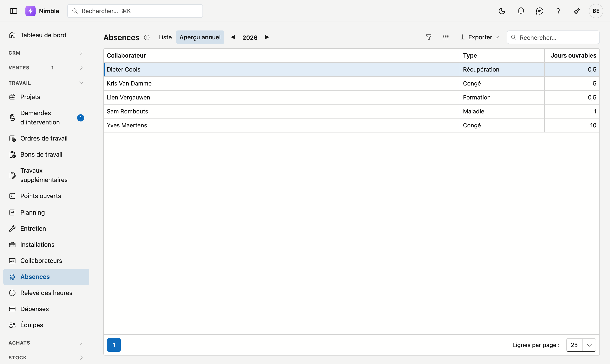

# Absences

Dans **Absences**, vous tenez à jour par collaborateur quand il n'est pas là : congé, maladie, formation, récupération ou une autre
raison. Le planning montre qui est absent, pour ne pas planifier une équipe avec quelqu'un qui n'est pas là ce jour-là. L'aperçu
annuel compte les jours ouvrables par collaborateur et par type.

## Ouvrir l'écran

Dans la barre latérale, cliquez sur **Travail → Absences**. Vous avez besoin du droit de consulter les collaborateurs ; ajouter ou
modifier des absences demande le droit de modifier les collaborateurs.

## La liste

Chaque ligne est une absence : le **Collaborateur**, le **Type**, les jours **De** et **À**, la **Partie du jour** et les **Jours
ouvrables**. Avec **◀** et **▶** à côté de l'année, vous choisissez une autre année. Vous recherchez, triez et filtrez comme dans
toute [liste](../lijsten-filteren.md), et **Exporter** emporte la liste vers Excel ou CSV.

**Jours ouvrables** ne compte que les jours travaillés : les week-ends et les jours fériés ne comptent pas, et une demi-journée
compte pour 0,5. Si le samedi est un jour ouvrable dans votre entreprise, il compte (voir la
[fiche d'entreprise](../settings/company-profile.md#planning)).

## Ajouter ou modifier une absence

Cliquez sur **Ajouter une absence**, ou double-cliquez une ligne. Une fenêtre s'ouvre avec ces champs :

| Champ | Remarque |
|---|---|
| **Collaborateur** | Obligatoire. Vous choisissez parmi les collaborateurs actifs |
| **Type** | Obligatoire. Les types se gèrent dans [Types d'absence](../administration/absence-types.md) |
| **De** et **À** | Obligatoires. Un seul jour : la même date dans les deux champs |
| **Partie du jour** | **Journée entière**, **Matin** ou **Après-midi**. Une demi-journée n'est possible que sur un seul jour ; sur plusieurs jours, le champ reste sur une journée entière |
| **Remarque** | Libre, par exemple la raison |

Sous les champs, vous voyez pour combien de jours ouvrables l'absence compte. Cliquez sur **Enregistrer**. **Supprimer** envoie une
absence dans la [corbeille](../administration/recycle-bin.md) ; vous l'y récupérez.

## L'aperçu annuel

Cliquez sur **Aperçu annuel** à côté du titre. Vous voyez par collaborateur et par type le nombre de jours ouvrables de l'année
choisie. Une absence à cheval sur deux années compte dans chaque année pour ses propres jours. Cet aperçu s'exporte aussi avec
**Exporter**.

## Dans le planning

Dans le [planning](planning.md), un collaborateur absent figure avec son type dans la case de son équipe, chaque jour où il n'est pas
là. Si vous planifiez un bloc un jour où quelqu'un de l'équipe est absent, Nimble signale qui et quels jours. Le bloc est quand même
planifié : c'est un avertissement, pas une interdiction.

## Erreurs fréquentes

!!! warning
    - **Une demi-journée sur plusieurs jours.** Ce n'est pas possible. Si quelqu'un prend trois matinées, créez trois absences d'un
      jour.
    - **Compter un jour férié.** Nimble ne compte pas les jours fériés comme jours ouvrables. Une semaine de congé avec un jour férié
      compte donc quatre jours.

## Voir aussi

- [Planning](planning.md)
- [Collaborateurs](staff.md)
- [Types d'absence](../administration/absence-types.md)
