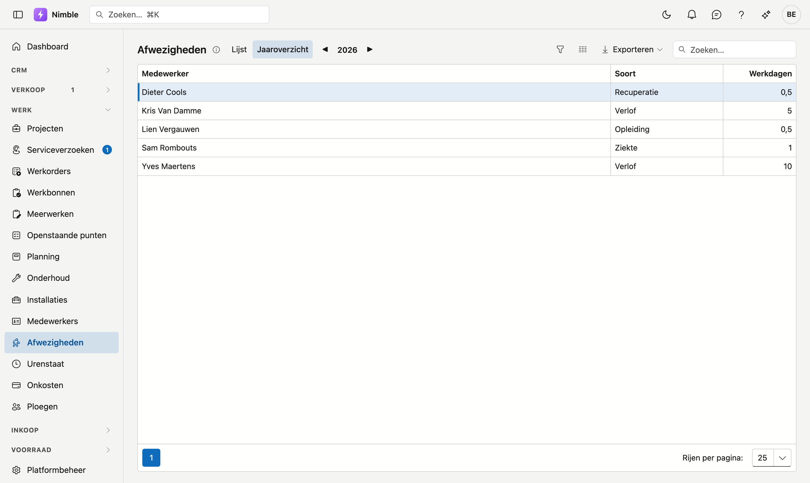

# Afwezigheden

In **Afwezigheden** houdt u per medewerker bij wanneer hij er niet is: verlof, ziekte, opleiding, recuperatie of een andere reden.
Het planbord toont wie afwezig is, zodat u geen ploeg inplant met iemand die er die dag niet is. Het jaaroverzicht telt per
medewerker en per soort de werkdagen.

## Het scherm openen

Klik in de zijbalk op **Werk → Afwezigheden**. U hebt het recht nodig om medewerkers te bekijken; afwezigheden toevoegen of
wijzigen vraagt het recht om medewerkers te bewerken.

## De lijst

Elke regel is één afwezigheid: de **Medewerker**, de **Soort**, de dagen **Van** en **Tot**, het **Dagdeel** en de **Werkdagen**.
Met **◀** en **▶** naast het jaartal kiest u een ander jaar. U zoekt, sorteert en filtert zoals in elke
[lijst](../lijsten-filteren.md), en met **Exporteren** neemt u de lijst mee naar Excel of CSV.

**Werkdagen** telt enkel de dagen waarop er gewerkt wordt: weekends en feestdagen tellen niet, en een halve dag telt voor 0,5. Is
de zaterdag bij uw bedrijf een werkdag, dan telt die mee (zie de [bedrijfsfiche](../settings/company-profile.md#planning)).

## Een afwezigheid toevoegen of wijzigen

Klik op **Afwezigheid toevoegen**, of dubbelklik op een regel. Er opent een venster met deze velden:

| Veld | Opmerking |
|---|---|
| **Medewerker** | Verplicht. U kiest uit de actieve medewerkers |
| **Soort** | Verplicht. De soorten beheert u in [Soorten afwezigheid](../administration/absence-types.md) |
| **Van** en **Tot** | Verplicht. Eén dag: dezelfde datum in beide velden |
| **Dagdeel** | **Hele dag**, **Voormiddag** of **Namiddag**. Een halve dag kan enkel op één dag; bij meer dagen staat het veld op een hele dag |
| **Opmerking** | Vrij, bijvoorbeeld de reden |

Onder de velden ziet u voor hoeveel werkdagen de afwezigheid telt. Klik **Bewaren**. Met **Verwijderen** gaat een afwezigheid naar
de [prullenbak](../administration/recycle-bin.md); daar haalt u ze terug.

## Het jaaroverzicht

Klik naast de titel op **Jaaroverzicht**. U ziet per medewerker en per soort het aantal werkdagen in het gekozen jaar. Een
afwezigheid over de jaarwisseling telt in elk jaar voor haar eigen dagen. Ook dit overzicht exporteert u met **Exporteren**.

## Op het planbord

Op de [planning](planning.md) staat een afwezige medewerker met zijn soort in de cel van zijn ploeg, op elke dag dat hij er niet is.
Plant u een blok op een dag dat iemand van de ploeg afwezig is, dan meldt Nimble wie en op welke dagen. Het blok staat er toch:
het is een waarschuwing, geen verbod.

## Veelgemaakte fouten

!!! warning
    - **Een halve dag over meer dagen.** Dat kan niet. Geeft iemand drie dagen een voormiddag op, maak dan drie afwezigheden van
      één dag.
    - **Een feestdag meetellen.** Nimble telt feestdagen niet als werkdag. Een week verlof met een feestdag erin telt dus vier dagen.

## Zie ook

- [Planning](planning.md)
- [Medewerkers](staff.md)
- [Soorten afwezigheid](../administration/absence-types.md)
