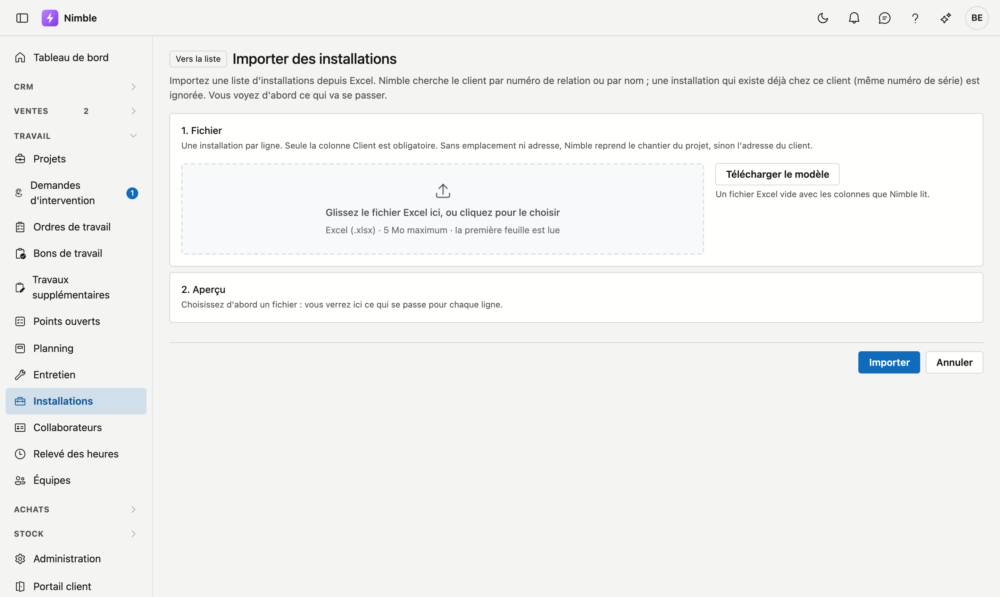

# Installations

Une installation est un appareil chez un client : une chaudière, une pompe à chaleur, un groupe de ventilation. Vous suivez ce qui
est installé, où, avec quel numéro de série et jusqu'à quand court la garantie. Pour chaque appareil, vous voyez les visites et les
réparations qui ont eu lieu, et ce qui n'était pas en ordre à chaque contrôle.

## Ouvrir l'écran

Dans la barre latérale, cliquez sur **Travail → Installations**.

Vous trouvez aussi les appareils d'un client dans l'onglet **Installations** de la [fiche relation](../relations.md#onglet-installations),
et ceux d'un projet dans l'onglet [Entretien](maintenance.md#longlet-entretien-du-projet) du projet.

## La liste

| Colonne | Ce que c'est |
|---|---|
| **Type** | Chaudière, pompe à chaleur, groupe de ventilation … de la liste [Types d'installation](../administration/installation-types.md) |
| **Marque** et **Modèle** | Ce qui figure sur la plaque signalétique |
| **Numéro de série** | Il permet de distinguer deux appareils identiques |
| **Client** | Le client chez qui se trouve l'appareil |
| **Projet** | Le projet auquel l'appareil appartient, s'il y en a un |
| **Commune** | Où se trouve l'appareil |
| **Garantie jusqu'au** | Le dernier jour de la garantie |
| **État** | En service, Hors service ou Remplacé |

- **Nouvelle installation** ouvre une fiche vide.
- **Importer des appareils** importe une liste depuis Excel, voir [Importer des appareils](#importer-des-appareils).
- Cochez des lignes pour imprimer leurs autocollants QR avec **Imprimer les étiquettes**, voir [L'autocollant QR](#lautocollant-qr).

À droite se trouve le tiroir **Journal** de l'appareil sur lequel se trouve votre curseur : tâches, notes, pièces jointes et
historique.

## La fiche

Double-cliquez sur une ligne pour ouvrir la fiche. En haut figure le nom de l'appareil avec son numéro de série.

| Champ | Ce que c'est |
|---|---|
| **Client** | Obligatoire. L'appareil reste chez le client, même quand le projet est clôturé |
| **Projet** | Le projet lors duquel l'appareil a été installé ou est entretenu. Peut rester vide |
| **Type** | Dans la liste de choix. **Gérer les types** ouvre cette liste |
| **Marque**, **Modèle**, **Numéro de série** | Indiquez au moins le type, la marque, le modèle ou le numéro de série. Si le même numéro de série figure déjà chez un autre appareil, la fiche le signale |
| **Installé le** | Le jour de l'installation |
| **Garantie jusqu'au** | Le dernier jour de la garantie. Un mois avant, une tâche est créée pour le responsable |
| **État** | En service, Hors service ou Remplacé. Un appareil qui n'est plus en service ne se choisit plus pour une visite |
| **Article** | L'article de votre stock, si vous avez vendu l'appareil vous-même. Sinon *Pas vendu par nous* |
| **Note** | Texte libre |

La carte **Emplacement** indique où se trouve l'appareil : un **Nom de l'emplacement** (par exemple *chaufferie*) et l'adresse.
**Reprendre l'adresse du client** et **Reprendre l'adresse du chantier** remplissent l'adresse à partir du client ou du chantier du
projet.

Si le client signale une panne sur cet appareil, cliquez sur **Nouvelle demande d'intervention**. La fenêtre s'ouvre avec le client et
l'appareil déjà remplis, voir [Demandes d'intervention](service-requests.md#une-nouvelle-demande). Vous voyez le bouton si vous pouvez
modifier le travail.

### Historique

L'onglet **Historique** montre deux cartes :

- **Contrôles** : chaque fois que l'appareil a été contrôlé sur un bon de travail, avec le jour, la conclusion et les points qui
  n'étaient pas en ordre. Le jour est un lien vers le bon de travail.
- **Historique** : les ordres de travail de l'appareil, le plus récent en premier : les visites d'entretien et les réparations.

## L'autocollant QR

Chaque appareil peut recevoir un autocollant QR. Celui qui le scanne avec l'app Nimble ouvre directement cet appareil. Avec un
appareil photo ordinaire, on ne voit que le nom et le numéro de téléphone de votre entreprise.

- Sur la fiche : **Imprimer l'étiquette**.
- Dans la liste : cochez les appareils et cliquez sur **Imprimer les étiquettes**.

La fenêtre imprime sur une feuille A4 de 3 × 8 étiquettes de 70 × 37 mm. Si la feuille est déjà à moitié utilisée, cliquez sur la
première étiquette libre. Cliquez sur **Aperçu** et imprimez en taille réelle (100 %), pas *ajusté à la page*.

!!! info "Réimprimer est toujours possible"
    Si l'appareil a déjà un autocollant, vous réimprimez la même étiquette sans risque. Ne choisissez un **nouveau code** que si
    l'ancien autocollant est perdu ou entre de mauvaises mains : l'autocollant précédent ne fonctionnera plus.

## Importer des appareils

Si vos appareils figurent déjà dans une liste Excel, importez-les. Dans la liste, cliquez sur **Importer des appareils**.

1. **Fichier** : cliquez sur **Télécharger le modèle** pour obtenir un fichier Excel vide avec les bonnes colonnes, remplissez-le et
   choisissez-le.
2. **Aperçu** : pour chaque ligne, vous voyez ce qui va se passer : nouveau, existe déjà, ou ignoré avec la raison. Rien n'est
   encore enregistré.
3. Cliquez sur **Importer**. Ensuite, vous voyez un résumé et les lignes qui n'ont pas été importées, avec leur raison.

| Colonne | Ce qu'elle contient |
|---|---|
| **Client** | Obligatoire : le numéro de relation ou le nom du client |
| **Projet** | Le code du projet, par exemple P2026-006. Le projet doit appartenir à ce client |
| **Type** | Un type qui n'existe pas encore est créé par Nimble |
| **Marque**, **Modèle**, **Numéro de série** | Au moins l'un des trois, ou un type |
| **Installé le**, **Garantie jusqu'au** | Une date sous la forme jour/mois/année |
| **Emplacement**, **Rue**, **Code postal**, **Commune** | Où se trouve l'appareil. Vide : le chantier du projet, sinon l'adresse du client |
| **Note** | Texte libre |

!!! info "Un appareil qui existe déjà"
    Si ce client a déjà un appareil avec le même numéro de série, Nimble ignore la ligne. Vous pouvez donc réimporter le même
    fichier sans crainte.

## Erreurs fréquentes

!!! warning "Une ligne est ignorée avec Plusieurs clients s'appellent …"
    Deux relations portent le même nom. Indiquez le numéro de relation dans la colonne **Client**.

!!! warning "Un appareil n'apparaît pas dans la fenêtre Choisir les appareils"
    La fenêtre ne montre que les appareils du client du projet, et seulement ceux qui sont **En service**.

## Voir aussi

- [Entretien](maintenance.md)
- [Types d'installation](../administration/installation-types.md)
- [Bons de travail](work-sheets.md#appareils)
- [Relations](../relations.md)
