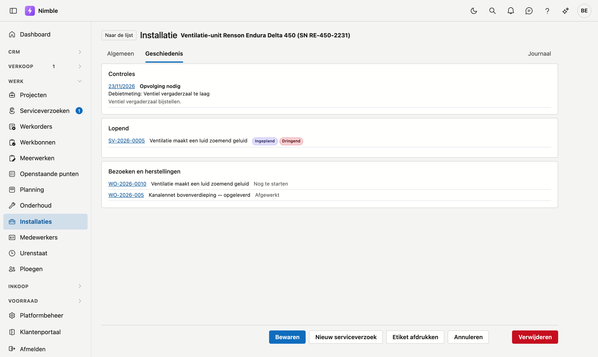
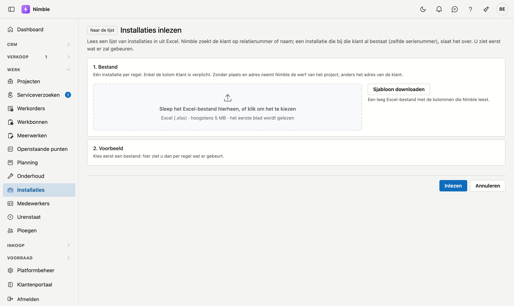

# Installaties

Een installatie is een toestel bij een klant: een ketel, een warmtepomp, een ventilatie-unit. U houdt bij wat er staat, waar, met
welk serienummer en tot wanneer de garantie loopt. Per toestel ziet u welke bezoeken en herstellingen er waren, en wat er bij
elke controle niet in orde was.

## Het scherm openen

Klik in de zijbalk op **Werk → Installaties**.

U vindt de toestellen van één klant ook op het tabblad **Installaties** van de [relatiefiche](../relations.md#tabblad-installaties), en die
van één project op het tabblad [Onderhoud](maintenance.md#het-tabblad-onderhoud-van-het-project) van het project.

## De lijst

| Kolom | Wat het is |
|---|---|
| **Soort** | Ketel, warmtepomp, ventilatie-unit … uit de keuzelijst [Soorten installatie](../administration/installation-types.md) |
| **Merk** en **Model** | Wat er op het typeplaatje staat |
| **Serienummer** | Hiermee houdt u twee gelijke toestellen uit elkaar |
| **Klant** | De klant bij wie het toestel staat |
| **Project** | Het project waarbij het toestel hoort, als dat er is |
| **Gemeente** | Waar het toestel staat |
| **Garantie tot** | De laatste dag van de garantie |
| **Toestand** | In gebruik, Buiten gebruik of Vervangen |

- **Nieuwe installatie** opent een lege fiche.
- **Toestellen inlezen** leest een lijst in uit Excel, zie [Toestellen inlezen](#toestellen-inlezen).
- Vink rijen aan om hun QR-stickers af te drukken met **Etiketten afdrukken**, zie [De QR-sticker](#de-qr-sticker).

Rechts zit de lade **Journaal** van het toestel waarop uw cursor staat: taken, notities, bijlagen en logboek.

## De fiche

Dubbelklik op een rij om de fiche te openen. Bovenaan staat de naam van het toestel met zijn serienummer.

| Veld | Wat het is |
|---|---|
| **Klant** | Verplicht. Het toestel blijft bij de klant, ook als het project afgerond is |
| **Project** | Het project waarbij het toestel geplaatst werd of onderhouden wordt. Mag leeg blijven |
| **Soort** | Uit de keuzelijst. **Soorten beheren** opent die lijst |
| **Merk**, **Model**, **Serienummer** | Vul minstens de soort, het merk, het model of het serienummer in. Staat hetzelfde serienummer al bij een ander toestel, dan meldt de fiche het |
| **Geplaatst op** | De dag van de plaatsing |
| **Garantie tot** | De laatste dag van de garantie. Een maand vooraf komt er een taak voor de verantwoordelijke |
| **Toestand** | In gebruik, Buiten gebruik of Vervangen. Een toestel dat niet meer in gebruik is, kiest u niet meer bij een bezoek |
| **Artikel** | Het artikel uit uw voorraad, als u het toestel zelf verkocht. Anders *Niet door ons verkocht* |
| **Notitie** | Vrije tekst |

In de kaart **Locatie** staat waar het toestel staat: een **Naam van de locatie** (bijvoorbeeld *stookruimte*) en het adres.
**Adres van de klant overnemen** en **Werfadres overnemen** vullen het adres in vanuit de klant of de werf van het project.

### Geschiedenis

Het tabblad **Geschiedenis** toont twee kaarten:

- **Controles**: elke keer dat het toestel op een werkbon nagekeken werd, met de dag, het besluit en de punten die niet in orde
  waren. De dag is een link naar de werkbon.
- **Geschiedenis**: de werkorders van het toestel, de nieuwste eerst: de onderhoudsbezoeken en de herstellingen.

## De QR-sticker

Elk toestel kan een QR-sticker krijgen. Wie hem scant met de app van Nimble, opent meteen dat toestel. Met een gewone camera ziet
men enkel de naam en het telefoonnummer van uw firma.

- Op de fiche: **Etiket afdrukken**.
- In de lijst: vink de toestellen aan en klik op **Etiketten afdrukken**.

Het venster drukt af op een A4-vel met 3 × 8 etiketten van 70 × 37 mm. Is het vel al half gebruikt, klik dan op het eerste vrije
etiket. Klik op **Voorbeeld** en druk af op ware grootte (100 %), niet *passend op de pagina*.

!!! info "Opnieuw afdrukken kan altijd"
    Heeft het toestel al een sticker, dan drukt u hetzelfde etiket opnieuw af zonder risico. Kies enkel een **nieuwe code** als
    de oude sticker verloren of in verkeerde handen is: de vorige sticker werkt dan niet meer.

## Toestellen inlezen

Hebt u uw toestellen al in een Excel-lijst, lees ze dan in. Klik in de lijst op **Toestellen inlezen**.

1. **Bestand**: klik op **Sjabloon downloaden** voor een leeg Excel-bestand met de juiste kolommen, vul het in en kies het.
2. **Voorbeeld**: per regel ziet u wat er zal gebeuren: nieuw, bestaat al, of overgeslagen met de reden. Er is nog niets bewaard.
3. Klik op **Inlezen**. Daarna ziet u een samenvatting en de regels die niet ingelezen werden, met hun reden.

| Kolom | Wat erin hoort |
|---|---|
| **Klant** | Verplicht: het relatienummer of de naam van de klant |
| **Project** | De code van het project, bijvoorbeeld P2026-006. Het project moet bij die klant horen |
| **Soort** | Een soort die nog niet bestaat, maakt Nimble aan |
| **Merk**, **Model**, **Serienummer** | Minstens één van de drie, of een soort |
| **Geplaatst op**, **Garantie tot** | Een datum als dag/maand/jaar |
| **Plaats**, **Straat**, **Postcode**, **Gemeente** | Waar het toestel staat. Leeg: de werf van het project, anders het adres van de klant |
| **Notitie** | Vrije tekst |

!!! info "Een toestel dat al bestaat"
    Staat er bij die klant al een toestel met hetzelfde serienummer, dan slaat Nimble de regel over. U kunt hetzelfde bestand dus
    gerust opnieuw inlezen.

## Veelgemaakte fouten

!!! warning "Een regel wordt overgeslagen met Meer dan één klant heet …"
    Twee relaties dragen dezelfde naam. Vul in de kolom **Klant** het relatienummer in.

!!! warning "Een toestel verschijnt niet in het venster Toestellen kiezen"
    Het venster toont enkel toestellen van de klant van het project, en enkel toestellen die **In gebruik** zijn.

## Zie ook

- [Onderhoud](maintenance.md)
- [Soorten installatie](../administration/installation-types.md)
- [Werkbonnen](work-sheets.md#toestellen)
- [Relaties](../relations.md)
